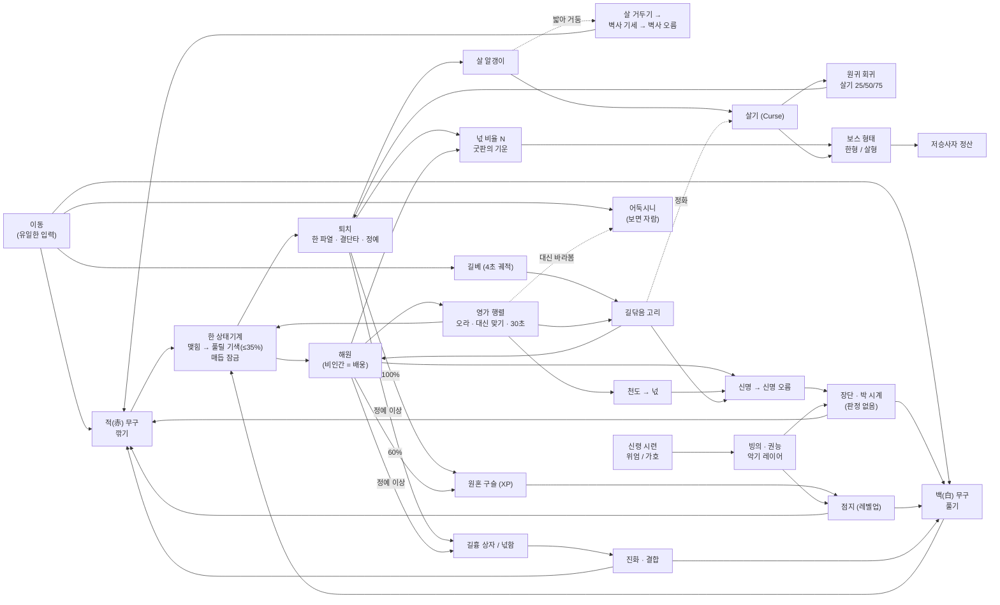
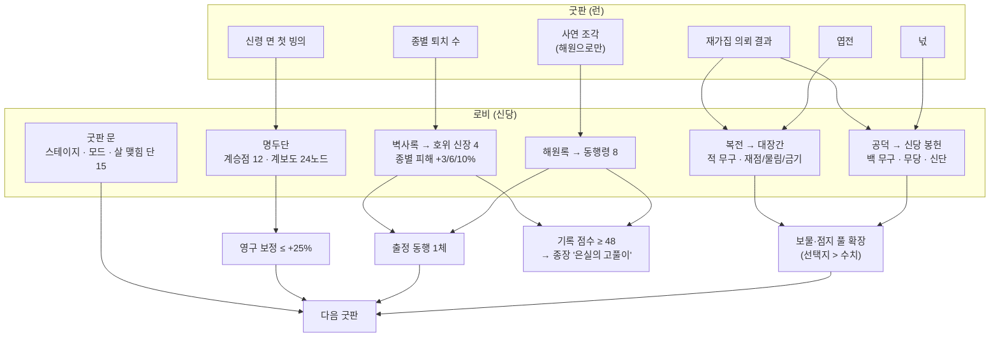
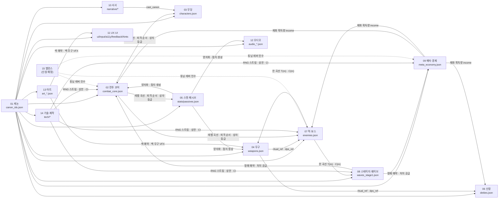

# 넋길: 해원굿 — GDD 마스터 (통합 색인)

> **SOULPATH: Untie the Han** · 탑다운 자동공격 서바이버 로그라이트(뱀서라이크)
> **문서 상태:** v1.2 통합본 — **캐논 v1.2 기준** (2026-11-21). v1.0 통합본(2026-11-20, 리드 디자이너 통합) 위에 `99-open-questions-and-next-steps.md` 1장 D-xx·2장 C-xx 확정 결정을 반영했다. 반영 내역은 문서 끝 '캐논 v1.2 반영 로그'.
> **이 문서의 역할:** 이 문서는 **색인·요약**이다. 새 규칙을 만들지 않는다. 규칙과 ID의 정본은 [`01-concept-and-canon.md`](01-concept-and-canon.md)(캐논 v1.2), 수치의 정본은 각 섹션 문서와 `data/*.json`이다.
> **정본 우선순위:** ① 캐논 01 v1.2(2026-11-21) → ② 해당 수치를 소유한 섹션 문서·JSON(소유표는 01 §8.3) → ③ 이 문서. 섹션끼리 값이 다르면 [`99-open-questions-and-next-steps.md`](99-open-questions-and-next-steps.md) 1장 결정(D-xx)·2장 불일치(C-xx) 표에서 확정값을 확인한다.
> **표기:** `C-nn` = 99 문서의 섹션 간 불일치 번호, `D-nn` = 99 문서의 결정 번호(캐논 v1.2에서 모두 확정·해소. 출처 열의 `(D-nn)`·`(C-nn)`은 근거 표시다). `[각색]` = 전승 기반 게임 창작(캐논 7-5).

---

## 목차

0. [표지](#0-표지)
1. [1페이지 피치](#1-1페이지-피치)
2. [핵심 비틀기](#2-핵심-비틀기)
3. [디자인 필러](#3-디자인-필러)
4. [루프 요약 (30초 · 20분 · 메타)](#4-루프-요약)
5. [시스템 맵](#5-시스템-맵)
6. [전체 문서 목차](#6-전체-문서-목차)
7. [핵심 수치 요약표](#7-핵심-수치-요약표)
8. [v1.0 범위 체크리스트](#8-v10-범위-체크리스트)
9. [용어집](#9-용어집)
10. [출처와 방법론](#10-출처와-방법론)
- [캐논 v1.2 반영 로그](#캐논-v12-반영-로그-2026-11-21)

---

# 0. 표지

| 항목 | 내용 |
|---|---|
| 국문 제목 | **넋길: 해원굿** (魂路 解冤굿) |
| 영문 제목 | **SOULPATH: Untie the Han** (내부 코드명 `soulpath`, 프로젝트 폴더 `KoreaLike`) |
| 태그라인 | "깎아 부수거나, 풀어 보내거나." / *"Cut them down, or set them free."* |
| 장르 | 탑다운(low top-down 3/4) 자동공격 서바이버 로그라이트 |
| 플랫폼 | PC(Steam) → 스팀덱 Verified → macOS(1.0) → Switch 2·PS5(1.0 이후, 포팅 파트너) → 모바일 별도 검토 |
| 엔진 | **Godot 4.7.2 + GDScript**(1차 빌드), 렌더러 `gl_compatibility`(D-43). C++ `soulsim` GDExtension은 성능 미달 시 후속(D-44, 14 §0) |
| 가격 | 프리미엄 단품. EA US$5.99 → 1.0 US$7.99(캐논). 가챠·소액결제 없음. 무료 업데이트 + 유료 DLC 1~2종 |
| 기본 런 | 20분 표준 굿판(+ 초굿 12분 / 자진모리 15분 / 무한굿 / 오늘의 굿판, x1 대동굿 30분) |
| 아트 | 640×360 정수배 픽셀아트. 플레이어 64px 캔버스, 잡귀 32~48px, 보스 128~256px. 먹색 밤하늘 `#0e0b16`, 한지 `#e9dcc0`, 오방색 악센트. 촛불·등불 광원 |
| 사운드 | 적응형 국악. 장구 기준 박 + 빙의한 신령마다 악기 1개 합류("빌드가 곧 악단") |
| 팀·일정 | 코어 5인 + 0.5인 2명 + 외주. W1 = 2026-12-07(1주 프로토타입) → 버티컬 슬라이스 2027-04-09 → Next Fest 2027-06-14~21 → **EA 2027-09-30** → **1.0 2028-04-20**(72주) |
| 예산 | 기준안 약 8.3억 원(예비비 15% 포함), 절감안 약 5.2억, 확장안 약 11억. 손익분기 기준안 약 20~21만 장(14 §12) |
| 원본 조사 | [`00-research.md`](00-research.md) |

---

# 1. 1페이지 피치

## 1.1 로그라인

> 밤의 굿판에 몰려드는 수백의 원혼을 붉은 무구로 **깎고** 흰 무구로 **풀어** 주면, 풀려난 넋은 무당 뒤를 따르는 흰 영가 행렬이 되어 함께 싸우고, 그 행렬로 고리를 그려 길을 닦으면 넋들이 한꺼번에 저승길로 떠난다.

## 1.2 30초 피치

넋길은 20분짜리 굿 한 판을 직접 치르는 무당 뱀서라이크다. 뱀서라이크에서 적은 죽으면 사라지는 경험치 주머니다. 넋길에서는 **어떻게 끝냈느냐**가 적의 운명을 가른다.

- **붉은 무구**(신칼·각궁·작두 등)로 부수면 경험치가 빨리 쌓인다. 대신 그 자리에 살(煞)이 남고, 살은 나중에 원귀가 되어 돌아온다.
- **흰 무구**(방울·부채·넋전 등)로 마지막 매듭을 풀면 귀신은 사람 얼굴을 되찾는다. 그리고 흰 소복의 영가가 되어 내 뒤를 따라 걷는다.
- 영가 행렬은 나 대신 맞아 주고 적을 달랜다. 행렬로 원을 그려 닫으면 씻김굿의 '길닦음'처럼 고리 안의 넋이 한꺼번에 저승으로 떠난다.

"Vampire Survivors의 물량전, Undertale의 살려주기, 포켓몬의 '약화 후 포획'이 한 판 안에 있다." 해원한 귀신마다 한 줄의 넋두리가 남는다. 예: "…엄마 얼굴이 기억이 안 났어."

## 1.3 왜 이 게임인가

| 질문 | 답 |
|---|---|
| 왜 뱀서라이크인가 | 장르 규칙이 이미 익숙하다(이동만 하면 자동 공격, 20분, 빌드 폭발). 그래서 '두 번째 동사' 하나만 더해도 차이가 바로 읽힌다 |
| 왜 한국 무속인가 | 무속에는 퇴치(벽사·퇴송)와 해원(씻김·천도)이 **둘 다 정당한 굿 절차**로 들어 있다. 해외 시청자가 K-오컬트에서 가장 신선하게 보는 지점도 '사연을 들어 주고 한을 풀어 주는' 정서다(00 조사) |
| 왜 지금인가 | 〈파묘〉·〈악귀〉 이후 K-오컬트 비주얼 기준이 생겼다. 〈산나비〉는 한국적 사운드의 글로벌 경쟁력을 보여 줬다. 그런데 서바이버 장르에는 아직 이 정서가 없다 |
| 무엇이 아닌가 | VS 재스킨이 아니다. 리듬 게임도 아니다(박 판정 없음). 스네이크 게임도 아니다(자유 이동). 도덕 점수 게임도 아니다(퇴치도 정당하다) |

## 1.4 타깃과 포지셔닝 (01 §1.6~1.7)

| 세그먼트 | 비중(가정) | 이 게임에서 얻는 것 |
|---|---|---|
| S1 뱀서라이크 코어(VS·HoloCure·Brotato·20MTD 30시간 이상) | 50% | 새 동사(해원), 고리 숙련, 적/백 2축 빌드 |
| S2 K-오컬트·동양 판타지 팬 | 25% | 귀신 사연, 굿 의례 연출, 신령 빙의 |
| S3 감성 인디(Undertale·Spiritfarer·Hades) | 15% | 살려주기, 넋두리 수집, 배웅의 카타르시스 |
| S4 스트리머·클립 소비층 | 10% | 길닦음 대폭발, 원귀 회귀, 정적 → 덩 드롭 |

- **난이도:** 미드코어. 신규 첫 사망 7~12분, 첫 클리어 3~6런. 고리를 한 번도 안 그려도 0단 클리어율 70% 이상(봇 검증).
- **콘텐츠 분량:** 1런 20분 + 로비 2~3분. 기능 해금 100%까지 약 38~42시간, 넋기록 100%까지 약 40~60시간.
- **스토어 첫 GIF 규칙:** 첫 3초는 반드시 "일그러진 귀신 얼굴 → 사람 얼굴 → 흰 영가가 되어 무당 뒤에 합류"다. 꼬리만 보이는 장면으로 시작하지 않는다(SNKRX 아류로 오인되지 않게).

| 경쟁작 | 넋길의 한 줄 차이 |
|---|---|
| Vampire Survivors | 처치가 두 갈래로 갈린다. Curse(살기)가 내가 부순 적의 **귀환**으로 맵에 보인다 |
| HoloCure | 적이 아군이 되었다가 **떠나는** 순환 |
| 20 Minutes Till Dawn | 조준이 없다. 숙련은 **동선**(고리, 마무리 위치)에 있다 |
| Brotato | 모든 결정이 **전투 중 실시간**이다. 정지 상점이 없다 |
| Death Must Die | 6신 풀에서 걸어 들어가 4신을 모신다. 같은 신령도 꺾느냐(위엄)/모시느냐(가호)로 갈린다 |
| SNKRX / HeroTail | 꼬리가 **자비로 얻은 적 출신**이다. 소모되는 흐름이고, 고리를 닫으면 의식이 발동한다 |
| Hades | 적 한 종 한 종이 사연의 화자다. 서사는 전투를 멈추지 않는 1줄 넋두리로 전한다 |

## 1.5 시그니처 모먼트 8 (01 §1.8)

| ID | 순간 | 시점 |
|---|---|---|
| `sm_first_haewon` | 첫 해원: 귀신 얼굴이 사람 얼굴로 바뀌고 작은 영가가 종종걸음으로 합류 | 약 00:40 |
| `sm_gildakkeum_burst` | 길닦음 대폭발: 장구 '덩', 히트스톱 80ms, 고리 안 흰 채움 | 상시 |
| `sm_eodukssini_silence` | 어둑시니의 정적: 행렬이 대신 바라보는 사이 소리가 사라졌다가 '덩'으로 돌아옴 | 07:30~ |
| `sm_wongwi_return` | 원귀 회귀: 맵의 살 알갱이가 떠올라 내가 부순 귀신으로 뭉침 | 살기 25/50/75 |
| `sm_jakdu_last_procession` | 작두거리 마지막 행렬: 이번 런에 천도한 영가들이 돌아옴 | 18:20 |
| `sm_dwitjeon_feast` | 뒷전 상차림: 공물상 셋을 묶는 거대 고리 → 화면 전체 해원 | 19:15~ |
| `sm_gopuri_boss` | 고풀이 보스전: 무명 매듭 7개를 지날 때마다 '툭'과 무가 한 소절 | 20:00(한형) |
| `sm_saja_bow` | 저승사자의 읍: 어느 정산이든 사자는 끝에 무당에게 읍한다 | 정산 |

---

# 2. 핵심 비틀기

## 2.1 세 문장

1. **처치에 두 번째 동사 '푼다'를 넣는다.** 한(恨)이 35% 아래로 떨어진 귀신은 '풀릴 기색'이 된다. 이때부터 붉은 무구는 마지막 매듭을 끊지 못하고(매듭 잠금), 흰 무구·영가·고리만 그 귀신을 해원한다. 붉은 무구로 끝내는 길은 한 파열(오버킬)과 결단타(치명)뿐이다.
2. **구한 넋이 나의 꼬리가 되고, 꼬리로 그린 원이 의식이 된다.** 해원한 사람의 넋은 30초 동안 내 뒤를 따르는 영가 행렬이 되어 대신 맞고 적을 달랜다. 내가 지나간 흰 길베에 다시 닿아 고리를 닫으면 고리 안의 풀릴 기색 귀신이 한꺼번에 해원된다(길닦음).
3. **내가 끝낸 방식이 굿판의 기운으로 돌아온다.** 퇴치는 살 알갱이를 남기고, 쌓인 살기는 원귀 회귀로 돌아온다. 해원/퇴치의 가중 비율(넋 비율 N)이 20:00 보스의 형태(한형 고풀이/살형 살귀)와 저승사자 정산을 정한다. 도덕 점수는 없다.

## 2.2 장르 문법을 어떻게 비트는가

| 장르 문법 (VS 계열) | 넋길의 비틀기 | 정본 |
|---|---|---|
| 적 = 죽으면 사라지는 경험치 | 적 = 한(恨)을 가진 존재. **퇴치**(경험치 100% + 살) 또는 **해원**(경험치 60% + 넋 + 영가) | 01 §3.2.2, 02 §6 |
| 막타는 운이다 | **매듭 잠금**으로 막타 색을 플레이어가 정한다. 결정 수단은 메뉴가 아니라 빌드(적/백 비율)·동선·고리다 | 01 §3.2.2, 05 §5 |
| 소환수는 영구 아군 | 영가는 30초 뒤 반드시 **천도**된다. 들어오는 흐름과 나가는 흐름이 함께 있다 | 01 §3.2.3, 02 §7 |
| 숙련 = 조준·회피 | 숙련 = **어디로 걷느냐**. 길베로 고리를 닫는 동선 기하학 | 01 §3.2.5, 02 §8 |
| Curse는 메뉴 숫자 | 살기가 **내가 부순 적의 귀환**(원귀 회귀)으로 맵에 보인다. 적 플레이어는 살 알갱이를 거두어 벽사 기세를 채운다 | 01 §3.2.6, 02 §9 |
| 레벨업 = 정지 화면 고르기 | 신령 시련은 맵의 두 화신 원 중 **걸어 들어간 쪽**이 선택이다. 같은 신령도 꺾느냐(위엄)/모시느냐(가호)로 빙의가 갈린다 | 01 §3.2.10, 06 §3 |
| 리듬 게임은 박 판정 | **판정 없는 박 양자화.** 무구가 장단 박에 맞춰 울릴 뿐 미스는 없다. 빙의한 신령마다 악기가 합류한다 | 01 §3.2.8, 12 §2 |
| 강한 적은 더 세게 때린다 | **어둑시니**는 바라보고 때릴수록 커진다. 등을 돌리거나 영가가 대신 바라보면 사라진다 | 01 §3.2.9, 02 §15 |
| 최종 보스는 처치 대상 | 보스는 **한형**(고풀이 7매듭)과 **살형**(살귀 합신) 2형이다. 비인간 보스는 본모습으로 배웅된다 | 01 §4.6.4, 07 §8 |
| 사신은 플레이어를 죽이러 온다 | 저승사자는 **굿판을 거두러** 온다. 넋 우세면 읍하고 영가를 인도한다. 살 우세면 비적대 사자가 살 덩어리를 거두는 동안 무당이 굿판을 지킨다(살 거둠, 쫓지 않음) | 01 §3.4 (D-02) |

## 2.3 이 비틀기가 지키는 바닥

- **바닥:** 걷기만 해도 굴러간다. 자동 공격, 물량 소탕, 20분, 빌드 폭발은 깎지 않는다(P5).
- **천장:** 고리 기하학, 두 색 관리, 양면 신령, 살 거두기 동선.
- **접근성 바닥:** 고리를 한 번도 그리지 않아도 0단 클리어율 70% 이상. 접근성 옵션 '자동 매듭'(스냅 1.5 → 2.5유닛)을 둔다.

## 2.4 버린 것 (01 §2.2 요약)

어둑시니 '고개 돌리기' 홀드 키, 박자 판정·정박률 점수, 장단판 시퀀서, 강신 버튼 변신, 오행 상생·상극(중국 오행 오독 위험), 이동 강탈(기싸움), 경계 있는 3×3 굿판, 웨이브 사이 상점. 공통된 이유는 둘이다. 입력을 늘리거나 '계속 흐르는 20분'을 끊기 때문이다.

---

# 3. 디자인 필러

기능 제안이 필러와 충돌하면 필러가 이긴다. 각 필러의 '하지 않을 것' 전문은 01 §1.5.

| # | 필러 | 한 줄 정의 | 대표적인 '하지 않을 것' | 검증 지표 |
|---|---|---|---|---|
| P1 | **깎고, 푼다** | 모든 처치는 퇴치 또는 해원으로 끝난다. 결정은 메뉴가 아니라 빌드·동선·고리다 | 처치 직전 선택 팝업, 타깃 락온, 무구 3색 이상 | 2런 안에 규칙 설명 70%, 막타 통제감 3.5/5 |
| P2 | **구한 넋이 나의 꼬리가 된다** | 영가는 함께 싸우고, 막아 주고, 반드시 떠난다 | 영구 소환수, 영가 A*·개별 AI, 스네이크식 조작 | 분당 길닦음 1.5회 |
| P3 | **한은 사라지지 않는다** | 퇴치는 정당하고 빠르지만 살을 남긴다. 결과는 도덕이 아니라 굿판의 기운으로만 드러난다 | 선/악·카르마 UI, 퇴치 질책 연출, 퇴치에 경고 툴팁, 사자를 처벌자로 그리기 | 해원 70% 이상 쏠린 테스터 ≤ 35% |
| P4 | **굿판이 곧 런** | 20분이 한양굿 열두거리 한 판이다. 장단이 빨라지며 난이도·BGM·피버를 겸한다 | 박 판정 입력, 런 중 상점 정지, 표준 런 25분 이상 | 신명 가동률 15~25% |
| P5 | **쾌감 우선, 모든 귀신에게 사연이 있다** | 자동공격·물량·20분은 깎지 않는다. 서사는 멈추지 않는 1줄 넋두리로 전한다 | 전투 중 대화창·컷신 정지, **이동 외 신규 입력 버튼**, 귀신 조롱·악마화 | '한 판 더' 65%, "복잡해서 쓸어버리는 맛이 줄었다" ≤ 30% |

**하위 필러:**
- **UX 필러 U1~U6**(11 §1): 상시 HUD는 가장자리에만 둔다. 흰빛은 해원만 말한다. 정지 화면은 점지·상자·일시정지·사망뿐이다. 위협 피드백은 즉시, 보상 연출만 박에 맞춘다. 결과를 도덕 점수로 보여 주지 않는다. 홀드 입력과 동시 입력은 0개다.
- **오디오 필러 A1~A6**(12 §0): 박 시계가 권위다. 신령 6악기는 아군 예약이다(적 테마에 쓰지 않음). 빌드가 곧 악단이다.
- **문화 존중 캐논 15조**(01 §7): 무속은 살아 있는 종교다. 신령은 처치 대상이 아니다. 귀신은 한을 가진 존재다(모든 적에게 해원 경로가 있다). 무협 '무당파'와 혼동하지 않는다. 고증 신뢰 태그(`[전승]`/`[무속]`/`[각색]`/`[현대]`)를 단다. 공덕은 봉헌이다. 자문 3인을 둔다. 질환·장애·실존 장소를 낙인찍지 않는다. 요괴를 '원래 사람'으로 그리지 않는다(`species_kind`). 계통별 신관을 평탄화하지 않는다. 저승사자는 처벌자가 아니다.

---

# 4. 루프 요약

## 4.1 30초 루프 (01 §3.3)

| 시간 | 플레이어 | 시스템 | 감정 |
|---|---|---|---|
| 0~5초 | 이동하며 몰이 | 신칼이 한을 깎는다. 한 파열은 붉은 파열 + 살 알갱이. 지나가며 알갱이를 거두면 벽사 기세가 찬다 | 시원함 |
| 5~12초 | 흰 외곽선 무리를 방울 범위로 쓸고 지나감 | 흰 빛 상승과 "딸랑", 영가 합류, 정예면 넋두리 2초 | 자비·수집 |
| 12~20초 | 행렬을 끌고 이동 | 행렬이 넋두리 오라로 적을 깎고, 피격 직전 영가가 대신 맞는다 | 든든함 |
| 20~26초 | 무리가 뭉친 순간 크게 돌아 길베와 교차 | 길닦음: 기색 일괄 해원, 수명 10초 이하 영가 천도, 나머지 영가 수명 +5초·오라 폭발, 신명 +15% | 폭발 |
| 26~30초 | 구슬 흡수 → 점지 | 무구/패시브/신령 권능 3택 1 | 성장 |

**흐르는 결정 3가지:** ① 이 무리를 부술까, 방울로 데려가 풀까(동선). ② 고리를 지금 닫을까, 더 키울까. ③ 살기가 임계에 다가오면 해원 쪽으로 기울일까, 알갱이를 거두어 원귀 재료를 줄일까.

## 4.2 20분 굿판 (캐논 v1.2 기준, 01 §3.4)

> **v1.2 D-01 확정:** 시련 4회 03:00 / 06:30 / 12:30 / 15:30(180 / 390 / 750 / 930초), 각 DESCEND 최대 8초 + 시련 30초. 면 선택은 위엄·가호 두 게이지가 동시에 진행되고 먼저 찬 쪽이 결과다. 고르지 않은 후보 신령은 다음 시련 1회만 물러난다. 18:00 합일은 모신 신령 전원이다.

| 시간 | 거리 (`geori_*`) | 장단 (BPM, 게임적 각색) | 주요 출현 | 이벤트 |
|---|---|---|---|---|
| 00:00~03:00 | 주당물림·부정 `geori_jutang_bujeong` | 진양조 ≈45 (1/4박 그리드) | 달걀귀신, 아귀, 객귀 | 00:00 등불 점화. 00:20 풀릴 기색 시범. 00:30 인연 신령 백 무구 지급 |
| 03:00 | — | — | — | **시련 1**(인연 신령 포함 2후보) |
| 03:00~06:00 | 가망청배·산신 `geori_gamang_sansin` | 중모리 ≈80 | +처녀·몽달·물귀신·호식 원혼 | 물귀신 웅덩이(해원 = 맑은 물, 퇴치 = 검은 물) |
| 06:00~12:00 | 별상·대감·제석 `geori_byeolsang_daegam_jeseok` | 중중모리 ≈95 | +도깨비불·영산·상문, 정예 | 06:30 **시련 2**, 07:00 정예 첫 출현, 07:30 어둑시니 첫 등장, **10:00 중간보스**(90초 제한, 11:30 만료) |
| 12:00~18:00 | 장군·군웅·창부 `geori_janggun_gunung_changbu` | 자진모리 ≈120 | +수비·훼훼귀신, 두억시니, 원귀 | 12:30 **시련 3**, 15:30 **시련 4**, 원귀 회귀(살기 25/50/75) |
| 18:00~19:15 | 작두거리 `geori_jakdu` | 단모리 ≈160 | 대규모 악령 웨이브 | 18:00 **신령 합일**(모신 신령 전원, 최대 4신) → 18:20 마지막 행렬 → 18:35 작두 강림(40초) (C-11 캐논 순서) |
| 19:15~20:00 | 뒷전 `geori_dwitjeon` | 최고조 ≈180 — UI 서울·황해 '당악' / 남도·동해안 '자진모리' (C-23) | 잡귀잡신 전원 | 공물상 자동 차림. 공물을 받아먹은 잡귀만 비적대. 20초 안에 못 닿은 잡귀는 '굶주린 잡귀'. 공물상을 묶는 고리 = 대해원 |
| 20:00 | 명부 대면 | 정적 → 보스 장단 | **스테이지 보스** | N ≥ 55% 한형(고풀이 7매듭), ≤ 45% 살형(살귀 합신), 사이는 살기 50 기준 |
| 보스 이후 | 명부 정산 `geori_myeongbu` | 북 독주 | 저승사자 | N_final ≥ 0.50 넋 우세(읍·인도·베가르기, 공덕 +50%) / 미만 살 우세 '살 거둠'(v1.2 D-02 확정: 비적대 사자가 살 덩어리 3 × 30초 = 기본 90초를 거두는 동안 깨어난 원귀를 막음) |
| 23:00 | — | — | — | 보스 미해결 시 저승사자 강림, 굿판을 거둠(런 종료) |

## 4.3 메타 루프 (01 §3.5, 09)

```
[런] ─ 넋 → 공덕(봉헌) ──┐            ┌─ 신당: 백 무구 · 무당 해금 · 신령 신단(3단)
     ─ 엽전 → 복전 ──────┼→ 로비 ───┼─ 대장간: 적 무구 · 다시 묻기/물림/금기 횟수
     ─ 사연 조각 ────────┤  (신당)   ├─ 넋기록 서고: 벽사록(퇴치) · 해원록(해원) · 의례서 과제
     ─ 빙의 기록 ────────┤            ├─ 명두단: 명두 계승점(최대 12, 영구 보정 총합 상한 +25%)
     ─ 재가집 의뢰 결과 ─┘            ├─ 굿판 문: 스테이지·모드·살 맺힘 단 · 재가집 의뢰 3장 중 1
                                      └─ 길베 마당: 사연을 완성한 귀신이 저승으로 건너가는 시각 보상
```

- **원칙:** 선택지 확장이 수치 강화보다 먼저다. 유한 싱크 중 수치 강화는 25%뿐이다(09 §1).
- **퇴치 쪽도 정당한 보상을 받는다:** 벽사록 단계 → 호위 신장 4종, 벽사 기록 24줄, 퇴치 전용 순위표, 원귀 퇴치 상자 등급 +1.
- **서사 메타:** 은실 만신의 죽음과 '대맺힘'(10 §3). 3스테이지 클리어 + 명두 12 + 기록 점수 48로 종장 '은실의 고풀이'가 열리고, 엔딩은 배웅/끊음 2종이다. 둘 사이에 우열은 없다.

---

# 5. 시스템 맵

## 5.1 런 안 시스템 관계

화살표는 "무엇이 무엇을 일으키는가"다. 붉은 계열은 퇴치 경로, 흰 계열은 해원 경로다.



## 5.2 런 → 메타 흐름



## 5.3 문서·데이터 소유 관계



---

# 6. 전체 문서 목차

## 6.1 GDD 19개 표준 섹션 대응표

game-design-document 스킬의 19개 마스터 섹션을 이 프로젝트 파일에 대응시킨 표다.

| 표준 섹션 | 넋길 문서 |
|---|---|
| 1 표지 · 2 요약 · 3 개요 | 00-GDD-master §0~2, 01 §1 |
| 4 코어 루프 · 5 메커닉 | 01 §3, 02, 05 |
| 6 진행 시스템 | 05(점지), 06(빙의), 09(메타) |
| 7 콘텐츠 | 03(무당), 04(무구), 06(신령), 07(적), 08(스테이지) |
| 8 서사·세계 | 10 |
| 9 UX·UI | 11 |
| 10 아트 · 11 오디오 | 13, 12 |
| 12 멀티플레이 | 해당 없음(싱글). 오늘의 굿판 순위표만 09·14 |
| 13 수익 모델 · 14 경제 | 14 §12(가격), 09(경제) |
| 15 기술 · 16 경쟁 분석 · 17 로드맵 | 14 |
| 18 리스크 | 14 §14, `data/tech/risk_register.json`, 99 §5 |
| 19 부록 | 00 조사, 99 열린 질문, 이 문서 §9 용어집 |

## 6.2 문서별 요약 (각 3줄)

### 00 원본 조사 — [`00-research.md`](00-research.md)
- 강신무·세습무 계통, 지역별 무당(만신·박수·단골·심방·법사·명두), 무구(巫具)와 전통 병기(武具)의 결합안을 조사했다.
- 퇴귀법(적대법·순종법), 귀신·요괴 몬스터 풀, VS 22스탯의 무속 치환, 6대 신령 시련-빙의 레벨업, 20분 한양굿 열두거리 웨이브를 제안한다.
- 신뢰 등급이 섞인 자료(블로그·커뮤니티)가 있어, 후속 문서가 고증 태그로 걸렀다. 문서 자체는 수정하지 않는다.

### 01 최종 컨셉 & 캐논 레지스트리 — [`01-concept-and-canon.md`](01-concept-and-canon.md) · v1.2 · `data/canon_ids.json`
- 제목·필러·핵심 규칙(매듭 잠금, 영가, 길닦음, 살기·원귀, 벽사 기세, 신명 시간 예산, 잔여 이월(위상 이월), 시련 4회·4신 합일, 넋 비율 N)을 확정한다.
- 모든 ID(무당 6, 신령 6+3, 무구 20+20+6, 패시브 16, 스탯 25, 적, 스테이지 5+2, 재화, 모드, 동행령)와 팔레트 예약, 문화 존중 15조를 정한다.
- v1.1에서 리뷰 26건을 처리했다(species_kind·배웅, 호신부, 폐분교, 초굿, 재가집 의뢰). v1.2에서 99의 확정 결정 D-01~D-57·C-01~C-38을 반영했다(문서 끝 '캐논 v1.2 반영 로그'). 다른 섹션에 넘긴 인계 목록은 §10에 있다.

### 02 코어 루프 & 전투 — [`02-core-loop-combat.md`](02-core-loop-combat.md) · v0.11 · `data/combat_core.json`
- 조작은 이동 하나다(360° 아날로그, 혼잡 감속). 카메라, 자동 조준(기색 일반 잡귀 제외·투과), 한 상태기계 `resolve_hit` 의사코드, 같은 틱 해석 순서(고리 → 백 → 적 → 지속)를 정한다.
- 영가 행렬(브레드크럼, `ritual_ref` 오라, 넋 무르익음), 길닦음 판정(래스터 + 플러드필, 빈 고리 가드), 살기 연속식, 신명·벽사 오름, 피격 파이프라인, 피드백 티어 T0~T4를 다룬다.
- 경험치 곡선과 20:00 기대 레벨(혼합 49 / 퇴치 56 / 해원 44), 상자 등급(소길·중길·대길), 런 종료 E1~E7, 1주 프로토타입 구현 순서(§23)를 소유한다.

### 03 플레이어블 무당 — [`03-characters.md`](03-characters.md) · v1.2 · `data/characters.json`
- 무당 6명(v1 5 + x1 법사)을 질문 하나로 정의한다. 예: 만신 = 어느 신을 어떤 면으로 모실까, 단골 = 칼 없이 어떻게 쓸어 낼까.
- 각 무당의 고증, 기본 스탯, 시작 무구, 고유 패시브 5단계(Lv1/8/16/24/32), 입력 없는 고유 기예 '신통', 추천 빌드, 해금, 비주얼 브리프, 무당 말을 정리했다.
- 파워 예산 밴드 6.5±1.5와 KPI가 있다. 명두는 고증에 맞춰 재설계했다(몸주 = 동자령, 인연 신령 = 칠성, 동자령은 전투 판정 없음). 개인 이름 = `narrative/cast_canon.json` 정본(한서리·강무진·문옥단·윤연이·고해월·최도경), 반영 완료(C-04).

### 04 무구 & 진화 — [`04-weapons-evolution.md`](04-weapons-evolution.md) · v0.9.2 · `data/weapons.json` (생성기 `tools/wpn04/gen.py`)
- 적 10 / 백 10 무구의 Lv1~8 표, 진화 20, 결합 6을 다룬다. 문서 표와 JSON은 생성기에서 함께 나온다(수작업 편집 금지).
- 파열 계수 k(1타 피해 / 대상 한)로 무구 선택이 곧 퇴치 성향 선택이 되게 했다. `ritual_ref`, 기준 DPS 표(`reference_curves.dps_ref`), 탄 병합, 상자 정의(1/3/5 강화, 상자당 진화 1건)를 정의한다.
- 빌드 아키타입 8종(= 의례서 과제 8)과 몬테카를로 결과(첫 진화 약 08:45, 진화 중앙값 6, 결합 49%)를 담았다. 파열 레버는 B(적 진화형 1타 ×1.3~1.5)로 확정했다(D-35).

### 05 스탯 & 패시브 — [`05-stats-passives.md`](05-stats-passives.md) · v0.11 · `data/stats.json`, `data/passives.json`
- 스탯 25종의 공식 `clamp((기본+Σ고정)×(1+Σ%)×Π곱연산)`, 상·하한, 색 기울기를 정한다. 곱연산은 닫힌 목록 6종이다.
- 신빨 딜레마(신빨이 오르면 한 파열이 늘어 살기가 자연히 쌓임), 고리 기하학(최대 고리 면적), 위상 이월 양자화(§3.2.2a 단일 정본)를 다룬다.
- 패시브 16종의 Lv5 완성 효과, 점지 2단계 추첨(단일 정본 §10), 다시 묻기(재점)·물림·금기 규칙, 검증 기준 V1~V14를 담았다.

### 06 신령 시련 & 빙의 — [`06-deities-possession.md`](06-deities-possession.md) · v1.2 · `data/deities.json`
- 6신 12면의 화신 패턴, 가호 의례 과제(5문법), 면 효과, 권능 30종(신령당 5종 설계, 런 노출 4종), 공수 대사를 정리했다.
- 시련 상태기계, 위엄 게이지(`trial_gauge`, 적 1.0/백 0.4/결합 0.7), 다시 묻기(재점, 산통 0.6초 체류), 공명 6쌍, 합일 3형(위세/자비/양면)을 정한다.
- 리뷰 대응으로 낸 4신 런, 30초 시련, 시련 시각 12:30/15:30은 캐논 v1.2 D-01로 확정됐다(DESCEND 최대 8초, 다음 시련 1회만 물러남). 면 선택은 두 게이지 동시 진행(먼저 찬 쪽)을 기본으로 둔다.

### 07 적·보스·AI — [`07-enemies-bosses.md`](07-enemies-bosses.md) · v1.2 · `data/enemies.json`
- 일반 12, 하위 변형 7, 정예 5(+원귀·작은 어둑시니), 중간보스 4, 보스 v1 3 × 2형(+x1 2), 저승사자를 다룬다. 종마다 species_kind, 고증 등급 A/B/C, 기색 행동, 퇴치/해원 결말, 넋두리를 정한다.
- 한 시간 곡선 T(m) = 1 + 0.12m + 0.006m²(단일 소유), 접촉 피해 C(m), 기준 DPS 표, 파열 분석, 계층형 AI, 스폰 링, 성능 예산(적 측 3.0ms)을 정한다.
- 문화 리뷰를 반영해 손님신을 처치 대상에서 뺐다. 보스는 `boss_yeokryeo` 역려(역병 잡귀 덩어리), 정예는 `elite_yeokgwi_ttae` 역귀 떼(손님을 따라온 잡귀), 손님신은 `npc_byeolsang_sonnim`(대접·배웅 대상)이다. 캐논 v1.2 D-03으로 확정됐다.

### 08 스테이지 & 웨이브 — [`08-stages-waves.md`](08-stages-waves.md) · v1.2 · `data/waves_stage1.json`
- 공통 맵 구조 4종, 시드 청크 생성, 스폰 디렉터(target/floor/주기 공급), 정예 예약표, 뒷전 공물상 규칙, 조명·가독성 규칙을 정한다.
- 스테이지 5(선바위 굿당·남도 갯마을 씻김굿판·동해안 + x1 제주·명부)의 분 단위 타임라인과 고유 해원 의식을 담았다. 두 v1 무대는 가상 지명이고(실명 '국사당'·'진도'는 도감 역사 설명에서만), 남도 갯마을은 실존 해난 참사를 연상시키지 않도록 바다 요소를 빼는 존중 규칙을 둔다.
- 모드(초굿, 자진모리, 무한굿, 오늘의 굿판 + 수정자 8, 대동굿), 난이도 곡선, 자유 몰이 예산(≥ 65%)을 다룬다. 시련 배치는 캐논 v1.2 D-01의 4회(03:00 / 06:30 / 12:30 / 15:30)를 따른다.

### 09 메타 진행 & 경제 — [`09-meta-economy.md`](09-meta-economy.md) · v1.2 · `data/meta_economy.json`, `achievements.json`, `save_profile.example.json` (시뮬 `tools/meta_econ_sim/`)
- 런 안 재화 획득량(`income`)의 단일 원본이다. 정산 공식, 기준 런 R_std(실수입 19,000 = 기준가 9,050), 가격 스케일 `econ_price_scale` 2.1을 정한다.
- 유한 싱크 91항목 1,125,500(기준가), 로비 시설 6곳, 무구·무당 해금, 대장간, 신단 3단, 명두 계보도 24노드, 넋기록, 업적 57, 살 맺힘 단 15, 재가집 의뢰를 다룬다.
- 페이싱 시뮬(400시드)로 1/5/20/50시간 해금 상태를 냈다(기능 해금 100%는 38~39시간). 세이브 구조, 마이그레이션, 익스플로잇 방어도 여기 있다.

### 10 세계관·서사·대사 — [`10-narrative-world.md`](10-narrative-world.md) · v0.9(+리뷰) · `data/narrative/*`
- 배경은 2020년대 후반 한국이다. 굿을 여는 동안 현대층이 가라앉는 '굿 시간'이 펼쳐진다. 은실 만신의 죽음이 넋길을 막은 '대맺힘'을 일으켰다. 세계 법칙은 L1~L7이다.
- 스토리 아크(선바위 굿당 → 남도 갯마을 → 동해안 → 종장), 메인 엔딩 2종(배웅/끊음), 인물 정본(`cast_canon.json`), 공수·넋두리 스케줄러, 대사 예시를 담았다. 공수 96, 스크립트 15, 은실 28, 바크 40줄이다.
- 사연 예시 10편, 톤 가이드(애틋 35·따뜻 30·해학 20·오싹 15), 민감 소재 금지 목록, 4개 언어 용어집, 린트 7종을 정한다.

### 11 UX·UI·HUD·접근성 — [`11-ux-ui-hud.md`](11-ux-ui-hud.md) · v0.11 · `ui_hud_layout.json`, `input_bindings.json`, `accessibility_options.json`, `feedback_matrix.json`, `onboarding_hints.json`
- UX 필러 U1~U6, 640×360 렌더, 화면 흐름도와 와이어프레임 약 15개, HUD 요소 25개(면적 예산 8%)를 정한다.
- 점지·빙의 점지·시련·상자 연출 UI, 정산 3막, 도감, 입력(키보드·패드·한 손·마우스 전용), 스팀덱 Steam Input을 다룬다.
- 접근성 옵션 59종, 3런 점진 개방 온보딩(힌트 26), 피드백 매트릭스, 퇴치 콤보 추임새 HUD를 정의한다.

### 12 오디오·적응형 국악 — [`12-audio.md`](12-audio.md) · v0.9.3 · `audio_jangdan.json`, `audio_music_layers.json`, `audio_sfx.json`, `audio_mix.json`
- 장단 속도 단계 `jd_*`, 박 시계 아키텍처, 흥 가속 3단, 굴림 브리지 전환, 스템 레이어 L00~L12, 4악기 부분집합 15조합 편성을 정한다.
- 신령 6악기(+확장 3)의 강/유 연주법, 빙의 스팅어, 합일 시나위, 적·보스 음악, SFX 194항목(테이크 1,232), 해원 음정 사다리를 다룬다.
- 믹스(−23 LUFS), 보이스 방침(공수 구음·무가·녹음 윤리), 용량 예산, QA를 담았다. CR1(3분박 1/3박 그리드)을 채택값으로 둔다.

### 13 아트 디렉션 & 에셋 — [`13-art-direction.md`](13-art-direction.md) · v1.0(+리뷰) · `art_palette.json`, `art_render_layers.json`, `art_anim_specs.json`, `art_vfx_list.json`
- 색이 곧 의미다: 적 = 깎기, 백 = 풀기, 황 = 보상, 청·흑 = 적 위협. 백 무구 VFX는 한지 50%(역할 `P`), 순백은 기색 테·영가·해원 빛만 쓴다. 19층 그리기 순서와 밀도 감광을 정한다.
- 런타임 4방향, 빙의 4레이어 오버레이, 얼굴 레이어 4상태, 박 동기 루프, 조명(등불 + 거리별 색조)을 다룬다.
- v1 물량(애니 2,840프레임, VFX 120종, 아이콘 127종 등)과 PixelLab 제작 계획(약 2,270 생성, 리뷰 G0~G5, 수작업 손질 약 662시간)을 정리했다.
- **이미 만든 컨셉 아트(약 360장):** 색인 [`../art/ART-CONCEPT-INDEX.md`](../art/ART-CONCEPT-INDEX.md), 한 장 요약 [`../art/ART-BOARD.png`](../art/ART-BOARD.png). 대표작은 키아트 [`key_art_gutpan`](../art/concept/key_art_gutpan.png), 캡슐 [`capsule_soulpath_beomtal`](../art/concept/capsule_soulpath_beomtal.png), 핵심 비틀기 [`core_twist_v2`](../art/concept/core_twist_v2.png), 길닦음 목업 [`gameplay_mockup_gildakkeum`](../art/concept/gameplay_mockup_gildakkeum.png)이다. 캐논 이전에 만든 일부 아트는 팔레트 예약(백·적)을 어기므로 13 §팔레트 기준으로 재검수해야 한다(99 참조).

### 14 기술·제작·사업 — [`14-tech-production.md`](14-tech-production.md) · v0.3 · `data/tech/*`
- Godot 4.7.2 + GDScript(1차 빌드), 렌더러 `gl_compatibility`. C++ `soulsim` GDExtension은 성능 미달 시 후속(D-44). 60Hz 고정 틱 19단계, SoA 적 저장소, 해시 격자, MultiMesh, 이중 시계(히트스톱 중 박 시계 진행), RNG 스트림 11개, 데이터 파이프라인·CI를 정한다.
- 세이브 기술 계층, 빌드·플랫폼, 72주 일정과 게이트 G0~G5, 팀, 예산 3안, 경쟁 분석, 가격, 마케팅(트레일러 첫 5초, Next Fest)을 다룬다.
- 리스크 레지스터 22개와 1주 프로토타입 검증 계획(대조군 빌드, n=12, 캐논 8.5 판정표)이 있다.

### 15 밸런스 — `15-balance.md` **(신설 예정, 미작성)**
- 캐논 8.3이 등록만 했다. 퇴치/해원/혼합 봇 1,000런 검증과 튜닝 레버 소유(02 §22, 07 §13.3, 09 노브)를 맡는다.
- 신설 전까지 전투 레버는 02 §22, 경제 레버는 09가 임시로 소유한다.
- 99 문서 §2의 밸런스 계열 불일치(파열 레버, 위엄 계수, 보스 한, 신명 가동률)를 넘겨받는다.

### 99 열린 질문 & 다음 단계 — [`99-open-questions-and-next-steps.md`](99-open-questions-and-next-steps.md)
- 미결정 사항과 결정 주체, 섹션 간 남은 불일치, 1주 프로토타입 작업 목록을 정리한다.
- 플레이테스트 가설 10개와 측정 방법, 주요 리스크를 담았다.
- 1장 결정 D-01~D-57·2장 불일치 C-01~C-38은 2026-11-21 캐논 v1.2로 확정됐다.

## 6.3 읽는 순서 권장

| 역할 | 순서 |
|---|---|
| 처음 합류한 사람 | 이 문서 → 01 §1~3 → 02 §1~8 → 99 |
| 프로그래머 | 01 §3 → 02 → 14 → 05 §3 → 각 JSON |
| 아티스트 | 01 §6 → 13 → 03 각 장 비주얼 브리프 → 07 외형 규칙 |
| 사운드 | 01 §6.3 → 12 → 06 §6 |
| 작가 | 01 §7 → 10 → 07 사연 칸 → 09 §11 넋기록 |
| 밸런스 | 02 §21~22 → 04 §2·7 → 05 → 07 §3 → 09 §3·16 |

---

# 7. 핵심 수치 요약표

> 값의 정본은 '출처' 열의 문서·JSON이다. 이 표는 캐논 v1.2(2026-11-21) 확정값 기준이다. 출처 열의 `(D-nn)`·`(C-nn)`은 그 값을 정한 결정이다.

## 7.1 런 길이와 시간 구조

| 항목 | 값 | 출처 |
|---|---|---|
| 표준 굿판 | 20:00 + 보스 + 정산. 보스 미해결 23:00 강제 정산 | 01 §3.4 |
| 초굿 (`mode_chogut`) | 12분 압축. 프로필 첫 1~2런 기본(건너뛰기 가능). 타임라인 정본은 08 §14.6: 시련 03:00/06:00, 08:00 중간보스, 09:30 마지막 행렬, 10:30 미니 뒷전, 11:00 보스(한형 매듭 3), 합일 없음, 명줄 +1 | 08 §14.6, 01 §4.9 (C-13) |
| 자진모리 | 15분. 시간 진행 ×1.33(경계 시각 ×0.75), BPM 불변, 흥 기본 1단계. 시련 02:15 / 04:53 / 09:23 / 11:38(24초, DESCEND 6초), 13:30 합일(모신 신령만), 자동 강림 없음 | 01 §4.9 (D-31·C-12) |
| 무한굿 | 보스 이후 무한. 5분마다 원귀 회귀, 25:00·30:00 재청 → 6신 대합일 | 01 §4.9, 08 §14.3 |
| 대동굿 (x1) | 30분, 시련 6회, 중간보스 2회 | 01 §4.9 |
| 빠른 개막 | 첫 클리어 후. 굿판 시계 01:30 시작(실시간 18:30) | 01 §3.4, 09 정산 규칙 (C-16 채택) |
| 시련 | 4회, 03:00 / 06:30 / 12:30 / 15:30, 30초 + DESCEND 최대 8초, 두 게이지 동시 진행(먼저 찬 쪽), 고르지 않은 후보는 다음 시련 1회만 물러남, 런당 최대 4신 | 01 §3.2.10 (D-01) |
| 시련 수치 | 위엄 시험량 DPS_ref × 18초(30초 시련 기준), 다시 묻기(재점) 입력 = 산통 0.6초 체류, 화신 비치명 `sys_sinryeong_bulsal`, 의뢰 신령 보장 슬롯 06:30(2번째 시련) | 01 §3.2.10, 06, `meta_economy.json uiroe` (D-36·D-25·D-24·C-20) |
| 명부 정산 | N_final ≥ 0.50 넋 우세(읍·인도, 공덕 +50%) / 미만 살 우세 '살 거둠': 비적대 사자(추격·접촉 피해 없음)가 살 덩어리 3 × 30초 = 기본 90초를 거두는 동안 깨어난 원귀를 막음. 180초는 살 맺힘 단 확장 여지 | 01 §3.4, 02 §20 E3 (D-02·C-02) |
| 신령 합일 | 18:00, 모신 신령 전원(최대 4신). 대합일(6신)은 무한굿 전용 | 01 §3.2.10 |
| 중간보스 | 10:00, 연출 포함 90초 제한. 미해결이면 퇴장(보상·살기 변화 없음) | 08 §5.7 |
| 거리·장단 BPM | 진양조 45 / 중모리 80 / 중중모리 95 / 자진모리 120 / 단모리 160 / 뒷전 최고조 180(UI 당악·자진모리) | 01 §3.4, `combat_core.json` |
| 뒷전 | 19:15~20:00 (45초), `combat_core.jangdan.geori[dwitjeon].start = 1155` | 01 §3.4 |
| 로비 체류 | 2~3분 | 01 §1.6 |

## 7.2 레벨·경험치 곡선

| 항목 | 값 | 출처 |
|---|---|---|
| 필요 경험치 | `req(L) = round(5 + 6(L−1) + 0.13(L−1)²)` | 02 §17.2, `combat_core.xp` |
| 20:00 기대 레벨 | 혼합 **49** / 순수 퇴치 56 / 순수 해원 44 (살기 되먹임 없으면 50 / 43) | 02 §17.2 |
| 혼합 Lv8 / 16 / 24 / 32 도달 | 04:00 / 08:00 / 11:30 / 14:20 (03 재계산 03:43 / 07:14 / 10:45 / 14:10) | 02 §17.2, 03 §17.1 |
| 무당 고유 패시브 단계 | Lv1 / 8 / 16 / 24 / 32 | 03 §2.7 |
| 첫인상 목표 | 00:20까지 처치 ≥ 15, 첫 레벨업 ≤ 00:15, 첫 해원 ≤ 00:45 | 02 §22.2, 08 §16.3 |
| 초반 레벨업 주기 | 25~35초 | 01 §3.2.11 |
| 20분 처치 곡선(가정) | 분당 30 → 450, 합 **4,360** | `combat_core.curves_assumption` |
| 정예(표준 모드) | 예약표 14마리(첫 07:00) + 살기 추가분 | 08 §5.5, `waves_stage1.json` |
| 퇴치 비율 목표 | 혼합 런(해원 40~60%)이 근소 우위. 순수 퇴치는 레벨 약 +15% 빠름, 순수 해원은 0~6분 약 20% 느리고 12분 이후 역전 | 01 §3.2.2 |
| 첫 진화 / 결합 | 첫 진화 약 08:45(목표 08:00~11:00), 진화 중앙값 6, 결합 성립 49% | 04 §6.3 |

## 7.3 전투 핵심 상수

| 항목 | 값 | 출처 |
|---|---|---|
| 풀릴 기색 진입 | 한 ≤ 35%. 백 피해 ×3.0(`stat_puri` 상한 ×6) | 01 §3.2.2 |
| 기색 테 | 백 1px + 먹 녹아웃 1px(2px는 가독성 테스트 결과로만 재론) | 01 §3.2.2·§6.1 (D-51) |
| 원혼 구슬 | 크기 6 / 8 / 10 lpx 차등, 구슬 소 = 청록(`cr` 램프, 적 탄 청과 분리) | 01 §6.1, 02 §17.1 (D-52·D-34) |
| 맺힘 복귀 | 일반 잡귀: 기색 12초(2회차 8초) 미해원 시 한 45% + 3초 비적대, 기색 중 이동 ×0.4·접촉 ×0.3 / 정예 이상: 피해 없는 누적 12초 → 60%, 이동 ×0.7 | 01 §3.2.2, 07 (D-20) |
| 결단 기본 | 5%(상한 50%), 결단타 피해 ×2.0 | 01 §4.5, 05 |
| 영가 행렬 | 상한 24(최대 60), 수명 30초(최대 60), 간격 0.45유닛, 대신 맞기 쿨 0.5초 | 01 §3.2.3 |
| 영가 오라 | 초당 0.15 × max(백 무구 `ritual_ref`) × 신빨, 그리드 틱 | 01 §3.2.3a |
| `ritual_ref` | Lv1~8: 10/12/14/16/18/21/24/28, 진화 36, 결합 40 | 01 §3.2.3a |
| 길베 / 길닦음 | 길베 4.0초(최대 8), 닫힘 스냅 1.5유닛, 최소 면적 9타일², 재사용 1초, 빈 고리 가드(기색 0 그리고 적 3 미만이면 무효) | 01 §3.2.5 |
| 고리 시간 예산 | 회복: 최근 10초 누적 +10%. 신명: 고리 1회 최대 +15% | 01 §3.2.5 |
| 만다라 도량 | 면적 ≥ 60타일²이면 6초 버프 장판(신빨 +15%, 적 둔화 20%) | 01 G16 |
| 신명 오름 | 15초, 장단 −15%p 가산 + 장단 하한 25%, 여운 20초 ×0.5, 재발동 최소 간격 45초 → 가동률 상한 25%(혼합 런 평균 약 19%) | 01 §3.2.7 (D-17) |
| 벽사 오름 | 거둔 알갱이 +0.6%, 원귀 퇴치 +10%. 8초, 결단 +10%p, 한 파열 충격파 | 01 §3.2.6b |
| 살기 효과 | 연속식: 살기 1당 출현 +0.5%, 정예 +0.5%, 한 +0.2%(10의 배수에서 v1.1 계단식과 같은 값) | 01 §3.2.6 (D-16) |
| 원귀 회귀 | 살기 25/50/75. 남은 알갱이 30개당 1체(1~3) | 01 §3.2.6 |
| 박 양자화 | 3분박 장단(중중모리·자진모리) 1/3박, 그 밖 1/2박(진양조 1/4박). 잔여 이월(위상 이월, `phase_carry`)로 평균 주기 = 실효 쿨다운, 장단 하한 40% | 01 §3.2.8, 05 §3.2.2a (D-18·D-21) |
| 플레이어 | 정기 100, 이속 4.0유닛/s, 히트박스 0.35유닛, 피격 무적 0.40초 | 01 §4.5, 02 §12 |
| 동시 상한 | 일반 잡귀 400(이벤트 중 480, 연속 30초), 정예 6, 적 장판 90, 적 탄 600, 살 알갱이 200, 원혼 구슬 병합 300 | 07 §11.1 (D-45) |
| 기술 하드 캡 | 적 2,500, 투사체 4,096 저장(시각 3,000), 드로우 콜 120, 구슬 1,500/2,000(런타임 상한이 아닌 기술 하드 캡, D-45) | `tech/perf_budgets.json` |

## 7.4 콘텐츠 수량

| 범주 | v1.0 | x1 | 비고 / 출처 |
|---|---|---|---|
| 플레이어블 무당 | **5** (기본 1 + 해금 4) | +1 법사 | 01 §4.1, 03 |
| 신령 | **6** (12면), 런당 4신 | +2 조왕·성주 (x2 영등할망) | 01 §4.2 |
| 신령 권능 | 30종 설계(신령당 5) / 런 노출 신령당 4 | | 06 §7, 01 §3.2.11 (D-23) |
| 무구 | **20** (적 10 · 백 10) | — | 01 §4.3, `weapons.json` |
| 진화 / 결합 | 20 / **4** | 결합 +2 | 01 §4.3.3 |
| 패시브 | **16** (최대 Lv5, 슬롯 6) | — | 01 §4.4, `passives.json` |
| 스탯 | **25** | — | 01 §4.5, `stats.json` |
| 일반 잡귀 | **12** (+ 하위 변형 7) | | 07 §5, `enemies.json` |
| 정예 | **5** + 원귀(시스템) + 작은 어둑시니(변형) | | 07 §6 |
| 중간보스 | **4** (대귀·도깨비·구미호·강철이) | | 07 §7 |
| 스테이지 보스 | **3 × 2형** (역려 `boss_yeokryeo`(역병 잡귀 덩어리)·원결·이무기) | 영감 배송(의식형) + 물귀 수비떼, 대악귀 | 07 §8 (D-03: 손님신 `npc_byeolsang_sonnim`은 대접·배웅 대상) |
| 굿판을 거두는 자(저승사자) | 1 (비적대, 쫓지 않음) | | 07 §9 (D-02) |
| 스테이지 | **3** (선바위 굿당·남도 갯마을·동해안) | +2 제주·명부 (x2 폐분교, 후보 활인원) | 01 §4.7 |
| 모드 | **5** + 살 맺힘 단 15 | 대동굿 | 01 §4.9 |
| 동행 | 동행령 8 + 동자령 + 호위 신장 4 | 동행령 +8 | 01 §4.11 |
| 사연 조각 | 24종 × 3 = **72** | 종당 5 | 01 §5.1 |
| 벽사 기록 | 24줄 | | 01 §5.1 |
| 넋두리 | 약 300줄(종당 일반 8 + 사연 3) | | 01 §5.1 |
| 공수 / 은실 / 바크 | 96 + 스크립트 15 / 28 / 40줄 | | 10 §7 |
| 재가집 의뢰 | **24장**(공통 12 + 스테이지별 4×3) | 30장 | 01 §3.5, `meta_economy.json uiroe` (C-14) |
| 의례서 과제 | 8 | | 04 §9 |
| 업적 | 57 (연속 접속 보상 없음) | | `achievements.json` |
| 언어 | 한국어, 영어, 일본어, 중국어 간체 | | 01 §5.1 |

## 7.5 메타·해금

| 항목 | 값 | 출처 |
|---|---|---|
| 재화 | 런: 원혼 구슬(XP), 넋 → 공덕, 엽전 → 복전. 영구: 공덕, 복전, 명두 계승점(12), 사연 조각(72) | 01 §4.8 |
| 기준 런 수입 | R_std 실수입 19,000 = 기준가 9,050. 표시가 = 기준가 × 2.1 | 09 §3 |
| 유한 싱크 | **91항목, 1,125,500(기준가)**. 공덕 574,000 / 복전 551,500. 수치 강화 비중 25% | 09 §2.5 |
| 무구 해금 | 기본 6종 + 해금 14종(백 7·적 7, 티어 1~4, 같은 색 해금 수 게이트) | 09 §6 |
| 무당 해금 | 행동 조건 + 봉헌. 박수 = 위엄 빙의 3회, 단골 = 해원 500, 명두 = 동행령 또는 호위 신장 1, 심방 = 상자 30개, 법사(x1) = 정적 드롭 10회 | 01 §4.1, 09 §7 |
| 대장간 | 다시 묻기(재점) 5 · 물림 3 · 금기 5 랭크(계보도 포함 런당 6/4/6) | 09 §8 |
| 신령 신단 | 6곳 × 3단(청신 → 청배 표식 → 대접) | 09 §9 |
| 명두 계승 | 계승점 12(신령 면 첫 빙의마다 1), 계보도 24노드, 영구 보정 총합 상한 +25%. 지급 조건 = 면 첫 빙의(미완 포함) | 01 §3.5, 09 §10 (D-26) |
| 살 맺힘 단 | 1~15(살 쪽 4·넋 쪽 3·공통 8), 단마다 메타 배율 +5%. 살풀이는 단을 깨는 연출명 | 09 §14 (D-04) |
| 페이싱(중앙값) | 1시간 해금 4건 / 5시간 21건(무당 3) / 20시간 43건(무당 5, 무구 18/20) / 50시간 56건. 기능 해금 100%는 38~39시간 | 09 §16 |

## 7.6 제작 물량

| 항목 | 값 | 출처 |
|---|---|---|
| 행위자 애니메이션 | v1 2,840프레임 (+x1 377) | 13 §D14 |
| VFX | 120종 619프레임 (+권능 24종 예비 144프레임) | 13, `art_vfx_list.json` |
| 지형·프롭·랜드마크·아이콘·초상 | 신규 지형 12세트, 프롭 104, 랜드마크 15, 아이콘 127종 223장, 초상 81 | 13 §D14 |
| PixelLab 생성 | v1 약 2,270회. 이번 주기 잔여 712(2026-12-10 갱신) | 13 §14 |
| 수작업 손질 | 약 662시간 | 13 §14 |
| SFX | 194항목, 테이크 1,232 | 12 §10, `audio_sfx.json` |
| 음악 | 스템 L00~L12, 거리 세트 `mus_<stage>_<segment>`, 면별 스템 축소안 44 채택(풀안 72 폐기) | 12 §3·7.6 (D-57) |
| HUD·접근성 | HUD 요소 25(면적 예산 8%), 접근성 옵션 59, 온보딩 힌트 26 | 11, JSON |

## 7.7 기술·일정·사업

| 항목 | 값 | 출처 |
|---|---|---|
| 프레임 | 60Hz 고정 틱, 스팀덱 60fps(p95 16.6ms). 적 측 CPU 3.0ms | 14 §1, 07 §11 |
| 프로토타입 게이트 | 적 300 + 영가 24에서 60fps(중급 PC) | 01 §8.5 |
| 일정 | ※ 2026-11-21 사용자 결정: 재미 검증 프로토타입 생략, **2026-11-26(목)까지 Godot 거의 완성 빌드**로 직행. 이하 원 계획: W1 2026-12-07 / G0 W3 / G1 W6 / VS 2027-04-09(G2 W18) / Steam 페이지 2027-03-15 / Next Fest 2027-06-14~21 / EA 2027-09-30 / 1.0 2028-04-20 | `tech/milestones.json` |
| 팀 | 코어 5인 + 0.5인 2명 + 외주(음악·국악 녹음·현지화·QA·자문 3인·작가·트레일러) | 14 §9 |
| 예산 | 기준 약 8.3억 / 절감 약 5.2억 / 확장 약 11억 | 14 §11 |
| 가격·손익분기 | EA $5.99 → 1.0 $7.99. 손익분기 기준안 약 20~21만 장, 절감안 약 12~13만 장 | 14 §12 |
| 위시리스트 목표 | G2 2,000 / G3 7,000 / G4 40,000(25,000 미만이면 EA 일정 재검토) | `tech/milestones.json` |

---

# 8. v1.0 범위 체크리스트

## 8.1 범위 표 (캐논 5.1 기준)

상태 열은 **기획 상태**다. 구현은 아직 시작 전이다(W1 = 2026-12-07).
- **설계 완료** = 문서와 데이터가 있다.
- **설계 부분** = 문서는 있으나 데이터나 결정이 빠져 있다.
- **미착수** = 문서나 데이터가 없다.

| 영역 | v1.0 수량 | 기획 문서 | 데이터 | 컨셉 아트 | 기획 상태 |
|---|---|---|---|---|---|
| 핵심 규칙(매듭 잠금·행렬·길닦음·살기·신명·박) | — | 01, 02, 05 | `combat_core.json`, `stats.json` | `art/concept/core_twist_*` | 설계 완료(양자화 `phase_carry` 확정, D-21) |
| 무당 | 5 | 03 | `characters.json` | 5명 스프라이트(`art/characters/`) | 설계 완료(이름 = `cast_canon.json` 정본 반영, C-04. 박수 리컬러·심방 소품 멩두 신칼 재생성 대상, D-49) |
| 신령·시련·빙의 | 6신 12면, 권능 | 06 | `deities.json` | 6신 컨셉(`art/deities/`), 산신 화신 | **설계 부분**(시련 구조는 D-01로 확정) |
| 무구·진화·결합 | 20 + 20 + 4 | 04 | `weapons.json` | 아이콘 시트 2장(일부 미제작) | 설계 완료(파열 레버 B 확정, D-35) |
| 패시브 | 16 | 05 | `passives.json` | 아이콘 일부 | 설계 완료 |
| 일반 잡귀 | 12 | 07 | `enemies.json` | 라인업 2장 | 설계 완료 |
| 정예 + 원귀 | 5 + 1 | 07 | `enemies.json` | 라인업 2장(대귀 붉은 뿔 수정 대상, D-54) | 설계 완료(손님신 비표적화 확정, D-03: 정예 `elite_yeokgwi_ttae` 역귀 떼, 손님신 `npc_byeolsang_sonnim`은 대접·배웅 대상) |
| 중간보스 | 4 | 07 | `enemies.json` | 라인업 | 설계 완료 |
| 스테이지 / 보스 | 3 / 3 × 2형 | 07, 08 | `waves_stage1.json`만 있음 | 선바위 굿당·남도 갯마을·동해안 + 역려(기존 `yeoksin_*` 컨셉은 손님신 표현이라 재검수)·원결·이무기 컨셉 | **설계 부분**(남도 갯마을·동해안 웨이브 JSON 없음, `stages.json`·`spawn_tables.json` 없음) |
| 모드 | 5 + 단 15 | 08, 09 | `meta_economy.json`(단), 웨이브 일부 | — | **설계 부분**(초굿 타임라인 정본 08 §14.6(C-13), 자진모리 ×1.33 = 시간 진행 확정(C-12)) |
| 동행령·호위 신장 | 8 + 동자령 + 4 | 01 §4.11, 03, 09 | `companions.json` **없음**(02 소유 예정) | — | **설계 부분** |
| 사연·벽사 기록·넋두리 | 72조각 · 24줄 · 약 300줄 | 10, 07 | `narrative/*`(예시 10편, 공수·바크) | — | 설계 부분(나머지 문안은 전담 작가) |
| 재가집 의뢰 | 24장 | 01, 08, 09 | `meta_economy.json uiroe`(v1 24, 컷 라인 ③ 12, x1 30) | — | 설계 부분(수량 C-14 확정) |
| 의례서 과제 | 8 | 04 §9 | — | — | 설계 부분 |
| 메타 시설·경제·세이브 | 로비 6시설 | 09, 14 | `meta_economy.json`, 세이브 예시·스키마 | `lobby_sindang` 컨셉 | 설계 완료 |
| UX·HUD·접근성 | HUD 25, 옵션 59 | 11 | 5종 JSON | HUD·점지 목업 | 설계 완료 |
| 오디오 | SFX 194, 스템 L00~L12 | 12 | `audio_*.json` 4종 | — | 설계 완료(국악 자문 전) |
| 아트 파이프라인 | 2,840프레임 등 | 13 | `art_*.json` 4종 | 아트 보드, 컨셉 다수 | 설계 완료 |
| 기술·CI·텔레메트리 | — | 14 | `tech/*` 6종 | — | 설계 완료(엔진 Godot 4.7.2 + GDScript 확정, D-44) |
| 밸런스 봇·튜닝 레버 | — | **15 미작성** | `balance_targets.json` 없음 | — | **미착수** |
| 현지화 | 4개 언어 | 10 §13, 11 §15 | `loc_glossary.json` | — | 설계 부분(CJK 픽셀 폰트 범위 확인) |

## 8.2 출시 체크리스트 (구현·검증 단계에서 체크)

**코어 (절대 컷 불가, 01 §5.1)**
- [ ] 매듭 잠금 / 퇴치·해원 판정(같은 틱 해석 순서 포함)
- [ ] 영가 행렬(브레드크럼, 오라, 대신 맞기, 천도)
- [ ] 길닦음(래스터 + 플러드필 ≤ 1ms, 빈 고리 가드, 자동 매듭 옵션)
- [ ] 살기·원귀 회귀·살 거두기·벽사 오름
- [ ] 시련 양면(위엄/가호) + 4신 합일
- [ ] 뒷전(공물상, 굶주린 잡귀, 대해원)
- [ ] 보스 2형(한형 고풀이 / 살형)
- [ ] 넋두리 1줄 자막(비정지)
- [ ] 초굿 12분

**콘텐츠**
- [ ] 무당 5(만신·박수·단골·명두·심방)
- [ ] 신령 6 × 2면, 권능(런 노출 4/신령)
- [ ] 무구 20, 진화 20, 결합 4(넋신칼·소금살·작두다리·칠성명경검)
- [ ] 패시브 16
- [ ] 잡귀 12, 정예 5 + 원귀, 중간보스 4
- [ ] 스테이지 3 + 보스 3 × 2형
- [ ] 모드 5(초굿·표준·자진모리·무한굿·오늘의 굿판) + 빠른 개막 + 살 맺힘 단 15
- [ ] 동행령 8 + 동자령 + 호위 신장 4
- [ ] 사연 72조각, 벽사 기록 24줄, 넋두리 약 300줄, 재가집 의뢰 24장, 의례서 8

**품질 게이트**
- [ ] 캐논 8.5 프로토타입 기준 12개(→ 99 §4)
- [ ] 고리 미사용 봇 0단 클리어율 ≥ 70%(전 무당, 특히 단골)
- [ ] `test_readability_1000`, `test_readability_1000_white` 합격
- [ ] 스팀덱 scene_a/b p95 ≤ 16.6ms, Steam Deck Verified 또는 Playable
- [ ] 플래시 1초 3회 이하(WCAG 2.3.1), 접근성 옵션 59종 동작
- [ ] 자문 3인(민속학·무속·국악) 감수 완료, 크레딧 명시
- [ ] 4개 언어 로컬라이즈 + 금지어 린트 통과
- [ ] 세이브 마이그레이션 CI·크래시 복구 테스트 10항목 통과

**컷 라인(일정 지연 시 이 순서로 뺀다, 01 §5.1):** ① 동해안 스테이지 → 첫 무료 업데이트, ② 심방 → 업데이트, ③ 재가집 의뢰 24 → 12, ④ 무한굿(대합일 포함), ⑤ 결합 4 → 2(넋신칼·작두다리 유지).

---

# 9. 용어집

정의의 정본은 01 §4.14다. 영문 UI 표기는 `data/narrative/loc_glossary.json`(10 소유)을 따른다.

| 용어 | 한자 | 영문 UI | ID | 정의 | 주의 |
|---|---|---|---|---|---|
| 굿판 | — | Rite | `sys_gutpan` | 한 판의 런 | — |
| 거리 | — | Movement | `sys_geori`, `geori_*` | 굿판의 시간 구간. 장단·출현표 단위 | 실제 굿 거리 순서와 다를 수 있음(각색) |
| 장단 | 長短 | Rhythm | `sys_jangdan` / `stat_jangdan` | ① BGM 리듬 구간 ② 쿨다운 스탯 | 데이터에서 둘을 구분 |
| 한 | 恨 | Han | `sys_han` | 적의 체력 | 플레이어 체력은 '정기' |
| 정기 | 精氣 | — | `stat_jeonggi` | 플레이어 체력 | — |
| 풀릴 기색 | — | Loosening | `sys_pullil_giseak` | 한 ≤ 35% 상태. 본모습 얼굴, 백 외곽선, 감속, 백 피해 ×3, 매듭 잠금 | — |
| 매듭 잠금 | — | Knot Lock | `sys_maedeup_jamgeum` | 기색 일반 잡귀는 적 무구로 한이 1 미만이 되지 않음 | 정예 이상 제외 |
| 한 파열 | 恨破 | Han Burst | `sys_han_pa` | 기색을 건너뛴 단일 타격 퇴치(오버킬) | — |
| 결단타 | 決斷打 | Decisive Cut | `sys_gyeoldanta` | 적 무구 치명. 기색 대상 퇴치 수단 | — |
| 맺힘 복귀 | — | — | `sys_maetim_bokgwi` | 일반 잡귀: 기색 12초(2회차 8초) 미해원 시 한 45% 회복 + 3초 비적대 / 정예 이상: 피해 없는 누적 12초 시 60% 회복 | v1.2 D-20 확정 |
| 퇴치 | 退治 | Banish | `sys_toechi` | 적 무구로 끝낸 처치. 구슬 100% + 살 | '살해·죽임' 표기 금지 |
| 해원 | 解冤 | Release | `sys_haewon` | 백 무구·영가·고리로 끝낸 처치. 구슬 60% + 넋 + 영가 | — |
| 배웅 | 送 | — | `sys_baeung` | 비인간(요괴·영물) 해원. 본모습으로 떠나며 행렬에 합류하지 않음 | 해원 집계에 포함 |
| species_kind | — | — | 데이터 필드 | `human_spirit` / `yokai` / `beast` | 사람 얼굴은 `human_spirit`만 |
| 영가 | 靈駕 | Spirit | `sys_yeongga` | 해원된 사람의 넋. 소복 차림으로 무당 뒤를 따르는 일시 아군 | '펫·소환수' 금지 |
| 행렬 | 行列 | Procession | `sys_haengnyeol` | 영가들의 줄 | — |
| 천도 | 薦度 | Send-off | `sys_cheondo` | 영가가 저승으로 떠남(수명·대신 맞기·고리·사자). 넋 지급 | '소멸·사망' 금지 |
| 길베 | — | Path Cloth | `sys_gilbe` | 무당 궤적의 흰 무명천 트레일(4초) | — |
| 길닦음 | — | Path-Clearing | `sys_gildakkeum` | 길베로 닫은 고리 의식. 기색 일괄 해원, 곧 떠날 영가 천도, 나머지 북돋움 | 빈 고리는 무효·무소모 |
| 살 / 살 알갱이 | 煞 | Blight | `sys_sal`, `obj_sal_algaengi` | 퇴치가 남기는 나쁜 기운과 그 오브젝트 | — |
| 살기 | 殺氣 | — | `stat_salgi` | 굿판에 쌓인 살의 총량(Curse) | 도덕 점수 아님 |
| 살 거두기 / 벽사 기세 / 벽사 오름 | 辟邪 | — | `sys_sal_geodugi`, `gauge_byeoksa_gise`, `sys_byeoksa_oreum` | 알갱이를 밟아 거둠 → 적 쪽 게이지 → 8초 강화 | 거두기는 살기를 줄이지 않음(정화와 구분) |
| 원귀 회귀 | 怨鬼回歸 | Vengeful Return | `sys_wongwi_hoegwi` | 살기 25/50/75에서 퇴치했던 종이 원귀로 돌아옴 | — |
| 넋 비율 N | — | — | `sys_neok_ratio` | 가중 해원 ÷ (가중 해원 + 가중 퇴치). 가중 1/5/20 | 재화 '넋'과 구분 |
| 굿판의 기운 | 場 | Rite's Balance | `ui_gutpan_giun` | N을 보여 주는 양방향 게이지(먹빛 ↔ 한지빛) | — |
| 신명 / 신명 오름 | 神明 | Trance / Trance Rising | `gauge_sinmyeong`, `sys_sinmyeong_oreum` | 피버 게이지 / 15초 피버 | — |
| 흥 가속 | 興 | — | — | 신명 비례 템포 +0/4/8% | — |
| 신령 | 神靈 | Deity | `deity_*` | 시련으로 모시는 신. 처치 대상이 아님 | — |
| 시련 | 試鍊 | Trial | `sys_siryeon` | 정해진 시각에 두 신령 화신이 내리는 시험 | '보스전' 금지 |
| 화신 | 化身 | — | `avatar_*` | 시련 때 나타나는 신령의 시험 형상 | 한·HP 표기 금지 |
| 신력·시험량 | 神力 | — | `sys_sinryeok`, `trial_gauge` | 화신이 요구하는 시험의 양 | '체력·피해' 금지 |
| 위엄 / 가호 | 威嚴 / 加護 | Majesty / Grace | `face_wieom` / `face_gaho` | 힘으로 통과 / 모심으로 통과. 빙의 면을 정함 | 제석·대감은 '어느 신령이 실리는가' |
| 빙의 | 憑依 | Descent | `sys_bingui` | 신령이 무당에게 실림(런 내 영구) | — |
| 강신 등급 | 降神 | — | `sys_gangsin_deunggeup` | 런 내 빙의한 신령 수 0~4 | 캐릭터 레벨과 구분 |
| 신령 합일 / 대합일 | 合一 | Union | `sys_hapil` / `sys_dae_hapil` | 18:00 모신 신령이 함께 실림 / 무한굿 6신 | '만신'을 상태명으로 쓰지 않음 |
| 물러남 / 재청 | — | — | — | 고르지 않은 후보가 다음 시련 1회만 후보에서 빠짐 / 후보가 모자랄 때(무한굿 25:00·30:00 등) 물러나 있는 신령을 다시 청함 | v1.2 D-01 확정 |
| 공명 | 共鳴 | — | `res_*` | 모신 신령 쌍의 추가 효과(런당 2~3쌍) | — |
| 권능 | 權能 | — | `pwr_*` | 빙의 신령의 점지 선택지 | — |
| 점지 | 點指 | Bestowal | `sys_jeomji` | 레벨업 3택 1(조건부 4택) | — |
| 다시 묻기(재점) / 물림 / 금기 | 再占 / — / 禁忌 | — | `stat_gongsu_gyojeong` 등 | 재추첨 / 넘기기 / 제외 | v1.2 D-04 확정: 표시명 '다시 묻기(재점)', ID 유지 |
| 진화 / 결합 | — | — | `evo_*` / `union_*` | 무구 Lv8 + 짝 패시브 + 상자 / 적 진화 + 백 진화 → 양면 무구 | — |
| 길흉 상자 / 넋함 | 吉凶 / 魂函 | — | `box_gilhyung` / `box_neokham` | 정예 이상 퇴치 / 해원 드롭. 엽전 홀짝 / 산통점 연출 | 결과 등급 소길·중길·대길(흉 없음) |
| 원혼 구슬 | 冤魂 | Grievance Bead | `cur_wonhon_guseul` | 경험치 | — |
| 넋 / 엽전 | — | Soul / Yeopjeon | `cur_neok` / `cur_yeopjeon` | 런 재화. 정산 때 공덕 / 복전으로 환산 | — |
| 공덕 / 봉헌 | 功德 | Merit / Offer | `cur_gongdeok`, `ui_bongheon` | 신당 재화 / 사용 동사 | '구매·상점' 금지 |
| 복전 | 福錢 | Blessing Coin | `cur_bokjeon` | 대장간 재화 | 스탯 '시주'와 구분 |
| 명두 계승 | 明斗 | Mirror Shard | `sys_myeongdu_gyeseung` | 신령 면 첫 빙의로 얻는 영구 보정점(최대 12) | 무구 '명두'와 구분 |
| 사연 조각 | 事緣 | Story Fragment | `cur_sayeon_jogak` | 해원으로만 얻는 귀신 이야기 조각 | — |
| 넋기록 / 벽사록 / 해원록 | — | Soul Records | `sys_singirok` | 도감 총칭 / 퇴치 쪽 / 해원 쪽 | 구 표시명 '신기록'은 웹툰 제목 혼동으로 교체(D-60, 16 D절). ID 유지 |
| 동행령 / 호위 신장 | 同行靈 / 護衛神將 | Companion Spirit | `comp_*` | 출정 동반 1체. 행렬 상한 미포함, 수명·흡입·인도 면역 | — |
| 인연 신령 / 몸주 | — | — | `char_*.momju` | 03:00 후보 보장 신령. 강신무 UI는 '몸주', 다른 계통은 계통별 표기 | `[각색]` |
| 넋두리 | — | Lament | `sys_neokduri` | 해원 시 귀신의 1줄 자막(망자의 목소리) | 공수와 구분 |
| 공수 | — | Oracle | `sys_gongsu` | 신령이 무당 입을 빌려 하는 1줄(신의 목소리) | — |
| 무당 말 | — | — | `char_*.bark.n` | 플레이어 무당의 대사 | — |
| 신통 | 神通 | — | `sys_sintong` | 입력 없이 상태 조건으로 자동 발동하는 무당 고유 기예 | 캐논 등록 요청 중 |
| 호신부 | 護身符 | — | `pick_hosinbu` | 피격 1회를 막는 붉은 부적 픽업(최대 2겹) | 몸에 글씨 새기는 연출 금지 |
| 고풀이 | — | — | `sys_gopuri` | 한형 보스의 무명 매듭 7개를 행렬·무당이 통과해 푸는 의식 | 남도 씻김굿 각색 |
| 베가르기 | — | — | `sys_begareugi` | 흰 베를 갈라 저승길을 여는 엔딩 연출 / 길베 진화명 | — |
| 뒷전 | — | — | `geori_dwitjeon` | 마지막 거리. 잡귀잡신 풀어먹이기 대해원 | — |
| 굶주린 잡귀 | — | — | `st_gumjurim` | 뒷전에서 공물에 못 닿아 다시 덤비는 잡귀(이속 +20%) | — |
| 재가집 의뢰 | 齋家 | — | `sys_jaegajip_uiroe` | 출정 전 고르는 의뢰(사연 + 수정자 + 보상) | 철자 `uiroe` 정본. v1 24장, x1 30장(C-14) |
| 살 맺힘 단 | — | — | `ladder_salpuri_dan` | 첫 클리어 후 1~15단 누적 난이도 사다리 | 캐논 v1.2 D-04 확정: 표시명 살 맺힘 단, 살풀이는 단을 깨는 연출명 |
| 초굿 / 빠른 개막 | 初굿 | — | `mode_chogut` / `opt_ppareun_gaemak` | 첫 런 12분 압축 / 01:30 시작 옵션 | — |
| 대맺힘 / 굿 시간 / 명부록 | — | — | `lore_*` | 세계관: 귀신이 넘치는 사건 / 굿 동안 현대층이 가라앉는 마당 / 넋기록의 정체 | 10 등록 요청 |
| 의례 문법 | — | — | `grm_*` | 시련 과제 5모듈: 고리 포획·지점 잇기·거점 유지·호송·설치 | — |
| `ritual_ref` | — | — | 데이터 키 | 백 무구 레벨별 공통 기준값(오라·고리 피해 기준) | — |
| 파열 계수 k | — | — | 설계 개념 | 1타 피해 / 대상 최대 한. 무구의 퇴치 성향 | — |

---

# 10. 출처와 방법론

- 원본 조사: [`00-research.md`](00-research.md)(참고 자료 1~93). 각 섹션의 웹 확인 출처는 해당 문서 말미에 있다(한국민족문화대백과사전 무구·명두·씻김굿·뒷전·손님굿·영감놀이 등, VS·Brotato·20MTD·HoloCure·Death Must Die 위키, Steamworks).
- 통합 방법론: `.claude/skills/game-design-document/SKILL.md`(19개 마스터 섹션, "중급 개발자가 구현할 수 있는가" 기준), `game-design-review`(근거 기반 지적, 최소 프로토타입 실험), `roguelike`(런 상태와 프로필 상태 분리, 평탄 버프보다 선택지 해금), `game-balance`(재화 소스·싱크 단일 출처).
- 이 문서는 2026-11-20 시점의 01~14 문서와 `data/` JSON 37개(모두 파싱 확인)를 읽고 만들었다. 수치는 그 시점 스냅샷이며, 이후 변경은 각 섹션 문서가 정본이다.

---

## 캐논 v1.2 반영 로그 (2026-11-21)

> 근거: `99-open-questions-and-next-steps.md` 1장 D-xx·2장 C-xx 확정 결정. 이 문서는 색인이므로 규칙을 새로 만들지 않고 확정값으로 요약만 갱신했다.

| 번호 | 바꾼 곳 | 내용 |
|---|---|---|
| C-36 | 머리말·정본 우선순위·§4.2 제목·§6.2 섹션 버전·§7 머리 문구 | '캐논 v1.2 기준'(2026-11-21), 섹션 문서 버전을 현재 판(01 v1.2, 02 v0.11, 03 v1.2, 04 v0.9.2, 05 v0.11, 06 v1.2, 07 v1.2, 08 v1.2, 09 v1.2, 11 v0.11, 12 v0.9.3, 14 v0.3)으로 갱신 |
| D-01 / C-01 | §4.2 주석·표, §6.2 06·08 요약, §7.1 시련·합일 행, §9 물러남/재청 | 시련 4회 03:00/06:30/12:30/15:30, 30초 + DESCEND 최대 8초, 두 게이지 동시 진행, 다음 시련 1회만 물러남, 18:00 합일 = 모신 신령 전원. 5회 구조 문장 삭제 |
| D-02 / C-02 | §2 비틀기 표, §4.2 정산 행, §7.4 '추격자' 행 | 살 거둠(비적대 사자, 덩어리 3 × 30초 = 기본 90초). 행 이름 '굿판을 거두는 자(저승사자)' |
| D-03 / C-03 | §6.2 07 요약, §7.4 보스 행, §8.1 정예·보스 행 | `boss_yeokryeo` 역려, `elite_yeokgwi_ttae` 역귀 떼, `npc_byeolsang_sonnim` 대접·배웅 대상. 구 표기 '역신'·'별상 손님' 삭제 |
| D-04 / C-15 | §4.3 도식, §5.2 mermaid M2·M6, §6.2 05·06·09 요약, §7.4·7.5, §8.2, §9 | 표시명 '살 맺힘 단'·'다시 묻기(재점)'. ID `ladder_salpuri_dan`·`stat_gongsu_gyojeong` 유지 |
| D-16·D-17·D-18·D-20·D-21·D-45 / C-06~C-10 | §7.3 | 살기 연속식, 신명 오름 장단 −15%p, 3분박 1/3박·`phase_carry`, 맺힘 복귀(일반 45% + 3초 비적대, 정예 이상 60%), 적 탄 600·구슬 병합 300(14 perf는 기술 하드 캡) |
| D-31 / C-12, C-13, C-16 | §7.1 초굿·자진모리·빠른 개막 | 초굿 정본 08 §14.6, 자진모리 시간 진행 ×1.33·BPM 불변·자동 강림 없음·시련 02:15/04:53/09:23/11:38, 빠른 개막 채택 |
| D-43 / D-44 | §0 엔진, §6.2 14 요약, §8.1 기술 행 | Godot 4.7.2 + GDScript(1차 빌드), `gl_compatibility`, C++ `soulsim`은 성능 미달 시 후속. Unity 전환 문구 삭제 |
| C-04, C-14, D-26, D-35, D-49, D-54, C-11, C-23, C-32 | §6.2 03·04 요약, §7.4 의뢰, §7.5 명두, §8.1, §9, §4.2 | 무당 이름 `cast_canon.json` 정본 반영 완료, 의뢰 v1 24장·x1 30장, 명두 계승 = 면 첫 빙의, 파열 레버 B, 박수·심방 재생성 대상, 대귀 뿔 수정, 작두거리 캐논 순서, 뒷전 '단모리(최고조)', 정예 첫 출현 07:00 |
| D-36·D-25·D-24·D-02·D-51·D-52·D-34·D-23·D-57, 사용자 결정 | §7.1 시련 수치·명부 정산 행, §7.3 기색 테·원혼 구슬 행, §7.4 권능, §7.6 음악, §7.7 일정 | 7장 핵심 수치표 v1.2 마무리: 위엄 ×18초·산통 0.6초·보장 슬롯 06:30, 살 거둠 정산 90초, 기색 테 1px+먹 1px, 구슬 6/8/10 lpx·소 청록, 스템 44, 2026-11-26(목) Godot 거의 완성 빌드 직행(프로토 생략) |
| 16 D절 사용자 결정·C절 반영 (2026-11-21) | §1, §4.2 뒷전 행, §5 도식, §6.2 03·08·09·10 요약, §7 수치표, §8.1, §9 용어 | '신기록' → '넋기록'(ID 유지), 스테이지 표시명 '선바위 굿당'·'남도 갯마을 씻김굿판', 박옥단 → 문옥단, 뒷전 최고조 UI '당악'(서울·황해)·'자진모리'(남도·동해안)(C-23) |
