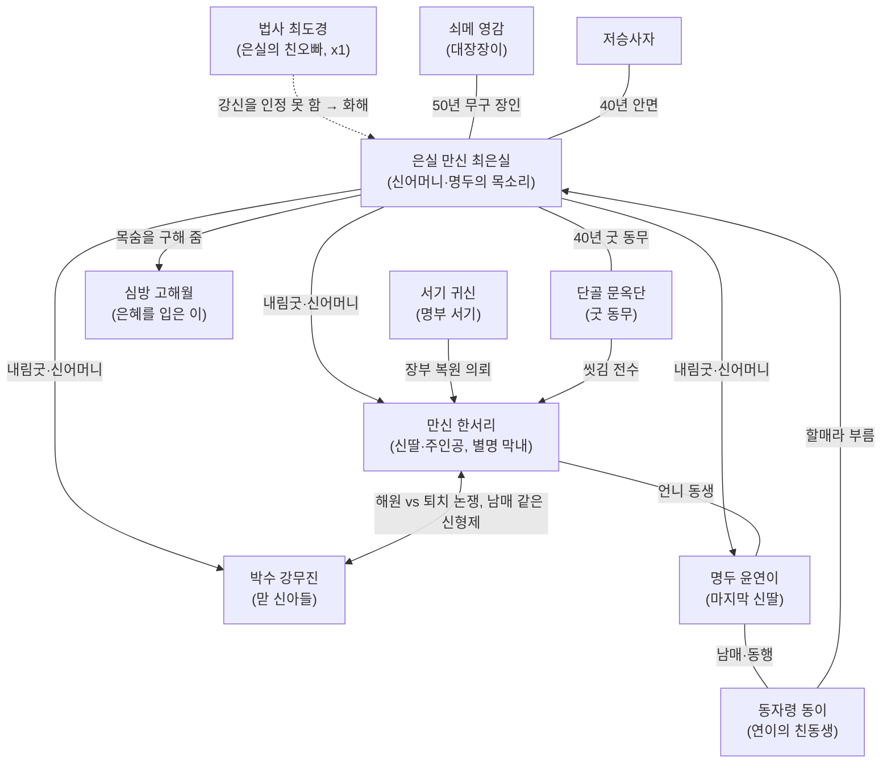
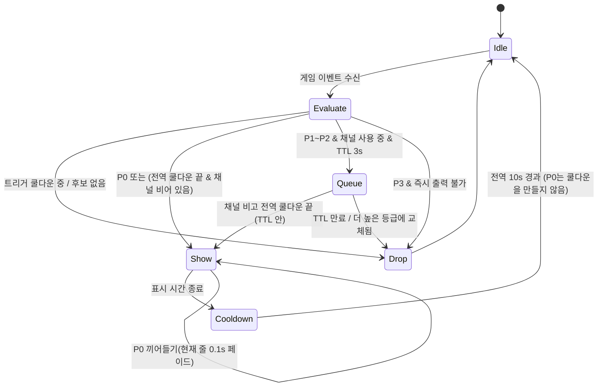

# 10. 세계관 & 서사 & 대사 — 넋길: 해원굿

> **문서 상태:** v0.9 섹션 기획 초안 (**캐논 v1.2 기준** — `01-concept-and-canon.md` + 2026-11-21 확정 결정 `99-open-questions-and-next-steps.md` 1·2장 반영, → 문서 끝 '캐논 v1.2 반영 로그')
> **담당:** 서사 섹션 기획
> **선행 문서:** `design/00-research.md`(조사), `design/01-concept-and-canon.md`(캐논·규칙·레지스트리 — 이 문서의 모든 ID는 여기서 온다)
> **동반 데이터:** `data/narrative/gongsu_lines.json`, `data/narrative/story_beats.json`, `data/narrative/sayeon_examples.json`, `data/narrative/loc_glossary.json`, `data/narrative/cast_canon.json`(인물 이름 단일 원본)
> **표기 규칙:** 캐논에 없던 이름·ID는 **[NEW]**로 표시하고 문서 끝 15장 "캐논 추가 요청"에 모았다. 수치는 서사 섹션 초안값이며, 시스템 수치(쿨다운 등)는 UI·오디오·밸런스 섹션이 조정할 수 있다. 규칙(무엇이 무엇을 일으키는가)은 바꾸지 않는다.
> **다른 섹션 참조 표기:** "→ 참조: `NN-파일명.md` (캐논 §번호)" 형식으로 실제 파일명을 쓴다(C-34). 파일명은 캐논 8.3 인계표와 `data/canon_ids.json` `doc_map`을 따른다.

---

## 목차

0. 한 장 요약
1. 서사 설계 원칙과 분량 예산
2. 세계관 설정: 시대, 이승·저승 구조, 왜 지금 귀신이 넘치는가
3. 규칙-서사 대응표 (모든 메커닉의 세계관 근거)
4. 메인 스토리 아크 (프롤로그 → 스테이지 3막 → 최종 고풀이, 확장 아크)
5. 등장인물과 관계도
6. 공수·넋두리 대사 시스템 (트리거, 우선순위, 선택 알고리즘, 표시 규칙)
7. 대사 예시집 (공수 96줄 + 무당 대사 + 은실 명두 + 넋두리 샘플)
8. 로비 서사: 비트 시스템, 신단 대사, NPC
9. 넋기록(벽사록·해원록) 작성 가이드와 예시 10편
10. 엔딩 구조
11. 톤 가이드 (존중·유머 비율, 금지 목록, 민감 소재)
12. 용어 고증 메모
13. 현지화 전략 (영문 중심, 일·중 메모)
14. 구현 메모 (데이터 스키마, 세이브, 텔레메트리, QA)
15. 캐논 추가 요청 · 열린 질문 · 출처
16. 리뷰 대응 로그
17. 캐논 v1.2 반영 로그 (2026-11-21)

---

# 0. 한 장 요약

| 질문 | 답 (확정안) |
|---|---|
| 언제, 어디서? | **현재의 한국(2020년대 후반)**. 동짓날 밤부터 이어지는 겨울밤들. 단, 굿이 열리는 동안 굿판은 이승의 현대층이 흐려진 **'굿 시간'**의 마당이 된다. 그래서 화면에는 전통 공간만 보인다(→ 2.1) |
| 무슨 일이 일어났나? | 넋길(이승에서 저승으로 가는 길)의 매듭을 40년 동안 풀어 오던 **은실 만신 [NEW]**이 죽었다. 죽는 순간 은실은 스스로를 넋길의 마지막 **고(매듭)**로 묶어 넘쳐흐르는 살(煞)을 막았다. 그 매듭이 버티는 동안에도 보내 주는 이 없던 넋들이 새어 나와 **굿 소리가 나는 곳마다 몰려든다**. 이 현상이 **대맺힘 [NEW]**이다 |
| 왜 귀신이 무당에게 달려드나? | 공격하러 오는 게 아니다. 굿판이 **저승으로 열린 유일한 문**이라서 몰려들고, 무당이 그 문의 다리라서 **붙잡는다(착 着)**. 한(恨)이 닿으면 정기가 깎인다. 악의가 아니라 맺힘의 무게다 |
| 플레이어의 목표는? | 전국의 굿판에서 맺힌 넋을 **깎고(퇴치) 풀어(해원)** 넋길의 흐름을 되살리고, 은실 만신의 명두 12조각을 모아 **신어머니라는 마지막 매듭을 푼다** |
| 주제 한 줄 | **"보내 주는 것도 사랑이다."** 해원도 퇴치도 '보내는' 방식이다. 하나는 풀어서, 하나는 끊어서 |
| 서사 전달 방식 | 전투 중 화면은 멈추지 않는다. 1줄 **넋두리**(망자의 목소리)와 1줄 **공수**(신령의 목소리)가 전부다. 서사의 몸통은 로비 비트 대사, 넋기록(벽사록·해원록), 정산 에필로그에 둔다 |
| 엔딩 | 런마다 정산 엔딩(사자의 읍/살 거둠/쓰러짐), 스테이지별 보스 2형 에필로그 6종, 메인 엔딩 2종(**배웅** 해원형 / **끊음** 퇴치형). 둘 다 정식 엔딩이고 우열이 없다. 두 엔딩을 모두 보면 '넋길 열림' 종장이 열린다 |
| v1.0 분량 | 문자열 약 1,180개, 한글 약 4.6만 자(→ 1.3) |

---

# 1. 서사 설계 원칙과 분량 예산

## 1.1 서사 원칙 5 (N1~N5) — 캐논 필러와의 연결

| ID | 원칙 | 연결 필러 | 구현 규칙 (판정 가능하게) | 설계 의도 |
|---|---|---|---|---|
| N1 | **멈추지 않는 서사** | P5 | 전투 중 화면 정지 0회. 대사는 1줄 자막만 쓴다(한국어 24자 이하). 예외는 보스 등장 2초 연출뿐이다. 컷신은 로비와 정산에만 둔다 | 뱀서라이크의 핵심 자산은 끊기지 않는 몰입이다. 서사가 쾌감을 끊는 순간 S1(코어 유저, 50%)을 잃는다 |
| N2 | **해원은 들어 주는 일이다** | P1, P5 | 사연 조각은 해원으로만 얻는다. 넋두리는 해원 순간에만 뜬다. 퇴치 순간에는 망자의 목소리를 내지 않는다 | "풀어 주면 말을 한다"는 보상 구조가 해원에 정서적 가치를 준다. 이 가치는 점수와 따로 움직인다 |
| N3 | **퇴치에도 서사가 있다** | P3 | 퇴치는 **벽사록**(민속지·벽사법 기록)을 채운다. 퇴치 루트 전용 엔딩 '끊음'을 둔다. 퇴치를 질책하는 대사는 0줄이다 | 퇴치를 서사 밖으로 밀어내면 그 순간 도덕 판정이 된다. 벽사록은 "사람들이 이 귀신을 어떻게 견뎌 왔는가"라는 다른 각도의 사연이다 |
| N4 | **신령은 말하되 심판하지 않는다** | P3, 존중 7.2 | 공수는 정보·응원·감탄·축원만 담는다. "잘못했다", "벌", "죄" 같은 어휘는 쓰지 않는다. 신령끼리 다투지 않는다 | 실존 신앙의 신령을 플레이어의 도덕 심판자로 만들지 않는다. 공수는 굿에서도 '덕담과 경고'에 가깝다 |
| N5 | **한은 사연이고, 사연은 사람이다** | P5, 존중 7.3 | 모든 귀신에게 해원 경로와 사연 3조각이 있다(정예·보스 포함). 죽음의 장면은 묘사하지 않고 그 전후의 감각과 관계를 쓴다 | 한국 오컬트의 정서적 차별점(해외 반응이 가장 큰 지점)이 '한을 듣고 푸는 것'이다. 고어나 자극으로 대체하지 않는다 |

## 1.2 장르 벤치마크와 포지션

| 작품 | 서사 분량 | 전달 방식 | 넋길이 가져올 것 / 버릴 것 |
|---|---|---|---|
| Vampire Survivors | 거의 없음(아이템 설명, 시크릿 대사) | 텍스트 플레이버 | 가져옴: 전투 중 텍스트 0에 가까운 밀도. 버림: 무서사 |
| Hades (Supergiant, 2020) | 보이스 21,020줄 / 305,433단어 (Supergiant 공개 수치) | 런 사이 허브 대화, 요구조건 기반 대사 풀 | 가져옴: **런 결과에 반응하는 허브 비트**, "본 대사 다시 안 나오기". 버림: 풀 보이스(예산 초과) |
| Hades II | 40만 단어 이상, 보이스 3만 줄 이상 | 동일 | 규모 참고용(넋길은 약 1/20 규모) |
| Spiritfarer | 영혼을 배웅하는 서사 | 동행과 이별 | 가져옴: "보내는 것"의 카타르시스. 버림: 긴 퀘스트 체인 |
| Undertale | 살려주기/죽이기 분기 | 분기 엔딩 | 가져옴: 두 동사의 의미. **버림: 죽이기 루트를 '나쁜 루트'로 만드는 도덕 판정**(P3 위반) |

**결론:** 넋길의 서사 밀도는 "VS의 전투 + Hades의 허브 반응성 축소판"이다. 전투 중에는 1줄, 허브에서는 2~6줄의 짧은 비트, 도감에서는 1~2문장 조각을 쓴다.

## 1.3 v1.0 서사 분량 예산

| 카테고리 | 키 접두 | 수량 | 평균 길이(한글 자) | 총 자수 | 비고 |
|---|---|---|---|---|---|
| 일반 넋두리 | `<ID>.neokduri.<n>` | 24종 × 8 = 192 | 18 | 3,456 | 캐논 5.1 "종당 일반 넋두리 8" |
| 원귀 넋두리 | `elite_wongwi.neokduri.<species>.<n>` | 12종 × 2 = 24 | 16 | 384 | 원귀는 퇴치 상위 종의 귀환이라 일반 잡귀 12종분 |
| 사연 조각(해원록) | `sayeon.<ID>.<1-3>` | 24 × 3 = 72 | 75 | 5,400 | 캐논 72조각 |
| 벽사록 항목 | `byeoksa.<ID>.desc` / `.tier<1-3>` | 24 × 4 = 96 | 70 | 6,720 | 전승 해설 1 + 단계 문구 3 |
| 공수(인게임) | `gs.<deity>__<face>.<trigger>.<n>` | 6신 × 2면 × 20 = 240 | 16 | 3,840 | 6.5 트리거표 기준 |
| 은실 명두 공수 | `gs.eunsil.*` | 12(조각) + 16(인게임) = 28 | 22 | 616 | |
| 무당 자기 대사 | `bark.<char>.<trigger>.<n>` | 5 × 16 = 80 | 16 | 1,280 | 시작·보스·쓰러짐·클리어 등 |
| 동자령 대사 | `bark.comp_dongja.*` | 20 | 14 | 280 | 명두 전용 |
| 로비 비트(NPC) | `beat.<id>.<n>` | 약 45비트 × 평균 4줄 = 180 | 28 | 5,040 | 8장 |
| 신단 대사 | `shrine.<deity>__<face>.<lv>` | 6 × 2 × 3 = 36 | 40 | 1,440 | 캐논 2.2 "빙의 횟수 3단계" |
| 정산·에필로그 | `ending.*` | 약 90 | 35 | 3,150 | 10장 |
| 프롤로그·종장 카드 | `story.*` | 약 24 | 40 | 960 | |
| 구경꾼 추임새 | `ui.chuimsae.<n>` | 4 (+변주 8) | 4 | 48 | 캐논 G5 |
| 시스템 설명문(서사 톤) | `<ID>.desc` 중 서사 감수분 | 약 180 | 45 | 8,100 | 무구·신령·패시브 설명은 각 섹션이 쓰고 서사가 톤을 감수 |
| **합계** | | **약 1,180** | | **약 45,700자** | |

- **환산(가정):** 한글 4.6만 자 ≈ 영어 1.9만~2.1만 단어. 번역 단가를 단어당 US$0.12로 가정하면 언어당 약 $2,400, 영·일·중 3개 언어 약 $7,200이다(감수비 별도). → 참조: `14-tech-production.md` 현지화 파이프라인
- **인력(가정):** 전담 작가 1인 × 4개월(초고) + 감수 1인 × 1.5개월 + 자문 3인(민속·무속·국악, 캐논 7.7) 각 2회 검토.
- **음성:** 풀 보이스는 하지 않는다. 화자별 **구음 스팅어**(0.3~0.8초, 면당 3변주)만 녹음한다. **예외: 은실 명두 공수 28줄(7.3)은 배우 음성으로 녹음한다(D-13 확정).** → 참조: `12-audio.md`
- **설계 의도:** 넋두리와 공수는 짧고 많이 반복되는 '바크(bark)'라서 줄 수보다 **반복 피로**가 품질을 결정한다. 그래서 예산의 핵심 지표는 줄 수가 아니라 "런당 같은 줄 재노출 0회"(→ 14.4)다.

---

# 2. 세계관 설정

> 방법론: `systemic-worldbuilding` 스킬의 '연쇄 결과' 틀을 썼다. 분기점 하나를 세우고 1차·2차·3차 결과를 따라간 다음, 모순과 '보이는 표지(visibility marker)'를 게임 화면 요소로 바꿨다.

## 2.1 시대 설정 — "현재, 그러나 굿 시간"

| 항목 | 확정 |
|---|---|
| 이승의 시간 | **현재 한국, 2020년대 후반**. 게임 첫 실행 시점이 '올해 동짓날'(음력 11월 무렵, 1년 중 밤이 가장 긴 날) |
| 서사 시간 흐름 | 런 1회 = 하룻밤의 굿 1판. 런 사이 시간은 명시하지 않는다(날짜 카운터 없음). 로비 대사에서 "지난밤"이라고만 말한다 |
| 굿 시간 (神時) [NEW: `lore_gut_sigan`] | 무당이 굿을 열면 굿판이 이승과 저승 사이의 마당이 된다. 이 동안 이승의 **현대층(전깃불, 도로, 건물)**이 먹빛으로 가라앉고 전통 공간의 층만 남는다. 굿이 끝나면(정산) 다시 현대층이 돌아온다 |
| 화면 표지 | ① 스테이지 맵 가장자리(카메라 외곽 1.5유닛)에 저대비 '이승의 흔적' 소품 1~2종을 둔다. 꺼진 가로등, 전봇대 실루엣 등이다(불투명도 25%, 충돌 없음). ② 정산 화면 배경은 같은 장소의 **현대 새벽 풍경**(가로등이 하나씩 켜짐) → 참조: `13-art-direction.md` |
| x2 DLC(폐병원) | 현대층이 '가라앉지 않는' 예외 밤이다. 형광등이 광원이 된다. 본편과 톤이 다른 이유를 세계관이 설명한다(→ 4.6) |

- **설계 의도:**
  - ① 무속은 **살아 있는 현재의 종교**다(캐논 7.1). 조선 시대로만 묶으면 '옛 미신'으로 박제될 위험이 있다. 현재를 배경으로 두면 "지금도 굿을 하는 사람들"이라는 존중이 생긴다.
  - ② 현대 배경은 『파묘』·『악귀』 등 K-오컬트의 시장 톤(S2 세그먼트)과 맞는다.
  - ③ '굿 시간' 설정 덕분에 기존 PixelLab 컨셉 아트(전통 공간 위주)를 그대로 쓸 수 있다.
  - ④ 현대 괴담 DLC를 세계관 안에 자연스럽게 넣을 수 있다.

## 2.2 우주론 — 다섯 층의 세계

```
          [하늘]  칠성 · 제석 · 하늘 길(이무기의 승천로)
             │
 [신령의 좌정처]  산(산신) · 바다(용왕) · 북두(칠성) · 진(장군) · 저승 어귀(바리) · 굿상(제석·대감)
             │   ← 청배(請拜): 굿 소리가 신령을 부른다
             ▼
 [이승] ──── [굿판 = 굿 시간의 마당] ──── [넋길] ──── [저승 문] ──── [명부(冥府)] ──── [저 너머]
  산 자들       무당이 여는 임시 문턱       망자가 걷는 길    차사가 지킴     시왕의 재판정     (묘사하지 않음)
               귀신이 몰려드는 곳          길베가 놓이는 길                  장부(명부록)
```

| 층 | 정의 | 게임에서 보이는 방식 | 고증 메모 |
|---|---|---|---|
| **이승** | 산 사람의 세상. 현대 한국 | 로비 창밖, 정산 배경의 새벽 | — |
| **굿판** (`sys_gutpan`) | 무당이 굿을 여는 동안만 존재하는 이승·저승 사이 마당. 하룻밤이 지나면 닫힌다 | 모든 스테이지 = 굿판. 런 = 굿 한 판 | 굿판을 신과 인간이 만나는 마당으로 보는 해석은 일반적이다. '경계 공간'으로 강조한 것은 **[각색]** |
| **넋길** (魂路) | 망자가 저승으로 걷는 길. 씻김굿의 길닦음에서 무당이 질베(길베) 위로 넋을 인도하는 길이 그 형상이다 | 길베(무당의 흰 무명 궤적)는 넋길의 조각이다. 영가 행렬은 그 위를 걷는다 | 남도 갯마을 씻김굿 길닦음: 무명베를 길게 펴고 넋을 저승길로 인도(→ 12장). 넋길이라는 명칭 자체는 게임 조어에 가까움 **[각색]** |
| **저승 문** | 넋길의 끝. 저승사자(차사)가 망자를 인계받는 곳 | 정산 시 저승사자 출현 지점(맵 북쪽 끝) | 저승차사 개념은 전승(제주 「차사본풀이」 등) **[무속]** |
| **명부** (冥府) | 시왕(十王)이 망자를 맞는 저승 관청. **명부록(冥府錄)** [NEW: `lore_myeongburok`]이라는 장부에 모든 망자의 이름이 적힌다 | x1 스테이지 `stage_myeongbu`. v1에서는 서기 귀신의 대사와 넋기록 UI 장식(장부 양식)으로만 나온다 | 시왕 신앙은 불교·무속 습합 **[무속]**. 장부 설정은 **[각색]** |
| **저 너머** | 천도된 넋이 가는 곳 | **묘사하지 않는다.** 흰 빛이 넋길 끝 너머로 사라지는 연출까지만 | 극락·서천꽃밭 등 종교마다 다른 내세를 특정하지 않는 존중 원칙 |

- **설계 의도:** 저 너머를 그리지 않는다. 특정 종교의 내세관을 확정하면 무속·불교·기독교 등 플레이어의 신앙과 부딪힌다. "어디로 가는지는 몰라도, 가는 길은 열어 줄 수 있다"가 무당의 위치다.

## 2.3 이 세계의 법칙 (서사 캐논 7조)

| # | 법칙 | 근거 | 게임 규칙 대응 |
|---|---|---|---|
| L1 | **한은 보존된다.** 한은 풀리거나(해원) 흩어질(퇴치) 뿐 없어지지 않는다. 흩어진 한은 살(煞)이 되어 그 자리에 고인다 | 필러 P3 | 퇴치 → 살 알갱이, 살기, 원귀 회귀 |
| L2 | **이름과 얼굴이 돌아오면 풀릴 수 있다.** 한이 옅어지면(35% 이하) 넋은 자기 얼굴을 기억해 낸다 | 넋두리: 넋이 무당의 입을 빌려 생전의 회한을 말하며 응어리를 푼다 | 풀릴 기색: 사람 얼굴 |
| L3 | **칼로는 매듭을 풀 수 없다.** 붉은 무구는 매듭을 끊거나 흩뜨릴 뿐, 다 풀린 매듭의 마지막 한 올은 흰 무구와 사람의 손(영가·길)으로만 푼다 | 고풀이: 무명 매듭을 춤추며 풀어 가는 의식 | 매듭 잠금 |
| L4 | **보내 주는 이가 있어야 떠난다.** 넋은 혼자서는 넋길을 찾지 못한다. 누군가 길을 닦고 배웅해야 한다 | 천도굿 일반 | 영가는 행렬을 따르다 천도된다. 길닦음 |
| L5 | **신령은 청해야 오고, 그릇을 본다.** 신령은 굿 소리에 응해 내려오고, 무당이 감당할 그릇인지 힘(위엄)이나 모심(가호)으로 시험한다 | 청배·오신·송신의 굿 구조 | 시련, 위엄/가호, 빙의 |
| L6 | **명부는 장부로 움직인다.** 이름이 장부에 바르게 적혀야 저승사자가 인계한다. 사연이 기록되면 이름이 돌아온다 | **[각색]** | 넋기록(해원록) 완성 → 길베 마당에서 저승으로 건너감 |
| L7 | **살이 쌓인 굿판에는 저승사자가 살을 거두러 온다.** 살을 많이 남긴 굿판은 장부에 '엉킨 곳'으로 오른다. 저승사자는 무당을 데려가거나 쫓지 않는다. 굿판에 남은 살 덩어리를 거두어 가고, 무당은 그동안 깨어난 원귀를 막아 굿판을 지킨다. 다 거두면 사자는 무당에게 읍하고 떠난다 | **[각색]** | 정산: 살 우세 시 '살 거둠'(사자 비적대·접촉 피해 없음, 02 §20 E3) |

## 2.4 왜 지금 귀신이 넘치는가 — 연쇄 결과 분석

### 2.4.1 분기점 (Divergence)

> **"이 세계에서 한(恨)은 실재하는 무게를 가진다. 보내 주는 이 없이 죽은 넋의 한은 넋길에 매듭으로 쌓인다. 그리고 그 매듭을 풀어 온 '매듭지기' 무당들이 있었다."**

현실과의 차이는 이것 하나뿐이다. 나머지(굿이 줄어든 역사, 장례 문화 변화, 무연고 사망 증가)는 현실의 흐름을 그대로 가져와 이 분기점에 대입했다.

### 2.4.2 결과 연쇄

| 차수 | 결과 | 이 게임에서 쓰는 방식 |
|---|---|---|
| **0차(역사적 배경)** | 수백 년 동안 마을굿·천도굿이 넋을 보냈다. 조선은 활인원에 무당을 두어 역병 구휼을 맡기기도 했다(조사 문서). 근현대에 들어 '미신 타파' 흐름과 도시화로 굿이 크게 줄었다 | 로비 대사에서 "굿을 하지 말라던 시절" 정도로만 언급한다. **특정 정권·종교를 탓하지 않는다** |
| **1차** | 보내 주는 의례 없이 떠난 넋이 늘었다. 객사, 무연고, 기억해 줄 이 없는 죽음이 그렇다. 현실에서도 무연고 사망은 최근 수년간 뚜렷하게 늘었다(집계 기준에 따라 연 3천~5천 명대, 15장 출처) | 일반 잡귀 대부분이 '보내 주는 이 없던 넋'이다(객귀, 영산, 상문 등). **현실 통계는 게임 안에 쓰지 않는다**(설계 근거로만 쓴다) |
| **1차** | 남은 매듭지기 무당들이 늙었다. 그중 마지막 큰 매듭지기가 **은실 만신**(40년 경력)이었다 | 은실의 존재 = 메인 아크의 축 |
| **2차** | 동짓날, 은실이 죽는다. 매듭을 풀 사람이 없어지자 넋길에 쌓이던 매듭이 한꺼번에 조인다. 이것이 **대맺힘** [NEW]이다 | 프롤로그 |
| **2차** | 은실은 죽는 순간 스스로를 넋길의 마지막 고(매듭)로 묶어 살이 이승으로 쏟아지는 것을 막는다(제방 역할). 그래도 그 틈으로 넋들이 새어 나온다 | 메인 미스터리. 남도 갯마을·동해안 클리어에서 단서가 나온다(→ 4.3) |
| **2차** | 새어 나온 넋들은 이승을 떠돌다 **굿 소리**를 듣고 몰려든다. 굿판만이 저승으로 열린 문이기 때문이다 | VS식 무한 웨이브의 세계관 근거. 굿을 열면 넋이 온다 |
| **2차** | 명부에 넘어오는 넋이 끊겼다가 엉킨 채로 밀려오면서 장부가 엉망이 된다. 명부 서기 하나가 장부 한 묶음을 들고 이승으로 도망친다 | 서기 귀신 [NEW] 등장 근거. 넋기록 = 장부 복원 |
| **2차** | 신령들의 좌정처도 흔들린다. 산에는 호식 원혼이, 바다에는 물에 든 넋이, 하늘 길에는 승천 못 한 이무기가 엉킨다 | 신령이 무당을 돕는 동기, 그리고 스테이지별 보스의 근거 |
| **3차(문화)** | 산 사람들은 이유 모를 불운, 가위눌림, '집에 뭐가 있다'는 소문을 겪는다. 신당에 의뢰가 다시 늘고, 젊은 무당들이 은실의 신당에 모여든다 | 로비가 북적이게 되는 근거(무당 해금 = 은실의 신당으로 모여드는 인연) |
| **3차(언어)** | 무당들 사이에서 "길이 막혔다", "넋이 샌다", "굿 소리가 문이다" 같은 말이 쓰이기 시작한다 | 로비 대사·공수 어휘로 반복해 노출한다(용어 학습 효과) |

### 2.4.3 모순과 긴장 (서사의 마찰점)

| 모순 | A 쪽 | B 쪽 | 서사 활용 |
|---|---|---|---|
| **빠름 vs 풀어 줌** | 퇴치는 빠르고 굿판을 지킨다(박수 무진의 입장: "끊는 것도 굿이다") | 해원은 느리지만 한을 남기지 않는다(단골 옥단의 입장: "소리로 풀어야 안 돌아온다") | 두 무당의 로비 대화. **어느 쪽도 틀리지 않았다**는 결론으로 간다(10장 엔딩 2종) |
| **신어머니를 붙잡기 vs 보내기** | 서리는 은실을 다시 만나고 싶다 | 은실을 풀면 은실은 떠난다 | 메인 아크의 정서적 핵심. 은실을 풀어 보내는 것이 곧 사랑이다 |
| **장부 질서 vs 사연** | 저승사자와 서기에게 넋은 '장부의 이름'이다 | 무당에게 넋은 '사연 있는 사람'이다 | 서기 귀신의 성장 아크(장부 → 사연을 기록하는 자) |
| **현대 vs 전통** | 굿을 미신이라 여기는 이승 | 넋이 실재하는 굿판 | 정산 배경의 현대 새벽. "아무도 모르게 지나간 밤"이라는 정서 |

### 2.4.4 집단별 차이 (Intersection)

| 집단 | 대맺힘을 겪는 방식 | 게임 반영 |
|---|---|---|
| 도시(서울) | 수많은 이름 없는 죽음이 객귀·영산·상문으로 넘친다. 역병의 기억(손님)도 있다 | `stage_guksadang`: 잡귀 물량 최다, 역려(손님 행차를 따라온 역병 잡귀) |
| 바닷가 마을(남도 갯마을·동해안) | 대대로 씻김굿·별신굿을 지내던 공동체가 비면서 의례가 끊겼다 | `stage_jindo_ssitgim`: 원결 / `stage_east_sea_byeolsin`: 이무기 |
| 섬(제주, x1) | 고유 신화 체계(본풀이)와 언어(제주어)가 살아 있지만 전승자가 줄고 있다 | `stage_jeju_chilmeori` |
| 세대 | 늙은 무당은 전통 의례 그대로, 젊은 무당(서리·연이)은 '자기 방식'으로 | 무당별 대사 톤 차이 |

## 2.5 '보이는 표지' — 대맺힘이 화면에 드러나는 방식

| 표지 | 위치 | 상태 변화 |
|---|---|---|
| 신당 창밖의 넋길 | 로비 배경 상단 | 처음에는 먹빛 매듭이 하늘을 가린다. 스테이지 클리어마다 매듭 1개씩 풀린다(3단계). 메인 엔딩 후 은하수 같은 흰 길이 된다 |
| 은실의 명두 | 명두단 중앙 | 12조각 균열. 명두 계승점 1점마다 조각 1개가 붙는다(캐논 `cur_myeongdu_jeom`, 최대 12) |
| 길베 마당의 넋들 | `hub_gilbe_madang` | 해원록을 완성한 종의 대표 넋이 저승으로 건너가는 장면(캐논 3.5) |
| 서기 귀신의 장부 | 넋기록 서고 | 기록 점수(→ 10.3)에 비례해 장부 두께가 3단계로 두꺼워진다 |
| 굿판 등불 | 런 중 | 캐논 G15. 해원 100마다 1개 점등. "넋이 길을 찾을 때마다 불이 켜진다" |

## 2.6 신령과 무당의 관계 설정

| 항목 | 설정 | 근거 |
|---|---|---|
| 몸주신 | 무당이 평생 모시는 주된 신령. 03:00 시련 후보로 반드시 나온다(캐논 3.2.10) | 강신무의 몸주 개념 |
| 시련의 의미 | 처치가 아니라 **인정 의식**이다. 화신은 시련이 끝나면 미소 짓고 실린다(캐논 3.2.10, 7.2) | 신령은 처치 대상이 아님 |
| 위엄과 가호 | 같은 신령의 두 얼굴이다. 위엄 = 힘을 보여 그릇을 증명함, 가호 = 그 신령의 일을 대신 해냄(모심) | 캐논 face 체계 |
| 공수의 성격 | 신령이 무당 입을 빌려 하는 말이다. 게임에서는 무당 머리 위가 아니라 **화면 하단 붓글씨 띠**로 띄워 '안에서 들리는 목소리'로 연출한다 | 공수 정의(한국민족문화대백과) |
| 신령끼리의 관계 | 서로 다투지 않는다. 합일(18:00) 때 그 밤 모신 신령 전원(표준 4신)이 각자 한 줄씩 '덕담'을 돌린다(→ 6.4.5, 7.2) | 존중 원칙 |
| 대감의 해학 | 대감은 탐욕스럽고 유쾌하게 말한다. 굿의 대감거리에서 대감이 재물·술을 요구하며 재담하는 전통을 따른 것이다 | 굿 전통 안의 해학이지 조롱이 아니다(→ 11.2) |

---

# 3. 규칙-서사 대응표 (Ludonarrative Map)

> 모든 캐논 규칙에 세계관 근거를 붙인다. 근거가 없는 규칙은 플레이어가 "게임이라서 그렇다"고 느낀다. 근거가 있으면 규칙이 곧 이야기가 된다. **이 표는 규칙을 바꾸지 않고 해석만 한다.**

| 캐논 규칙 (ID) | 세계관 해석 | 화면·텍스트 표현 | 서사 법칙 |
|---|---|---|---|
| 한 = 적 HP (`sys_han`) | 넋을 붙잡고 있는 응어리의 양 | HP바 대신 먹빛 매듭 게이지(정예 이상) | L1 |
| 풀릴 기색 (`sys_pullil_giseak`) | 한이 옅어져 넋이 자기 얼굴과 이름을 기억해 낸 순간 | 사람 얼굴 + 백 외곽선 | L2 |
| 매듭 잠금 (`sys_maedeup_jamgeum`) | 칼로는 마지막 한 올을 풀 수 없다 | 붉은 타격이 '팅' 하고 튕기는 SFX + 매듭 아이콘 반짝임(0.2초) | L3 |
| 퇴치 (`sys_toechi`) | **퇴송(退送)**: 잡귀를 쫓아 보내는 굿의 정당한 절차. 한은 풀리지 않고 흩어진다 | 붉은 파열, 넋두리 없음 | L1 |
| 한 파열·결단타 | 매듭째로 끊어 냄 | 붉은 방사형 파열 | L3 |
| 해원 (`sys_haewon`) | 맺힌 것이 풀려 넋이 가벼워짐 | 흰 빛 수직 상승 + "딸랑" + (확률적) 넋두리 1줄 | L2 |
| 맺힘 복귀 (`sys_maetim_bokgwi`) | 기억한 얼굴을 다시 잃음(12초) | 사람 얼굴이 다시 일그러짐 | L2 |
| 영가 행렬 (`sys_yeongga`, `sys_haengnyeol`) | 풀린 넋이 길 안내자(무당)를 따라 걷는 **배웅 줄** | 소복 차림 영가 | L4 |
| 영가 수명 30초 | 풀린 넋이 이승에 머물 수 있는 잠깐의 시간 | 영가가 점점 투명해짐(마지막 5초) | L4 |
| 대신 맞기 | 풀어 준 은혜를 갚는 넋의 마지막 일 | 영가가 무당 앞으로 나서며 넋전 종이가 흩날림 | L4 |
| 천도 (`sys_cheondo`) | 넋길을 따라 저승 문으로 떠남 | 흰 빛이 화면 북쪽으로 흘러감 | L4 |
| 길베 (`sys_gilbe`) | 무당의 발걸음이 깔아 주는 넋길의 조각 | 흰 무명 트레일 | L4 |
| 길닦음 (`sys_gildakkeum`) | 씻김굿 길닦음의 각색. 닫힌 길 안의 넋을 한꺼번에 인도함 | 장구 '덩' + 흰 채움 | L4 |
| 살·살기 (`sys_sal`, `stat_salgi`) | 흩어진 한이 굿판에 고인 나쁜 기운 | 검은 알갱이, '굿판의 기운' 게이지 | L1 |
| 원귀 회귀 (`sys_wongwi_hoegwi`) | 고인 살이 다시 엉겨 돌아옴. 같은 귀신이 '덜 풀린 채' 돌아온 것 | 붉은 눈 원귀 | L1 |
| 어둑시니 규칙 | 관심을 먹고 자라는 어둠(`[각색]`, 16 A-1). 외면하면 작아진다 | 정적 → '덩' 드롭, "별거 아니네" | 게임 각색 |
| 시련·위엄·가호 (`sys_siryeon`) | 신령이 무당의 그릇을 시험함 | 신장대 강림, 위엄/가호 게이지 | L5 |
| 빙의 (`sys_bingui`) | 시험을 통과한 무당에게 신령이 실림 | 오버레이(탈·관), 악기 레이어 합류 | L5 |
| 신령 합일 (`sys_hapil`) | 그 밤 모신 신령 전원(표준 4신)이 함께 실린 큰무당의 경지(하룻밤 한정). 6신 전원 '대합일'(`sys_dae_hapil`)은 무한굿 전용 | 시나위 전환 | L5 |
| 뒷전 (`geori_dwitjeon`) | 굿의 마지막, 잡귀잡신을 풀어 먹여 보내는 거리(전승) | 공물상, 잡귀가 공격을 멈춤 | L4 |
| 저승사자 정산 (`chaser_jeoseung_saja`) | 굿이 끝나면 차사가 풀린 넋을 인계받으러 온다. 살이 많으면 굿판에 남은 살을 거두러 온다(무당을 쫓지 않는다) | 사자의 읍 / 살 거둠 | L6, L7 |
| 정기 0 (런 실패) | **굿판이 흩어짐**. 무당은 쓰러지지만 죽지 않는다. 명두 조각의 힘(은실)이 신당으로 되돌려 보낸다 | 사인 문구 "굿판이 흩어졌다"(→ 10.1) | — |
| 명줄 (`stat_myeongjul`) | 칠성이 이어 준 여분의 목숨 줄 | 실 끊김 → 이어짐 연출 | — |
| 넋 → 공덕 (`cur_neok`→`cur_gongdeok`) | 떠난 넋들이 남긴 고마움이 공덕이 된다. 공덕은 신당에 **봉헌**한다 | "봉헌" 동사(캐논 7.6) | — |
| 엽전 → 복전 (`cur_yeopjeon`→`cur_bokjeon`) | 정예·상자에서 나온 엽전. 대장간 장인에게 맡겨 벽사 무구를 벼린다 | 대장간 | — |
| 사연 조각 (`cur_sayeon_jogak`) | 장부(명부록)에서 지워진 이름과 사연의 조각. 서기 귀신이 넋기록에 옮겨 적는다 | 넋기록 서고 | L6 |
| 명두 계승점 (`cur_myeongdu_jeom`) | 갈라진 **은실의 명두 12조각**. 신령의 새 얼굴을 처음 받을 때마다 한 조각이 돌아온다 | 명두단의 명두 복원 | — |
| 살 맺힘 단 (`ladder_salpuri_dan`) | 대맺힘이 깊어진 밤들. 단이 오를수록 은실의 매듭이 약해져 살이 더 샌다 | 단 선택 시 공수 1줄(→ 7.5) | — |
| 오늘의 굿판 (`mode_oneul`) | 서기 귀신이 매일 장부에서 찢어 오는 '오늘 밤의 한 장' | 모드 진입 시 서기 대사 | L6 |
| 무한굿 (`mode_muhan`) | 날이 새지 않는 굿. 은실이 "끝나지 않는 굿은 무당을 먹는다"고 경고했던 금기의 굿 | 진입 경고 공수 | — |
| 자진모리 굿판 (`mode_jajinmori`) | 급한 의뢰. 장단을 몰아서 치는 짧은 굿 | — | — |

---

# 4. 메인 스토리 아크

## 4.1 구조 개관

```
[프롤로그] 은실의 진오기굿 → 대맺힘 → 명두 12조각
     │
[1막: 선바위 굿당 — "대접"]   서울 · 역려(별상 손님 배송) · 서기 귀신 합류 · 박수 해금
     │   (선바위 굿당 첫 클리어)
[2막: 남도 갯마을 — "씻음"]     남도 갯마을 · 원결 · 단골 해금 · '은빛 실' 단서
     │   (남도 갯마을 첫 클리어)
[3막: 동해안 — "기다림"] 동해안 · 이무기 · 명두/심방 해금 · 은실의 매듭 확인
     │   (3스테이지 클리어 + 명두 12조각 + 기록 점수 48)
[종장: 은실의 고풀이]     최종 런의 보스 형태를 따라 '배웅' 또는 '끊음'
     │
[확장 x1] 제주(보냄) · 명부(대악귀 · 법사 도경 · 은실의 과거)
[확장 x2] 다른 밤: 남해 폐병원(현대 괴담, 별도 톤)
```

- **진행 원칙(로그라이트 서사):**
  - ① 서사 비트는 **런 결과에 반응**한다(승패와 무관하게 진행된다).
  - ② 어떤 비트도 특정 플레이 스타일(해원/퇴치)을 강제하지 않는다.
  - ③ 실패한 런도 최소 1개 비트 또는 넋기록 진척을 남긴다.
  - ④ 메인 아크 완주 예상 시간은 약 **12~18시간(35~55런)**이다. 넋기록 100%(40~60시간, 캐논 1.6)보다 앞에 둔다.
- **설계 의도:** 로그라이트에서 서사는 실패를 보상하는 장치다. Hades처럼 "죽어서 돌아오면 누군가 그 죽음에 대해 말해 준다"는 구조를 축소 적용한다. 메인 엔딩을 넋기록 100%보다 앞에 두면 엔딩 후에도 수집 동기가 남는다.

## 4.2 프롤로그 (첫 실행, 스킵 가능)

| 항목 | 값 |
|---|---|
| 형식 | 정지 카드 4장. 한지 질감 배경에 먹 붓 일러스트 1장 + 텍스트 1~2줄. 카드당 5초 자동 진행, 아무 키로 넘김, 길게 누르기(0.8초)로 전체 스킵 |
| 총 길이 | 20~25초 |
| 이어지는 것 | 첫 런: `char_mansin` 고정, `stage_guksadang`, 튜토리얼 가이드(캐논 3.4의 00:30/01:30 안내) |

| 카드 | 화면 | 텍스트 (`story.prologue.<n>`) |
|---|---|---|
| 1 | 인왕산 아래 작은 신당, 꺼져 가는 촛불 | "동짓날 밤, 인왕산 아래 은실 만신이 숨을 거두었다." |
| 2 | 흰 무명 길베를 펼치는 젊은 만신(서리)의 뒷모습 | "신딸 서리는 신어머니를 보내는 진오기굿을 열었다." |
| 3 | 굿판 사방 어둠 속 수백 개의 흰 눈 | "그러나 어머니의 넋은 내리지 않았다. / 대신, 보내 주는 이 없던 넋들이 굿 소리를 듣고 몰려왔다." |
| 4 | 놋쇠 명두가 열두 조각으로 갈라짐 | "명두가 갈라지며 마지막 목소리가 울렸다. / "서리야, 풀어라. 다 풀고 나면… 나도."" |

- 첫 런 시작 직후(00:03) 첫 공수: 몸주 후보가 아직 없으므로 **은실 명두**가 1회 말한다. "얘, 넋들이 무서워서 오는 게 아니다. 문 찾아오는 거야." (`gs.eunsil.tutorial.1`)
- 첫 해원(`sm_first_haewon`): 캐논 그대로 달걀귀신의 "…엄마 얼굴이 기억이 안 났어." 이 줄은 **프로필 최초 해원 시 1회 강제 출력**한다.
- **설계 의도:** 프롤로그는 3가지 질문만 남긴다. ① 은실은 왜 내려오지 않았나? ② 왜 넋들이 몰려오나? ③ "다 풀고 나면… 나도"는 무슨 뜻인가? ②는 첫 런 안에서 답하고(신속한 이해), ③은 종장에서 답한다(장기 견인).

## 4.3 막별 상세

### 1막 — 인왕산 선바위 굿당: "대접"

| 항목 | 내용 |
|---|---|
| 스테이지 | `stage_guksadang` (서울·재수굿/진오기굿 모티프) |
| 서사 질문 | 이 넋들은 다 누구인가? 왜 은실은 내려오지 않았나? |
| 밝혀지는 것 | ① 대맺힘의 존재(서기 귀신). ② 은실이 죽기 전 "길이 막히고 있다"고 말했었다(쇠메 영감). ③ 넋들은 문을 찾아온 것이다 |
| 주제 | **대접(待接)**. 굿은 신과 넋을 손님으로 맞아 먹이고 보내는 일이다. 손님신(별상 손님 `npc_byeolsang_sonnim`)은 적이 아니라 대접해 배웅하는 귀빈이고, 역려는 손님 행차 뒤를 따라와 상 한 번 받지 못한 잡귀들이다(07 §6.5.2·8.1) |
| 중간보스 | `mboss_daegwi`, `mboss_dokkaebi` |
| 보스 | `boss_yeokryeo` 역려(疫癘) — 손님 행차 뒤에 엉겨 붙은 이름 없는 역병 잡귀들의 덩어리. 손님은 상을 받았지만 뒤따른 이들은 물 한 그릇 얻지 못해 집집마다 앓는 소리로 남았다. 손님신 본체는 아레나 가장자리에서 대접받는 NPC이며, 역려의 결말(형태 무관) 직후 손님 배송 `sm_sonnim_baesong`(2초, 싸리말)으로 떠난다. 배송 대사는 07 §6.5.2의 대접 게이지 3단 대사를 쓴다(벌칙 없음). 적 쪽 대사·에필로그에는 '손님' 본체를 적으로 쓰지 않는다 |
| 보스 등장 1줄(2초) | 역려(여러 목소리 겹침): "…손님 상만 차리고, 우리 몫은?" |
| 한형 에필로그 (`ending.boss_yeokryeo__form_han`) | "매듭이 풀릴 때마다 엉긴 얼굴 하나가 사람 얼굴로 돌아와 흩어졌다. / "이제 됐소. 손님 가시는 길, 우리도 뒤따라 가겠소." / 그날 밤 서울 어딘가에서 앓던 아이의 열이 내렸다." |
| 살형 에필로그 (`ending.boss_yeokryeo__form_sal`) | "살을 두른 역려가 무너지며 흩어졌다. / 역병은 물러갔다. 그러나 문간에 남은 살은 아직 따뜻하다. / 무진: "물렸으면 됐다. 다음 손님 맞을 준비나 하자."" |
| 첫 클리어 후 로비 변화 | 신당 창밖 매듭 1개 풀림. 단골 옥단이 전화로 남도 갯마을에 "씻김 손이 모자라다"고 알려 온다 → `stage_jindo_ssitgim` 해금(캐논 해금 조건: 선바위 굿당 클리어) |
| 이 막의 대표 비트 | B01, B02, B03, B05, B06 (→ 8.2) |

### 2막 — 남도 갯마을 씻김굿판: "씻음"

| 항목 | 내용 |
|---|---|
| 스테이지 | `stage_jindo_ssitgim` (남도 갯마을 씻김굿판, 가상 지명·씻김굿) |
| 서사 질문 | 맺힘은 어디서 생겨 어디로 가는가? 은실은 어디에 있나? |
| 밝혀지는 것 | ① 한 마을 여러 세대의 '보내지 못한 넋'이 엉켜 원결이 된다. ② **원결의 매듭 속에서 은빛 명주실이 발견된다.** 은실이 자기 실로 넋길을 묶었다는 첫 단서다. ③ 옥단이 은실과 젊은 시절 함께 굿을 다녔던 사이임이 드러난다 |
| 주제 | **씻음**. 씻김굿은 망자의 몸(영돈)을 씻겨 맺힌 것을 푸는 굿이다. 슬픔을 씻는 일이기도 하다 |
| 중간보스 | `mboss_gumiho`, `mboss_daegwi` |
| 보스 | `boss_wongyeol` (원결 怨結, 각색) — 수많은 고혼이 무명천처럼 엉킨 형상. **특정 사건의 희생자로 읽히지 않도록**, 오래된 시간대의 다양한 사람이 섞인 집합으로만 표현한다(→ 11.4 민감 소재) |
| 보스 등장 1줄 | 원결(여러 목소리 겹침): "…누가… 우리를… 씻겨 주나…" |
| 한형 에필로그 | "고풀이 일곱 매듭이 풀릴 때마다 한 사람씩 얼굴을 되찾았다. 어부, 베 짜던 할머니, 장꾼, 이름 모를 나그네. / 마지막 매듭 안에서 서리는 은빛 실 한 올을 집었다. / 어머니의 실이었다." |
| 살형 에필로그 | "신칼이 엉킨 무명을 갈랐다. 원결은 흩어졌고 갯벌 위에 살이 검게 내려앉았다. / 갈라진 매듭 사이로 은빛 실 한 올이 반짝였다. / 옥단: "…저건 은실이 실이여. 그 양반, 어디다 자기를 묶어 놨당가."" |
| 첫 클리어 후 | 창밖 매듭 2개째 풀림. 서리가 은빛 실을 명두단에 올린다(명두 UI 장식 추가). 동해안 별신굿 마을에서 "용왕제 날 바다가 울었다"는 소식이 온다 → `stage_east_sea_byeolsin` 해금 |
| 대표 비트 | B07, B08, B09, B10 |

### 3막 — 동해안 별신굿 바닷가: "기다림"

| 항목 | 내용 |
|---|---|
| 스테이지 | `stage_east_sea_byeolsin` (경북·강원 동해안 별신굿) |
| 서사 질문 | 넋길 끝에는 무엇이 있는가? |
| 밝혀지는 것 | ① 땅의 넋길뿐 아니라 **하늘 길**도 막혀 이무기가 천 년을 기다렸다. ② 이무기를 풀자 하늘에서 넋길 전체가 보인다. 그 끝, 저승 문 바로 앞에 **은빛 실로 묶인 사람 모양의 매듭**이 걸려 있다. 은실이다. ③ 은실은 갇힌 것이 아니라 스스로 제방이 되어 살을 막고 있었다 |
| 주제 | **기다림**. 별신굿은 마을이 함께 신을 기다려 맞는 축제다. 이무기는 기다리다 지친 존재다 |
| 중간보스 | `mboss_dokkaebi`, `mboss_gangcheori` |
| 보스 | `boss_imugi` — 여의주가 깨져 승천하지 못한 한 |
| 보스 등장 1줄 | 이무기: "천 년… 하늘 문이 열리기를… 기다렸다." |
| 한형 에필로그 | "일곱 매듭이 풀리자 이무기는 용이 되어 올랐다. 구름이 갈라진 자리로 하늘에서 넋길 전체가 보였다. / 그 끝, 저승 문 앞에 은빛 실로 묶인 매듭 하나가 걸려 있었다. / 사람의 모양이었다." |
| 살형 에필로그 | "살귀를 두른 이무기가 바다로 가라앉았다. 파도가 잠잠해지고 수평선 위 구름이 잠시 걷혔다. / 그 틈으로 보였다. 넋길 끝에 걸린, 은빛 실로 묶인 사람 모양의 매듭이. / 무진: "…어머니다."" |
| 첫 클리어 후 | 창밖 매듭 3개째 풀림. 남은 것은 넋길 끝의 은빛 매듭 하나다(로비 배경에 상시 표시). 명두단 대사 해금: "명두를 다 맞추면 길이 보일 거다." 종장 조건 안내 UI가 열린다(→ 10.3) |
| 대표 비트 | B11, B12, B13, B14 |

### 종장 — 은실의 고풀이 (`ep_eunsil_gopuri` [NEW])

| 항목 | 내용 |
|---|---|
| 해금 조건 | ① v1 3스테이지 모두 1회 이상 클리어(형태 무관) ② 명두 계승점 12/12 ③ **기록 점수** ≥ 48/144 (해원록 조각 수 + 벽사록 단계 수, → 10.3) |
| 발동 | 조건 충족 후 **어느 스테이지든** 다음 클리어 런에서 보스 해결 직후 정산 대신 발동한다. 로비에서 "오늘 밤은 어머니를 풀러 간다"는 안내가 뜨고, 플레이어는 '다음에' 버튼으로 미룰 수 있다 |
| 형식 | **조작 가능한 짧은 에필로그**(45~70초, 전투 없음, 피격 없음). 무당이 하늘로 이어진 길베 위를 걷는다. 이번 런에서 천도된 영가 전원(최대 60, 반투명)이 뒤를 따른다. 길 끝 은빛 매듭까지 걸어가 통과한다. 화면에 HUD는 없다 |
| 분기 | 그 런의 **보스 형태**를 따른다. 한형으로 끝낸 런 → **배웅 엔딩**, 살형으로 끝낸 런 → **끊음 엔딩**(→ 10.4) |
| 저승사자 | 길 끝에서 기다린다. 두 엔딩 모두 은실에게 읍한다: "만신, 사십 년 동안 수고 많으셨소." |
| 크레딧 | 엔딩 직후 크레딧(스킵 가능). 배경은 신당 창밖 넋길이 흰 은하수로 바뀌는 장면 |
| **설계 의도** | ① 마지막 보스가 '신어머니'인 것은 맞지만, 그녀를 공격하지 않는다. 매듭을 푸는 것이다. 신어머니를 쓰러뜨리는 것은 존중 원칙과 정서 모두에 맞지 않는다. ② 엔딩 분기를 '그 런의 보스 형태'에 묶었다. 그래서 플레이어의 누적 성향이 아니라 **마지막 굿판에서의 선택**이 엔딩을 고른다. 두 엔딩을 다 보고 싶은 플레이어는 형태만 바꿔 다시 하면 된다(재도전 비용 1런) |

## 4.4 무당별 개인 아크 (각 3비트)

> 무당 개인 아크는 해당 무당으로 플레이한 런 수와 행동으로 진행된다. 각 비트는 로비 비트(→ 8장)로 출력되며 2~6줄이다.

| 무당 | 비트 1 (해금 직후) | 비트 2 (해당 무당 5런) | 비트 3 (해당 무당으로 스테이지 1개 클리어) |
|---|---|---|---|
| `char_mansin` 서리 | (프롤로그가 대신함) | "어머니 명두를 맞추면 어머니가 돌아오는 거죠?" 쇠메 영감이 대답하지 않는다 | 서리: "돌아오는 게 아니라… 가시는 거구나." 보내는 법을 받아들이기 시작한다 |
| `char_baksu` 무진 | 무진 등장: "귀신 달래다 사람 다치면 그게 굿이냐." 서리와 첫 충돌 | 화재 현장에서 소방관으로 일하다 신병을 앓은 과거. "구할 수 없는 사람은 빨리 보내 주는 게 낫다고 배웠다." | 무진이 처음으로 영가 행렬을 오래 지켜본다. "…저렇게 보내는 방법도 있었구나." 퇴치를 버리지는 않는다 |
| `char_dangol` 옥단 | 옥단 등장: "강신무는 신을 받고, 우리 단골은 소리를 받제." 은실과의 우정 | 젊은 은실이 남도 갯마을에 와서 씻김굿을 배우겠다며 사흘 동안 장구를 쳤던 이야기(해학) | 옥단: "은실이가 그라더라. 넋 보내는 건 강신이고 세습이고 없다고." |
| `char_myeongdu` 연이 | 연이와 동이 등장. 은실이 연이의 내림굿을 해 주었다(은실의 마지막 내림굿). 동이는 연이의 명두에 깃든 친동생 동자령 | 동이가 은실을 "할매"라 부르며 그리워한다. 연이는 동이도 언젠가 보내야 하는지 두려워한다 | 동이: "누나, 나는 안 가. 내가 누나 일 도와주는 게 내 길이야." 동자령은 천도 대상이 아니라 동행이라는 설정 확정 |
| `char_simbang` 해월 | 해월 등장. 젊은 시절 뭍의 굿판에서 쓰러졌을 때 은실이 살려 준 빚을 갚으러 왔다 | 제주 본풀이를 들려줌. "신도 다 사연이 있수다. 본풀이가 신의 사연이주." | 해월: "은실 삼춘(제주에서 어른을 부르는 말)이 묶은 매듭, 우리 멩두로 길흉을 봤수다. …길하우다." |
| `char_beopsa` 도경 (x1) | 도경 등장. 은실의 친오빠(75), 충남 내포 앉은굿 법사. 누이의 강신을 끝내 인정하지 않았다 | 은실이 열아홉에 신병을 앓던 해, 갓 북을 물려받은 도경이 독경으로 신을 '눌러' 보내려 했던 과거. 은실은 그 뒤 집을 떠났다 | 도경이 은실의 무복 앞에서 처음으로 경을 읽는다. 사과의 경이다 |

## 4.5 확장 아크 (x1)

| 스테이지 | 주제 | 서사 질문 | 핵심 사건 | 연결 |
|---|---|---|---|---|
| `stage_jeju_chilmeori` 제주 칠머리당 | **보냄** (대접 후 배에 태워 보냄) | 신을 어떻게 '잘' 보내는가? | 도채비 영감(`boss_yeonggam`)은 대접받기를 좋아하는 도깨비신이다. 잘 놀아 주고 배방선으로 보내는 영감놀이의 정신을 따른다. 해월 개인 아크가 완결된다 | 영감놀이·배방선(캐논 출처). 제주어 대사는 자문 필수 |
| `stage_myeongbu` 명부 저승길 | **기록** (이름을 되찾음) | 대맺힘은 누가 이용했나? | 명부록을 갉아먹으며 살을 먹고 자란 **대악귀**(`boss_daeakgwi`)가 드러난다. 대악귀는 플레이어의 퇴치 때문에 생긴 것이 아니다. **역사 속 보내지 못한 살이 오래 고여 뜻을 가진 것**이다. 서기 귀신이 장부를 돌려놓고, 도경이 은실의 과거를 고백한다 | 대악귀를 플레이어 퇴치의 '벌'로 쓰지 않는다(P3) |

## 4.6 x2 DLC — "다른 밤" (남해 외딴 섬 폐병원)

- **세계관 위치:** 대맺힘과 별개인 '다른 밤'의 의뢰. 이 섬에서는 굿 시간이 와도 현대층이 가라앉지 않는다. 형광등이 꺼지지 않는 곳이다.
- **톤:** 본편(해학 20%)과 달리 공포 비중을 35%로 올린다(→ 11.1).
- **민감 원칙:** 폐정신병원 배경은 정신질환 낙인 위험이 크다. **환자를 괴물로 그리지 않는다.** 귀신은 방치와 격리의 피해자로만 그린다. 현대 괴담(`[현대]` 태그, 장산범 등)은 '소문이 만든 존재'로 분리해 실존 피해자와 섞지 않는다. 정신건강 자문 1인을 추가한다.

---

# 5. 등장인물과 관계도

## 5.1 인물 목록

> **이 절(5.1·5.1.1)이 인물 서사의 단일 캐논이다(리뷰 R10-01·R10-02 반영).** 플레이어블 무당의 개인 이름은 데이터 필드 `char_*.lore_name`(03 캐릭터 섹션이 정의한 필드명, 구 `given_name` 폐기)으로 들어가며, 값의 원본은 `data/narrative/cast_canon.json`이다. 03 캐릭터 섹션의 '서사 속 이름'·배경 서사와 `data/characters.json`의 `lore_name`·`companion_name`은 이 표를 따라 갱신한다(→ 15.1 `[CANON-REQUEST]` CR-NAME-01~03). 계통(지역·입무 방식) 고증은 03 쪽 근거를 이 표로 흡수했다.
> UI의 무당 선택 화면 표기명은 캐논 한글명(만신, 박수무당 …)을 그대로 쓴다. 개인 이름은 로비 대사와 넋기록에서만 쓴다.

| ID | 표기명 / 개인 이름 `lore_name` (한자) | 나이·출신·계통 | 성격 키워드 | 말투(레지스터) | 몸주 / 모시는 신 | 서사 역할 |
|---|---|---|---|---|---|---|
| `char_mansin` | 만신 / **한서리** (韓서리, '서리'는 고유어) | 31, 서울 인왕산 아랫동네. **서울굿 강신무**, 내림굿 7년차(24세 내림굿) | 무뚝뚝하고 장난스러움. 귀신에게 다정한 반말 | 반말·짧은 문장. "자, 줄 서." | 몸주가 하나로 앉지 않음 → 해금 신령 중 선택 | 주인공. 은실의 신딸. 연이가 들어오기 전까지 막내였고 무진은 지금도 "막내"라 부른다 |
| `char_baksu` | 박수무당 / **강무진** (姜武鎭) | 38, 경기 북부. **황해도굿 계통 강신무(남무)**. 할머니가 황해도에서 내려온 큰무당. 전직 소방관, 내림굿 9년차 | 책임감, 직설, 츤데레 | 하오체 섞인 단문. "다시 선다." | `deity_janggun` | 신당에 남은 은실의 신자식 중 맏이(맏 신아들). 퇴치의 정당성을 대변 |
| `char_dangol` | 단골 / **문옥단** (文玉丹) | 64, 남도 갯마을(가상). **호남 세습무**, 6대째 단골 집안. 신이 내린 적 없음 | 노련, 해학, 정 많음 | 전라 방언 가볍게("~당가", "~제", "~잉"). 자막은 표준어 병기 없이 읽히는 수준 | (세습무라 몸주 없음) 무가로 모시는 무조신 `deity_barigongju` | 은실의 40년 굿 동무. 해원의 장인 |
| `char_myeongdu` | 명두 / **윤연이** (尹연이) | **20(성인)**, 서울. 명두(동자령을 모신 강신무). 19세에 은실에게 내림굿, 2년차 | 소심하지만 단단함 | 해요체 | 몸주 동자령(`comp_dongja`) / 인연 신령 `deity_chilseong`(명다리) (D-27) | 은실이 마지막으로 내림굿을 해 준 신딸(실제 막내). 동이와 함께 '보내지 않는 동행'의 의미를 보여 줌 |
| `comp_dongja` | 동자령 / **동이** | (나이 묻지 않음. 외형은 일곱 살 남짓 아이) 연이의 **친동생**(혈연 아이 영 = 명두 고증) | 명랑, 호기심 | 아이 말투 반말. 연이를 "누나", 은실을 "할매"라 부름 | — | 연이의 명두(놋쇠 거울)에 깃든 동자신. 게임 규칙상 기색 예고·귀띔만 하고 전투 판정은 없다(D-27). **죽음의 경위·병명·나이는 끝까지 언급하지 않는다**(11.4) |
| `char_simbang` | 심방 / **고해월** (高海月) | 47, 제주 동쪽 바닷가 마을. **제주 심방**, 4대째 멩두를 물려받음. 남성 | 느긋함, 운명론, 의리 | 제주어 어휘 일부("~수다", "~우다", "혼저 옵서") + 표준어 | `deity_yongwang` | 젊은 시절 뭍의 굿판에서 쓰러졌을 때 은실이 살려 낸 빚을 갚으러 옴. 길흉·점복 담당 |
| `char_beopsa` (x1) | 법사 / **최도경** (崔道經) | **75**, 충남 내포(서산). **충청 앉은굿 독경 법사**, 앉은굿 법사 집안 맏아들 | 엄격, 후회, 학자풍 | 하게체, 경문 인용 | `deity_jeseok_daegam` | 은실의 **친오빠(4살 위)**. 화해의 아크 |
| `npc_eunsil` [NEW] | 은실 만신 / **최은실** (崔銀실) | 향년 71. 충남 내포 앉은굿 법사 집안의 딸 → 19세 신병, 집안 반대로 서울로 올라가 황해도 피란민 출신 큰만신에게 20세 내림굿(그 큰만신의 이름·고향 마을은 끝까지 밝히지 않는다, 16 A-5 D-61). **서울·황해도굿 계통 강신무**, 무업 50년 | 호탕, 다정, 엄격한 스승 | 반말, 사투리 없음, "얘", "내 딸" | 산신(몸주) | 신어머니. 명두 목소리. 종장의 '마지막 매듭' |
| `npc_myeongbu_seogi` [NEW] | 서기 귀신 (명부 서기) | 명부에서 300년 근무(본인 주장) | 깐깐, 투덜이, 숫자 집착, 사실은 다정 | 공문서체 하오체. "기록에 의하면…" | — | 넋기록 서고 관리자. 해설·해학 담당 |
| `npc_soeme` [NEW] | 쇠메 영감 (대장장이) | 79, 은실의 무구를 50년 벼린 장인 | 과묵, 무뚝뚝, 츤데레 | 단답 반말. "벼려 놓으마." | — | 대장간 관리자. 은실의 옛 기억 |
| `npc_meokmul` [NEW] | 먹물 (신당 고양이) | 검은 고양이 | — | 대사 없음(행동 텍스트 "먹물이 꼬리를 세운다") | — | 로비 앰비언트. 귀신을 보는 고양이(민간 속설). 컨셉 아트 `lobby_sindang`의 고양이 |
| `chaser_jeoseung_saja` | 저승사자 | 명부 차사 | 정중, 과묵, 규칙적 | 하오체 최소 대사(런당 1줄) | — | 정산자. 은실과 40년 안면이 있다 |

- **이름 선택 규칙:** 실존하는 유명 무속인(예: 국가무형유산 보유자) 이름과 겹치지 않게 했다. 한자·뜻이 서사 모티프(실·서리·옥·바다·경)와 맞물리게 지었다. 1차 중복 검사 결과는 5.1.2, 최종 확정 전 법무·자문 확인이 필요하다.
- **나이 규칙:** 플레이어블 무당은 전원 성인(최연소 연이 20세)이다. 연이는 체구가 작은 스프라이트(체형 40~42px)를 쓰지만 성인 비율·성인 복식으로 그리며, '소녀처럼 보인다' 같은 묘사를 서사·마케팅 문자열에 쓰지 않는다. 아이 외형은 동자령 동이 하나뿐이고, 동이는 전투·피격 대상이 아니다.

### 5.1.1 배경 서사 캐논 (03 캐릭터 섹션 '배경 서사' 단락의 대체 원문)

> 03의 각 캐릭터 배경 단락(구 새별·석주·순례·여울·고만수·한도경)은 아래 원문으로 교체한다. 03에서 가져온 계통 고증(굿 집안·멩두 계승·혈연 동자령·내포 앉은굿)은 살렸고, 10의 관계도(은실의 신자식·굿 동무·은인·친오빠)에 묶었다. 아동의 죽음 경위(구 달이의 '열병')는 11.4에 따라 삭제했다.

| ID | 배경 서사 (03 교체용, 4~6문장) |
|---|---|
| `char_mansin` 한서리 | 서리는 인왕산 아랫동네 연립주택에서 자랐고, 스물세 살 겨울에 신병을 앓았다. 석 달 동안 열이 내리지 않았고, 꿈마다 서로 다른 신령이 문간에 서 있었다. 선바위 굿당 아래에서 오래 굿을 해 온 은실 만신이 내림굿을 마친 뒤 말했다. "너는 몸주가 하나로 안 앉는다. 그릇이 큰 거다. 그게 복인지 짐인지는 네가 정해라." 은실이 세상을 뜬 해, 서울의 밤 굿판마다 이름 없는 원혼이 한꺼번에 몰려들기 시작했다. 서리는 신어머니가 남긴 신칼과 방울을 들고 진오기굿을 연다. |
| `char_baksu` 강무진 | 무진의 할머니는 황해도에서 피란 내려온 큰무당이었고, 작두를 타는 날이면 동네 사람들이 마당 담장에 줄지어 섰다. 무진은 그 마당에서 장구채를 쥐고 자랐지만 무당이 될 생각은 없었고, 소방관이 되었다. 스물여덟, 무너지는 화재 현장에서 동료를 끌어낸 뒤 깨어나 보니 꿈속에서 갑옷 입은 장군이 그의 손에 월도를 쥐여 주고 있었다. 할머니와 같은 황해도굿 계통인 은실이 그의 내림굿을 맡았다. 그는 귀신을 미워하지 않는다. 다만 산 사람을 해치려 드는 것은 물리고, 끊어 낸 자리에 남은 살은 자기가 짊어진다. |
| `char_dangol` 문옥단 | 옥단은 남도 갯마을 갯마을 6대째 단골 집안의 딸로 태어나 어머니에게서 씻김굿 무가를 배웠다. 신이 내린 적은 없다. 신령을 몸에 받는 대신 무가의 사설과 장단을 한 글자 한 박도 틀리지 않게 이어 왔다. 장구를 잡는 고인(鼓人)이던 남편과 사십 년 가까이 한 굿판에 섰고, 서울에서 씻김을 배우겠다고 내려온 젊은 은실과도 그 무렵 굿 동무가 되었다. 몇 해 전 남편이 갯벌에서 돌아오지 않은 뒤로, 옥단은 그의 장구를 허리에 메고 혼자 굿판에 선다. 칼은 들지 않는다. 씻기고, 고를 풀고, 길을 닦아 보내는 것이 단골의 일이라고 배웠기 때문이다. |
| `char_myeongdu` 윤연이 + `comp_dongja` 동이 | 연이의 남동생 동이는 연이가 어릴 때 먼저 떠났다. 열아홉 살 봄, 연이가 집안 아무도 모르는 일을 하나씩 맞히기 시작했다. 잃어버린 반지가 있는 곳, 할머니가 숨긴 편지, 이웃집 아이가 아픈 이유. 연이 곁에는 늘 동이가 있었고, 동이는 누나 귓가에서 휘파람을 불어 알려 주었다. 은실 만신은 연이를 명두라 부르고 마지막 내림굿을 해 주었다. 연이는 놋쇠 거울 명두를 등에 메고 할아버지가 쓰던 작은 각궁을 든다. 그리고 매번, 동이도 언젠가 보내야 하는 날이 오는지 생각한다. |
| `char_simbang` 고해월 | 해월은 증조부에게서 할아버지, 할아버지에게서 아버지로 내려온 멩두(놋쇠 신칼 한 쌍, 산판, 요령)를 물려받았다. 심방들은 멩두에 앞서 쓰던 심방들의 넋이 깃든다고 믿기에, 그는 굿을 시작하기 전마다 멩두에게 먼저 인사한다. 젊은 시절 뱃일을 하다 바다에서 돌아오지 못한 친구들의 요왕맞이를 직접 치르며 심방의 길로 들어섰다. 서른 무렵 뭍의 뱃사람 굿판에 불려 갔다가 쓰러졌을 때, 옆 굿당의 은실이 밤새 붙들어 그를 살렸다. "점은 길을 알려 주지, 길을 대신 걸어 주진 않수다." 은실의 부고를 들은 해, 그는 멩두를 보자기에 싸서 배에 오른다. |
| `char_beopsa` 최도경 (x1) | 도경은 내포 지방 앉은굿 법사 집안의 맏아들이다. 아버지는 정초마다 마을 집들을 돌며 안택경을 읽었고, 한지를 오려 신장 자리를 꾸미는 설경을 밤새 만들었다. 도경은 스물셋에 아버지의 북을 물려받았다. 그해 열아홉 살 누이 은실이 신병을 앓자, 그는 강신을 집안의 수치로 여겨 독경으로 신을 '눌러' 보내려 했고, 은실은 집을 떠나 서울로 갔다. 그는 춤을 추지 않는다. 굿판 한가운데 의관을 갖추고 앉아 북을 치고 경을 읽는다. 그리고 쉰 해 동안 미뤄 둔 경 한 편을, 이제야 누이의 무복 앞에서 읽으려 한다. |

### 5.1.2 실존 인물 이름 중복 1차 검사 (2026-11, 웹 검색)

| 확정 이름 | 검색어 | 결과 | 판정 |
|---|---|---|---|
| 한서리 / 강무진 / 윤연이 | 이름 + 무당·박수·만신 | 실존 무속인 일치 없음 | 통과 |
| 문옥단 (구 박옥단) | 이름 + 무당·단골·씻김굿 | 일치 없음. 진도씻김굿 보유자(박병천·김대례·채계만), 전승교육사(송순단·박성훈)와 겹치지 않음. 구 성씨 '박'은 '진도 박씨 세습 단골' 설정과 합쳐 박병천 무계를 떠올리게 해 **문(文)으로 교체**(16 A-5 D-61 ①·B-3). 세습 단골 설정은 유지 | 통과 (대조 완료, 16 A-5) |
| 고해월 | 이름 + 심방·무당 | 동명 심방 없음. '해월(궁)'을 상호로 쓰는 점집이 있으나 성명이 아니고 제주·심방과 무관 | 통과 (제주어 자문 시 재확인) |
| 최도경 / 최은실 | 이름 + 법사·앉은굿·독경 / 만신·무속인 | 일치 없음. 전북 앉은굿 보유자 최갑선 법사와 성만 같음(지역·이름 다름) | 통과 (앉은굿 자문 시 재확인) |
| 동이 | — | 흔한 아명. 실존 인물 특정 불가 | 통과 |

- 검사는 1차(공개 웹)다. 국가유산청 무형유산 보유자·전승교육사 명단 대조와 법무 확인은 15.3 `[OPEN QUESTION]`으로 남긴다.
- **설계 의도:** 허브 NPC는 4명(은실·서기·쇠메·먹물)이다. 대사 예산을 지키려고 기능마다 하나씩만 두었다(명두단=은실, 서고=서기, 대장간=쇠메). 신당 봉헌은 신령 신단이 맡고 별도 NPC는 없다.

## 5.2 관계도



## 5.3 관계 상세 (대사 작성용 레퍼런스)

| 관계 | 호칭 (A→B / B→A) | 갈등·정서 | 대사 톤 예 |
|---|---|---|---|
| 서리 ↔ 은실 | "어머니" / "서리야, 내 딸" | 그리움 → 보냄의 수용 | 서리: "어머니, 아직 다 못 풀었어요." |
| 서리 ↔ 무진 | "오빠" / "막내" | 방법론 논쟁, 서로 신뢰 | 무진: "막내야, 풀다가 너 다친다." 서리: "오빠는 끊다가 다 놓쳐." |
| 서리 ↔ 연이 | "연이야" / "언니" | 보호, 언니 역할 | 연이: "언니, 동이가 무서워해요." |
| 연이 ↔ 동이 | "동이야" / "누나" | 동반, 이별 공포 | 동이: "누나 뒤에 딱 붙을게!" |
| 옥단 ↔ 서리 | "서리 아가" / "옥단 선생님" | 스승 대리 | 옥단: "장단은 손으로 치는 게 아니여, 숨으로 치제." |
| 해월 ↔ 일동 | "~삼춘"(어른 존칭) / "해월 심방" | 느긋한 운명론 | 해월: "괘가 좋수다. 걱정 맙서." |
| 서기 ↔ 서리 | "한서리 무당" / "서기님" | 투덜거림 속 협력 | 서기: "기록에 의하면 오늘 무당께서 또 서류를 늘리셨소." |
| 쇠메 ↔ 서리 | "꼬마" / "할아버지" | 과묵한 보살핌 | 쇠메: "칼은 벼려 놨다. 다치지 말고." |
| 저승사자 ↔ 은실 | "만신" / "차사 양반" | 오랜 동업자의 예의 | 사자: "만신, 사십 년 수고 많으셨소." |

---

# 6. 공수·넋두리 대사 시스템

> 방법론: `dialogue-systems` 스킬. 넋길의 인게임 대사는 분기 대화가 아니다. **이벤트 → 후보 필터 → 가중 선택 → 쿨다운·우선순위 큐 → 표시**로 흐르는 '바크(bark) 스케줄러'다. 분기와 조건이 있는 대화는 로비 비트(8장)뿐이고, 이것도 선택지 없는 조건부 시퀀스다. 그래서 Ink/Yarn 같은 스크립트 언어는 도입하지 않고 **JSON 데이터 + 소형 런너(약 300줄)**로 구현한다. 모든 텍스트는 문자열 ID로 참조한다(현지화 키).
> **설계 의도:** 외부 언어 런타임은 의존성과 현지화 파이프라인을 늘린다. 넋길의 대사 구조(1줄 바크 + 선형 비트)는 그 비용을 정당화하지 못한다.

## 6.1 화자와 채널

| 채널 ID [NEW] | 화자 | 표시 위치 | 동시 표시 | 스타일 | 소리 |
|---|---|---|---|---|---|
| `CH_NEOK` (넋두리) | 해원된 귀신 | **월드 좌표**. 해원 지점 위 0.8유닛에서 시작해 상승하는 흰 빛을 따라 1.2유닛/s로 위로 흐른다 | 최대 2 | 한지백 `#f2ece0` 글자, 1px 먹 외곽선, 명조 계열 픽셀 폰트 | 없음(해원 "딸랑"만) |
| `CH_GONGSU` (공수) | 신령 면 / 은실 명두 | **화면 하단 중앙 띠** (640×360 기준 y=300~324). 좌측에 신령 문장 아이콘 16px | 최대 1 | 붓글씨 계열 폰트, 띠 좌단에 신령 색 2px 줄(→ 6.7) | 신령별 구음 스팅어 0.3~0.8초 |
| `CH_BARK` (무당·동자령) | 플레이어 무당, 동자령 | 무당 머리 위 1.6유닛, 말풍선 없음 | 최대 1 | 기본 고딕 픽셀 폰트, 소형 | 없음 또는 짧은 숨소리 |
| `CH_CHUIMSAE` (추임새) | 구경꾼 영령 | 맵 가장자리 붓글씨 슬램 | 캐논 G5 | 캐논 그대로 | 캐논 그대로 |
| `CH_STORY` | 보스 등장 1줄, 시스템 서사문 | 화면 중앙 상단, 보스 이름 카드와 함께 | 1 | 대형 붓글씨 | 정적 |

- **채널 간 규칙:** `CH_GONGSU`가 표시 중이면 `CH_BARK`는 대기열 없이 버린다. `CH_NEOK`는 다른 채널과 독립이다. `CH_STORY`가 뜨면 나머지 채널의 신규 출력을 2.0초 동안 막는다.
- **설계 의도:** 넋두리는 '그 자리에서 들리는 망자의 목소리'라서 월드에 붙인다. 공수는 '무당 안에서 울리는 신의 목소리'라서 화면에 붙인다. 위치 자체가 화자를 구분해 준다(넋두리/공수 구분, 캐논 4.14).

## 6.2 표시 시간·길이 규칙

| 항목 | 공식/값 | 비고 |
|---|---|---|
| 한국어 표시 시간 | `t = clamp(0.6 + 글자수(공백 제외) / 12, 1.5, 3.5)`초 | 초당 12자 읽기 가정(가정치, UX 테스트로 조정) |
| 영어 표시 시간 | `t = clamp(0.6 + 문자수 / 20, 1.5, 3.5)`초 | 초당 20자 가정 |
| 페이드 | 인 0.15초 / 아웃 0.25초 | |
| 최대 길이 | 한국어 **26자**(공백 포함) · 영어 **52자** · 일본어 28자 · 중국어 20자 | 1줄 강제, 줄바꿈 금지. 초과 시 빌드 경고(→ 14.4) |
| 화면 정지 | **없음.** 게임 시간 기준으로 표시하므로 일시정지·점지 화면에서 타이머가 멈춘다 | 캐논 3.1 |
| 히트스톱 중 | 히트스톱(80ms)에도 타이머는 실시간으로 흐른다 | 체감 일관성 |

## 6.3 넋두리 트리거 규칙

| 규칙 | 값 | 설계 의도 |
|---|---|---|
| 발생 이벤트 | `sys_haewon` 성립 시에만. 퇴치·천도·맺힘 복귀에는 넋두리가 없다 | N2: 들어 주는 보상은 해원에만 |
| 일반 잡귀 출력 확률 | 해원 1회당 `p = 0.05` | 런당 해원 약 1,000~1,400회(가정) → 시도 약 60회 |
| 종별 첫 해원 보장 | 이번 런에서 해당 종을 처음 해원하면 `p = 1.0` | 출현 종마다 최소 1줄 |
| 프로필 최초 해원 | 그 종의 **1번 넋두리**(`<ID>.neokduri.1`)를 강제 출력. 달걀귀신 1번은 캐논 `sm_first_haewon` 대사 | 첫인상 큐레이션 |
| 전역 최소 간격 | 일반 넋두리끼리 6.0초 | 런당 표시 목표 35~50줄(분당 약 2줄) |
| 정예·중간보스·보스 해원 | `p = 1.0`, 간격 무시. 표시 중인 일반 넋두리를 0.1초 페이드로 밀어낸다 | 중요 개체 우선 |
| 길닦음 대량 해원 | 고리 1회당 최대 1줄. 그 고리 안에서 **이번 런 미출력 종 > 정예 > 무작위** 순으로 화자를 고른다 | 대폭발 순간의 텍스트 폭주 방지 |
| 줄 선택 | 종별 8줄 풀에서 **셔플 백**(런마다 초기화). 프로필 기준 '본 적 없는 줄'에 가중치 ×3 | 런 내 재노출 0, 장기적으로 전 줄 노출 |
| 원귀 해원 | 원본 종의 원귀 전용 2줄 풀(`elite_wongwi.neokduri.<species>.<n>`). **플레이어를 탓하지 않는다** | P3 |
| 뒷전(19:15~20:00) | `p = 0.10`으로 상향, 간격 4.0초. 뒷전 전용 '먹고 가는' 줄 태그 `dwitjeon` 우선 | 대해원 구간의 정서 피크 |
| 접근성 옵션 | 넋두리: 전체 / 정예 이상만 / 끔 | → 참조: `11-ux-ui-hud.md` |

## 6.4 공수 스케줄러

### 6.4.1 우선순위 등급

| 등급 | 의미 | 예 | 규칙 |
|---|---|---|---|
| **P0** | 스크립트(반드시 출력) | 시련 예고, 빙의 완료, 합일, 뒷전, 보스 등장, 원귀 회귀, 명줄 소모 | 전역 쿨다운 무시. 표시 중인 P1~P3를 0.1초 페이드로 밀어낸다 |
| **P1** | 위기·필수 정보 | 정기 25% 이하, 살기 임계 경고, 어둑시니 첫 등장(공략 힌트) | 전역 쿨다운 적용. 대기열 TTL 3초 |
| **P2** | 성취 감탄 | 대형 길닦음, 정예 해원·퇴치, 신명 오름 | 전역 쿨다운 + 트리거별 쿨다운 |
| **P3** | 맛(flavor) | 영역 해원, 행렬 만석, 상자 개봉 | 위와 같음. 대기열에 들어가지 않는다(즉시 출력 못 하면 버림) |

- **전역 공수 쿨다운:** P1~P3 사이 최소 10초.
- **대기열:** 길이 1, TTL 3초. 새 후보의 등급이 대기 중인 것보다 높으면 교체한다.
- **런당 목표:** 공수 25~40줄(평균 약 35초당 1줄). 텔레메트리로 확인한다(→ 14.3).

### 6.4.2 트리거 표 (v1)

| # | trigger_id [NEW] | 조건 | 등급 | 트리거 쿨다운 | 화자 후보 | 면 태그 | 신령당 변주 |
|---|---|---|---|---|---|---|---|
| T01 | `gs_trial_announce` | 시련 T-10초 (캐논 3.2.10) | P0 | — | 두 후보 신령 중 몸주 우선, 없으면 무작위 | common | 2 |
| T02 | `gs_trial_enter` | 화신 원 진입(1초 확인 링 시작) | P1 | 시련당 1회 | 그 신령 | common | 1 |
| T03 | `gs_trial_wieom` | 위엄 게이지 100% → 위엄 빙의 | P0 | — | 그 신령 | wieom | 2 |
| T04 | `gs_trial_gaho` | 가호 게이지 100% → 가호 빙의 | P0 | — | 그 신령 | gaho | 2 |
| T05 | `gs_trial_partial` | 시련 제한(30초 + DESCEND 최대 8초) 만료, 미완 빙의 70% | P0 | — | 그 신령 | common | 1 |
| T06 | `gs_ring_big` | 길닦음 1회에 해원 ≥ 20 또는 면적 ≥ 60타일² | P2 | 25초 | 빙의 신령 가중 선택(6.4.3) | wieom/gaho | 각 1 |
| T07 | `gs_elite_haewon` | 정예·중간보스 해원 | P2 | 15초 | 가중 선택 | common | 2 |
| T08 | `gs_elite_toechi` | 정예·중간보스 퇴치 | P2 | 15초 | 가중 선택 | wieom/gaho | 각 1 |
| T09 | `gs_low_hp` | 정기 비율 25% 이하로 **진입**(에지) | P1 | 40초 | 가중 선택 | common | 2 |
| T10 | `gs_revive` | 명줄 소모 | P0 | — | 칠성(빙의 시) > 최근 빙의 신령 | common | 1 |
| T11 | `gs_salgi_warn` | 살기가 22/47/72에 처음 도달(임계 3 전) | P1 | 임계당 1회 | 가중 선택 | common | 1 |
| T12 | `gs_wongwi_return` | 원귀 회귀 발동 | P0 | — | 최근 빙의 신령 | common | 1 |
| T13 | `gs_eodukssini_first` | 런 첫 어둑시니 등장 +1.5초 | P1 | 런당 1회 | 최근 빙의 신령. **공략 힌트 필수 포함** | common | 1 |
| T14 | `gs_sinmyeong_oreum` | 신명 오름 시작 | P2 | 60초 | 가중 선택 | wieom/gaho | 각 1 |
| T15 | `gs_domain_haewon` | 신령 영역 종을 런에서 처음 해원(6.4.4) | P3 | 런당 종별 1회 | 영역 신령(빙의 시에만) | common | 1 |
| T16 | `gs_procession_full` | 행렬이 상한 도달 | P3 | 90초 | 가중 선택 | wieom/gaho | 각 1 |
| T17 | `gs_box_open` | 길흉 상자·넋함 개봉 | P3 | 30초 | 제석·대감 > 칠성 > 가중 | common | 1 |
| T18 | `gs_hapil` | 18:00 신령 합일 | P0 | — | **모신 신령 전원 돌림**(6.4.5) | common | 1 |
| T19 | `gs_dwitjeon` | 19:15 뒷전 진입 | P0 | — | 장군(빙의 시) > 최근 빙의 | common | 1 |
| T20 | `gs_boss_enter` | 20:00 보스 등장(보스 1줄 뒤 +2.0초) | P0 | — | 몸주 > 최근 빙의 | common | 1 |
| T21 | `gs_boss_form` | 보스 형태 결정(한형/살형) | P0 | — | 한형: 바리 > 최근 / 살형: 장군 > 최근 | common | 2(형태별 1) |
| T22 | `gs_mboss_enter` | 10:00 중간보스 등장 | P1 | — | 가중 선택 | common | 1 |
| T23 | `gs_run_start` | 00:03 런 시작 | P1 | — | 몸주(빙의 전이라도 '먼 목소리'로 출력) | common | 1 |

- **신령당 변주 합계:** common 20 + wieom 7 + gaho 7 = **34줄**. 6신이면 204줄이고, `deity_jeseok_daegam`의 common 20줄은 제석/대감 2목소리로 쓰므로 +20줄이다. **총 224줄**이며 1.3 예산 240 안에 들어간다.
- **제석·대감 목소리 규칙:** 면이 정해지면 위엄 = 대감, 가호 = 제석 목소리를 쓴다. 빙의 전 common은 번갈아 쓴다.

### 6.4.3 화자 가중 선택 공식

```
후보 집합 C = 이번 런에서 빙의한 신령들 (빙의 전이면 {몸주})
score(d) = 1.0
         + 2.0 × [d가 이 트리거의 영역 신령]
         + 1.0 × [d = 가장 최근에 빙의한 신령]
         + 0.5 × [d = 몸주]
         − 0.6 × (최근 60초 동안 d가 말한 횟수)
weight(d) = max(score(d), 0.1)
d* = 가중 무작위(C, weight)
면 = d*의 빙의 면 (wieom|gaho). 트리거가 common이면 면 무관
줄 = 셔플 백(d*, 면, trigger) — 프로필 미열람 줄 가중 ×3
```

- **설계 의도:** 최근 빙의 신령에 가중치를 주면 '새로 실린 신이 말이 많은' 자연스러운 흐름이 생긴다. 반복 감점은 한 신령이 독점하는 것을 막는다. 몸주 보너스는 캐릭터 정체성을 지킨다.

### 6.4.4 영역 대응표 (`gs_domain_haewon`, 대사 6.4.3 가중치에도 사용)

| 신령 | 영역 종 (해원 시 반응) |
|---|---|
| `deity_sansin` | `enm_hosik_wonhon`, `elite_dueoksini` |
| `deity_yongwang` | `enm_mul_gwisin`, `boss_imugi` |
| `deity_chilseong` | `enm_dokkaebi_bul`, `elite_eodukssini`(광명) |
| `deity_janggun` | `enm_subi`, `enm_yeongsan` |
| `deity_barigongju` | `enm_cheonyeo_gwisin`, `enm_mongdal_gwisin`, `enm_dalgyal_gwisin`, `boss_wongyeol` |
| `deity_jeseok_daegam` | `enm_agwi`, `enm_gaekgwi`, `enm_sangmun` |

### 6.4.5 합일 돌림 (T18, `sm` 연출 보조)

18:00에 그 밤 **모신 신령 전원**(표준 4신)이 **한 줄씩 1.0초 간격으로** 공수 띠를 이어받는다(띠 색이 신령 색으로 순환, 표준 4초). 마지막에 `CH_STORY` "신령 합일"이 뜬다. 이 동안 다른 공수는 차단한다. 시련(빙의) 순서대로 말한다. 합일 시점의 자동 강림은 없다(캐논 3.2.10). 무한굿 대합일(`sys_dae_hapil`)에서는 6신 전원이 돈다.
- **설계 의도:** 빌드가 곧 악단(캐논 G2)이듯, 합일 순간 신령 목소리가 한 바퀴 돈다. 그래서 "내가 이 신들을 다 모셨다"는 서사적 정산이 몇 초 안에 끝난다.

### 6.4.6 스케줄러 상태기계



## 6.5 무당·동자령 바크 규칙

| trigger_id [NEW] | 조건 | 채널 | 쿨다운 | 무당당 변주 |
|---|---|---|---|---|
| `bark_run_start` | 00:01 | CH_BARK | — | 2 |
| `bark_first_ring` | 런 첫 길닦음 | CH_BARK | 런당 1 | 2 |
| `bark_procession_full` | 행렬 만석(공수 T16이 안 뜰 때만) | CH_BARK | 120초 | 1 |
| `bark_wongwi` | 원귀 회귀 +3초 | CH_BARK | — | 2 |
| `bark_eodukssini_vanish` | 어둑시니 소멸("별거 아니네" 자막 +1.5초) | CH_BARK | 런당 1 | 1 |
| `bark_boss_enter` | 보스 공수 뒤 +2.5초 | CH_BARK | — | 2 |
| `bark_death` | 정기 0(슬로모 0.6초 동안) | CH_BARK | — | 2 |
| `bark_clear` | 정산 진입 | CH_BARK | — | 2 |
| `bark_salpuri_start` | 살 맺힘 단 ≥ 1 런 시작 | CH_BARK | — | 2 |
| **합계** | | | | **16** |

- 명두로 플레이하면 무당 바크 대신 **동자령 대사가 50% 확률로 대답**한다(같은 트리거, `bark.comp_dongja.<trigger>`, 20줄).
- **화자·키 규칙(리뷰 R10-02):** 모든 대사 데이터의 `speaker`와 현지화 키는 **엔티티 ID**(`char_myeongdu`, `comp_dongja`, `npc_eunsil` …)만 쓴다. 개인 이름(연이·동이 등)을 키나 화자 값에 넣지 않는다. 이름이 바뀌어도 키·세이브·로컬라이즈가 깨지지 않게 하기 위해서다. 본문 속 이름은 `cast_canon.json`에서 치환하지 않고 문자열에 직접 쓰되, 린트(14.4 #8)가 캐논 외 이름을 잡는다.

## 6.6 은실 명두 공수 규칙

| 상황 | 조건 | 등급 | 비고 |
|---|---|---|---|
| 튜토리얼 | 프로필 첫 런의 00:03 / 00:30 / 01:30 | P0 | 캐논 3.4 튜토리얼 가이드와 동시에 출력. 일반 안내문 대신 은실의 목소리로 가르친다 |
| 조각 회수 | 신령 면 첫 빙의(=명두 계승점 +1). 런 중에는 빙의 공수 +3초 뒤에 1줄 | P0 | 12줄(→ 7.3). 로비 명두단에서 다시 볼 수 있다 |
| 인게임 드문 대사 | 명두 조각 ≥ 6. 아래 트리거에서 25% 확률로 신령 공수 대신 출력 | 원 트리거 등급 | 은실 전용 쿨다운 180초 |
| 대상 트리거 | `gs_low_hp`, `gs_ring_big`(런 첫 회), `gs_wongwi_return`, `gs_boss_enter`(조각 ≥ 9) | | |
| 모드 진입 | `mode_muhan` 시작, 살 맺힘 단 첫 진입 | P1 | 1회성 경고 |

## 6.7 신령 시각·음성 식별자 (공수 띠)

| 신령 | 띠 색 | 문장 아이콘(16px) | 구음 스팅어(→ 오디오) | 말투 |
|---|---|---|---|---|
| `deity_sansin` | 황 `#e8b931` | 범 발자국 | 낮은 허밍 + 대북 1타 | 위엄: 해라체 호령 / 가호: 느긋한 하게체 |
| `deity_yongwang` | 청 `#2a5caa` | 물결 | 길게 끄는 구음 + 징 여운 | 하오체, 느림 |
| `deity_chilseong` | 백 `#f2ece0` | 북두칠성 | 맑은 쇳소리(설쇠) | 해라체, 담담·시적 |
| `deity_janggun` | 적 `#c8322d` | 깃발 | 짧은 기합 + 태평소 1음 | 군령조 명령형 |
| `deity_barigongju` | 칠보 보라 `#7b5ea7` [NEW 색, 오방 예약색과 비충돌] | 꽃관 | 해금 한 활 | "아가", 다정한 해라체 |
| `deity_jeseok_daegam` | 대감: 황, 제석: 한지 `#e9dcc0` | 갓 / 고깔 | 대감: 헛기침 "에헴" / 제석: 제금 | 대감: 거들먹 재담 / 제석: 축원조 |
| 은실(명두) | 놋쇠 `#b08d57` [NEW 색] | 명두 원 | 목소리 없음, 놋쇠 공명음 | 반말, "얘", "내 딸" |

- **팔레트 예약 확인:** 띠 색은 UI 레이어에만 쓴다. 백(`#f2ece0`)은 캐논 6.1에서 '풀릴 기색·길베·영가·해원'에 예약되어 있지만, 칠성 띠는 HUD 띠의 2px 줄로만 쓰고 월드에는 쓰지 않으므로 충돌하지 않는다. 바리 보라·은실 놋쇠는 신규 UI 색이다. → 참조: `13-art-direction.md` 팔레트 등록 요청

---

# 7. 대사 예시집

> 표기: 한국어 = 최종 초안, EN = 현지화 기준 초안(톤 레퍼런스, 13장). 한국어는 26자 이하를 지켰다. 모든 줄은 `data/narrative/gongsu_lines.json`에 같은 ID로 들어 있다.

## 7.1 신령 공수 (96줄: 신령당 16줄)

### 7.1.1 산신 `deity_sansin` — 위엄: 범의 호령 / 가호: 산 할아버지

| 키 | 트리거 | 면 | 한국어 | EN |
|---|---|---|---|---|
| `gs.sansin.trial_announce.1` | T01 | common | 산이 운다… | The mountain weeps… |
| `gs.sansin.trial_announce.2` | T01 | common | 솔바람이 멎었네. 범이 내려오네. | The pine wind stills. The tiger descends. |
| `gs.sansin.trial_enter.1` | T02 | common | 내 앞에 섰는가. 어디 보세. | You stand before me. Let me look at you. |
| `gs.sansin__wieom.trial_wieom.1` | T03 | wieom | 범의 발톱을 빌려주마. 베어라! | Take the tiger's claws. Cut! |
| `gs.sansin__wieom.trial_wieom.2` | T03 | wieom | 기세가 좋다. 산이 네 편이다. | Fierce. The mountain stands with you. |
| `gs.sansin__gaho.trial_gaho.1` | T04 | gaho | 길 잃은 것들은 내가 업고 가세. | The lost ones, I'll carry on my back. |
| `gs.sansin__gaho.trial_gaho.2` | T04 | gaho | 산길은 자네가 닦게. 범은 내가 맡지. | You clear the trail. I'll mind the tiger. |
| `gs.sansin__wieom.ring_big.1` | T06 | wieom | 한 번에 쓸었구나! 범도 놀라겠다. | One sweep! Even the tiger is startled. |
| `gs.sansin__gaho.ring_big.1` | T06 | gaho | 옳지, 산길 닦듯 닦는구먼. | That's it—like clearing a mountain trail. |
| `gs.sansin.elite_haewon.1` | T07 | common | 저 녀석도 산에 묻은 사연이 있었지. | That one had a story buried in the hills. |
| `gs.sansin__wieom.elite_toechi.1` | T08 | wieom | 물러가라! 산신 앞이다! | Begone! You stand before the Mountain God! |
| `gs.sansin.low_hp.1` | T09 | common | 숨 고르게. 산은 어디 안 가네. | Catch your breath. The mountain will wait. |
| `gs.sansin.salgi_warn.1` | T11 | common | 골짜기에 살이 고였네. 곧 일어서겠어. | Blight pools in the valley. It will rise. |
| `gs.sansin.eodukssini_first.1` | T13 | common | 어둠은 쳐다볼수록 크네. 등을 보이게. | Darkness grows when watched. Turn your back. |
| `gs.sansin.domain_haewon.1` | T15 | common | 범에게 물려 간 넋이구나… 미안하네. | Taken by a tiger… I'm sorry, child. |
| `gs.sansin.boss_enter.1` | T20 | common | 큰 손님이 오셨네. 산처럼 버티게. | A great guest arrives. Stand like a mountain. |

### 7.1.2 용왕 `deity_yongwang` — 느리고 넓은 하오체

| 키 | 트리거 | 면 | 한국어 | EN |
|---|---|---|---|---|
| `gs.yongwang.trial_announce.1` | T01 | common | 물때가 바뀌었소. | The tide has turned. |
| `gs.yongwang.trial_announce.2` | T01 | common | 바다가 숨을 들이쉬오. | The sea draws a long breath. |
| `gs.yongwang.trial_enter.1` | T02 | common | 물가에 선 이여, 무엇을 청하오? | You at the water's edge—what do you ask? |
| `gs.yongwang__wieom.trial_wieom.1` | T03 | wieom | 물결이 그대 발을 따를 것이오. | The waves will follow your feet. |
| `gs.yongwang__wieom.trial_wieom.2` | T03 | wieom | 거센 물결로 쓸어 가시오. | Sweep them away like a heavy swell. |
| `gs.yongwang__gaho.trial_gaho.1` | T04 | gaho | 물에 든 넋들, 내가 건져 주리다. | The souls in the water—I'll draw them up. |
| `gs.yongwang__gaho.trial_gaho.2` | T04 | gaho | 맑은 물을 내어 주겠소. 씻겨 보내시오. | Take my clear water. Wash them, then send them. |
| `gs.yongwang__wieom.ring_big.1` | T06 | wieom | 해일처럼 덮쳤구려! | Like a tidal wave! |
| `gs.yongwang__gaho.ring_big.1` | T06 | gaho | 밀물처럼 감싸고, 썰물처럼 보내시오. | Embrace like the flood; release like the ebb. |
| `gs.yongwang.elite_haewon.1` | T07 | common | 깊은 물 밑에도 이름은 남는 법이오. | Even under deep water, a name remains. |
| `gs.yongwang.low_hp.1` | T09 | common | 물러나시오. 파도도 물러났다 다시 오오. | Fall back. Even waves retreat, then return. |
| `gs.yongwang.salgi_warn.1` | T11 | common | 물이 탁해지고 있소. 맑혀야 하오. | The water grows murky. It must be cleared. |
| `gs.yongwang.eodukssini_first.1` | T13 | common | 안개 속 그림자는 보지 마오. 지나가오. | Don't stare at shadows in the fog. Walk on. |
| `gs.yongwang.domain_haewon.1` | T15 | common | 차가웠겠소. 이제 따뜻한 물로 가시오. | It must have been cold. Go now, into warm water. |
| `gs.yongwang.box_open.1` | T17 | common | 바다는 빈 그물로 돌려보내지 않소. | The sea never sends back an empty net. |
| `gs.yongwang.boss_enter.1` | T20 | common | 큰 물결이 오오. 발을 단단히 딛으시오. | A great wave comes. Plant your feet. |

### 7.1.3 칠성 `deity_chilseong` — 담담하고 시적인 해라체

| 키 | 트리거 | 면 | 한국어 | EN |
|---|---|---|---|---|
| `gs.chilseong.trial_announce.1` | T01 | common | 북녘 하늘에 일곱 별이 낮게 떴다. | Seven stars hang low in the north. |
| `gs.chilseong.trial_announce.2` | T01 | common | 명(命)을 셈할 때가 왔다. | The hour has come to count fates. |
| `gs.chilseong.trial_enter.1` | T02 | common | 별을 보러 왔느냐. | Have you come to see the stars? |
| `gs.chilseong__wieom.trial_wieom.1` | T03 | wieom | 일곱 별을 쏘아라. 하늘이 셈한다. | Loose the seven stars. Heaven keeps count. |
| `gs.chilseong__wieom.trial_wieom.2` | T03 | wieom | 별이 떨어지는 곳마다 길이 난다. | Wherever a star falls, a path opens. |
| `gs.chilseong__gaho.trial_gaho.1` | T04 | gaho | 명줄 하나, 이어 두었다. | I have tied one more thread of life. |
| `gs.chilseong__gaho.trial_gaho.2` | T04 | gaho | 일곱 별을 이었구나. 네 명도 길어졌다. | You joined the seven. Your fate grows long. |
| `gs.chilseong__wieom.ring_big.1` | T06 | wieom | 별자리처럼 맞물렸구나. | Locked tight, like a constellation. |
| `gs.chilseong__gaho.ring_big.1` | T06 | gaho | 고리 하나에 별 일곱. 잘 닦았다. | Seven stars in one ring. Well cleared. |
| `gs.chilseong.elite_haewon.1` | T07 | common | 저 넋의 별도 다시 빛나는구나. | That soul's star shines again. |
| `gs.chilseong.low_hp.1` | T09 | common | 명이 짧아진다. 별을 보고 걸어라. | Your fate runs short. Walk by the stars. |
| `gs.chilseong.revive.1` | T10 | common | 아직 네 명은 다하지 않았다. | Your fate is not yet spent. |
| `gs.chilseong.salgi_warn.1` | T11 | common | 별빛이 흐려진다. 살이 하늘을 가린다. | Starlight dims. Blight veils the sky. |
| `gs.chilseong.eodukssini_first.1` | T13 | common | 어둠은 빛에 진다. 거울을 비추어라. | Darkness yields to light. Let the mirror shine. |
| `gs.chilseong.box_open.1` | T17 | common | 괘가 좋다. 열어 보아라. | The omen is good. Open it. |
| `gs.chilseong.boss_enter.1` | T20 | common | 오늘 밤 하늘이 지켜본다. | Tonight, the heavens are watching. |

### 7.1.4 장군 `deity_janggun` — 군령조 명령형

| 키 | 트리거 | 면 | 한국어 | EN |
|---|---|---|---|---|
| `gs.janggun.trial_announce.1` | T01 | common | 깃발이 선다! 사방을 살펴라! | Banners up! Watch all four sides! |
| `gs.janggun.trial_announce.2` | T01 | common | 북을 울려라. 장군이 납신다. | Sound the drum. The General comes. |
| `gs.janggun.trial_enter.1` | T02 | common | 진 안에 들었느냐. 각오는 됐겠지. | You've entered the ranks. Ready, I trust. |
| `gs.janggun__wieom.trial_wieom.1` | T03 | wieom | 칼끝을 세워라. 물러서지 마라! | Blades up. Do not give ground! |
| `gs.janggun__wieom.trial_wieom.2` | T03 | wieom | 가락을 몰아쳐라! 쉬지 마라! | Drive the rhythm! No rest! |
| `gs.janggun__gaho.trial_gaho.1` | T04 | gaho | 오방을 막는다. 뒤는 맡겨라. | Five directions held. I have your back. |
| `gs.janggun__gaho.trial_gaho.2` | T04 | gaho | 신장들이 줄을 지킨다. 앞만 보라. | My guards hold the line. Eyes forward. |
| `gs.janggun__wieom.ring_big.1` | T06 | wieom | 포위 완료! 잘했다! | Encirclement complete! Well done! |
| `gs.janggun__gaho.ring_big.1` | T06 | gaho | 진형이 단단하다. 다 보내라! | The formation holds. Send them all! |
| `gs.janggun.elite_haewon.1` | T07 | common | 적이었으나 백성이었다. 예를 갖춰라. | A foe, yet one of our people. Show respect. |
| `gs.janggun__wieom.elite_toechi.1` | T08 | wieom | 베었다! 다음! | Cut down! Next! |
| `gs.janggun.low_hp.1` | T09 | common | 진을 물려라! 다시 짠다! | Pull back the line! Regroup! |
| `gs.janggun.salgi_warn.1` | T11 | common | 적의 기세가 오른다. 살을 걷어라! | The enemy surges. Clear the blight! |
| `gs.janggun.eodukssini_first.1` | T13 | common | 저건 칼로 못 벤다! 등 돌려 빠져라! | No blade cuts that! Turn and withdraw! |
| `gs.janggun.dwitjeon.1` | T19 | common | 칼을 거둬라. 이제 먹여 보낼 때다. | Sheathe your blades. Now we feed and send them. |
| `gs.janggun.boss_enter.1` | T20 | common | 대적이다. 전원, 제자리! | A great foe. All of you—hold your ground! |

### 7.1.5 바리공주 `deity_barigongju` — "아가", 다정하고 단단한 해라체

| 키 | 트리거 | 면 | 한국어 | EN |
|---|---|---|---|---|
| `gs.barigongju.trial_announce.1` | T01 | common | 저승길 바람이 분다, 아가. | The wind from the road below is blowing, child. |
| `gs.barigongju.trial_announce.2` | T01 | common | 길 잃은 아이들이 우는구나. | The lost children are crying. |
| `gs.barigongju.trial_enter.1` | T02 | common | 왔구나. 무섭지 않니? | You came. Aren't you afraid? |
| `gs.barigongju__wieom.trial_wieom.1` | T03 | wieom | 끊을 것은 끊거라. 나도 그리 걸었다. | Cut what must be cut. That's how I walked, too. |
| `gs.barigongju__wieom.trial_wieom.2` | T03 | wieom | 버려진 아이가 가장 멀리 간단다. | The abandoned child walks the farthest. |
| `gs.barigongju__gaho.trial_gaho.1` | T04 | gaho | 길 잃은 아이들, 내가 데려가마. | The lost ones—I will lead them. |
| `gs.barigongju__gaho.trial_gaho.2` | T04 | gaho | 약수 길을 다녀온 내가 앞장서마. | I walked the road to the healing water. I'll lead. |
| `gs.barigongju__wieom.ring_big.1` | T06 | wieom | 한 번에 끊었구나. 맺힘 없이. | One clean cut. No knot left behind. |
| `gs.barigongju__gaho.ring_big.1` | T06 | gaho | 그래, 이렇게 보내는 거란다. | Yes. This is how you send them. |
| `gs.barigongju.elite_haewon.1` | T07 | common | 들었니? 그 아이도 이름이 있었어. | Did you hear? That one had a name, too. |
| `gs.barigongju__wieom.elite_toechi.1` | T08 | wieom | 그 매듭은 끊어야 했다. 괜찮다. | That knot had to be cut. It's all right. |
| `gs.barigongju.low_hp.1` | T09 | common | 넘어져도 돼. 나도 수없이 넘어졌다. | It's all right to fall. I fell countless times. |
| `gs.barigongju.salgi_warn.1` | T11 | common | 살이 쌓이면 돌아온단다. 겁내지 마. | Gathered blight returns. Don't be afraid. |
| `gs.barigongju.eodukssini_first.1` | T13 | common | 보지 마. 외면해도 되는 것도 있단다. | Don't look. Some things you may turn from. |
| `gs.barigongju.domain_haewon.1` | T15 | common | 혼자 떠나지 않게, 손을 잡아 주마. | You won't leave alone. I'll hold your hand. |
| `gs.barigongju.boss_enter.1` | T20 | common | 큰 한이 온다. 같이 들어 주자. | A great han approaches. Let's listen together. |

### 7.1.6 제석·대감 `deity_jeseok_daegam` — 위엄=대감(재담), 가호=제석(축원)

| 키 | 트리거 | 면·목소리 | 한국어 | EN |
|---|---|---|---|---|
| `gs.jeseok_daegam.trial_announce.1` | T01 | common·대감 | 에헴! 대감 납신다! 술상은 봤나? | Ahem! The Daegam arrives! Is the wine poured? |
| `gs.jeseok_daegam.trial_announce.2` | T01 | common·제석 | 흰 고깔이 내린다. 굿상을 살펴라. | The white hood descends. Tend the table. |
| `gs.jeseok_daegam.trial_enter.1` | T02 | common·대감 | 날 불렀으면 대접부터 해야지! | You called me? Then treat me properly first! |
| `gs.jeseok_daegam__wieom.trial_wieom.1` | T03 | wieom·대감 | 옳거니! 엽전 소리 좀 나게 해 보자! | Splendid! Let's hear those coins jingle! |
| `gs.jeseok_daegam__wieom.trial_wieom.2` | T03 | wieom·대감 | 대감 체면 세워 줬으니 복이 쏟아진다! | You saved my face—now fortune pours! |
| `gs.jeseok_daegam__gaho.trial_gaho.1` | T04 | gaho·제석 | 복은 나누어야 불어나는 법이다. | Blessings grow only when shared. |
| `gs.jeseok_daegam__gaho.trial_gaho.2` | T04 | gaho·제석 | 굿상이 넉넉하니 넋들도 배부르겠다. | A full table—the souls will eat well. |
| `gs.jeseok_daegam__wieom.ring_big.1` | T06 | wieom·대감 | 이야, 한 상 거하게 차렸구나! | Now that's a feast of a ring! |
| `gs.jeseok_daegam__gaho.ring_big.1` | T06 | gaho·제석 | 다 먹여 보내라. 남기지 말고. | Feed them all and send them. Leave none behind. |
| `gs.jeseok_daegam.elite_haewon.1` | T07 | common·제석 | 배불리 먹고 가거라. | Eat your fill, then go. |
| `gs.jeseok_daegam.low_hp.1` | T09 | common·대감 | 아이고, 대감 체면 말이 아니다! 물러서! | Oh, my dignity! Back off, back off! |
| `gs.jeseok_daegam.salgi_warn.1` | T11 | common·제석 | 굿상에 살이 앉는다. 털어 내야 한다. | Blight settles on the table. Brush it off. |
| `gs.jeseok_daegam.eodukssini_first.1` | T13 | common·대감 | 저 시커먼 건 쳐다보면 손해다, 손해! | Staring at that dark thing? Pure loss, I say! |
| `gs.jeseok_daegam.domain_haewon.1` | T15 | common·제석 | 배고팠구나. 이제 실컷 먹거라. | You were hungry. Now eat all you like. |
| `gs.jeseok_daegam.box_open.1` | T17 | common·대감 | 열어라 열어! 대감 몫은 떼어 놓고! | Open it, open it! Set my share aside! |
| `gs.jeseok_daegam.boss_enter.1` | T20 | common·대감 | 큰손님이다! 상다리 부러지게 차려라! | A grand guest! Set the table till it groans! |

## 7.2 공통·스크립트 공수 (15줄)

| 키 | 트리거 | 화자 | 한국어 | EN |
|---|---|---|---|---|
| `gs.sansin.hapil.1` | T18 | 산신 | 산이 너를 받친다. | The mountain bears you. |
| `gs.yongwang.hapil.1` | T18 | 용왕 | 바다가 너를 띄운다. | The sea lifts you. |
| `gs.chilseong.hapil.1` | T18 | 칠성 | 하늘이 너를 비춘다. | The heavens light your way. |
| `gs.janggun.hapil.1` | T18 | 장군 | 오방이 너를 지킨다. | The five directions guard you. |
| `gs.barigongju.hapil.1` | T18 | 바리 | 저승길도 너를 안다. | Even the road below knows you. |
| `gs.jeseok_daegam.hapil.1` | T18 | 제석·대감 | 복이 너를 따른다. | Fortune follows you. |
| `gs.sansin.wongwi_return.1` | T12 | 산신 | 고였던 살이 일어선다! | The pooled blight rises! |
| `gs.yongwang.wongwi_return.1` | T12 | 용왕 | 가라앉았던 것이 떠오르오. | What sank is surfacing. |
| `gs.chilseong.wongwi_return.1` | T12 | 칠성 | 흩어진 별이 붉게 모인다. | Scattered stars gather, red. |
| `gs.janggun.wongwi_return.1` | T12 | 장군 | 적이 돌아왔다! 다시 맞서라! | The foe returns! Face them again! |
| `gs.barigongju.wongwi_return.1` | T12 | 바리 | 덜 풀린 아이들이 돌아왔구나. | The ones not yet untied have come back. |
| `gs.jeseok_daegam.wongwi_return.1` | T12 | 대감 | 에구머니, 쫓아낸 손님이 또 왔네! | Oh my, the guests we shooed are back! |
| `gs.barigongju.boss_form_han.1` | T21 | 바리 | 한이 짙다. 매듭을 하나씩 풀어 주렴. | Deep han. Untie its knots, one by one. |
| `gs.janggun.boss_form_sal.1` | T21 | 장군 | 살귀가 붙었다. 끊어 내라! | Blight has taken it. Cut it free! |
| `gs.chilseong.trial_partial.1` | T05 | 칠성 | 반쯤 실렸다. 나머지는 다음 굿에서. | Half descended. The rest, at the next rite. |

> **원귀 회귀 공수 검수 메모:** 6줄 모두 '돌아왔다'는 사실만 말하고 퇴치를 탓하지 않는다(P3, N4). 바리의 "덜 풀린"은 상태 묘사이지 책임 추궁이 아니다.

## 7.3 은실 명두 공수 (28줄)

### 7.3.1 튜토리얼 (프로필 첫 런)

| 키 | 시점 | 한국어 | EN |
|---|---|---|---|
| `gs.eunsil.tutorial.1` | 00:03 | 얘, 넋들은 문 찾아오는 거다. | Child, the souls are only looking for a door. |
| `gs.eunsil.tutorial.2` | 00:30 | 하얗게 테 두른 넋은 방울로 쓸어 줘라. | The ones rimmed in white—sweep them with the bell. |
| `gs.eunsil.tutorial.3` | 01:30 | 빙 둘러 길을 닫아 봐라. 다 같이 간다. | Walk a circle and close the path. They'll go together. |
| `gs.eunsil.tutorial.4` | 첫 원귀 회귀 | 돌아온 것도 손님이다. 다시 보내면 돼. | What returns is a guest, too. Send it off again. |

### 7.3.2 명두 조각 회수 (12면, 첫 빙의 시)

| 키 | 면 | 한국어 | EN |
|---|---|---|---|
| `gs.eunsil.shard.sansin__wieom` | 산신 위엄 | 범 무섭지? 나도 처음엔 후들거렸다. | Scary, the tiger? My knees shook, too. |
| `gs.eunsil.shard.sansin__gaho` | 산신 가호 | 산 할아버지가 널 업어 주셨구나. | The old man of the mountain carried you. |
| `gs.eunsil.shard.yongwang__wieom` | 용왕 위엄 | 바다는 밀어도 안 무너진다. 너도. | The sea won't break when pushed. Nor will you. |
| `gs.eunsil.shard.yongwang__gaho` | 용왕 가호 | 물에 든 넋은 손부터 잡아 줘라. | Hold a drowned soul's hand first. It's cold. |
| `gs.eunsil.shard.chilseong__wieom` | 칠성 위엄 | 별을 쏘다니, 너답다. 겁도 없지. | Shooting stars—so like you. Fearless. |
| `gs.eunsil.shard.chilseong__gaho` | 칠성 가호 | 명줄 받았지? 아껴 써라, 얘. | They gave you a life thread? Use it sparingly. |
| `gs.eunsil.shard.janggun__wieom` | 장군 위엄 | 무진이가 장군님 받을 때 꼭 너 같았다. | Mujin looked just like you when the General came. |
| `gs.eunsil.shard.janggun__gaho` | 장군 가호 | 뒤를 맡길 줄 아는 게 진짜 용기다. | Trusting someone with your back—that's courage. |
| `gs.eunsil.shard.barigongju__wieom` | 바리 위엄 | 바리 할머니가 끊으라면, 끊어도 된다. | If Grandmother Bari says cut, you may cut. |
| `gs.eunsil.shard.barigongju__gaho` | 바리 가호 | 바리 할머니 따라가면 안 헤맨다. 나도. | Follow Grandmother Bari and you won't get lost. Me neither. |
| `gs.eunsil.shard.jeseok_daegam__wieom` | 대감 위엄 | 대감님 술값은 내가 달아 놨다. 하하. | I put the Daegam's wine on my tab. Ha! |
| `gs.eunsil.shard.jeseok_daegam__gaho` | 제석 가호 | 굿상은 나누라고 차리는 거다. | We set the table so we can share it. |
| `gs.eunsil.shard.complete` | 12/12 (로비) | 다 맞췄구나. 길 보이지? …와서 풀어 줘. | You've pieced it all. See the path? …Come untie me. |

### 7.3.3 인게임 드문 대사 (조각 ≥ 6)

| 키 | 트리거 | 한국어 | EN |
|---|---|---|---|
| `gs.eunsil.low_hp.1` | T09 | 얘, 발밑 봐라. 넘어질라. | Watch your feet, child. You'll trip. |
| `gs.eunsil.low_hp.2` | T09 | 숨부터 쉬어. 굿은 숨으로 하는 거다. | Breathe first. A rite runs on breath. |
| `gs.eunsil.ring_big.1` | T06 | 옳지, 내 딸. | That's it, my girl. |
| `gs.eunsil.ring_big.2` | T06 | 그래, 그렇게 둘러 주는 거다. | Yes—you wrap them just like that. |
| `gs.eunsil.wongwi_return.1` | T12 | 덜 풀렸으면 한 번 더 풀면 된다. | Not untied yet? Untie it once more. |
| `gs.eunsil.boss_enter.1` | T20 | 손님 맞듯 해라. 무서워 말고. | Greet it like a guest. Don't be afraid. |
| `gs.eunsil.boss_enter.2` | T20 | 저 손님도 누가 배웅해 줬어야 했다. | Someone should have seen that guest off. |
| `gs.eunsil.muhan_start.1` | 무한굿 시작 | 끝 안 나는 굿은 무당을 먹는다. 쉬어 가. | An endless rite eats the shaman. Rest sometimes. |
| `gs.eunsil.salpuri_start.1` | 살 맺힘 단 첫 진입 | 오늘 밤은 살이 짙다. 단단히 묶어라. | The blight runs thick tonight. Tie yourself fast. |
| `gs.eunsil.oneul_start.1` | 오늘의 굿판 첫 진입 | 서기 양반 또 장부 찢어 왔구나. | The clerk tore another page from his ledger, I see. |
| `gs.eunsil.hapil.1` | 합일(조각 12 이후, 돌림 끝 +1초) | 오늘 밤 모실 분은 다 모셨구나. 큰무당 다 됐다. | Tonight's gods all came to you. A great shaman now. |

## 7.4 무당 바크 (예시 38줄)

| 키 접두 | 트리거 | 만신 서리 | 박수 무진 | 단골 옥단 | 명두 연이 | 심방 해월 |
|---|---|---|---|---|---|---|
| `bark.<char>.run_start.1` | 00:01 | 자, 굿 열자. 다들 줄 서. | 부정 쳐내고 시작한다. | 어디 보자, 오늘 손님 몇이나 되당가. | 동이야, 오늘도 같이 가자. | 혼저 옵서, 넋들아. 굿 열었습니다. |
| `bark.<char>.first_ring.1` | 첫 길닦음 | 가자, 다 같이. | …이것도 나쁘지 않군. | 옳제, 이 맛에 굿하제! | 됐다…! 동이야, 봤어? | 멩두 괘대로요. |
| `bark.<char>.wongwi.1` | 원귀 회귀 | 돌아왔네. 괜찮아, 다시 보내 줄게. | 돌아왔으면 다시 물린다. | 덜 씻긴 손님이 또 왔구먼. | 다시 왔구나. 이번엔 꼭 풀어 줄게. | 돌아온 손님도 손님이지요. |
| `bark.<char>.boss_enter.1` | 보스 | 손님, 오래 기다리셨죠. | 물러설 데 없다. 간다. | 큰손님 오셨네잉. 장구 단단히 메라. | 무서워도… 할 수 있어요. | 큰손님입니다. 잘 놀려서 보냅시다. |
| `bark.<char>.death.1` | 쓰러짐 | …어머니, 아직이에요. | 다시… 선다. | 아이고, 장구채를 놓쳤네… | 언니… 미안해요… | …괘가 틀렸네요. |
| `bark.<char>.clear.1` | 정산 | 잘 가요. 다음엔 길 잃지 말고. | 끝. 정리하고 들어가자. | 다들 잘 씻고 가소. | 잘 가요. 이름, 기억할게요. | 잘 가십시오. |
| `bark.<char>.eodukssini_vanish.1` | 어둑시니 소멸 | 봐, 별거 아니지? | 쳐다볼 가치도 없었군. | 겁먹으면 커지는 거여. | 아… 진짜 작아졌다. | 그림자는 그림자일 뿐이지요. |

**동자령(동이) 대답 예시:** `run_start` "응! 누나 뒤에 딱 붙을게!" / `first_ring` "우와, 다 날아간다!" / `boss_enter` "누나, 저거 엄청 커!" / `death` "누나! 일어나!" / `clear` "다들 안녕—!"

- **방언 표기 원칙:** 옥단(전라)·해월(제주)의 방언은 **어휘·어미 1~2개만** 쓴다. 자막만 보고도 표준어 화자가 의미를 바로 알 수 있어야 한다. 제주어는 소멸 위기 언어(유네스코 지정)이므로 반드시 제주어 자문을 받는다(→ 11.3).

## 7.5 넋두리 작성 예시 (해설 포함)

> 종별 8줄 중 일부. 전체 예시는 9.3의 10편에 종마다 4줄씩 수록했다.

| 키 | 화자 | 한국어 | 쓰기 기법 |
|---|---|---|---|
| `enm_dalgyal_gwisin.neokduri.1` | 달걀귀신 | …엄마 얼굴이 기억이 안 났어. | 캐논 고정. 결핍을 한 문장으로 |
| `enm_agwi.neokduri.3` | 아귀 | 누가 먹었냐고 물어봐 준 거, 처음이야. | 사연(9.3 #2)과 연결되는 '관계'의 결핍 |
| `enm_mul_gwisin.neokduri.2` | 물귀신 | 끌어당긴 게 아니야. 손을 잡고 싶었어. | 전승(물귀신 작전)을 인간적으로 뒤집기 |
| `elite_eodukssini.neokduri.1` | 어둑시니 | 아무도 안 보니까… 편하다. | 반전 기믹을 감정으로 |
| `elite_wongwi.neokduri.dalgyal_gwisin.1` | 원귀(달걀귀신) | 아직… 얼굴이 반밖에 없어. | 원귀는 '덜 풀린 상태'만 말하고 탓하지 않는다 |

---

# 8. 로비 서사: 비트 시스템, 신단 대사, NPC

## 8.1 비트(beat) 시스템 규칙

로비(신당)에서 출력되는 모든 서사는 **비트**다. 비트는 선택지 없는 2~6줄의 조건부 시퀀스다(Hades식 '요구조건 기반 대사 풀'의 축소판).

| 항목 | 규칙 | 설계 의도 |
|---|---|---|
| 비트 종류 | **주 비트**(메인·개인 아크): 로비 진입 시 자동 재생. 화면 하단 대화창, 초상 64px, 아무 키로 넘김, 길게 누르기로 스킵 / **시설 비트**(NPC 반응): 시설 위에 먹 점(●) 표시, 다가가면 재생 / **앰비언트**: 걸어 지나갈 때 머리 위 1줄 | 로비 체류 2~3분(캐논 1.6)을 지킨다 |
| 방문당 상한 | 주 비트 1 + 시설 비트 최대 2. 나머지는 다음 방문으로 이월 | 한 번에 쏟아내지 않는다 |
| 우선순위 | `priority` 값이 큰 것부터. 같으면 오래 대기한 것부터. 메인 아크(B-번호 01~20)는 100, 개인 아크 80, 런 결과 반응 60, 잡담 20 | |
| 1회성 | 기본 `once: true`. 런 결과 반응 풀은 `once: false` + 쿨다운(같은 비트 5런) | |
| 조건 어휘 | 6.4와 같은 프로필 변수(→ 14.1). 예: `last_run.result == "death"`, `stage_clear.stage_jindo_ssitgim >= 1`, `shards >= 6`, `char_runs.char_baksu >= 5` | 데이터 주도 |
| 스킵 안전성 | 스킵해도 플래그와 보상은 같다. 놓친 주 비트는 넋기록 서고 '굿판 일지' 탭에서 다시 볼 수 있다 | 서사를 안 보는 S1 유저 보호 |

## 8.2 메인 비트 목록 (v1)

> 전체 데이터는 `data/narrative/story_beats.json`. 아래는 요약이며, ★ 표시는 대사 전문을 8.2.1에 실었다.

| ID | 우선 | 조건 | 장소·화자 | 내용 요약 |
|---|---|---|---|---|
| **B01** ★ | 100 | 프로필 첫 로비 진입 | 신당 / 서기, 서리 | 서기 귀신 등장. 대맺힘 설명. 넋기록 = 장부 복원 의뢰 |
| B02 ★ | 100 | 첫 쓰러짐(사인 무관) 후 로비 | 대장간 / 쇠메 | "쓰러졌다고 굿이 끝나냐." 은실도 처음엔 자주 쓰러졌다는 이야기 |
| B03 | 90 | 첫 해원록 조각 획득 | 서고 / 서기 | 사연이 기록되면 장부에 이름이 돌아온다는 설명(L6). 길베 마당 소개 |
| B04 | 90 | 첫 명두 계승점 | 명두단 / 은실(명두) | 첫 조각 대사 재생 + 서리 "…어머니?" |
| B05 ★ | 100 | `char_baksu` 해금 | 신당 / 무진, 서리 | 무진 합류. 해원·퇴치 첫 논쟁 |
| B06 | 100 | 선바위 굿당 첫 클리어 | 신당 / 서리, 옥단(전화) | 창밖 매듭 1개 풀림. 남도 갯마을 씻김 손 요청 |
| B07 | 100 | `char_dangol` 해금 | 신당 / 옥단 | 옥단 합류. "강신무는 신을 받고 우리는 소리를 받제" |
| B08 | 80 | 남도 갯마을 첫 진입 후 로비 | 신당 / 옥단 | 씻김굿 절차 짧은 해설(고풀이·씻김·길닦음) |
| **B09** ★ | 100 | 남도 갯마을 첫 클리어 | 명두단 / 서리, 옥단 | 은빛 실 발견. 은실이 자기를 묶었다는 첫 의심 |
| B10 | 100 | `char_myeongdu` 해금 | 신당 / 연이, 동이 | 연이·동이 합류. 동이가 은실을 "할매"라 부름 |
| B11 | 100 | `char_simbang` 해금 | 신당 / 해월 | 해월 합류. 은실에게 진 빚 |
| B12 | 80 | 동해안 첫 진입 후 로비 | 서고 / 서기 | 하늘 길(승천로)과 이무기의 장부 기록 |
| **B13** ★ | 100 | 동해안 첫 클리어 | 신당 전원 | 넋길 끝의 은빛 매듭 = 은실. 무진이 처음으로 흔들림 |
| B14 | 90 | 명두 계승점 6 | 명두단 / 은실 | "절반 왔다. 무섭니? 나는 안 무섭다." |
| **B15** ★ | 100 | 명두 계승점 12 | 명두단 / 은실, 서리 | `gs.eunsil.shard.complete`. 종장 조건 UI 공개 |
| B16 | 100 | 종장 조건 모두 충족 | 신당 / 전원 | "오늘 밤은 어머니를 풀러 간다." 다음 클리어 런에서 종장 발동(미루기 가능) |
| B17 | 100 | 배웅 또는 끊음 엔딩 1회 | 신당 / 전원 | 엔딩 후 로비. 창밖 넋길이 흰 은하수로 바뀜. 서리가 '큰만신' 칭호를 받음(코스메틱) |
| B18 | 100 | 두 엔딩 모두 | 길베 마당 / 저승사자 | 종장 '넋길 열림'(→ 10.5) |
| B19 | 60 | B17 이후 + 명부 x1 설치 | 신당 / 서기 | 도경 법사의 편지(x1 훅) |
| B20 | 80 | 해원 누적 1,000 / 퇴치 누적 1,000 각각 | 서고 / 서기 | 서기의 장부 두께 변화 + 퇴치·해원 각각을 인정하는 대사(둘 다 칭찬) |

### 8.2.1 주요 비트 전문

**B01 — 서기 귀신 (첫 로비)**

| # | 화자 | 대사 |
|---|---|---|
| 1 | 서기 귀신 | 실례하오! 명부 서기올시다. 문이 열려 있기에. |
| 2 | 서리 | …귀신이 노크도 해? |
| 3 | 서기 귀신 | 기록에 의하면 이 신당은 은실 만신 소관. 그분이 가신 뒤 넋길이 꽉 막혔소. 우리는 이걸 대맺힘이라 적소. |
| 4 | 서기 귀신 | 넋이 안 넘어오니 장부는 엉망이고, 나는 장부 한 묶음 들고 도망…아니, 출장 왔소. |
| 5 | 서기 귀신 | 무당께서 넋을 풀어 사연을 들으면, 내가 받아 적겠소. 이름이 장부에 돌아오면 넋도 길을 찾소. |
| 6 | 서리 | 어머니 이름도 거기 있어? |
| 7 | 서기 귀신 | …찾는 중이오. |

**B02 — 쇠메 영감 (첫 쓰러짐)**

| # | 화자 | 대사 |
|---|---|---|
| 1 | 쇠메 | 쓰러졌냐. |
| 2 | 서리 | …네. |
| 3 | 쇠메 | 은실이도 처음 십 년은 굿판에서 자주 뻗었다. 그래도 다음 날이면 칼 갈러 왔지. |
| 4 | 쇠메 | 쓰러졌다고 굿이 끝나냐. 칼 줘 봐라. 벼려 놓으마. |

**B05 — 박수 무진 합류**

| # | 화자 | 대사 |
|---|---|---|
| 1 | 무진 | 막내. 귀신 하나하나 달래다가 네가 다치면 그게 굿이냐. |
| 2 | 서리 | 오빠는 다 쳐내고 나면 살이 남잖아. 그거 다 돌아와. |
| 3 | 무진 | 돌아오면 또 물리면 된다. 불 속에선 빨리 끌어내는 게 사람 살리는 거였다. |
| 4 | 서리 | 여긴 불 속 아니야. |
| 5 | 무진 | 굿판도 불 속이다. 다만 타는 게 한일 뿐. |
| 6 | 무진 | …어머니라면 뭐라고 했을까. |
| 7 | 서리 | "둘 다 해라." |
| 8 | 무진 | (짧게 웃는다) 그 양반답다. |

**B09 — 은빛 실 (남도 갯마을 첫 클리어)**

| # | 화자 | 대사 |
|---|---|---|
| 1 | 서리 | 선생님, 원결 매듭 안에 이게 있었어요. |
| 2 | 옥단 | …은실이 실이네. 명두 끈에 감던 은빛 명주실. 그 양반 말고 이런 걸 쓰는 사람이 없제. |
| 3 | 서리 | 어머니 실이 왜 남도 갯마을 매듭 속에 있어요? |
| 4 | 옥단 | 넋길은 다 이어져 있응께. 어디선가 이 실이 넋길을 묶어 놨다는 거여. |
| 5 | 옥단 | 은실이가 젊을 적에 그라더라. "길이 터지면 내가 마개가 되지 뭐." 농담인 줄 알았제. |
| 6 | 서리 | …농담 아니었네요. |

**B13 — 넋길 끝의 매듭 (동해안 첫 클리어)**

| # | 화자 | 대사 |
|---|---|---|
| 1 | 무진 | 하늘에서 봤다. 넋길 끝, 저승 문 앞에… |
| 2 | 서리 | 어머니였어. 은빛 실로 자기를 꽁꽁 묶고. |
| 3 | 옥단 | 갇힌 게 아니여. 막고 있는 거제. 살이 이승으로 쏟아지지 않게. |
| 4 | 해월 | 그 매듭이 버티는 동안만 우리가 굿을 할 수 있는 거우다. |
| 5 | 무진 | 그럼 풀면… 어머니는. |
| 6 | 서리 | 가시는 거지. 원래 가셨어야 했던 데로. |
| 7 | 연이 | 언니… 괜찮아요? |
| 8 | 서리 | 아니. 그래도 풀 거야. 그게 어머니가 시킨 일이니까. |

**B15 — 명두 복원 (명두 계승점 12)**

| # | 화자 | 대사 |
|---|---|---|
| 1 | 은실(명두) | 다 맞췄구나. 길 보이지? …와서 풀어 줘. |
| 2 | 서리 | 어머니, 풀면 진짜 가시는 거예요? |
| 3 | 은실(명두) | 얘. 보내 주는 것도 굿이다. 제일 큰 굿이야. |
| 4 | 은실(명두) | 마흔아흐레 넘게 기다렸다. 조금만 더 기다리마. |

## 8.3 런 결과 반응 풀 (반복 가능, `once: false`, 같은 비트 5런 쿨다운)

| 풀 ID [NEW] | 조건 | 화자 | 변주 수 | 예시 |
|---|---|---|---|---|
| `react_death_early` | 쓰러짐, 런 시간 < 6:00 | 쇠메 | 3 | "초장에 뻗었냐. 신칼 날부터 다시 보자." |
| `react_death_eodukssini` | 사인 = 어둑시니 | 서기 | 2 | "기록에 의하면 무당께서 그걸 너무 오래 쳐다보셨소." |
| `react_death_wongwi` | 사인 = 원귀 | 옥단 | 2 | "덜 씻긴 손님한테 당했구먼. 다음엔 소금 좀 챙겨 가." |
| `react_death_saja` | 23:00 강제 강림 | 서기 | 2 | "차사 양반이 시간 지키는 건 명부 제일이오. 나도 지각해서 혼났소." |
| `react_clear_han` | 클리어, 보스 한형 | 은실(조각 ≥ 3) | 3 | "손님 잘 보냈다. 상 물리고 쉬어라." |
| `react_clear_sal` | 클리어, 보스 살형 | 무진 | 3 | "깔끔하게 물렸다. 남은 살은 다음에 걷자." |
| `react_saja_bow` | 정산 = 사자의 읍 | 서기 | 2 | "차사가 읍했다니! 장부에 줄 긋는 소리가 여기까지 들리오." |
| `react_sal_geodum_hold` | 정산 = 살 거둠 완수 | 쇠메 | 2 | "차사가 살 거두는 동안 굿판을 지켰다고? …칼 좀 더 벼려야겠군." |
| `react_ratio_haewon_high` | 해원 비율 ≥ 80% | 무진 | 2 | "다 풀었다고? …막내, 손목 괜찮냐." |
| `react_ratio_toechi_high` | 퇴치 비율 ≥ 80% | 옥단 | 2 | "시원하게 쳐냈구먼. 그랴, 쳐낼 땐 쳐내야제." |
| `react_ring_record` | 이번 런 최대 고리 해원 ≥ 60 | 서리(독백) | 2 | "…방금 그거, 어머니도 봤으면 좋았을 텐데." |

- **검수 규칙:** 퇴치 비율이 높은 반응도 반드시 **긍정 또는 중립**으로 쓴다(`react_ratio_toechi_high` 예시 참조). 해원이 높은 반응도 무조건 칭찬하지 않고 걱정 같은 다른 결을 쓴다(무진의 "손목 괜찮냐"). → P3, N3

## 8.4 신단 대사 (캐논 `hub_sindang`: 빙의 횟수 3단계)

| 단계 | 조건 (해당 면 누적 빙의 횟수) | 성격 |
|---|---|---|
| Lv1 | 1회 | 첫 인사, 신령의 성격 소개 |
| Lv2 | 5회 | 무당을 알아봄, 조언 |
| Lv3 | 15회 | 깊은 공수. 은실·대맺힘과 연결된 한 조각의 정보 |

**예시: 산신 (6줄)**

| 키 | 단계·면 | 대사 |
|---|---|---|
| `shrine.sansin__wieom.1` | Lv1 위엄 | 범의 기세를 버틴 무당이 오랜만이구나. 은실 이후로 처음이다. |
| `shrine.sansin__wieom.2` | Lv2 위엄 | 힘으로 길을 내는 것도 산의 일이다. 산사태도 길을 낸다. |
| `shrine.sansin__wieom.3` | Lv3 위엄 | 은실은 늘 범 위엄을 받았다. 그 아이는 무서운 걸 먼저 껴안았지. |
| `shrine.sansin__gaho.1` | Lv1 가호 | 길 잃은 것들을 지켜 줘서 고맙네. 산이 시끄러웠거든. |
| `shrine.sansin__gaho.2` | Lv2 가호 | 호식총 시루 밑에 갇힌 넋이 아직 많네. 천천히 내려보내 주게. |
| `shrine.sansin__gaho.3` | Lv3 가호 | 은실이 묶은 매듭에 산의 솔바람을 조금 넣어 두었네. 풀 때 알 걸세. |

**예시: 제석·대감 (6줄)**

| 키 | 단계·면 | 대사 |
|---|---|---|
| `shrine.jeseok_daegam__wieom.1` | Lv1 대감 | 에헴! 대감을 이겼다고? 그럼 술값은 네가 내라! |
| `shrine.jeseok_daegam__wieom.2` | Lv2 대감 | 재물은 돌아야 재물이다. 쌓아 두면 그게 살이 되느니라. |
| `shrine.jeseok_daegam__wieom.3` | Lv3 대감 | 은실이 외상값? 사십 년 치다. 그래도 그 굿상은 늘 넉넉했지. 허허. |
| `shrine.jeseok_daegam__gaho.1` | Lv1 제석 | 굿상을 지켜 주었구나. 복이 너에게 머물 것이다. |
| `shrine.jeseok_daegam__gaho.2` | Lv2 제석 | 복은 나누어야 불어난다. 넋들에게 나눈 것은 사라지지 않는다. |
| `shrine.jeseok_daegam__gaho.3` | Lv3 제석 | 은실의 마지막 굿상에도 내가 있었다. 그 아이는 자기 몫을 남기지 않았다. |

- **나머지 4신(용왕·칠성·장군·바리) 24줄**은 같은 구조로 쓴다. Lv3에는 반드시 은실 관련 정보 1조각을 넣는다(종장 복선 분산). → 데이터는 `story_beats.json`의 `shrine` 섹션에 자리만 잡아 두었다.

## 8.5 NPC 앰비언트 (반복 1줄, 시설 근처 통과 시)

| NPC | 예시 (각 10줄 중 4줄) |
|---|---|
| 서기 귀신 | "기록에 의하면 오늘도 서류가 늘었소." / "붓이 닳는 속도가 넋 늘어나는 속도를 못 따라가오." / "명부 식당 밥이 그립소. …아니, 거짓말이오." / "이름 없는 넋은 장부에 '무명씨'라 적소. 나는 그게 제일 싫소." |
| 쇠메 영감 | "칼은 날보다 손잡이가 중하다." / "작두는 내가 벼렸어도 올라서는 건 네 발이다." / "…은실이 신칼, 아직 내가 갖고 있다." / "쇠는 거짓말 안 한다." |
| 먹물(고양이) | "먹물이 빈 방석을 바라본다." / "먹물이 명두 앞에서 꼬리를 감는다." / "먹물이 아무도 없는 쪽을 향해 하악질한다." / "먹물이 길베 마당 쪽으로 천천히 눈을 깜박인다." |

---

# 9. 넋기록(벽사록·해원록) 작성 가이드와 예시 10편

## 9.1 넋기록 구조

| 영역 | 내용 | 채워지는 방식 | 시점·문체 | 보상 연결 |
|---|---|---|---|---|
| **벽사록** (辟邪錄) | 그 귀신에 대한 **민속지**: 전승 해설 + 사람들이 그것을 견뎌 온 벽사법 + 퇴치 단계 문구 3 | **퇴치 누적** | 3인칭 민속지 문체(백과사전 톤, 서기의 주석 1줄) | 종별 피해 +3/6/10% (캐논 3.5) |
| **해원록** (解冤錄) | 그 귀신 '한 사람'의 **사연 3조각** + 넋두리 다시 보기 + 동행령 | **해원**(조각 1 = 첫 해원 확정, 캐논) | 조각 ①② = 1인칭 망자 / 조각 ③ = 서기 기록체(배웅 장면) | 사연 완성 → 동행령 해금(캐논 4.11), 길베 마당 건너감 |

- **기록 점수** [NEW: `sys_girok_jeomsu`] = 해원록 조각 수(최대 72) + 벽사록 단계 수(최대 72). 최대 144이며 종장 조건은 48이다(→ 10.3).
- **페이지 레이아웃:** 펼친 한지 장부 양식. 좌면은 벽사록(먹 글씨, 붉은 인장), 우면은 해원록(옅은 먹, 흰 넋전 장식). 미획득 조각은 먹으로 지워진 줄(━━)로 보인다. 조각 하나를 얻으면 서기가 붓으로 덧쓰는 애니메이션(0.8초)이 나온다. → 참조: `11-ux-ui-hud.md`
- **설계 의도:** 퇴치와 해원 양쪽이 **같은 페이지의 양면**을 채운다. 어느 쪽만 해도 도감이 반은 찬다. 둘 다 해야 한 귀신의 '전체'가 보인다. 이것이 P1(깎고 푼다)의 도감 버전이다.

### 9.1.1 조각·단계 획득 조건 (서사 제안값 — 메타·경제 섹션이 수치 확정)

| 등급 | 해원록 조각 1 | 조각 2 | 조각 3 (의례 조건) | 벽사록 단계 1/2/3 (퇴치 누적) |
|---|---|---|---|---|
| 일반 잡귀 | 첫 해원(캐논 확정) | 해원 누적 150 | **종별 의례 조건**(아래 예시. 메커닉 학습 유도) | 50 / 300 / 1,500 |
| 정예 | 첫 해원 + 넋함 | 넋함 3회 | 의례 조건 | 5 / 25 / 100 |
| 중간보스 | 첫 해원(넋함) | 해원 3회 | 서로 다른 무당 2명으로 해원 | 1 / 5 / 15 |
| 보스 | 첫 한형 해원 | 한형 해원 3회 | 서로 다른 무당 2명으로 한형 해원 | 1(살형 퇴치) / 3 / 8 |

- **의례 조건 예:**
  - 달걀귀신: 길닦음 고리 안에서 30마리 해원
  - 아귀: 뒷전거리에서 20마리 해원
  - 물귀신: 맑은 물(해원 웅덩이) 위에서 15마리 해원
  - 몽달귀신: 대신 맞기로 천도된 몽달 영가 10
  - 객귀: 착 붙은 적과 함께 동시 해원 10
  - 처녀귀신: 행렬 20 이상일 때 해원 20
  - 호식 원혼: 산신 시련(가호) 중 해원 5
  - 어둑시니: 영가 '대신 바라보기'로 소멸 3
- **설계 의도:** 조각 3을 '숙련 과제'로 만들면 사연 수집이 메커닉 튜토리얼을 겸한다. 동시에 숙련 유저에게 장기 목표가 된다.

## 9.2 작성 가이드 (작가용 체크리스트)

### 9.2.1 해원록 3조각 구조

| 조각 | 역할 | 시점 | 길이 | 반드시 들어갈 것 |
|---|---|---|---|---|
| ① 그날 | 죽음 직전·직후의 **정황과 감각**. 죽음 장면은 쓰지 않는다 | 1인칭 망자, 과거형 | 50~90자 | 시대감 1개(간지·물건·풍속), **감각 1개**(소리·냄새·촉감·온도) |
| ② 맺힌 것 | 놓지 못한 한 가지 = **이 귀신의 게임 행동을 설명하는 이유** | 1인칭 망자 | 50~90자 | 전승 속 특징(얼굴 없음, 굶주림, 끌어당김 등)을 인간적인 이유로 재해석 |
| ③ 풀린 것 | 배웅 장면. **이름이 장부로 돌아옴** | 서기 기록체("기록:" 시작, "명부록 복원." 끝) | 60~100자 | 무당 행동 1개 + 넋의 마지막 행동 1개 + **이름**(무명이면 "무명씨, 이름 대신 ○○로 적음") |

### 9.2.2 금지·필수 규칙

| 구분 | 규칙 |
|---|---|
| 금지 | 죽음의 순간·방법·신체 손상·고통 묘사. 원인은 한 단어 수준("열병", "큰물", "범")까지만 쓴다 |
| 금지 | **자살·자해, 성폭력, 아동 학대·아동 사망 경위, 고문** 소재 (→ 11.4) |
| 금지 | 실존 사건·실존 인물·특정 참사 연상(날짜·배·학교·제복 등 표지 포함) |
| 금지 | 퇴치를 원망하거나 무당을 탓하는 문장 |
| 금지 | 지역·직업·장애 비하. 지역명은 도 단위까지만 |
| 시대 | v1 사연의 시대는 **1970년대 이전 또는 시대 불명**. 간지(을축년 등)·풍속으로 흐리게 쓴다 |
| 필수 | 메커닉 연결 1개 이상(예: 몽달 → 돌진 대리, 물귀신 → 맑은 물, 아귀 → 공물). 플레이어가 "그래서 저렇게 움직였구나"를 깨닫게 한다 |
| 필수 | 이름: 시대에 맞는 이름(순덕, 막동, 연화…). 성은 생략 가능 |
| 필수 | 출처 태그 `[전승]`/`[무속]`/`[각색]`/`[현대]`와 벽사록 전승 해설의 신뢰도(상/중/하, → 12장) |
| 문체 | 형용사보다 명사·동사. 감정어("슬펐다")는 쓰지 않고 행동으로 보인다("동생 몫부터 싸 두었다") |

### 9.2.3 넋두리 8줄 배분 (종별)

| 줄 번호 | 유형 | 비중 | 예(달걀귀신) |
|---|---|---|---|
| 1 | **대표 줄**(프로필 최초 해원 고정) | 1 | …엄마 얼굴이 기억이 안 났어. |
| 2~4 | 사연 암시(조각을 모르는 사람도 정서가 전달됨) | 3 | 장날엔 사람이 너무 많아. |
| 5~6 | 해방·감사 | 2 | 가벼워. 이제 걸을 수 있어. |
| 7 | 해학 또는 엉뚱함(종 성격에 따라, 없으면 해방 1줄 추가) | 1 | 엿장수 가위 소리 또 들린다! |
| 8 | 뒷전 전용(`dwitjeon` 태그) | 1 | 떡이다! 나도 먹어도 돼? |

## 9.3 예시 10편

> 형식: 벽사록(전승 해설 · 벽사법 · 단계 문구) → 해원록(조각 3) → 넋두리 4줄 → 원귀 줄(일반 잡귀만) → 동행령 해금 대사(해당 종만). 데이터는 `data/narrative/sayeon_examples.json`.

---

### #1 달걀귀신 `enm_dalgyal_gwisin` `[전승]`

**벽사록**
- **전승 해설:** 눈·코·입이 없는 달걀 같은 얼굴로 밤길에 나타난다는 귀신. 얼굴이 없는 까닭은 전하는 바가 없다. (신뢰도: 중, 근현대 구전으로 널리 퍼짐)
- **벽사법:** 얼굴이 없으니 눈을 마주칠 일도 없다. 무리 지어 몰려오면 신칼을 던져 길을 연다.
- **단계 문구:** Ⅰ "장터 골목마다 하나씩." / Ⅱ "무리 지어 다니는 것은 서로 얼굴을 대신하려는 듯하다." / Ⅲ "서기 주석: 얼굴 없는 것들이 이렇게나 많았소."

**해원록 — 대표 넋: 순덕**
1. **그날** — "장날이었다. 엄마 치맛자락을 놓친 건 엿장수 가위 소리를 따라갔기 때문이다. 철컥철컥, 그 소리가 아직 들린다."
2. **맺힌 것** — "엄마 얼굴이 자꾸 흐려졌다. 엄마가 날 못 알아볼까 봐 내 얼굴도 지웠다. 그러면 공평하니까. 그래서 다들 나처럼 얼굴이 없다."
3. **풀린 것** — "기록: 한서리 무당이 먹으로 아이 얼굴을 그려 줌. 아이는 행렬 맨 앞에서 '엄마' 하고 불렀고, 저 앞에서 누군가 돌아봄. 이름: 순덕. 명부록 복원."

**넋두리:** "…엄마 얼굴이 기억이 안 났어." / "장날엔 사람이 너무 많아." / "엿장수 가위 소리 또 들린다!" / (뒷전) "떡이다! 나도 먹어도 돼?"
**원귀 줄:** "아직… 얼굴이 반밖에 없어." / "엄마… 여기 아니야?"
**동행령(`comp_dalgyal`) 해금:** "언니 뒤에 서면 얼굴 안 잃어버릴 것 같아."

---

### #2 아귀 `enm_agwi` `[전승]` (불교 유래 요소)

**벽사록**
- **전승 해설:** 굶주림과 목마름에 끝없이 시달리는 존재. 목구멍이 바늘처럼 가늘어 먹지 못한다고도 하고, 바리공양을 씻은 물만 마실 수 있다고도 한다. (신뢰도: 상, 불교 설화와 민간 전승)
- **벽사법:** 공물과 회복 기운을 먼저 노린다. 공물을 미끼로 삼아 한데 모은 뒤 풀거나 쳐낸다.
- **단계 문구:** Ⅰ "제사상 근처에 늘 있다." / Ⅱ "먹어도 배부르지 않다는 것은, 먹은 기억이 없다는 뜻이다." / Ⅲ "서기 주석: 명부 식당에도 이런 손님이 있소."

**해원록 — 대표 넋: 막동**
1. **그날** — "보릿고개 넘던 해 봄이었다. 쑥버무리 냄새가 났다. 나는 내 몫을 동생에게 밀어 주었다. 배는 고파도 형이니까."
2. **맺힌 것** — "죽어서도 배가 고팠다. 먹지 못해서가 아니라, 아무도 '먹었니' 하고 묻지 않아서였다. 그래서 상만 보면 달려들었다."
3. **풀린 것** — "기록: 뒷전 공물상 앞에서 무당이 '먹었니' 하고 물음. 넋은 떡을 받아 들고 동생 몫부터 싸 둔 뒤 넘어감. 이름: 막동. 명부록 복원."

**넋두리:** "누가 먹었냐고 물어봐 준 거, 처음이야." / "배고프다는 말, 해도 되는 거였어?" / "쑥 냄새… 봄이구나." / (뒷전) "동생 몫은 남겨 둘게."
**원귀 줄:** "…아직 배고파." / "상이 멀어."
**동행령(`comp_agwi`) 해금:** "공물은 내가 지킬게. 먹진 않을게. 아마도."

---

### #3 객귀 `enm_gaekgwi` `[무속]`

**벽사록**
- **전승 해설:** 집을 떠나 객지에서 죽은 넋. 떠돌다 산 사람에게 붙으면(착) 탈이 난다고 여겨, 민간에서는 바가지에 밥과 물을 담아 내놓고 칼을 던져 쫓는 '객귀 물림'을 했다. (신뢰도: 중, 지역별 차이 큼)
- **벽사법:** 다른 귀신 등에 업혀 다니며 그 귀신을 빠르게 만든다. 업힌 채로 풀면 둘 다 풀린다.
- **단계 문구:** Ⅰ "길 위의 넋." / Ⅱ "업혀 다니는 것은 제 발로 돌아갈 길을 몰라서다." / Ⅲ "서기 주석: 이 넋들의 장부는 고향 쪽에 따로 있었소. 찾느라 애먹었소."

**해원록 — 대표 넋: 무명씨(봉구로 적음)**
1. **그날** — "항구에서 짐을 졌다. 비린내와 기름 냄새. 고향엔 '잘 지낸다'는 편지만 보냈다. 거짓말은 아니었다. 그날까지는."
2. **맺힌 것** — "객지에서 쓰러진 몸은 이름 대신 번호가 되었다. 혼자서는 집으로 가는 길을 몰라 남의 등에 업혀 다녔다. 미안했다."
3. **풀린 것** — "기록: 무당이 넋의 고향 마을 이름을 소리 내어 부름. 넋은 업혀 있던 등에서 내려와 처음으로 제 발로 걸어감. 본명 미상, 고향 사람들이 부르던 '봉구'로 적음. 명부록 복원."

**넋두리:** "업어 줘서 고마웠어. 이제 내려갈게." / "편지… 부치긴 했는데." / "여기가 어디야? 고향 쪽이야?" / (뒷전) "객지 밥도 따뜻하네."
**원귀 줄:** "…집이 어느 쪽이었지." / "또 남의 등이야."
**동행령(`comp_gaekgwi`) 해금:** "길 잃은 애들 붙잡아 둘게. 나도 붙잡혀 봤으니까."

---

### #4 처녀귀신 `enm_cheonyeo_gwisin` `[전승]`

**벽사록**
- **전승 해설:** 혼인하지 못하고 죽은 여성의 원혼. '손각시'라고도 한다. 민간에서는 사혼(영혼결혼)으로 달래기도 했다. (신뢰도: 상)
- **벽사법:** 멀리서 원혼 탄막을 흩뿌린다. 탄막 사이로 파고들어 가까이에서 푼다. 풀면 탄막이 꽃잎으로 흩어진다.
- **단계 문구:** Ⅰ "흰 소복, 풀어 헤친 머리." / Ⅱ "멀리서 던지는 것은, 가까이 와 달라는 뜻일지도." / Ⅲ "서기 주석: 이 넋들은 장부에 이름 없이 '모씨 여식'으로만 적혀 있었소."

**해원록 — 대표 넋: 연화**
1. **그날** — "혼례 날을 받아 둔 봄이었다. 마당 살구꽃이 막 피었다. 다홍치마를 한 번 대 보았는데, 열병이 먼저 왔다."
2. **맺힌 것** — "시집을 못 갔으니 족보에 오를 자리가 없었다. 이름 없는 제사는 아무도 지내지 않는다. 그래서 멀리서 꽃잎 대신 한을 던졌다."
3. **풀린 것** — "기록: 무당이 한지 지방에 '모씨 여식'이 아닌 넋의 이름을 씀. 넋은 다홍치마 빛으로 잠시 물들었다가 웃으며 넘어감. 이름: 연화. 명부록 복원."

**넋두리:** "내 이름, 불러 줄래?" / "살구꽃이 피었어?" / "던진 거 미안해. 받아 줘서 고마워." / (뒷전) "다홍 떡도 있네."
**원귀 줄:** "…아직 이름이 없어." / "꽃이 다 졌어."
**동행령(`comp_cheonyeo`) 해금:** "이번엔 내가 대신 던져 줄게. 꽃잎으로."

---

### #5 몽달귀신 `enm_mongdal_gwisin` `[전승]`

**벽사록**
- **전승 해설:** 장가를 들지 못하고 죽은 총각의 원혼. 처녀귀신과 짝으로 이야기된다. (신뢰도: 상)
- **벽사법:** 한 방향으로 곧게 돌진한다. 옆으로 비켜 세운 뒤 풀어 준다.
- **단계 문구:** Ⅰ "곧장 달려든다." / Ⅱ "멈출 줄 모르는 것은 할 말을 다 못 했기 때문이다." / Ⅲ "서기 주석: 이 넋 앞으로 꾸러미 하나가 장부에 같이 적혀 있었소."

**해원록 — 대표 넋: 덕보**
1. **그날** — "을축년 여름, 머슴살이 칠 년 만에 엽전 꾸러미가 묵직해졌다. 짤랑, 그 소리를 들으며 장가갈 날을 셌다."
2. **맺힌 것** — "꾸러미를 줄 사람에게 말 한마디 못 하고 앓아누웠다. 그래서 자꾸 누군가에게 달려간다. 이번엔 말하려고."
3. **풀린 것** — "기록: 넋은 영가 행렬에 서서 앞사람의 손을 처음 잡음. 무당을 향해 날아오던 것을 대신 막고 넘어감. 꾸러미는 무당에게 맡김. 이름: 덕보. 명부록 복원."

**넋두리:** "이번엔 내가 막아 줄게." / "꾸러미, 아직 있어." / "손… 잡아도 돼요?" / (뒷전) "잔치다! 장가는 못 가도 잔치는 왔네."
**원귀 줄:** "…또 말 못 했어." / "멈추는 법을 몰라."
**동행령(`comp_mongdal`) 해금:** "길 둘러 닫을 때 내가 한 바퀴 달려 줄게. 그건 잘하거든."
- 메커닉 연결: 해원 결과 "행렬 영가 돌진 대리(1회)"(캐논 4.6.1), 동행령 "길닦음 시 고리 둘레 돌진"(캐논 4.11).

---

### #6 물귀신 `enm_mul_gwisin` `[전승]`

**벽사록**
- **전승 해설:** 물에 빠져 죽은 넋. 물가에서 산 사람을 물속으로 끌어들인다고 전한다. 남을 끌어들여 함께 곤경에 빠뜨리는 것을 '물귀신 작전'이라 부르는 말이 여기서 나왔다. (신뢰도: 상)
- **벽사법:** 웅덩이를 만들어 발을 묶는다. 쳐내면 물이 검게 흐려지고, 풀면 맑아진다.
- **단계 문구:** Ⅰ "물가의 그림자." / Ⅱ "끌어당기는 손은 붙잡을 손을 찾는 손이다." / Ⅲ "서기 주석: 용왕 관할 장부와 대조하느라 사흘 걸렸소."

**해원록 — 대표 넋: 분이**
1. **그날** — "장마 끝물, 빨랫방망이를 들고 냇가에 갔다. 물이 불어 소리가 컸다. 물살이 그렇게 빠른 줄 몰랐다."
2. **맺힌 것** — "다들 물귀신은 사람을 끌어들인다고 했다. 나는 그저 손을 잡아 줄 사람을 찾았을 뿐이다. 너무 차가워서."
3. **풀린 것** — "기록: 무당이 넋의 손을 맨손으로 잡음. 웅덩이가 맑아지고 넋은 따뜻해진 물을 따라 넘어감. 빨랫방망이는 냇가에 두고 감. 이름: 분이. 명부록 복원."

**넋두리:** "끌어당긴 게 아니야. 손을 잡고 싶었어." / "따뜻하다…" / "물소리가 작아졌어." / (뒷전) "젖은 옷 말려도 돼요?"
**원귀 줄:** "…아직 차가워." / "손이 안 닿아."
**동행령(`comp_mulgwi`) 해금:** "이제 내 물은 맑아. 같이 씻어 줄게."

---

### #7 호식 원혼 `enm_hosik_wonhon` `[전승]`

**벽사록**
- **전승 해설:** 범에게 물려 죽은 넋. 범에게 붙들려 다른 사람을 범에게 이끄는 '창귀'가 된다고 했다. 산간에서는 호식당한 자리에 돌무덤을 쌓고 시루를 엎어 넋이 나오지 못하게 하는 '호식총' 풍습이 전한다. (신뢰도: 중, 강원 산간 전승)
- **벽사법:** 다른 귀신을 앞세워 몸을 숨긴다. 앞장선 것부터 걷어 내야 닿는다.
- **단계 문구:** Ⅰ "범의 그림자 뒤에 숨는다." / Ⅱ "앞세우는 버릇은 스스로 앞에 섰다가 잃은 자의 버릇이다." / Ⅲ "서기 주석: 산신 관할. 산신께서 직접 장부를 고쳐 주셨소."

**해원록 — 대표 넋: 무명씨(나무꾼 아비로 적음)**
1. **그날** — "강원 산골, 겨울 땔감을 하러 고개를 넘었다. 눈 밟는 소리가 내 것 하나뿐이 아니었다."
2. **맺힌 것** — "돌무덤 시루 밑에 갇혀 범의 앞잡이 노릇을 했다. 남을 데려가야 풀린다는 거짓말을 믿었다. 그래서 늘 남 뒤에 숨는다."
3. **풀린 것** — "기록: 산신 가호 아래에서 무당이 시루를 들어 올림. 산신이 넋의 어깨에서 눈을 털어 줌. 넋은 '애들이 컸겠지' 하며 집 쪽 고개로 넘어감. 이름 대신 '나무꾼 아비'로 적음. 명부록 복원."

**넋두리:** "범은 이제 안 따라와?" / "애들이… 컸겠지." / "숨지 않아도 되는구나." / (뒷전) "따뜻한 국이다."
**원귀 줄:** "…시루가 무거워." / "또 누구 뒤에 서야 해."
- 메커닉 연결: 산신 가호 시련(`grm_hold`, "길 잃은 영가 10을 호식 원혼으로부터 지키기")과 연동(캐논 4.2).

---

### #8 어둑시니 `elite_eodukssini` `[각색]` (정예)

**벽사록**
- **해설:** `[각색]` 어두운 데서 생긴다는 이름의 귀신. 볼수록 커진다는 성질은 이 게임에서 붙인 것이다. (16 A-1: 공개 백과 항목 없음 — "~라고 전한다" 같은 전승 단정 금지)
- **벽사법:** 칼로 베면 더 커진다. 등을 돌리고 걷거나, 영가가 대신 바라보게 하거나, 거울 빛을 비춘다.
- **단계 문구:** Ⅰ "쳐다보지 말 것." / Ⅱ "등을 보인 자 앞에서는 작아진다." / Ⅲ "서기 주석: 장부에 이름이 없소. 사람이 아니니까. 그래도 적어 두오."

**해원록 — 대표: 어느 초가의 어둠**
1. **그날** — "초가삼간 윗목, 문풍지가 울던 밤이었다. 아이가 이불 밖 어둠을 노려보았다. 그 눈길을 먹고 나는 태어났다."
2. **맺힌 것** — "보면 볼수록 나는 커졌다. 아무도 날 보지 않으면 나는 없다. 그게 무서워서 더 크게, 더 크게 부풀었다."
3. **풀린 것** — "기록: 영가 하나가 무당 대신 어둠을 오래 바라봐 줌. 할머니 목소리를 닮은 바람이 '별거 아니다' 함. 어둠은 처음으로 편안하게 작아짐. 이름 없음. '초가의 어둠'으로 적음."

**넋두리:** "아무도 안 보니까… 편하다." / "작아져도 괜찮구나." / "별거… 아니네." / (뒷전) (어둑시니는 뒷전에 출현하지 않음 → 해방 줄로 대체) "불 꺼도 돼. 이제 안 커."
- 메커닉 연결: 캐논 3.2.9 소멸 수단 ②(영가 대신 바라보기).

---

### #9 구미호 `mboss_gumiho` `[전승]` (중간보스)

**벽사록**
- **전승 해설:** 천 년 묵어 꼬리가 아홉 갈래가 된 여우. 사람으로 둔갑해 홀린다고 하며, 사람의 간을 먹으면 사람이 된다는 설화가 널리 퍼져 있다. (신뢰도: 상)
- **벽사법:** 가짜 공물을 흘려 영가를 홀린다. 홀린 영가는 흰 무구로 풀어야 돌아온다.
- **단계 문구:** Ⅰ "공물이 너무 많으면 의심할 것." / Ⅱ "홀리는 것은 홀리고 싶은 마음이 있기 때문이다." / Ⅲ "서기 주석: 장부상 '짐승'란과 '넋'란 사이에 끼어 있었소. 어느 칸에 적을지 한참 고민했소."

**해원록 — 대표: 아홉 꼬리**
1. **그날** — "천 년을 채우면 사람이 된다고 했다. 나는 산 아래 마을의 제사상을 천 번 훔쳐보았다. 향 냄새가 좋았다."
2. **맺힌 것** — "사람이 되고 싶었던 건 간 때문이 아니었다. 누군가에게 상을 차려 주고 싶었다. 그래서 가짜 공물을 흘렸다. 받아 주길 바라며."
3. **풀린 것** — "기록: 무당이 가짜인 줄 알면서 여우가 흘린 떡을 영가들과 나눠 먹음. 여우는 아홉 꼬리를 하나씩 접고 산으로 넘어감. 짐승란과 넋란 사이에 따로 줄을 그어 적음."

**넋두리:** "가짜인 줄 알면서… 먹어 준 거야?" / "향 냄새, 이제 내 몫이네." / "천 년보다 오늘이 길었어."
**해원 결과 연결:** "홀린 영가 전원 복귀 + 넋 보너스"(캐논 4.6.3)

---

### #10 역려 `boss_yeokryeo` `[각색]` (스테이지 보스, 한형 해원)

**벽사록**
- **전승 해설:** 사람들은 천연두(마마)를 두려워하면서도 '손님'이라 높여 불렀다. 손님굿·별상거리에서 손님신을 대접한 뒤 정중히 배송했다(신뢰도: 상). 신령을 따라온 잡귀잡신은 뒷전에서 따로 풀어먹여 보냈다. 역려는 손님 행차 뒤에 엉겨 붙은 역병 잡귀들의 덩어리로, 게임의 각색이다. 손님신 본체(별상 손님)는 적이 아니다(07 §8.1).
- **벽사법:** 역병 장판을 피해 다닌다. 살이 짙으면 퇴치한 종들을 몸에서 토해 내고, 한이 짙으면 일곱 매듭을 드러낸다. 손님을 잘 대접하면 뒤따른 이들도 몫을 얻는다.
- **단계 문구:** Ⅰ "손님 행차 뒤를 살필 것." / Ⅱ "손님은 상을 받고, 뒤따른 것들은 뒷전에서 먹인다." / Ⅲ "서기 주석: 천연두는 사라졌다고 이승 장부에 적혀 있소. 뒤따른 것들은 그걸 몰랐소."

**해원록 — 대표: 뒤따른 이들**
1. **그날** — "우리는 손님 행차 뒤를 따라온 이름 없는 것들이었다. 가마 방울 소리만 따라 걸었다."
2. **맺힌 것** — "손님은 상을 받았지만, 뒤따른 우리에게는 물 한 그릇 없었다. 그래서 집집마다 앓는 소리로 남았다."
3. **풀린 것** — "기록: 고풀이 일곱 매듭이 풀릴 때마다 엉긴 얼굴 하나가 사람 얼굴로 돌아와 흩어짐. 손님은 싸리말을 타고 떠났고, 뒤따른 이들도 그 뒤를 따라감. 명부록에 '손님 행차를 따라온 이들'로 적음."

**넋두리(보스 해원 시 1줄 + 정산 에필로그 연결):** "이제 됐소. 손님 가시는 길, 우리도 뒤따라 가겠소."
- **민감 메모:** 천연두는 1980년 WHO가 박멸을 선언한 질병이다. **최근 팬데믹(코로나19)을 연상시키는 표현**(마스크, 격리, 거리두기 등)은 쓰지 않는다(→ 11.4). 손님신을 적·퇴치·살형 대상으로 그리지 않고, 처용 설화는 쓰지 않는다(07 §8.1 존중 메모, D-03).

---

# 10. 엔딩 구조

## 10.1 쓰러짐(런 실패) 문구

- 형식: 큰 붓글씨 **"굿판이 흩어졌다"** + 아래 작은 사인 문구 1줄 + 무당 바크(`bark.<char>.death`).
- "죽었다", "사망", "GAME OVER"는 쓰지 않는다. 무당은 죽지 않는다. 명두(은실)의 힘이 신당으로 되돌려 보낸다(→ 3장).

| 사인 키 [NEW] | 조건 | 사인 문구 (`ending.death.<cause>`) |
|---|---|---|
| `swarm` | 일반 잡귀 접촉 피해로 정기 0 | 넋들에게 너무 꽉 붙들렸다. |
| `elite` | 정예 공격 | {정예명}의 한을 다 받아 내지 못했다. |
| `wongwi` | 원귀 공격 | 돌아온 원귀에게 붙들렸다. |
| `eodukssini` | 어둑시니 | 어둠을 너무 오래 바라보았다. |
| `mboss` | 중간보스 | {중간보스명}에게 굿판을 내주었다. |
| `boss` | 보스 | {보스명}을 끝내 배웅하지 못했다. |
| `trial` | 시련 중 피격 | 신령의 시험을 견디지 못했다. |
| `saja_23` | 23:00 강제 강림 | 날이 새도록 굿을 끝내지 못했다. |

## 10.2 정산 엔딩 (런 단위, 캐논 3.4)

| ID | 조건 (캐논 3.4 판정 공식을 그대로 사용) | 연출 | 저승사자 대사 (`ending.saja.<id>`) |
|---|---|---|---|
| `end_saja_bow` (사자의 읍) | 보스 해결 + 넋 우세 | 사자가 고개 숙임 → 영가를 이끌고 북쪽으로 → 베가르기(흰 베가 갈라지며 길이 열림) → 현대 새벽 배경으로 페이드 | "넋들은 내가 모셔 가겠소. 수고하셨소." |
| `end_sal_geodum` (살 거둠) | 보스 해결 + 살 우세 | 사자는 무당을 쫓지 않는다(비적대, 접촉 피해 없음). 사자가 살 덩어리 3개를 각 30초씩 거두는 동안(기본 90초) 무당은 깨어난 원귀 무리를 막아 굿판을 지킨다. 버틴 진척 비례 복전(02 §20 E3, 09). 다 거두면 사자가 무당에게 읍하고 떠난다. 정기 0이어도 사망이 아니라 '굿판을 거둠'(클리어 유지) | 시작: "장부에 엉킨 살이 있소. 내가 거둬 가겠소." / 끝(읍): "살을 끊어 낸 손이오. 명부도 그 손을 기억하겠소." |
| `end_fallen` (쓰러짐) | 보스 해결 전 정기 0 | 10.1 | 없음 |
| `end_saja_23` | 23:00 보스 미해결 | 사자 강제 강림 | "굿이 너무 길었소. 오늘은 여기까지." |

- **설계 의도:** 살 우세 정산은 벌이 아니라 '마무리 일'이다(L7, 캐논 7-15 "사자를 처벌자로 그리지 않는다"). 사자는 무당을 쫓지 않고 끝까지 정중하며, 퇴치 루트의 결산을 함께 거둔다. 굿판을 지켜 낸 진척은 복전이라는 정당한 보상으로 이어진다(P3).

## 10.3 스테이지 보스 에필로그 (6종) + 메인 엔딩 조건

- 보스 에필로그 6종은 4.3 막별 표의 한형/살형 에필로그 문구다(`ending.<boss>__form_han|sal`). 정산 화면 상단에 3줄 이하로 표시하고, 첫 회만 자동으로 펼친다.
- **종장 조건(공식):**

```
gate_final = stage_clear_count(v1 3스테이지 각각 ≥ 1) == 3
           AND cur_myeongdu_jeom == 12
           AND girok_score >= 48
girok_score = Σ(해원록 조각 획득 수, 최대 72) + Σ(벽사록 단계 달성 수, 최대 72)
```

- **기대치(가정):** 3스테이지 첫 클리어 약 15~25런, 12면 첫 빙의 약 25~40런(시련 4회/런 × 면 선택), 기록 점수 48 약 30~45런. → 메인 엔딩 도달 **약 35~55런(12~18시간)**. 밸런스 섹션이 봇 시뮬레이션으로 검증한다.
- **설계 의도:** 기록 점수를 해원록+벽사록 **합산**으로 만들었다. 순수 퇴치 플레이어도(벽사록 72 단계만으로) 엔딩에 도달할 수 있다. 명두 12조각은 '위엄과 가호를 모두 경험하라'는 요구다. 즉 두 길을 다 걸어 본 무당만 신어머니를 보낼 자격이 있다는 주제의 체계화다.

## 10.4 메인 엔딩 2종 (종장 `ep_eunsil_gopuri`)

### 10.4.1 공통 시퀀스

| 시간 | 장면 | 조작 | 소리 |
|---|---|---|---|
| 0~3초 | 보스 해결 직후 화면이 한지빛으로 번짐. 정산 대신 하늘로 이어진 흰 길베가 펼쳐짐 | 없음 | 시나위 → 해금 독주 |
| 3~35초 | 무당이 길베 위를 걷는다. 이번 런 천도 영가 전원(최대 60, 반투명)이 따른다. 길 양옆에 이번 런 빙의 신령들의 실루엣(대사 없음, 고개 숙임) | **이동만**(길 밖으로 못 나감, 피격 없음, HUD 없음) | 구음 코러스(행렬 길이 비례) |
| 35~55초 | 길 끝, 은빛 실로 묶인 사람 모양의 매듭. 형태에 따라 분기(10.4.2/10.4.3) | 이동 | 분기별 |
| 55~70초 | 은실이 처음으로 **얼굴을 보인다**(전 게임 통틀어 첫 노출). 대사 → 저승사자의 읍 → 은실과 영가들이 빛 속으로 | 없음 | 정적 → 장구 '덩' 한 번 |
| 70초~ | 엔딩 카드 1장 → 크레딧(스킵 가능) | | 엔딩 테마 |

- **은실 얼굴 비공개 규칙:** 프롤로그 카드와 로비에서 은실은 항상 뒷모습·손·명두로만 나온다. 종장에서 처음 얼굴을 보여 정서적 보상을 극대화한다. → 참조: `13-art-direction.md` 은실 초상 1점(128px) + 엔딩 일러스트 2점

### 10.4.2 엔딩 A — 배웅 (送) — 그 런의 보스가 한형

| 단계 | 연출 |
|---|---|
| 매듭 | 은빛 실 7가닥. 무당과 행렬이 표식 7개를 통과할 때마다 한 가닥씩 '툭' 풀리고 씻김 무가 한 소절이 나온다(캐논 `sm_gopuri_boss`와 같은 문법) |
| 대사 | 은실: "왔구나, 내 딸." / 서리: "어머니, 다 풀었어요." / 은실: "잘 풀었다. 이제 네 굿이다." / 저승사자(읍): "만신, 사십 년 수고 많으셨소." / 은실: "차사 양반, 내 딸 굿판엔 너무 일찍 오지 마시오." / (돌아보며) **무당별 마지막 줄**(10.4.4) |
| 엔딩 카드 | "그날 밤, 넋길이 다시 흘렀다." |

### 10.4.3 엔딩 B — 끊음 (斷) — 그 런의 보스가 살형

| 단계 | 연출 |
|---|---|
| 매듭 | 은빛 매듭을 검은 살이 칭칭 감고 있다(은실이 홀로 막아 온 살). 살이 사슬 7줄로 굳는다. 무당의 적 무구가 **자동으로 사슬만** 친다(15초, 실패 없음, 은실은 맞지 않음). 사슬이 끊길 때마다 '챙' + 대북 1타 |
| 대사 | 은실: "왔구나, 내 딸. …그 칼, 내려놓지 마라." / 서리: "어머니한테 붙은 살, 제가 끊을게요." / (끊음 완료) 은실: "잘 끊었다. 맺힌 걸 끊어 주는 것도 무당 일이다." / 저승사자(읍): "만신, 사십 년 수고 많으셨소." / 은실: "차사 양반, 이 아이 칼 솜씨 봤지요?" / **무당별 마지막 줄** |
| 엔딩 카드 | "그날 밤, 넋길을 막던 살이 끊어졌다." |

- **설계 의도:** 끊음 엔딩도 은실이 **긍정**한다("잘 끊었다"). 끊음은 나쁜 엔딩이 아니다. 신칼은 원래 부정을 헤치는 무구이고(00-research), 맺힌 것을 끊어 내는 것도 굿의 일이다. 두 엔딩은 같은 사랑의 두 형식이다.

### 10.4.4 무당별 마지막 줄 (은실 → 무당)

| 무당 | 배웅 | 끊음 |
|---|---|---|
| 만신 서리 | "보내 줘서 고맙다." | "무진이한테 전해라. 네 말도 맞았다고." |
| 박수 무진 | "막내한테 전해라. 네 말이 맞았다고." | "잘 끊었다, 내 아들. 불 속에서도 그랬겠지." |
| 단골 옥단 | "옥단아, 네 장구 소리 듣고 간다." | "옥단아, 너 칼도 쓰는구나? 하하." |
| 명두 연이 | "연이야, 동이 잘 부탁한다." (동이: "할매, 안녕!") | "연이야, 이제 안 무섭지?" (동이: "할매, 안녕!") |
| 심방 해월 | "해월아, 빚은 다 갚았다." | "해월아, 멩두 괘가 맞았구나." |
| 법사 도경 (x1) | "오라버니, 경 잘 들었소." | "오라버니, 이제 나 인정하시오?" |

## 10.5 종장 — '넋길 열림' (두 엔딩을 모두 본 뒤, B18)

| 항목 | 내용 |
|---|---|
| 발동 | 두 엔딩을 모두 본 뒤 첫 로비 진입 |
| 장면 | 처음으로 저승사자가 정산하러 오는 차사가 아니라 손님으로 신당 길베 마당에 온다. 은실의 신칼을 쇠메에게 돌려준다("만신이 맡기고 갔소") |
| 대사 | 저승사자: "넋길이 흐르니 명부도 돌아가오. 가끔 굿판에서 뵙겠소." / 서기 귀신: "차사 양반, 나 복귀 안 해도 되오?" / 저승사자: "…장부 다 채우고 오시오." / 서기: (장부를 끌어안는다) |
| 보상 | 코스메틱 '은실의 무복'(만신 팔레트), 칭호 '큰만신', 신당 창밖 영구 은하수, 넋기록 '굿판 일지' 완결 페이지 |
| 이후 세계 | 대맺힘은 풀렸지만 **넋은 여전히 굿 소리를 찾아온다.** 보내 주는 이가 필요한 넋은 늘 있기 때문이다. 이 설정이 엔딩 후 지속 플레이(살 맺힘 단, 무한굿, 오늘의 굿판)의 세계관 근거다 |

## 10.6 엔딩 매트릭스 요약

| 층위 | 종류 | 수 | 조건 | 우열 |
|---|---|---|---|---|
| 런 | 정산 엔딩 | 4 | 3.4 판정 | 없음(보상 종류만 다름: 공덕 +50% vs 복전) |
| 스테이지 | 보스 에필로그 | 6 (v1) | 보스 형태 | 없음 |
| 메인 | 배웅 / 끊음 | 2 | 종장 + 그 런의 보스 형태 | **없음, 둘 다 정식 엔딩** |
| 종장 | 넋길 열림 | 1 | 2엔딩 모두 | 수집 보상 |
| x1 | 제주·명부 에필로그 | 4 + 도경 아크 | x1 | — |

---

# 11. 톤 가이드

## 11.1 감정 배분 (정량 목표)

| 감정 | 전체 서사 문자열 비중 목표 | 주 담당 |
|---|---|---|
| **애틋함**(그리움·슬픔·회한) | 35% | 넋두리 2~4번, 사연 ①②, 은실 |
| **따뜻함**(위로·감사·배웅) | 30% | 사연 ③, 공수(가호), 정산 |
| **해학**(웃음) | 20% | 대감, 서기 귀신, 옥단, 동이, 먹물, 뒷전 넋두리 |
| **오싹함**(공포·긴장) | 15% | 보스 등장 1줄, 벽사록, 시련 예고, 원귀 |

- x2 DLC(폐병원)만 오싹함 35% / 해학 10%로 바꾼다.
- **측정:** 문자열 시트의 `tone` 열(애/따/해/오)을 작가가 태깅하고 빌드 리포트에서 비율을 확인한다. 허용 오차는 ±5%p.

### 11.1.1 한 판(20분)의 감정 곡선

| 거리 | 시간 | 감정 목표 | 서사 장치 |
|---|---|---|---|
| 주당물림·부정 | 0~3분 | 오싹 → 호기심 | 먹색 어둠, 첫 해원 넋두리, 은실 튜토리얼 |
| 가망청배·산신 | 3~6분 | 경외 | 첫 시련 예고 공수, 빙의 |
| 별상·대감·제석 | 6~12분 | **해학 피크** | 대감 공수, 도깨비 미혹, 어둑시니 "별거 아니네" |
| 장군·군웅·창부 | 12~18분 | 긴장 | 원귀 회귀, 저HP 공수 |
| 작두 | 18:00~19:15 | 고양 | 18:00 합일 돌림 → 18:20 마지막 행렬 "우리도 같이 갈게요"(캐논) → 18:35 작두 강림 |
| 뒷전 | 19:15~20:00 | **애틋 → 카타르시스** | 뒷전 넋두리(먹고 가는 줄), 대해원 |
| 보스·정산 | 20분~ | 따뜻함 | 보스 1줄, 에필로그, 사자의 읍 / 살 거둠 뒤의 읍 |

## 11.2 해학 규칙

| 구분 | 규칙 |
|---|---|
| **웃음의 원천** | 굿 전통 **안에 이미 있는** 해학을 쓴다. 대감거리의 재물 타령, 뒷전의 잡귀 대접, 무당끼리의 정 많은 핀잔, 관료적인 명부 서기 |
| **누가 웃길 수 있나** | 대감(위엄 면), 서기 귀신, 옥단, 동이, 먹물, 은실(가끔), 뒷전 넋두리 7·8번 |
| **누가 웃기면 안 되나** | 산신·용왕·칠성·바리의 공수(근엄한 신격), 보스 등장 1줄, 사연 ①②, 쓰러짐 문구 |
| **절대 웃음 소재로 쓰지 않을 것** | 죽음의 원인·방식, 신령의 체면 실추 슬랩스틱, 무당을 사기꾼으로 그리는 클리셰, 굿 자체를 우스꽝스럽게 묘사하는 것, 지역 방언 자체를 웃음거리로 만드는 것, 장애(캐논 7.8), 외모 |
| **판정 질문** | "이 농담을 굿판에 있던 무당과 단골 손님이 듣고 같이 웃을 수 있는가?" 아니면 뺀다 |

## 11.3 존중 체크리스트 (모든 서사 문자열에 적용)

1. 귀신을 '악'으로 규정하는 어휘가 없는가? (악령·악마·사탄·저주받은 → 금지. 예외: 고유명사 `boss_daeakgwi` '대악귀'는 캐논명이라 유지하되, 설명문에서 '오래 고인 살'로 서술)
2. 신령이 심판·처벌하는 말을 하지 않는가? (N4)
3. 퇴치를 탓하는 문장이 없는가? (P3)
4. 실존 무속인·실존 굿 영상을 연상시키는 고유 정보가 없는가? (캐논 7.7)
5. 지역 의례에는 지역명이 붙어 있는가? (남도 씻김굿, 동해안 별신굿, 제주 영감놀이. 실명 '진도'는 도감 `[전승]` 역사 설명에서만, 16 D절)
6. 무협 '무당파'를 연상시키는 어휘·묘사가 없는가? (캐논 7.4)
7. 방언은 어휘 1~2개 수준이고, 해당 지역 자문을 거쳤는가? (전라: 전남 출신 자문. 제주어: 표준어 + 어휘 몇 개로 줄였으므로 감수는 출시 전 선택, 16 B-5)
8. 출처 태그와 신뢰도가 붙어 있는가?

## 11.4 민감 소재 — 사용 금지 목록

| 분류 | 금지 대상 | 특히 주의할 곳 | 이유 |
|---|---|---|---|
| **실존 참사** | 세월호 참사(2014, 진도 인근 해역), 이태원 참사(2022), 삼풍백화점·성수대교 붕괴, 대구 지하철 화재 등 | **남도 갯마을 씻김굿판 스테이지**(원결 보스·고혼): 바다·배·익사·물귀신 스폰·넋건지기 과제·학생 단체 원혼·교복·4월 16일·노란 리본 등 **연상 표지 일절 금지**(16 A-4·D절). 표시명에 '진도'를 쓰지 않는다. 원결의 고혼은 '오래된 시간대의 다양한 사람들'로만 그린다 | 생존 유가족과 공동체에 대한 존중. 게임 소재화는 2차 가해가 될 수 있다 |
| **정치적 국가 폭력** | 제주 4·3, 5·18 민주화운동, 한국전쟁 중 민간인 학살 | **제주 스테이지(x1)**: 4·3 연상 동굴·학살 장면 금지 | 같은 이유 + 정치적 해석 논란 |
| **민족 갈등사** | 임진왜란·일제강점기를 귀신 사연의 원한 원인으로 쓰는 것(v1) | 사연·보스 | 국가 간 혐오를 부추길 위험, 해외 시장(일본) 반응. 『파묘』식 역사 주제는 v1에서 다루지 않는다 |
| **최근 감염병** | 코로나19를 연상시키는 표현(마스크, 격리, 거리두기, 확진) | 역려·역귀 떼·별상 손님 | 현재 진행형 기억 |
| **자살·자해** | 방법·장면·암시 일체 | 처녀귀신·물귀신 사연 | 모방 위험(언론의 자살 보도 권고 기준 정신) |
| **성폭력·학대** | 사연 원인으로 사용 금지 | 처녀귀신 | 피해자 서사의 소비 금지 |
| **아동의 죽음 경위** | 아이 귀신(달걀귀신·동이)의 사망 원인과 장면 | 동이, 달걀귀신 | '길을 잃음·잊음'으로만 그린다 |
| **정신질환 낙인** | 환자를 위험한 존재로 그리는 것 | x2 폐병원 | 별도 자문 |
| **타 종교 비하** | 기독교·불교 등과 무속을 대립시키거나 조롱 | 로비 대사 | 존중은 무속에만 적용되는 것이 아니다 |
| **사기꾼 무당 클리셰** | 무당을 돈만 밝히는 사기꾼으로 그리는 것 | 대감 해학(대감은 신령이지 무당이 아님) | 캐논 7.1 |

## 11.5 어휘 규칙

| 한국어 금지 | 대체 | 영어 금지 | 대체 |
|---|---|---|---|
| 죽이다, 처치, 살해, 사냥 | 퇴치하다, 쳐내다, 물리다 / 해원하다, 풀다 | kill, slay, hunt, murder | banish, cut down / release, untie |
| 몬스터, 몹, 적 유닛 | 귀신, 잡귀, 넋 | monster, mob, enemy unit | ghost, spirit, the restless |
| 펫, 소환수 | 영가 | pet, summon, minion | Spirit (in the Procession) |
| 소멸, 사망(영가) | 천도 | die, despawn, destroy | send off, cross over |
| 상점, 구매 | 봉헌, 벼리기 | shop, buy, purchase | offer, forge |
| 악령, 악마, 저주받은 | 원혼, 맺힌 넋 | demon, devil, evil spirit, cursed | vengeful spirit, the knotted |
| 미신 | (쓰지 않음) | superstition, witchcraft, voodoo, mystic Orient, exotic | (쓰지 않음) |
| 게임 오버, 사망 | 굿판이 흩어졌다 | Game Over, You Died | The Rite Is Broken |
| 카르마, 선/악, 죄 | 굿판의 기운 | karma, good/evil, sin | the Rite's Balance |

## 11.6 등급 목표(가정)

| 기관 | 목표 | 근거 요소 |
|---|---|---|
| 게임물관리위원회 | 12세 이용가 | 판타지 폭력(피 없음), 공포 분위기 |
| ESRB | T (Teen) | Fantasy Violence |
| PEGI | 12 | Horror, Mild violence |
- 피·유혈 표현은 없다(귀신은 붉은 파열과 흰 빛만). 이 등급 목표는 11.4 금지 목록과 함께 지켜야 유지된다.

---

# 12. 용어 고증 메모

> 신뢰도: **상** = 공인 백과(한국민족문화대백과사전·한국민속대백과사전)·학술 논문으로 확인 / **중** = 복수의 2차 자료로 확인했으나 지역·이본 차이 큼 / **하** = 블로그·커뮤니티 위주. 각색도: 0 = 그대로, 1 = 의미 유지·게임화, 2 = 모티프만 차용, 3 = 게임 조어.

| 용어 | 실제 의미(요약) | 게임 사용 | 각색도 | 신뢰도 | 비고·출처 |
|---|---|---|---|---|---|
| 공수 | 신령이 무당의 입을 빌려 인간에게 뜻을 전하는 일 | 신령의 1줄 대사 | 1 | 상 | 한국민족문화대백과 |
| 넋두리 | 굿에서 죽은 이의 넋이 무당(또는 가족)에게 실려 하는 말. 생전의 회한을 말하며 응어리를 푼다. 일상어로는 '늘어놓는 푸념' | 해원 시 귀신의 1줄 자막 | 1 | 상 | 한국민족문화대백과. **영문 번역 시 일상어 의미(complaint)로 오역 주의** |
| 해원 (解冤) | 원통함을 풂 | 핵심 동사 | 0 | 상 | 일반 어휘 |
| 천도 (薦度) | 죽은 이의 넋을 좋은 곳으로 보냄 | 영가가 떠나는 것 | 0 | 상 | 불교·무속 공통 |
| 영가 (靈駕) | 망자의 넋을 높여 이르는 말(주로 불교) | 행렬의 일시 아군 | 1 | 상 | |
| 고풀이 | 진도 씻김굿에서 무명필로 만든 매듭(고)을 춤추며 풀어 가는 의식 | 한형 보스 7매듭, 종장 | 1 | 상 | 한국민족문화대백과 '씻김굿' |
| 씻김굿 | 전남 지역 망자 천도굿. 안당·초가망석·제석·고풀이·씻김·넋올리기·길닦음·종천 등. 순서는 명인·지역에 따라 다름 | 남도 갯마을 스테이지 | 1 | 상 | 같음. 송순단·함종엽 사례 순서 차이 |
| 길닦음 / 질베 | 씻김굿 후반, 무명베(질베)를 펴고 넋을 저승길로 인도 | 고리 의식, 길베 트레일 | 2 | 상 | 고리(원) 형태는 게임 각색 |
| 베가르기 | 서울 진오기굿에서 베를 몸으로 갈라 저승길을 여는 절차 | 사자의 읍 연출, 길베 진화명 | 1 | 상 | 홍태한 논문(캐논 출처) |
| 진오기굿 | 서울 지역 망자 천도굿. 바리공주 무가를 부름 | 프롤로그(은실의 굿) | 1 | 상 | |
| 뒷전 | 굿의 마지막 거리. 잡귀잡신을 풀어 먹여 보냄 | 19:15~20:00 대해원 | 1 | 상 | 캐논 출처 |
| 영산·수비·상문 | 뒷전에서 대접하는 잡귀잡신(비명횡사 넋, 신령을 따르는 잡신, 상문살) | 일반 잡귀 | 1 | 상 | 캐논 출처 |
| 손님굿 / 별상거리 | 천연두 신을 모시는 굿거리. 지역별로 별상거리·호구거리(서울·중부), 손굿(호남), 마누라배송(제주), 손님굿(동해안) | 별상 손님(`npc_byeolsang_sonnim`) 대접·배송, 역려 사연 | 1 | 상 | 한국민족문화대백과 '손님굿' |
| 싸리말 배송 | 손님(마마)을 싸리나무 말에 태워 보내는 풍속 | 손님 배송 `sm_sonnim_baesong`(역려 결말 직후) | 1 | **중** | 1차 백과 원문 미확인. 자문 확인 필요 |
| 처용 설화 | 『삼국유사』. 처용의 노래와 춤에 역신이 물러감 | **사용 안 함**(07 §8.1 존중 메모, D-03) | 0 | 상 | |
| 바리공주 | 망자천도굿의 서사무가. 오구대왕의 일곱째 딸, 버림받았다가 약수를 구해 부모를 살리고 무조신이 됨. 약수 지킴이는 서울 각편 '동수자', 중서부 '무장승' 등 지역차 | 신령 `deity_barigongju`, 화신 '무장승' | 1 | 상 | 한국민족문화대백과 '바리공주'. **캐논의 화신 '무장승'은 중서부 각편 기준임을 도감에 표기** |
| 저승사자 / 차사 | 망자를 저승으로 인도하는 존재. 제주 「차사본풀이」의 강림이 저승차사가 된 내력 | `chaser_jeoseung_saja` (이름 없이 '차사'로만) | 1 | 상 | 한국학중앙연구원 디지털 인문학 위키. 강림은 특정하지 않음(실제 신앙 대상 존중) |
| 시왕 (十王) | 저승에서 망자를 심판하는 열 명의 왕(불교·무속 습합) | 명부 배경(x1) | 1 | 상 | |
| 명부록 | — | 장부 설정 | 3 | — | **게임 조어 [NEW]** |
| 대맺힘 | — | 세계관 사건 | 3 | — | **게임 조어 [NEW]**. '맺힘'(맺힌 한)은 일반 어휘 |
| 굿 시간 | — | 굿판의 경계 공간 | 3 | — | **게임 조어 [NEW]** |
| 몸주(신) | 무당이 주로 모시는 신 | 캐논 그대로 | 0 | 상 | |
| 신어머니 / 신딸 / 신아들 | 내림굿을 해 준 무당과 받은 무당의 관계 | 은실과 무당들 | 0 | 상 | 조사 문서 강신무 항목 |
| 내림굿 | 신병을 앓는 이에게 신을 내려 무당이 되게 하는 굿 | 무당 배경 | 0 | 상 | |
| 명두 | 놋쇠 원판 무구. 사제 간 계승의 증표이자 선대 무녀의 사령 상징. 또는 죽은 아이 넋이 실린 강신무 | 은실의 명두 12조각, `char_myeongdu` | 1 | 중~상 | 조사 문서 |
| 동자(신) | 아이 신령(동자·동녀) | 동이(`comp_dongja`) | 1 | 중 | 사망 경위 언급 금지 |
| 대감놀이 | 굿의 대감거리. 대감신이 재물·술을 요구하며 재담 | 대감 해학의 근거 | 1 | 상 | |
| 강철이 | `[전승]` 『지봉유설』 권16 「속언」: "강철이 간 데는 가을도 봄 같다." 강철이 사는 곳 몇 리 안은 풀과 곡식이 모두 말라 죽는다(마을 노인의 말). `[각색]` 용의 몸과 가뭄을 부르는 힘은 이 게임의 해석 | `mboss_gangcheori`의 '가뭄 장판' | 1 | **상** | 위키문헌 지봉유설 16권 원문 대조 완료(16 A-1, C-33 닫음). '가뭄 악룡'·『성호사설』 '독룡' 설은 쓰지 않는다 |
| 어둑시니 | `[각색]` 어두운 데서 생긴다는 이름의 귀신. 볼수록 커진다는 성질은 이 게임에서 붙인 것이다 | 정예 | 1 | 하 | encykorea·folkency 항목 없음. '바라볼수록 커진다'는 근래 괴물 사전류에서 퍼진 설명 → 전체 `[각색]`(16 A-1) |
| 호식총 | 호식당한 자리에 돌무덤을 쌓고 시루를 엎는 산간 풍습(창귀 봉인) | 호식 원혼 사연 | 1 | 중 | 강원 태백 등. 자문 확인 |
| 객귀 물림 | 객귀가 들린 탈을 바가지 밥·물과 칼 던지기로 쫓는 민간 치병 | 객귀 벽사록 | 1 | 중 | 지역별 차이 |
| 손각시 | 처녀귀신의 다른 이름 | 처녀귀신 벽사록 | 0 | 상 | |
| 사혼(영혼결혼) | 미혼으로 죽은 이를 혼인시키는 의례 | 처녀귀신 벽사록 | 0 | 상 | |
| 삼춘 | 제주어. 가까운 어른을 성별 구분 없이 부르는 말 | 해월의 호칭 | 0 | 상 | 제주어 자문 |
| 진양조~단모리 | 판소리·산조식 빠르기 장단 | 거리별 BGM 이름 | 2 | 상 | 캐논 3.4 각색 표기와 일치 |
| 마흔아흐레(49일) | 망자가 이승에 머문다는 49일(불교 사십구재) | 은실의 대사 | 1 | 상 | |

- **검증 일정:** 싸리말·강철이·호식총·객귀 물림·어둑시니는 공개 자료 조사로 확정했다(16 A-1·A-2: 강철이·싸리말·호식총·객귀 물림 확인, 어둑시니는 `[각색]`). 확정 전 도감 문구에는 "~라고 전한다" 같은 전언체를 쓴다.

---

# 13. 현지화 전략 (영문 중심)

## 13.1 원칙

| # | 원칙 | 설계 의도 |
|---|---|---|
| 1 | **한국어 원문 → 영·일·중 각각 직역 번역**(영어를 중간 언어로 쓰지 않는다). 영어 초안은 톤 참고용이다 | 이중 번역의 의미 손실 방지 |
| 2 | 핵심 무속 용어는 **"유지(Keep) + 첫 노출 글로스"**를 기본으로 한다. 번역어가 서구 종교 함의를 가지면 유지한다 | 문화적 고유성이 곧 상품성(S2 세그먼트) |
| 3 | UI 라벨처럼 짧아야 하는 곳은 **번역어**, 도감·대사처럼 맥락이 있는 곳은 **원어+글로스**를 쓴다 | 가독성과 정체성의 균형 |
| 4 | 모든 문자열에 맥락 열(화자, 레지스터, 최대 길이, 트리거, 화자 성별)을 붙인다 | 일·중 번역의 경어·성별 처리 |
| 5 | 외국어 표기는 국립국어원 로마자 표기법(Revised Romanization)을 따른다(캐논 8.1). 학술서의 McCune-Reischauer(예: *kut*)는 쓰지 않는다 | 캐논 일관성 |

## 13.2 핵심 용어집 (KO / EN / JA / ZH)

> 전체: `data/narrative/loc_glossary.json`. 전략: K=원어 유지, T=번역, H=원어+번역 혼용.

| 한국어 | EN (UI) | EN (도감·대사) | 전략 | JA | ZH(간체) | 메모 |
|---|---|---|---|---|---|---|
| 넋길: 해원굿 | SOULPATH: Untie the Han | — | T | ノッキル：解冤クッ（仮） | 魂路：解冤祭（暂定） | 캐논 영제 |
| 한 (恨, 적 HP) | Han | han — a knot of sorrow and grievance | K | 恨（ハン）※UI 라벨은「未練」 검토 | **执念** (UI) / 恨(한) 도감 | 중국어 恨은 '증오'에 가까워 오해를 부른다 → UI는 执念. 일본어 未練은 귀신의 미련 정서에 맞는다 |
| 풀릴 기색 | Loosening | the knot loosening | T | ほどけかけ | 将解 | 매듭 은유를 유지한다 |
| 매듭 잠금 | Knot Lock | — | T | 結び目ロック | 结锁 | |
| 퇴치 | Banish | banishment (toechi) | T | 退治 | 驱退 | kill 금지 |
| 해원 | Release | release (haewon) — untying the han | H | 解冤（ヘウォン） | 解冤 | 영제 Untie와 연결 |
| 한 파열 | Han Burst | — | T | 恨破裂 | 恨裂 | |
| 결단타 | Decisive Cut | — | T | 決断打 | 决断击 | |
| 영가 | Spirit | spirits who follow you | T | 霊駕（れいが） | 灵驾 | 넋(Soul)과 구분 |
| 행렬 | Procession | — | T | 行列 | 行列 | |
| 천도 | Send-off | sent off / crossed over | T | 送り（おくり） | 超度 | 중국어 超度는 적확한 대응어 |
| 넋 (재화) | Soul | — | T | 魂（たま） | 魂 | |
| 길베 | Path Cloth | the gilbe, a white cotton path | H | 道布（みちぬの） | 引路布 | |
| 길닦음 | Path-Clearing | gildakkeum, clearing the path | H | 道清め | 清路 | |
| 살 (煞) / 살기 | Blight | sal — lingering malice | H | 煞（サル）/ 煞気 | 煞 / 煞气 | 중국어 煞는 자연스럽게 통한다 |
| 원귀 회귀 | Vengeful Return | — | T | 怨鬼回帰 | 怨鬼回归 | |
| 굿판의 기운 | Rite's Balance | — | T | 祭場の気 | 祭场之气 | karma 금지 |
| 굿 / 굿판 | Rite | *gut* (Korean shamanic rite) | H | クッ / 祭場 | 巫祭 / 祭场 | 13.3 |
| 거리 (구간) | Movement (of the Rite) | geori | T | 段（だん） | 段 | 음악의 '악장' 은유 |
| 장단 (BGM) | Rhythm | jangdan | H | 長短（チャンダン） | 长短 | |
| 신명 / 신명 오름 | Trance / Trance Rising | sinmyeong, divine elation | H | 神明（シンミョン）/ 神明昇り | 神明 / 神明升腾 | ecstasy(약물 연상)·rapture(기독교) 회피 |
| 공수 | Oracle | gongsu, a deity speaking through you | H | 神託（コンス） | 神谕 | |
| 넋두리 | Lament | neokduri, the voice of the dead | H | 魂語り（ノットゥリ） | 魂语 | complaint로 오역 금지 |
| 신령 | Deity | — | T | 神霊 | 神灵 | Spirit과 충돌 회피 |
| 시련 | Trial | — | T | 試練 | 试炼 | boss 금지 |
| 위엄 / 가호 | Majesty / Grace | — | T | 威厳 / 加護 | 威严 / 加护 | |
| 빙의 | Descent | the deity descends into you | T | 憑依 | 降身 | 영어 possession은 엑소시즘(악령 빙의) 함의 → Descent. 중국어 附身도 귀신 함의라 降身 |
| 신령 합일 | Union | — | T | 神霊合一 | 神灵合一 | 모신 신령 전원(표준 4신). 'of Six' 쓰지 않음(C-30) |
| 대합일 | Grand Union | — | T | 大合一 | 大合一 | 무한굿 6신 전원(`sys_dae_hapil`) |
| 점지 | Bestowal | — | T | 授け | 赐福 | |
| 무당 | Shaman | mudang (shaman) | H | 巫堂（ムーダン） | 巫堂 | 일본어 巫女(미코, 신토) 금지. 중국어 武当 혼동 주의 |
| 만신 / 박수무당 / 단골 / 명두 / 심방 / 법사 | Mansin / Baksu / Dangol / Myeongdu / Simbang / Beopsa | + 1줄 소개 | K | マンシン / パクス / タンゴル / ミョンドゥ / シンバン / ポプサ | 万神 / 博数 / 丹骨 / 明图 / 神房 / 法师 | 클래스명은 고유명사로 유지 |
| 귀신 / 잡귀 | Ghost / Stray Ghost | — | T | 鬼神 / 雑鬼 | 鬼 / 杂鬼 | |
| 저승사자 | Jeoseung Saja | the Envoy of the Underworld | H | 冥府の使者（チョスンサジャ） | 阴间使者 | Grim Reaper 금지(서구 이미지) |
| 명부 | Myeongbu | the Underworld Court | H | 冥府 | 冥府 | |
| 넋기록 / 벽사록 / 해원록 | Soul Records / Book of Wards / Book of Release | — | T | 魂記録 / 辟邪録 / 解冤録 | 魂记录 / 辟邪录 / 解冤录 | 구 표시명 '신기록'은 웹툰 제목 혼동으로 교체(16 D-60·B-1). 내부 ID 유지, `loc_glossary.json` 동일 |
| 공덕 / 봉헌 | Merit / Offer | — | T | 功徳 / 奉献 | 功德 / 供奉 | shop 금지 |
| 복전 | Blessing Coin | — | T | 福銭 | 福钱 | |
| 엽전 | Yeopjeon | old brass coins | H | 葉銭（ヨプチョン） | 叶钱 | |
| 원혼 구슬 | Grievance Bead | — | T | 怨魂の珠 | 怨魂珠 | XP |
| 사연 조각 | Story Fragment | — | T | 物語の欠片 | 故事碎片 | |
| 명두 계승점 | Mirror Shard | shards of Eunsil's mirror | T | 明図の欠片 | 明图碎片 | 서사(은실 명두 12조각)와 일치 |
| 동행령 | Companion Spirit | — | T | 同行霊 | 同行灵 | |
| 굿판이 흩어졌다 | The Rite Is Broken | — | T | 祭場が散った | 祭场散了 | Game Over 대체 |

## 13.3 '굿(Gut)' 표기 결정

- **문제:** 'gut'은 영어로 '내장·배·직감'이다. UI에 단독으로 쓰면 오독되거나 우스워진다. 학계에서는 *kut*(M-R 표기)이나 *gut*을 이탤릭으로 쓴다.
- **결정:**
  - ① **UI·모드명·버튼은 'Rite'를 쓴다**(예: 표준 굿판 = Standard Rite, 오늘의 굿판 = Today's Rite).
  - ② 도감·대사에서 원어가 필요하면 소문자 이탤릭 *gut*을 쓰고, 첫 노출에 "(a Korean shamanic rite)" 글로스를 붙인다.
  - ③ 지역 의례 고유명사는 원어를 살린다(Ssitgim-gut, Jinogwi-gut, Byeolsin-gut).
- **설계 의도:** 정체성(원어)과 가독성(번역어)을 맥락별로 나눈다.

## 13.4 레지스터(말투) 매핑 — 영어

| 한국어 화자·말투 | 영어 방침 | 예 |
|---|---|---|
| 산신(하게체), 용왕(하오체) | 약간 고풍스럽고 느린 문장. **thee/thou 같은 가짜 셰익스피어체는 금지** | "Catch your breath. The mountain will wait." |
| 칠성(담담) | 짧은 평서문, 운율 | "Seven stars hang low in the north." |
| 장군(군령) | 명령형, 느낌표, 짧게 | "Blades up!" |
| 바리("아가") | 'child'로 부름, 다정하지만 단단하게 | "It's all right to fall, child." |
| 대감(재담) | 과장된 허세 영어, 유머 | "Set my share aside!" |
| 서기 귀신(공문서체) | 관료적 영어 ("Per the records…") | "Per the records, you have increased my paperwork again." |
| 옥단(전라 방언) | **음성 방언 흉내(미국 남부 사투리 등) 금지.** 리듬과 관용구, 친근한 호칭(dear, love)으로 표현 | "Well now, how many guests tonight, dear?" |
| 해월(제주어) | 제주어 단어 1개를 원어로 남기고 이탤릭 + 문맥으로 의미 전달 | "*Honjeo opseo*—come on in, souls. The rite is open." |
| 은실 | 따뜻하고 직설적인 엄마 말투 | "Watch your feet, child." |

## 13.5 일본어·중국어 메모

| 항목 | 일본어 | 중국어(간체) |
|---|---|---|
| 가장 큰 함정 | 巫女(미코)는 신토 무녀 → 무당에 쓰지 않는다. 방언을 関西弁으로 치환하는 관습을 피한다 | 恨 = '증오' 뉘앙스 → UI는 执念. 武当(무당파)과의 혼동 → 무당은 巫堂, 소개문에 "韩国巫俗" 명시 |
| 경어 | 신령 = 古風な常体(〜じゃ는 노인 산신만), 은실 = 母親の口語, 서기 = 役所言葉 | 신령 = 半文言 짧은 문장, 대감 = 口语夸张 |
| 길이 | 28자 이하 | 20자 이하 |
| 사연 문체 | 조각 ①② 一人称(私/おら 등 시대감), ③ 記録体 | ①② 第一人称, ③ 记录体("记：…") |

## 13.6 기술 규칙

| 항목 | 규칙 |
|---|---|
| 키 | 캐논 8.1 `<ID>.name`, `<ID>.desc`, `<ID>.neokduri.<n>` + 이 문서의 `gs.*`, `bark.*`, `beat.*`, `sayeon.*`, `byeoksa.*`, `shrine.*`, `ending.*`, `story.*` |
| 변수 | `{boss_name}`, `{elite_name}`, `{char_name}`, `{count}` 처럼 이름 있는 자리표시자만 쓴다. 조사 처리를 위해 한국어는 `{boss_name:이/가}` 형식의 조사 함수를 지원한다 |
| 길이 검사 | 빌드 시 언어별 최대 길이 초과를 경고하고, 공수·넋두리는 오류로 처리한다 |
| 폰트 | 픽셀 폰트는 Galmuri + Fusion Pixel(둘 다 OFL) 혼용으로 확정(D-56). 갈무리가 지원하지 않는 범위(간체 등)는 Fusion Pixel로 채운다. 한국어 픽셀 폰트는 KS X 1001 2,350자 + 이름용 확장 글리프를 포함한다. 일본어(JIS 제1·2수준), 중국어(GB2312 6,763자). 붓글씨 계열 공수 폰트는 언어별로 따로 선정한다. → 참조: `11-ux-ui-hud.md` |
| 스토어 | 스토어 1줄 카피는 "여섯 신령, 매 판 다른 네 신령"(D-05, 대합일은 트레일러 후반). 영문 스토어 첫 문단에 "Korean shamanism (*musok*)", "han", "a rite to send the dead"를 넣는다. 'Wudang', 'mystic Orient', 'exotic'은 쓰지 않는다 |

---

# 14. 구현 메모

## 14.1 프로필 서사 상태 (세이브 대상) → 참조: `14-tech-production.md`

| 키 | 타입 | 설명 |
|---|---|---|
| `narr.seen_lines` | set<string> | 한 번이라도 표시된 줄 ID(미열람 가중치용) |
| `narr.beats_done` | set<string> | 완료한 비트 ID |
| `narr.beat_cooldown` | map<string,int> | 반복 비트의 남은 런 쿨다운 |
| `narr.first_haewon_species` | set<string> | 프로필 최초 해원 종(대표 줄 강제용) |
| `narr.shards` | set<string> | 획득한 명두 조각(`deity_x__face`) |
| `narr.endings_seen` | set<enum> | `baeung`, `kkeuneum` |
| `narr.final_deferred` | bool | 종장 미루기 상태 |
| `narr.shrine_count` | map<string,int> | 면별 누적 빙의 횟수(신단 단계) |
| `record.haewon_pieces` | map<species,int 0~3> | 해원록 조각 |
| `record.byeoksa_tier` | map<species,int 0~3> | 벽사록 단계 |
| `stats.char_runs` | map<char,int> | 무당별 런 수 |
| `last_run.*` | struct | stage, char, result, cause, boss_form, saja_end(`bow` / `sal_geodum` / `saja_23`), haewon_ratio, max_ring |

- **런 상태(세이브 아님):** 셔플 백, 쿨다운 타이머, 이번 런 출력 종 집합.

## 14.2 데이터 스키마 요약

```jsonc
// gongsu_lines.json — 트리거 정의 + 줄
{
  "triggers": [{ "id": "gs_ring_big", "priority": "P2", "cooldown_s": 25,
                 "speaker_rule": "weighted", "faces": ["wieom","gaho"] }],
  "lines": [{ "key": "gs.sansin__wieom.ring_big.1", "speaker": "deity_sansin",
              "face": "wieom", "trigger": "gs_ring_big",
              "ko": "한 번에 쓸었구나! 범도 놀라겠다.",
              "en": "One sweep! Even the tiger is startled.",
              "tone": "해", "max_len_ko": 26 }]
}
// story_beats.json — 로비 비트
{ "beats": [{ "id": "B05", "priority": 100, "once": true, "location": "hub_sindang",
              "requires": ["unlocked.char_baksu"],
              "lines": [{ "speaker": "char_baksu", "key": "beat.B05.1", "ko": "..." }] }] }
// cast_canon.json — 인물 이름·나이·계통 단일 원본(5.1). characters.json lore_name이 이 값을 따른다
{ "cast": [{ "id": "char_myeongdu", "lore_name": { "ko": "윤연이", "short": "연이" }, "age": 20,
             "companion": "comp_dongja" }], "retired_names": ["여울", "달이", "..."] }
// sayeon_examples.json — 넋기록 항목
{ "entries": [{ "id": "enm_dalgyal_gwisin", "tag": "전승", "reliability": "중",
                "byeoksa": { "desc": "...", "method": "...", "tiers": ["...","...","..."] },
                "haewon": { "name": "순덕", "pieces": ["...","...","..."],
                            "piece3_condition": "ring_haewon_30" },
                "neokduri": ["..."], "wongwi": ["..."], "companion_unlock": "..." }] }
```

- **조건 표현식:** 로비 비트 `requires`는 문자열 배열(AND)이다. 원자 표현은 `key op value`(예: `shards >= 6`, `last_run.result == death`)와 `unlocked.<id>`, `flag.<id>`다. 파서는 `dialogue-systems` 스킬의 runner 패턴(변수 저장소 + 조건 평가)을 그대로 쓴다.

## 14.3 텔레메트리 (서사 KPI)

| 이벤트 | 필드 | KPI 목표 |
|---|---|---|
| `narr_line_shown` | key, channel, run_time | 런당 공수 25~40, 넋두리 35~50 |
| `narr_line_dropped` | key, reason(cooldown/ttl/channel) | P1 드롭률 < 10% |
| `narr_beat_skipped` | beat_id, line_index | 주 비트 스킵률 < 40%(스킵 지점으로 대사 길이 조정) |
| `narr_singirok_open` | tab, species | 넋기록 서고 방문률: 로비 방문의 25% 이상 |
| `narr_final_deferred` | count | 종장 미루기 후 5런 내 재개율 |
| `narr_ending` | type, char | 배웅:끊음 비율(극단적 쏠림 > 85:15이면 조건 재검토) |

## 14.4 QA·린트 체크리스트 (빌드 자동화)

1. **길이:** 공수·넋두리 한국어 26자 / 영어 52자 초과 = 빌드 실패.
2. **누락 키:** 트리거 표의 (신령 × 면 × 트리거) 조합에 줄이 0개면 경고. 런너는 common 폴백을 쓴다.
3. **금지어 린트:** 11.5 금지어가 문자열에 있으면 경고(예외 목록: 고유명사 `대악귀`).
4. **P3 린트:** `trigger ∈ {gs_elite_toechi, gs_wongwi_return, react_ratio_toechi_high, ending.*sal*}`인 줄에서 부정어 사전("잘못", "벌", "죄", "탓", "미안해야")이 나오면 오류.
5. **도달성:** 모든 주 비트의 `requires`가 v1 데이터로 충족 가능한지 정적으로 검사한다(죽은 비트 0).
6. **반복 테스트:** 봇 100런 시뮬레이션에서 런 내 동일 넋두리 재노출 0회, 동일 공수 30분 내 재노출 1회 이하.
7. **방언·고증 플래그:** `dialect: jeolla|jeju`, `reliability: 중|하` 줄은 자문 승인 전 '임시' 워터마크.
8. **인물 이름 린트:** `data/narrative/cast_canon.json`의 `retired_names`(새별·석주·순례·여울·달이·고만수·한도경, `yeoul`·`dali`)가 `speaker`·`lore_name`·`companion_name` 필드에 나오면 오류. 일반 문자열에서는 3음절 이름(고만수·한도경)만 오류, 2음절 이름은 보통명사와 겹치므로(달이 뜨다, 순례) 경고만 낸다. `speaker` 값이 엔티티 ID 형식(`char_`·`comp_`·`npc_`·`deity_`·`chaser_` 접두)이 아니면 오류. `characters.json`의 `lore_name.ko`가 `cast_canon.json`과 다르면 오류.

## 14.5 작성 파이프라인

| 단계 | 도구 | 산출 |
|---|---|---|
| 초고 | 공유 스프레드시트(열: key, speaker, face, trigger, ko, tone, dialect, reliability, notes, max_len) | 시트 |
| 감수 | 서사 감수 → 자문 3인(민속·무속·국악) → 지역어 자문 | 승인 열 체크 |
| 익스포트 | 시트 → JSON 변환 스크립트 + 린트(14.4) | `data/narrative/*.json` |
| 현지화 | 키·맥락 열과 함께 번역사 전달, 용어집(`loc_glossary.json`) 고정 | 언어별 JSON |
| 인게임 검수 | 디버그 키로 트리거 강제 발동(`dbg_fire_trigger <id>`) | 스크린샷 리뷰 |

---

# 15. 캐논 추가 요청 · 열린 질문 · 출처

## 15.1 캐논 추가 요청 (`[CANON-REQUEST]`)

| ID | 한글명 | 분류 | 사유 |
|---|---|---|---|
| `npc_eunsil` | 은실 만신 | 허브 NPC/서사 | 메인 아크의 축, 명두 목소리, 종장 |
| `npc_myeongbu_seogi` | 서기 귀신(명부 서기) | 허브 NPC | 넋기록 서고 관리자, 해설·해학 |
| `npc_soeme` | 쇠메 영감 | 허브 NPC | 대장간 관리자 |
| `npc_meokmul` | 먹물(신당 고양이) | 허브 앰비언트 | 컨셉 아트 `lobby_sindang`의 고양이 |
| 무당 개인 이름 6 + 동자령 + 은실 성명 | 한서리, 강무진, 문옥단, 윤연이, 고해월, 최도경 + 동자령 '동이' + 최은실 (원본: `data/narrative/cast_canon.json`) | 서사 속성 | 로비 대사·넋기록용 `char_*.lore_name`(03 필드명으로 통일, 구 `given_name` 폐기). 캐논 4.1 표에 `lore_name` 열 추가 요청 |
| CR-NAME-01 → 03 캐릭터 | 03 §3.2·4.2·5.2·6.2·7.2·8.2 '서사 속 이름'·배경 서사 | 문서 정정 | 새별→한서리(31), 석주→강무진(38, 황해도굿 계통·전직 소방관), 순례→문옥단(64), 여울(16)→윤연이(20), 달이→동이, 고만수(67)→고해월(47), 한도경(45)→최도경(75, 은실의 친오빠). 배경 단락은 5.1.1 원문으로 교체. 명두 바크 표의 "달아"→"동이야", 화자 여울/달이→연이/동이. 고유명 목록 표의 `char_*.lore_name` 행 갱신 |
| CR-NAME-02 → 03 데이터 | `data/characters.json` | 데이터 정정 | `lore_name.ko/hanja/age`를 `cast_canon.json` 값으로(6개 무당 항목의 `lore_name` 블록), 명두 항목 `companion_name: "동이"`, `barks[].speaker`를 이름(`yeoul`/`dali`)이 아닌 엔티티 ID(`char_myeongdu`/`comp_dongja`)로(명두 항목 `barks`) |
| CR-NAME-03 → 캐논 | 01 §4.1 무당 표 | 캐논 열 추가 | `lore_name` 열(한 벌 확정값) 추가. 이후 이름 변경은 캐논 개정으로만. **캐논 v1.2 결정(C-04): cast_canon 정본, 4.1 `lore_name` 열 추가 확정** |
| `lore_daemaetim` | 대맺힘 | 세계관 용어 | "왜 지금 귀신이 넘치는가"의 사건명. **v1.2 승인(D-33, 접두사 `lore_`·`ep_`·`end_`는 D-32 승인)** |
| `lore_gut_sigan` | 굿 시간 | 세계관 용어 | 현대 배경 + 전통 공간 화면의 근거. **v1.2 승인(D-33)** |
| `lore_myeongburok` | 명부록 | 세계관 용어 | 넋기록 = 장부 복원 설정. **v1.2 승인(D-33)** |
| `ep_eunsil_gopuri` | 은실의 고풀이(종장) | 시퀀스 | 메인 엔딩 발동 시퀀스 |
| `end_baeung` / `end_kkeuneum` | 배웅 / 끊음 | 엔딩 | 메인 엔딩 2종 |
| `end_saja_bow` / `end_sal_geodum` / `end_fallen` / `end_saja_23` | 정산 엔딩 4 | 엔딩 | 캐논 3.4 정산을 ID화. 살 우세 정산 ID는 v1.2에서 `end_sal_geodum`(D-02/C-19) |
| `sys_girok_jeomsu` | 기록 점수 | 시스템 | 종장 조건(해원록+벽사록 합산) |
| `CH_NEOK` / `CH_GONGSU` / `CH_BARK` / `CH_STORY` | 대사 채널 | 시스템 | 표시 규칙 |
| `gs_*` 트리거 23종, `bark_*` 9종, `react_*` 11종 | 대사 트리거 | 데이터 | 6.4.2, 6.5, 8.3 |
| B01~B20 | 메인 비트 | 데이터 | 8.2 |
| UI 색 `#7b5ea7`(바리 칠보 보라), `#b08d57`(놋쇠) | 공수 띠 색 | 아트 | 6.7, 오방 예약색 비충돌 |

## 15.2 다른 섹션과의 의존 관계

| 섹션 | 이 문서가 요구하는 것 |
|---|---|
| 전투 코어 | 넋 비율·우세 판정 공식(정산 엔딩·보스 형태 공용), 정기 0 처리(사망 아님) |
| 신령·시련·빙의 | 시련 이벤트 훅(T01~T05), 면 확정 시점, 합일 순서 |
| 적·AI | 종별 해원·퇴치 이벤트 훅, 영역 대응(6.4.4), 원귀의 원본 종 ID 전달 |
| 웨이브·타임라인 | 거리 전환·10:00·18:00·19:15(뒷전)·20:00 이벤트 훅 |
| 메타·경제 | 해원록 조각 2·3 조건 수치, 벽사록 단계 수치, 기록 점수 48 검증 |
| UI/UX·HUD | 채널 위치·폰트·접근성 옵션, 넋기록 장부 UI, 로비 대화창 |
| 아트 바이블 | 은실 초상(얼굴 비공개 → 종장 공개), 엔딩 일러스트 2, 이승의 흔적 소품, 공수 띠 색 등록, 서기·쇠메·먹물 스프라이트 |
| 오디오 | 신령별 구음 스팅어(면당 3), 은실 놋쇠 공명음, 종장 BGM(해금 독주 → 시나위) |
| 기술·세이브 | 14.1 상태 저장, 린트 파이프라인, 디버그 트리거 |
| 밸런스 | 메인 엔딩 도달 런 수(35~55) 봇 검증 |

## 15.3 열린 질문

- `[OPEN QUESTION]` 확정 이름(5.1) 실존 무속인 중복: 1차 웹 검사는 통과(5.1.2). 국가유산청 보유자·전승교육사 명단 대조와 법무 확인이 남았다.
- `[OPEN QUESTION]` 싸리말 배송·호식총·객귀 물림의 1차 자료 확인(신뢰도 '중').
- ~~`[OPEN QUESTION]` 강철이: 『지봉유설』 원문 대조~~ → **닫음(16 A-1, C-33):** 원문 확인. 도감 문구는 12장 표(`[전승]` 속언 + `[각색]` 용·가뭄).
- ~~`[OPEN QUESTION]` 진도 스테이지의 실존 참사 연상 위험에 대한 지역 자문~~ → **결정(16 A-4·D절):** 표시명 '남도 갯마을 씻김굿판'(가상), '진도'는 도감 역사 설명에서만, 바다·배·익사·물귀신·넋건지기·노란 리본·4월 16일 연상 금지. 보존회 안내 메일은 선택(B-2 ③). 컨셉 `art/stages/stage_jindo_ssitgim.png`는 재생성하지 않고 상단 약 15%를 산 능선·노을로 인페인트(D-50, 13 소관).
- `[OPEN QUESTION]` 바리공주 화신 '무장승'(중서부 각편) vs 서울 각편 '동수자': 서울 배경 첫 스테이지와의 정합성. 화신은 무장승을 유지하고 도감에 각편 차이를 표기하는 안을 권장.
- `[OPEN QUESTION]` 표시 시간 공식(초당 12자)의 실측 UX 테스트.
- ~~`[OPEN QUESTION]` 은실 명두 대사를 음성(배우 녹음)으로 할지.~~ **결정됨(D-13): 은실 28줄 녹음**(1.3 음성 예외).

## 15.4 출처

- 원본 조사: `design/00-research.md` (참고 자료 1~93), 캐논: `design/01-concept-and-canon.md`
- 넋두리·공수 정의: [한국민족문화대백과사전 '넋두리'](https://encykorea.aks.ac.kr/Article/E0012611), [한국민족문화대백과사전 '공수'](https://encykorea.aks.ac.kr/Article/E0004360), [Wiktionary 넋두리](https://kaweah.freedombox.rocks/kiwix/wiktionary_en_all_maxi_2023-04/A/%EB%84%8B%EB%91%90%EB%A6%AC)
- 진도 씻김굿 절차: [한국민족문화대백과사전 '씻김굿'](https://encykorea.aks.ac.kr/Article/E0034204), [한국민족문화대백과사전 E0054645](https://encykorea.aks.ac.kr/Article/E0054645), [호남 무속 복식 연구(송순단·함종엽 순서)](https://koreascience.kr/article/JAKO201128536354696.pdf), [주간경향: 故 박병천 씻김굿](https://weekly.khan.co.kr/article/16253), [전북일보: 씻김굿](https://www.jjan.kr/articleAmp/20221110580149)
- 바리공주: [한국민족문화대백과사전 '바리공주'](https://encykorea.aks.ac.kr/Article/E0020479), [한국학중앙연구원 디지털인문학 '바리데기'](https://dh.aks.ac.kr/~dh_edu/wiki/index.php/%EB%B0%94%EB%A6%AC%EB%8D%B0%EA%B8%B0)
- 차사본풀이·저승차사: [한국학중앙연구원 디지털인문학 '차사본풀이'](https://dh.aks.ac.kr/Edu/wiki/index.php/차사본풀이), [KoreaScience 차사본풀이 연구](https://koreascience.kr/article/JAKO201525947432349.page)
- 손님굿: [한국민족문화대백과사전 '손님굿'](https://encykorea.aks.ac.kr/Article/E0030480), [한국민족문화대백과사전 '마마배송굿'](https://encykorea.aks.ac.kr/Article/E0017343)
- 강철이: [Wikipedia: Gangcheori](https://www.Wikipedia.org/wiki/Gangcheori), [더위키 '강철이'](https://thewiki.kr/w/강철이) (『지봉유설』 1614, 곽재식 『한국괴물백과』 2018 인용)
- 굿 영문 표기(gut/kut): [Wikipedia: Gut (ritual)](https://en.wikipedia.org/wiki/Gut_(ritual)), [Wikipedia: Durin-gut](https://Www.wikipedia.org/wiki/Durin-gut)
- 무연고 사망 추세(설계 근거 전용): [더팩트: 무연고 사망자 5년 새 2배](https://news.tf.co.kr/read/life/2305896.htm), [주간경향: 빈곤 탓 늘어난 무연고사](https://weekly.khan.co.kr/article/202411040600001), [노동리뷰 2025.5](https://repository.kli.re.kr/bitstream/2021.oak/11747/2/%eb%85%b8%eb%8f%99%eb%a6%ac%eb%b7%b0_no.242_2025.5_7.pdf) — 집계 기준별 수치 차이(2023년 3,661명 / 5,415명)가 있어 게임 내 사용 금지
- 서사 분량 벤치마크: [Screen Rant: Hades 21,020 voice lines / 305,433 words](https://screenrant.com/hades-dev-script-voice-lines-huge-massive/), [GamesRadar: Hades II 400,000+ words, 30,000+ lines](https://www.gamesradar.com/games/hades/hades-2-has-an-epic-script-of-over-400-000-words-and-30-000-voice-lines-around-50-percent-more-than-the-original-roguelike), [ScreenHub: Kasavin on Supergiant narrative](https://www.screenhub.com.au/news-article/features/digital/jini-maxwell/hades-greg-kasavin-breaks-down-supergiants-unique-approach-to-narrative-262459)
- 인물 계통 고증(03에서 흡수): [한국민족문화대백과사전 '무당'](https://encykorea.aks.ac.kr/Article/E0018976), [한국민족문화대백과사전 '명두'](https://encykorea.aks.ac.kr/Article/E0018243)(혈연 아이 영), [한국민족문화대백과사전 '앉은굿'](https://encykorea.aks.ac.kr/Article/E0035126), [한국학중앙연구원 '앉은굿(태안 설위설경)'](https://dh.aks.ac.kr/~heritage/wiki/index.php/%EC%95%89%EC%9D%80%EA%B5%BF(%ED%83%9C%EC%95%88_%EC%84%A4%EC%9C%84%EC%84%A4%EA%B2%BD)), [한국민족문화대백과사전 '전북의 앉은굿'(최갑선 법사)](https://encykorea.aks.ac.kr/Article/E0067553)
- 이름 중복 1차 검사(5.1.2): [한국민족문화대백과사전 E0054645 진도씻김굿 보유자](https://encykorea.aks.ac.kr/Article/E0054645), [서울신문 1997 진도씻김굿 기능보유자](https://www.seoul.co.kr/news/1997/08/02/19970802011001), [전북일보 2022 우수 이수자](https://www.jjan.kr/article/20220321580220)
- 방법론: `~/.claude/skills/systemic-worldbuilding/SKILL.md`(연쇄 결과·모순·보이는 표지), `~/.claude/skills/dialogue-systems/SKILL.md`(데이터 그래프 + 런너, 문자열 ID, 변수 분리, 분기 검증)

---

# 16. 리뷰 대응 로그

| ID | 심각도·출처 | 지적 요지 | 대응 | 반영 위치 |
|---|---|---|---|---|
| R10-01 | major · culture | 플레이어블 무당·NPC의 이름·나이·배경이 10과 03·`characters.json`·`data/narrative`에서 서로 달라 계통 고증·자문 감수·실존 이름 중복 검사가 무력화된다 | **수용.** ① 5.1을 서사 캐논으로 선언하고 개인 이름 원본을 `data/narrative/cast_canon.json`(신규, 이 섹션 소유)으로 분리했다. ② 03의 계통 고증을 10으로 흡수했다: 박수 = 할머니가 황해도 큰무당인 황해도굿 계통, 단골 = 진도 6대째 단골 집안·고인 남편, 명두 = 혈연 아이 영(동이를 연이의 친동생으로), 심방 = 4대째 멩두 계승·뱃일 출신, 법사 = 내포 앉은굿 법사 집안·안택경·설경. 은실도 '황해도 피란민 2세'에서 '내포 법사 집안 출생 → 황해도 피란민 출신 큰만신에게 내림굿'으로 바꿔, 법사 오빠와 황해도 계통을 한 줄로 이었다. ③ 03 교체용 배경 원문을 5.1.1에 실었다. ④ 확정 이름 8개로 실존 무속인·무형유산 보유자 1차 중복 검사를 실행했다(5.1.2, 전부 통과, 명단 대조·법무는 15.3에 잔류). ⑤ `data/narrative/*.json`은 원래 화자를 ID로만 참조해 이름 충돌이 없음을 확인했다(본문 이름은 이미 10과 일치). **부분 보류:** 03 본문과 `data/characters.json`은 03 섹션 소유라 이 작업 범위(이 파일과 이 섹션 소유 데이터만 수정)에서 직접 고치지 않았다. 대신 정정 내용을 행 단위로 15.1 CR-NAME-01·02에 적었고, 불일치가 다시 생기지 않게 이름 린트(14.4 #8)를 추가했다 | 5.1, 5.1.1, 5.1.2, 5.2, 4.4, 14.2, 14.4 #8, 15.1, 15.3, 15.4, `cast_canon.json` |
| R10-02 | critical · consistency | 본명·나이·설정이 03과 완전히 다르고, 바크 화자 키(`yeoul`/`dali`)·로컬라이즈 키도 갈라지며, 명두 나이(16 vs 20)가 미성년자 표현 검토에 영향 | **수용.** ① 권고대로 서사 관계도(신딸·신아들·친오빠)가 걸린 10의 설정을 기준으로 한 벌 확정했다: 한서리 31 / 강무진 38 / 박옥단 64 / 윤연이 20 + 동이 / 고해월 47 / 최도경 75 / 최은실(향년 71). ② **법사 나이 모순 수정:** 기존 10은 도경 67·은실 71인데 은실이 도경을 "오라버니"라 불렀다(10.4.4). 도경을 75세 친오빠(4살 위)로 고치고, 성씨를 은실과 같은 최(崔)로 확정해 은실 성명을 최은실로 정했다. ③ 명두는 20세 성인으로 확정하고 '소녀처럼 보인다' 묘사를 삭제했으며, 성인 비율로 그린다는 나이 규칙을 5.1에 추가했다. ④ 동자령 사망 원인('열병')은 11.4 금지 항목이라 캐논에서 뺐다. ⑤ 화자·키 규칙(6.5)을 추가했다: `speaker`와 현지화 키는 엔티티 ID만 쓴다. `characters.json`의 `speaker: yeoul/dali` → `char_myeongdu`/`comp_dongja` 정정을 CR-NAME-02로 요청했다. ⑥ 필드명은 03이 정의한 `lore_name`으로 통일하고 10의 `given_name`을 폐기했다. 캐논 4.1의 `lore_name` 열 추가는 01 소유라 CR-NAME-03으로 요청했다. **반박 1건:** "03 §3.2~8.2·바크 표와 `characters.json`을 이 작업에서 갱신"하라는 부분은 범위 규칙과 충돌해 직접 수정하지 않았다. 정정값과 대체 원문은 CR과 5.1.1에 모두 넣어 두었으므로 03 담당이 그대로 옮기면 된다 | 5.1, 5.1.1, 5.2, 6.5, 10.4.4(대사 변경 없음, 나이 수정으로 정합), 15.1 CR-NAME-01~03, `cast_canon.json` |

- **추가로 맞춘 정합성 문제(리뷰 범위 밖, 같은 원인):** ① 서리를 '막내 신딸'이라 하면서 더 늦게 내림굿을 받은 연이(20)가 있었다 → 서리는 '연이가 오기 전까지 막내, 별명으로 남음', 연이는 '마지막 신딸'로 정리했다. ② 무진의 '맏 신아들'은 은실의 무업 50년과 맞지 않았다 → '신당에 남은 신자식 중 맏이', 내림굿 9년차(서리 7년차보다 앞섬)로 고정했다. ③ 단골은 세습무라 몸주가 없다 → 5.1 열을 '몸주 / 모시는 신'으로 바꾸고 옥단의 `deity_barigongju`를 '무가로 모시는 무조신'으로 표기했다(게임 데이터 `momju` 값은 그대로 둠). ④ 해월의 빚을 '제주에서'가 아니라 '뭍의 굿판에서'로 바꿨다. 서울 만신이 제주 굿판에 서는 경위가 없었기 때문이다(4.4).

## 캐논 v1.2 반영 로그 (2026-11-21)

> 근거: `99-open-questions-and-next-steps.md` 1장(D-xx)·2장(C-xx)의 CD 확정 결정. 결정에 없는 규칙은 새로 만들지 않았고, 이미 일치하던 항목은 손대지 않았다. 동반 데이터 4종(`gongsu_lines`·`loc_glossary`·`sayeon_examples`·`story_beats`)도 함께 고쳤다.

| 번호 | 바꾼 내용 | 위치 |
|---|---|---|
| C-36 | 머리말 캐논 기준 표기 v1.0 → **v1.2** | 머리말 |
| C-34 | '→ 참조: [섹션명]' 9곳을 실제 파일명(`11-ux-ui-hud.md`·`12-audio.md`·`13-art-direction.md`·`14-tech-production.md`)으로 치환, 머리말 참조 규칙을 파일명 기준으로 | 머리말, 1.3, 2.1, 6.3, 6.7, 9.1, 10.4.1, 13.6, 14.1 |
| D-01/C-01 | 시련 제한 45초 → 30초 + DESCEND 최대 8초(T05). 합일 = 모신 신령 전원(표준 4신), 18:00 자동 강림 문구 삭제, 6신 전원은 무한굿 대합일 전용. 시련 5회/런 → 4회/런. 은실 합일 공수 '여섯 분' → '오늘 밤 모실 분'. 데이터: `gs_trial_partial.condition`, `gs_hapil.speaker_rule` `round_robin_six` → `round_robin_served`, `gs.eunsil.hapil.1` | 2.6, 3, 6.4.2, 6.4.5, 7.3.3, 10.3, `gongsu_lines.json` |
| D-02/C-02/C-19 | 살 우세 정산 '추격' → **'살 거둠'**: 사자 비적대·접촉 피해 없음·쫓지 않음, 살 덩어리 3 × 30초(기본 90초) 동안 깨어난 원귀를 막음, 끝에 읍. '붙잡힘' 대사 삭제. 정산 엔딩 ID → `end_sal_geodum`, 반응 풀 → `react_sal_geodum_hold`(`last_run.saja_end == sal_geodum`). '갓을 벗고 읍/인정' 문구는 이 문서에 원래 없었다 | 0, 2.3 L7, 3, 8.3, 10.2, 10.5, 11.1.1, 14.1, 15.1, `story_beats.json` |
| D-03/C-03 | 1막 보스를 `boss_yeokryeo`(역려, 손님 행차를 따라온 역병 잡귀 덩어리)로 교체. 손님신은 `npc_byeolsang_sonnim`(대접·배웅 대상), 결말 뒤 `sm_sonnim_baesong`. 보스 등장 1줄·한형/살형 에필로그(키 `ending.boss_yeokryeo__form_*`)·9.3 #10 신기록을 07 §6.5.2·8.1의 사연 문장에 맞춰 재작성. 처용 설화 미사용. 구 ID는 이 문서·데이터에서 모두 치환(별칭은 캐논 8.1.1·`canon_ids.json`에만) | 2.4.4, 4.1, 4.3 1막, 9.3 #10, 11.4, 12, `sayeon_examples.json` |
| D-04/C-15 | 표시명 '살풀이 단' → **'살 맺힘 단'** 6곳(ID `ladder_salpuri_dan`, 키 `bark_salpuri_start`·`gs.eunsil.salpuri_start.1` 유지). '공수 교정'은 이 문서에 없음 | 3, 6.5, 6.6, 7.3.3, 10.5 |
| D-05 | 스토어 1줄 카피 "여섯 신령, 매 판 다른 네 신령" | 13.6 |
| D-13 | 은실 명두 공수 28줄 음성 녹음 확정, 열린 질문 닫음 | 1.3, 15.3 |
| D-27/C-28 | 명두: 몸주 동자령 / 인연 신령 칠성(명다리). `comp_dongja`는 기색 예고·귀띔만(전투 판정 없음) | 5.1 |
| D-32/D-33 | `lore_`·`ep_`·`end_` 접두사와 대맺힘·굿 시간·명부록 용어 승인 표기 | 15.1 |
| C-04 | CR-NAME-03(캐논 4.1 `lore_name` 열) 확정 표기 | 15.1 |
| D-50/C-26 | 진도 컨셉 아트는 갯벌·상엿길 중심 '재생성 대상'으로 표기 | 15.3 |
| D-56 | 픽셀 폰트 Galmuri + Fusion Pixel(OFL) | 13.6 |
| C-30 | 신령 합일 영문 'Union of Six' → 'Union', 대합일 'Grand Union' 행 추가 | 13.2, `loc_glossary.json` |
| C-31 | 뒷전 19:00 → 19:15~20:00 | 6.3, 6.4.2 T19, 11.1.1, 12, 15.2, `gongsu_lines.json` `gs_dwitjeon` |
| C-11 | 감정 곡선 작두 행에 캐논 순서(18:00 합일 → 18:20 마지막 행렬 → 18:35 작두 강림) 명시 | 11.1.1 |
| C-33 | 강철이 도감 문구는 확인된 범위만 쓴다는 결정 표기(12장은 이미 적용) | 15.3 |
| 변경 없음 | D-06·D-11(이동·방향: 이 문서에 표기 없음), D-07(길흉 상자 이름 유지, 6.4.2 그대로), D-26(명두 계승점 = 면 첫 빙의, 이미 일치), D-30(첫 해원 아이 얼굴 1회, 순덕 사연 그대로), C-22·C-23(별칭 ID·'진오방진' 표기 없음) | — |
| 16 C절·D절 (2026-11-21) | '신기록' → '넋기록'(목차, 1장, 2.x 세계관 표, 4장, 5장, 9장 제목·구조, 11·13장 로컬라이즈 표, 14·15장; 내부 ID 유지). 스테이지 표시명 '국사당' → '선바위 굿당', '진도'·'진도 씻김 마을' → '남도 갯마을'·'남도 갯마을 씻김굿판'(4장 아크·막 표, 5장, 6장 비트, 11장 체크리스트·11.4 실존 참사 행). 단골 박옥단 → 문옥단(文玉丹), 출신 '남도 갯마을(가상)', 5.1.2 이름 대조 행 갱신(D-61 대조 완료). 은실의 큰만신 이름·고향 비공개 명시(D-61 ②). 7.4 해월 바크·방언 원칙을 '표준어 + 제주어 어휘 몇 개'(B-5)로, `gongsu_lines.json`과 일치. 도감 문구: 강철이(지봉유설 원문, C-33 닫음)·어둑시니(전체 `[각색]`), 3장 어둑시니 행, 9장 #8, 12장 고증 표·검증 일정 갱신, 13.2 용어집, 15.3 강철이·진도 열린 질문 닫음 | 목차, 1~6, 7.4, 9, 11, 12, 13.2, 14, 15.3 |
