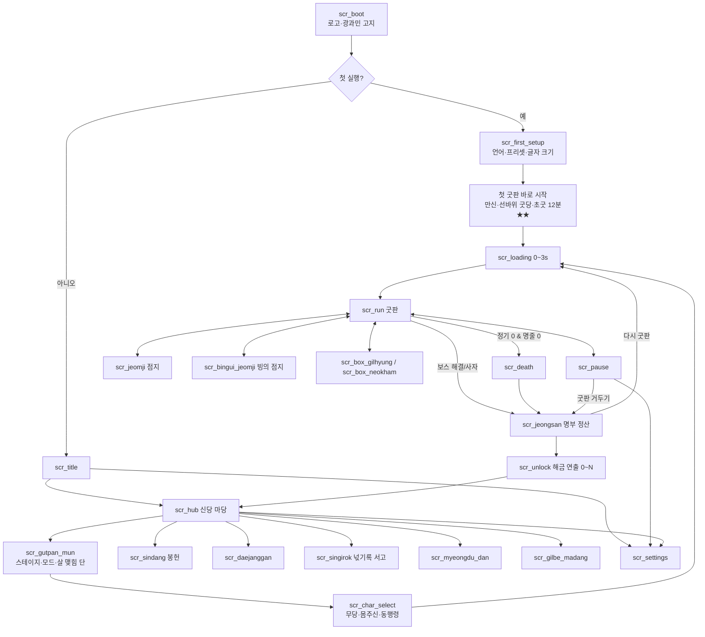

# 11. UX / UI / HUD / 조작 / 접근성 — 넋길: 해원굿

> **문서 상태:** v0.11 섹션 기획 초안 — 교차 리뷰 10건 반영(19장 '리뷰 대응 로그'), **캐논 v1.2 확정 결정 반영(문서 끝 '캐논 v1.2 반영 로그', 2026-11-21)**.
> **선행 문서:** `00-research.md`, `01-concept-and-canon.md` (**캐논 v1.2 기준**). 결정 근거는 `99-open-questions-and-next-steps.md` 1장(D-xx)·2장(C-xx). 이 문서는 캐논의 ID와 규칙을 그대로 쓴다. 새로 만든 ID와 항목은 **[NEW]**로 표시하고 0.4절에 모았다.
> **방법론:** `game-ui-ux`(앵커 레이아웃, 정수배 스케일, 세이프 에어리어, 포커스 내비게이션, 화면 스택, 이벤트 기반 HUD), `game-feel`(중요도 티어, trauma 셰이크, 히트스톱, 피드백 레이어링, 접근성 토글). 그 밖에 Steam Deck 호환성 기준, Xbox Accessibility Guidelines 101/102/118, Game Accessibility Guidelines, WCAG 2.3.1을 근거로 삼았다(출처는 18장).
> **수치 원칙:** UI 좌표와 크기는 모두 **640×360 논리 픽셀(이하 lpx)** 단위다. 화면 배율은 정수배만 쓴다. 시간은 ms 또는 초로 쓰고, 기본값과 범위를 함께 적는다.
> **동반 데이터 파일 [NEW]:** `data/ui_hud_layout.json`, `data/input_bindings.json`, `data/accessibility_options.json`, `data/feedback_matrix.json`, `data/onboarding_hints.json`

---

## 목차

0. 문서 범위·참조 규칙·[NEW] 목록
1. UX 필러와 설계 원칙
2. 해상도·스케일·세이프 에어리어·타이포그래피·색
3. 화면 흐름도와 화면 스택(상태기계)
4. 아웃게임 화면 와이어프레임 (부팅 → 타이틀 → 신당 → 굿판 문 → 무당 선택)
5. 인게임 HUD — 요소, 배치, 상태, 이벤트
6. 월드 공간 UI와 가독성 레이어 (풀릴 기색, 길베, 고리, 오프스크린)
7. 점지(레벨업) UI와 시련(신령 선택) UI
8. 길흉 상자·넋함 연출 UI (엽전 홀짝 점복 / 산통점)
9. 일시정지·사망·명줄·정산 화면
10. 넋기록 서고(도감) UI와 로비 시설 UI
11. 입력: 키보드·마우스·게임패드·스팀덱
12. 접근성 (색약, 흔들림·플래시, 조준 보조, 폰트, 자막, 난이도 보조)
13. 온보딩: 첫 세 판 설계 (점진 개방·초굿)
14. 피드백 레이어: VFX·SFX·셰이크·히트스톱·햅틱 매트릭스
15. 텍스트·로컬라이즈 UI 규칙
16. 구현 사양 (이벤트 버스, 화면 스택, 성능 예산, 엔진 매핑)
17. 검증 계획 (UX 테스트·텔레메트리·수용 기준)
18. 열린 질문·출처
19. 리뷰 대응 로그

---

# 0. 문서 범위 · 참조 규칙 · [NEW] 목록

## 0.1 범위

| 포함 | 제외 (담당 섹션) |
|---|---|
| 화면 흐름, 모든 화면의 와이어프레임, HUD 요소와 배치, 월드 공간 UI 규칙, 점지·시련·상자·정산·도감 UI, 입력 매핑, 접근성 옵션, 온보딩, 피드백 매트릭스, UI 성능 예산 | 전투 판정 수치(→ 02-core-loop-combat), 무구 수치(→ 04-weapons-evolution), 시련 패턴(→ 06-deities-possession), 적 행동(→ 07-enemies-bosses), 스폰 테이블(→ 08-stages-waves), 재화 수치(→ 09-meta-economy), 스프라이트 제작(→ 13-art-direction), 오디오 믹스 버스(→ 12-audio), 넋두리 원문(→ 10-narrative-world) |

## 0.2 참조 표기

본문의 "→ 참조"는 아래 실제 섹션 파일을 가리킨다(2026-11-21 기준 `design/` 폴더). 아직 파일이 없는 섹션(밸런스, `15-balance.md` 예정)만 '섹션'으로 표기했고 파일이 생기면 치환한다(18.1).

| 표기 | 파일 | 이 문서가 기대는 내용 |
|---|---|---|
| → 02-core-loop-combat | `02-core-loop-combat.md` | 조작·이동 물리·카메라, 한 상태기계, 정지·재개 규칙(3.7), **피드백 티어 T0~T4·히트스톱·셰이크 수치(14장)** — 이 문서 14장의 정본 |
| → 03-characters | `03-characters.md` | 무당별 시작 무구·고유 능력 표기 |
| → 04-weapons-evolution | `04-weapons-evolution.md` | 무구·진화·결합 수치, 방향 무구 목록, 대체 보상 카드 |
| → 05-stats-passives | `05-stats-passives.md` | 스탯 표기, 패시브 수치 |
| → 06-deities-possession | `06-deities-possession.md` | 시련 패턴, 권능(설계 30 / 런 노출 신령당 4, 캐논 v1.2 D-23), 공수 |
| → 07-enemies-bosses | `07-enemies-bosses.md` | 적 행동, 보스 형태 |
| → 08-stages-waves | `08-stages-waves.md` | 스폰 테이블, 스테이지, 타임라인 |
| → 09-meta-economy | `09-meta-economy.md` | 재화 수치, 해금 순서, 봉헌 가격 |
| → 밸런스 섹션 | (미작성) | 봇 시뮬레이션 |
| → 10-narrative-world | `10-narrative-world.md` | 넋두리·공수·사연 원문 |
| → 12-audio | `12-audio.md` | 버스·덕킹·악기 레이어 |
| → 13-art-direction | `13-art-direction.md` | 팔레트 램프, **19층 렌더 레이어(2.10.2)**, 아이콘·UI 아트 |
| → 14-tech-production | `14-tech-production.md` | 엔진, 세이브, 텔레메트리, 성능 |

## 0.3 캐논에서 그대로 가져온 UX 제약 (변경 불가)

| 캐논 | UX에 주는 제약 |
|---|---|
| P1 하지 않을 것 | 처치 직전 퇴치/해원 선택 팝업 금지. 타깃 락온·수동 사격 입력 금지. 무구 색은 적/백 2색 고정 |
| P3 하지 않을 것 | '선/악·카르마·죄' UI 용어 금지. 퇴치에 질책 연출 금지 |
| P4 하지 않을 것 | 박자 판정·미스 표시 금지. 웨이브 사이 정비 화면 금지 |
| P5 하지 않을 것 | 전투 중 대화창·컷신 정지 금지(보스 등장 2초 이내 예외). **조작은 이동 1개 + 일시정지/메뉴뿐** |
| 3.1 | 기준 해상도 640×360 정수배, 가시 영역 약 20×11유닛 |
| 3.2.5 | 길닦음 연출은 다음 박에 스냅(≤250ms), 판정은 즉시. '자동 매듭'(스냅 2.5유닛)과 '고리 보조선' 접근성 옵션 |
| 3.2.6 | 살기 표기는 '굿판의 기운' 게이지(살 = 먹빛, 넋 = 한지빛) |
| 3.2.10 | 시련 선택은 화신 원에 걸어 들어가는 것. 화신은 HP바 대신 '위엄' 게이지 |
| 3.2.11 | 점지는 정지 화면 **3택 1, 조건부 4택(상한 4장)**(캐논 v1.2 D-19). 다시 묻기(재점)/물림/금기 |
| 3.2.10 + 06 7.7 | 빙의 직후 '빙의 점지'(정지, 2/3/4장, 교정만 가능, 물림·금기 불가) — 7.8절 |
| 6.1 | 팔레트 예약. 백은 풀릴 기색·길베·영가·해원 전용. 적 탄은 청·흑 전용이며 불투명. 플레이어 VFX 반투명 기본 70%(옵션 30~100%). 플레이어 발밑 고대비 링 |
| 4.14 | '소환수/펫/소멸/사망/살해/구매/상점/보스전(시련)' 표기 금지. '봉헌' 동사 |
| P2 (v1.2 D-06) | 이동은 **자유 이동(스틱 360°, 키보드 8방향)**. 런타임 캐릭터 스프라이트는 4방향, 로비는 8방향(D-11) |
| 3.2.10 (v1.2 D-01) | 시련 4회 03:00 / 06:30 / 12:30 / 15:30, 시련 30초 + 선택 단계(DESCEND) 최대 8초, 위엄·가호 두 게이지 동시 진행·먼저 찬 쪽이 결과, 고르지 않은 후보는 다음 시련 1회만 물러남. 18:00 신령 합일 = 모신 신령 전원 |

## 0.4 [NEW] 목록 (캐논 추가 요청)

> 모두 `[CANON-REQUEST]` 대상이다. UI 내부 ID는 게임 규칙을 바꾸지 않는다. 규칙에 영향을 주는 제안 2건(★ 첫 굿판 완화, ★★ 초굿 모드)은 08-stages-waves의 합의가 필요하다. 시련 다시 묻기 입력은 06-deities-possession 4.4의 산통 오브젝트를 그대로 쓴다.

| 범주 | ID / 이름 | 사유 |
|---|---|---|
| 화면 ID | `scr_boot`, `scr_first_setup`, `scr_title`, `scr_hub`, `scr_gutpan_mun`, `scr_char_select`, `scr_loading`, `scr_run`, `scr_pause`, `scr_jeomji`, `scr_bingui_jeomji`(v0.10, 7.8), `scr_box_gilhyung`, `scr_box_neokham`, `scr_death`, `scr_jeongsan`, `scr_unlock`, `scr_settings`, `scr_singirok`, `scr_sindang`, `scr_daejanggan`, `scr_myeongdu_dan`, `scr_gilbe_madang`, `scr_confirm` | 화면 스택 키, 로컬라이즈 키, 텔레메트리 키 |
| HUD 요소 | `hud_wonhon_bar`, `hud_clock`, `hud_geori_label`, `hud_ritual_slot`, `hud_gutpan_giun`, `hud_sal_maedeup`(v0.10부터 기운 바 내장 눈금), `hud_gangsin_slots`, `hud_weapon_slots`, `hud_passive_slots`, `hud_currency`(v0.10 기본 숨김), `hud_sinmyeong_jing`(v0.10 발밑 호), `hud_haengnyeol_count`(v0.10 발밑 호), `hud_combo`, `hud_neokduri_lane`, `hud_gongsu_lane`, `hud_offscreen`, `hud_player_jeonggi`, `hud_status_icons`, `hud_boss_bar`, `hud_trial_gauge`, `hud_trial_countdown`, `hud_hp_corner`, `hud_hint_line`, `hud_sintong_seal`(v0.10), `hud_trait_tier_banner`(v0.10, 월드 텍스트) | 레이아웃 데이터 키 |
| 입력 액션 | `in_neokduri_log` 넋두리 로그 토글 | 02-core-loop-combat 3.1의 'Tab 누르는 동안' 로그 오버레이를 **토글**로 바꾼다(U6 홀드 0). 비정지 보기 전용. **캐논 v1.2 D-08: 토글 채택, P5 '이동 + 일시정지/메뉴' 입력 원칙에 포함(보기 전용 메뉴)** |
| 규칙 제안 ★ | 첫 굿판 완화 `sys_first_gutpan_assist` | 프로필 첫 2런: ① 00:00~03:00 스폰 예산 −20% ② 00:00~00:20 스폰 풀을 객귀·아귀로 바꾸고 00:20에 달걀 무리를 정면 배치(`evt_pullil_demo`) ③ 첫 런 어둑시니 미등장. 13.0절. → 08-stages-waves 합의 필요 |
| 규칙 제안 ★★ | 초굿(初굿) 12분 압축 굿판 `mode_chogut` | 프로필 첫 1~2런 전용. 첫 세션(60분) 안에 뒷전·보스 결말·마지막 행렬을 보게 한다. 13.0절. → 08-stages-waves 14장 모드 추가 합의 필요 |
| 온보딩 | 점진 개방표 `onboarding_unlock_run` | 런 1~3에 걸쳐 시스템·HUD·힌트를 나눠 연다(13.0). `data/onboarding_hints.json` `unlock_run` 필드 |
| UI 용어 | `ui_haewon_combo` 연속 해원 / `ui_toechi_combo` 연속 퇴치(v0.10) | G5 구경꾼 추임새의 카운터(간격 2.0초 이내). 퇴치에도 같은 크기·같은 임계의 콤보와 벽사 추임새를 둔다(5.2, U5) |
| 시스템 표시 | `sys_sintong` 신통 HUD 인장, 고유 패시브 단계 배너 | 03-characters 2.7·2.8의 표시 요구. 용어 `sys_sintong`의 4.14 등록은 03이 요청(03 C15·인계표) |
| UI 용어 | ~~`ui_gilhyung_pyeong/gil/daegil` 평·길·대길~~ → **폐기(캐논 v1.2 C-18).** 상자 결과 등급은 02 §18.1 정본 `jg_sogil` 소길 / `jg_junggil` 중길 / `jg_daegil` 대길을 그대로 쓴다 | 상자 보상 1/3/5개를 엽전 점괘로 표기. '흉'은 쓰지 않는다 |
| 옵션 | `opt_*` 59종 (12장, `data/accessibility_options.json`) | 설정 키 |
| 보조 모드 | `opt_assist_bosalpim` 보살핌 | 피해 ×0.5(파이프라인 위치는 12.7), 보살핌 명줄 1. 순위표 제외 인장. 런 기록 플래그 `assist_used` |
| 보조 옵션 | `opt_game_speed` 굿판 빠르기 70/85/100% | 운동·인지 접근성. 순위표 제외 |
| 온보딩 | `hint_*` 26종 (13장, `data/onboarding_hints.json`. v0.10: `hint_pullil_seen`을 `hint_white_weapon`에 병합, `hint_gyeoldan_first`·`hint_dwitjeon`·`hint_sinmyeong`·`hint_hud_full_offer`·`hint_sintong_first` 추가) | 힌트 트리거 키 |
| 입력 액션 | `in_move`, `in_pause`, `in_mouse_move`, `in_neokduri_log`, `ui_*` 13종 (11장) | 리매핑 키 |
| 팔레트 보조 | `pal_cheong_rim` #5f93de(아트 `ch` 램프 값 재사용), `pal_jeok_light` #e0524a, `pal_cb_jeok` #d94a8c, `pal_panel` #2a2238, `pal_ink_text` #3a2f2a | 대비 미달 보완(2.5절 계산 근거) |
| 폰트 | `font_galmuri`(갈무리 7/9/11/14), `font_fusion_pixel`(간체 대체), `font_readable`(비픽셀 가독 글꼴) | 폰트 스택. 픽셀 폰트는 Galmuri + Fusion Pixel(둘 다 OFL) 조합으로 확정(캐논 v1.2 D-56) |

---

# 1. UX 필러와 설계 원칙

## 1.1 UX 필러 (게임 필러의 UI 번역)

| UX 필러 | 연결 필러 | 정의 | 판정 기준 (17장) |
|---|---|---|---|
| **U1. 가운데는 굿판, 가장자리는 기록** | P5 | 상시 HUD는 화면 테두리 띠 안에만 둔다. 중앙 타원(400×220 lpx)에는 상시 UI를 두지 않는다. 예외는 **플레이어 마커에 붙는 것**(발밑 링·정기 바·발밑 호 2개, 5.2)뿐이다. 런 중 결정에 쓰이지 않는 숫자(넋·엽전·처치 누계)는 기본으로 숨기고 일시정지·정산에서 보인다 | 상시 HUD 면적 ≤ 화면의 **8%**(v0.10, 5.4) |
| **U2. 흰빛은 해원만 말한다** | P1, 6.1 | 월드에서 순백(#f2ece0)은 풀릴 기색 외곽선·길베·영가·해원 빛에만 쓴다. **백 무구 VFX도 순백을 쓰지 않는다**(한지 반투명 50% + 재질 패턴, → 13-art-direction 2.6.3). UI 패널은 한지(#e9dcc0)로 백과 분리한다. 모든 상태는 **색 + 모양 + 움직임** 3중으로 인코딩한다 | 적 300마리 장면에서 풀릴 기색 개체 인지 ≤ 0.5초(테스터 80%). 백 빌드 오라 안에서도 같은 기준(UX-1b) |
| **U3. 멈추는 화면은 다섯뿐** | P4, P5 | 게임이 멈추는 화면은 점지, **빙의 점지**, 상자, 일시정지, 사망(명줄 없을 때) 다섯뿐이다. 그 밖의 모든 정보(넋두리, 공수, 시련 예고, 힌트, 빙의 연출)는 비정지 오버레이로 전한다 | 정지 화면 평균 체류 ≤ 4초(점지·빙의 점지), ≤ 3초(상자 기본 연출) |
| **U4. 위협은 즉시, 보상은 박에** | P4 | 피격·위험·적 등장 피드백은 지연 0ms. 보상 연출(길닦음 덩, 해원 빛 상승, 공덕 팝)은 다음 그리드 경계(2분박 1/2박, 3분박 1/3박 — 캐논 v1.2 D-18)에 스냅(≤250ms). 판정은 언제나 즉시 | 피격 피드백 지연 측정 ≤ 1프레임 |
| **U5. 도덕이 아니라 기운** | P3 | 퇴치와 해원은 '점수'가 아니라 '굿판의 기운'(먹 ↔ 한지)으로만 표시한다. 수치 비교는 정산에서만 보이고, 두 순위표는 동등하게 다룬다 | 퇴치 성향 플레이어의 "질책받는 느낌" ≤ 15% |
| **U6. 걷기만 해도 알 수 있다** | P5 | 모든 UI 조작은 '이동 + 확인/취소' 두 축으로 끝난다. 홀드 입력과 동시 입력은 두지 않는다 | 한 손 프리셋으로 전 기능 도달 가능 |

## 1.2 설계 원칙 (판단 규칙)

1. **정보 위계 3층.** ① 생존(정기, 위협) → 플레이어 몸과 중앙에 붙임 ② 결정(풀릴 기색, 길베, 고리, 시련 원, **행렬 크기·신명**) → 월드 공간·플레이어 발밑 ③ 진척(시계, 레벨, 슬롯) → 화면 테두리. *의도: VS류는 시선이 플레이어 주변 반경 약 100lpx에 머문다. 생존 정보와 '지금 고리를 닫을까'를 정하는 정보(행렬·신명)를 테두리에 두면 시선이 왕복하다 죽는다. v0.10에서 시선 지점을 상단·하단·발밑 3곳에서 **상단·발밑 2곳**으로 줄였다.*
2. **테두리 게이지는 최대 2개만 상시 노출한다**(원혼 구슬 바, 굿판의 기운 바 — 살 매듭 눈금 내장). 신명과 행렬은 발밑 호(arc) 2개로 압축한다. *의도: 캐논 2.2에서 "게이지 3~4개, HUD 시선 분산"을 이유로 폐기한 결정을 HUD에도 그대로 적용한다.*
3. **박자 트랙(스크롤 노트 띠)은 만들지 않는다.** 컨셉 목업(`art/ui/hud_rhythm_elements.png`)의 장단 트랙은 신명 호의 박 펄스 하나로 대체한다. *의도: 스크롤 노트는 "타이밍 맞춰 누르라"는 장르 신호를 줘서 P4(판정 없음)와 충돌한다.*
4. **숫자보다 사물.** 넋은 '넋전 종이' 아이콘, 엽전은 '엽전', 살기는 기운 바 아래 '살 매듭' 눈금 3개로 표시하고, 숫자는 보조로만 쓴다. *의도: 무속 세계관 몰입 + 언어 독립성.*
5. **모든 정지 화면은 0.35초 입력 잠금 + 중립 복귀 조건을 가진다.** *의도: 이동 스틱이나 키를 누른 채 점지가 뜨면 의도하지 않은 카드가 선택되는 VS류 고질 문제를 막는다.*
6. **상태 변화는 이벤트로 그린다.** HUD는 게임 상태를 폴링하지 않는다(16장 이벤트 목록).
7. **두 길 대칭 표기 (v0.10).** 퇴치와 해원은 UI 피드백의 **양과 질**이 같아야 한다. 해원 쪽에 붙는 UI(콤보·추임새, 결말 연출, 도감 완성 보상 칸, 사망 카드 조언, 정산 보너스 줄)는 퇴치 쪽에도 같은 크기·같은 위치·같은 임계로 둔다. 스탯·무구 툴팁에는 경고 아이콘·붉은 글자를 쓰지 않고 **양쪽 결과를 함께 보여 주는 중립 정보**만 쓴다(예: "한 파열 약 30% · 풀릴 기색 약 70%"). *의도: 재화 총량이 ±3%로 맞아도(→ 09) 피드백이 한쪽으로 쏠리면 플레이어는 '해원이 정답'이라고 배운다(P3 위반). UI가 만드는 쏠림은 UI가 책임진다.*

---

# 2. 해상도 · 스케일 · 세이프 에어리어 · 타이포그래피 · 색

## 2.1 렌더 구조

```
[월드 뷰포트 640×360(+확장)] ──정수배 업스케일──┐
[월드 UI 레이어(풀릴 기색 외곽선 패스, 오프스크린 화살표, 발밑 링)] ─┤──→ 화면
[스크린 UI 캔버스 = 화면 / UI 배율] ───────────────┘
```

| 항목 | 값 | 설계 의도 |
|---|---|---|
| 월드 기준 | 640×360 lpx, 정수배 업스케일(nearest) | 캐논 3.1. 픽셀 그리드 보존 |
| 월드 배율 `S_world` | `floor(min(W/640, H/360))` | 720p ×2, 1080p ×3, 1440p ×4, 4K ×6, 스팀덱 1280×800 ×2 |
| 남는 픽셀 처리 | **가시 영역 고정 + 레터박스**(→ 02-core-loop-combat 4.1: 20.0×11.25유닛, 줌 고정). 남는 픽셀은 한지 무늬 프레임 레터박스 | 화면비가 시야 이득이 되지 않게 한다(순위표 공정성). 스팀덱 1280×800은 ×2 = 1280×720 + 위아래 40px, 21:9 2560×1080은 ×3 = 1920×1080 + 좌우 320px |
| 레터박스 HUD [NEW] | `opt_letterbox_hud`(16:10·21:9에서 기본 켬): 원혼 바와 시계를 위쪽 레터박스로, 무구·패시브 슬롯을 왼쪽 필러박스(21:9)로 옮긴다 | 버려지는 화면을 HUD에 써서 게임 영역의 HUD 점유를 줄인다(U1). 스팀덱 위 띠는 20 lpx 높이라 원혼 바(6) + 시계(T2)가 들어간다 |
| 스크린 UI 배율 `S_ui` | 기본 = `S_world`. 옵션 'UI 크기'로 −1/0/+1 (최소 2, UI 논리 캔버스가 480×270 미만이 되는 값은 막음) | 1080p에서 UI +1 → ×4 → UI 논리 480×270. 앵커 레이아웃이 남은 공간에 맞춰 재배치한다 |
| 서브픽셀 카메라 | 월드는 640×360+2px 여유로 렌더한 뒤 출력 해상도 픽셀 단위로 오프셋을 준다 | 셰이크와 추적을 부드럽게 하면서 픽셀 그리드를 유지한다. → 14-tech-production |

## 2.2 세이프 에어리어

| 항목 | 기본 | 옵션 |
|---|---|---|
| 상시 HUD 여백 `safe_margin` | 8 lpx (상하좌우) | `opt_safe_margin` 0~5% (TV 오버스캔). 콘솔 기본 5% |
| 앵커 규칙 | 모든 HUD 요소는 9점 앵커 중 하나 + 오프셋. 절대 좌표 금지 | — |
| 중앙 금지 타원 | 화면 중심 기준 400×220 lpx 타원 안에 상시 UI 금지(일시 텍스트 슬램은 0.8초 이하 허용) | — |
| 레터박스 영역 | `opt_letterbox_hud`가 꺼져 있으면 HUD는 게임 영역에 앵커한다. 켜져 있으면 2.1 표의 요소만 레터박스로 옮긴다 | — |

## 2.3 타이포그래피

### 2.3.1 폰트 스택 [NEW]

| 역할 | 기본 폰트 | 크기(lpx) | 1080p 실픽셀 | 스팀덱 실픽셀 | 사용처 |
|---|---|---|---|---|---|
| 표제 T1 | 갈무리14 (Galmuri14) | 15 | 45 | 30 | 화면 제목, 진화명 슬램, 정산 결말 |
| 본문 T2 | 갈무리11 (Galmuri11, Bold 포함) | 12 | 36 | 24 | 카드 이름, 넋두리·공수 자막, 메뉴 항목 |
| 보조 T3 | 갈무리9 | 10 | 30 | 20 | 카드 설명, 툴팁, 거리명 |
| 숫자 T4 | 갈무리7 (숫자·라틴만) | 8 | 24 | 16 | HUD 카운터, 레벨 핍, 시계 보조 |
| 간체 중국어 대체 | Fusion Pixel Font 10/12px (zh_hans) | 10/12 | — | — | 갈무리가 간체를 보장하지 않음 |
| 붓글씨 슬램 | 수작업 픽셀 레터링 스프라이트(폰트 아님) | 24~48 | — | — | "얼씨구/좋다/잘한다/그렇지!", 진화명, 길닦음 |
| 가독 글꼴 옵션 | 비픽셀 고딕(Pretendard 계열, OFL) — 스크린 UI 고해상도 레이어로 렌더 | 동일 크기 | — | — | `opt_font_readable` |

- **스팀덱 기준 충족:** 화면의 최소 문자는 T4 8 lpx × 2 = **16px**다. Valve 기준(1280×800에서 최소 9px, 권장 12px)을 충족한다.
- **PC 1080p 기준:** 최소 본문 T3 10 lpx × 3 = 30px로, Xbox AG101의 PC 최소 18px를 넘는다. 단 **UI 크기 −1(×2)** 에서는 T3 = 20px다. 이 값도 18px 이상이라 허용한다.
- **한글 최소 규칙:** 한글은 T3(10 lpx) 미만으로 쓰지 않는다. 갈무리7의 한글은 4,358자로 제한되어 있어 숫자·라틴 전용으로 쓴다.
- **글자 크기 옵션 `opt_text_size`:** 기본(T1~T4) / 크게(한 단계씩 상향: T4→T3 크기, T3→T2, T2→T1, T1→T1×2 레터링) / 아주 크게(크게 + UI 크기 +1 강제). '아주 크게'는 1080p 기준 본문 36→48px(133%), UI 크기 +1과 합치면 기본 대비 약 **200%**다(Xbox AG101 200% 권고).
- **줄 간격:** T2 = 16 lpx, T3 = 13 lpx. **자간:** 0. **외곽선:** 월드 위 텍스트(자막, 피해 숫자)는 1 lpx 먹색(#0e0b16) 외곽선 + 50% 그림자, 패널 위 텍스트는 외곽선을 쓰지 않는다.

## 2.4 UI 색 토큰

| 토큰 | HEX | 용도 | 비고 |
|---|---|---|---|
| `pal_bg` | #0e0b16 | 월드 배경, 정지 화면 딤(80%) | 캐논 |
| `pal_hanji` | #e9dcc0 | 패널 바탕, 넋 쪽 게이지, UI 본문 글자(어두운 패널 위) | 캐논 |
| `pal_panel` [NEW] | #2a2238 | 어두운 패널 바탕(HUD 칩, 툴팁) | 한지 글자 대비 11.17:1 |
| `pal_ink_text` [NEW] | #3a2f2a | 한지 패널 위 본문 글자 | 한지 위 9.55:1 |
| `pal_baek` | #f2ece0 | **월드 전용**(풀릴 기색, 길베, 영가, 해원). UI에서는 '해원' 아이콘에만 허용 | 캐논 예약 |
| `pal_jeok` | #c8322d | 적 무구 VFX, 퇴치 파열, 적 무구 카드 테두리 | 캐논. 먹 배경 대비 3.66:1. 그래픽 요소로는 3:1을 넘지만 작은 글자에는 쓰지 않는다 |
| `pal_jeok_light` [NEW] | #e0524a | 먹 배경 위 붉은 **글자**·작은 아이콘 | 먹 배경 대비 5.08:1 |
| `pal_hwang` | #e8b931 | 엽전, 상자, 공덕 숫자, 등불, 포커스 테두리 | 캐논 |
| `pal_cheong` | #2a5caa | 적 탄 몸통, 물 | 캐논. 먹 배경 대비 **2.98:1로 3:1 미달** |
| `pal_cheong_rim` [NEW 토큰명] | #5f93de | **적 탄 1 lpx 외곽 림**(필수). 값은 → 13-art-direction `ch` 램프 2번째 색. '강하게' 모드는 아트 `accessibility_overrides.enemy_bullet_alt_rim` 1번 #a9caf5 | 먹 배경 대비 6.23:1(#a9caf5는 11.55:1). 적 탄 시인성 보완 |
| `pal_heuk` | #1a1a1a | 외곽선, 적 탄 코어 | 캐논 |
| `pal_focus` | #e8b931 2 lpx 테두리 + 1 lpx 먹 외곽 | 키보드·패드 포커스 | 색 외에 두께와 모서리 장식(단청 모서리 4 lpx)으로도 구분 |

## 2.5 대비·색약 검증 결과 (계산값)

> WCAG 상대 휘도 공식으로 계산했다. 색약 시뮬레이션은 Machado 2009 행렬(심도 1.0)을 썼다. ΔE는 CIELAB 76 기준이다. 스크립트 재현 방법은 17.4절에 있다.

| 쌍 | 일반 대비비 | 판정 | 조치 |
|---|---|---|---|
| 한지 글자 / 먹 배경 | 14.34 | 통과 | — |
| 적 #c8322d / 먹 배경 | 3.66 | 그래픽 통과, 작은 글자 미달 | 글자는 `pal_jeok_light` |
| 청 #2a5caa / 먹 배경 | **2.98** | **미달** | 적 탄에 `pal_cheong_rim` #5f93de(6.23:1) 1 lpx 외곽 필수. 아래 색약 표의 '청 림' ΔE는 초기 후보 #6f9be6 기준으로 계산했으며 #5f93de와의 차이는 ΔE 약 4로 결론에 영향이 없다 |
| 적 / 백 (퇴치 vs 해원) | 4.52 | 통과 | 모양 이중 인코딩 유지 |
| 백 / 한지 | 1.15 (ΔE 10.4) | **유사** | 도량 바닥(한지) 위의 길베(백)에는 1 lpx 먹 테두리 |

| 색약 유형 | 적(#c8322d) 시뮬 | 적/먹 대비 | 적/황 ΔE | 판단 |
|---|---|---|---|---|
| 1형(protan) | #60562b | **2.65** | 61.3 | 적 VFX가 어두워져 묻힌다 → 색약 모드에서 적을 `pal_cb_jeok` #d94a8c(연지)로 바꾼다. 대비 3.89, 황과 ΔE 97.1 |
| 2형(deutan) | #857727 | 4.32 | **37.9** | 엽전(황)과 적 무구 VFX가 비슷해진다 → 같은 연지 치환(황과 ΔE 71.3) |
| 3형(tritan) | #dc0033 | 3.79 | 56.4 | 적은 문제없다. 청 탄 림과 백의 ΔE 46.6으로 유지된다. 황/백 ΔE가 34.8로 낮아 엽전 아이콘에 사각 구멍(엽전 모양)을 필수로 둔다 |

*설계 의도: 적→연지 치환은 붉은 계열(전통 연지·진분홍)이어서 세계관 톤을 깨지 않는다. 1·2형 색약에서도 황(엽전)·청(적 탄)과 구분된다.*

---

# 3. 화면 흐름도와 화면 스택

## 3.1 전체 흐름



- **첫 실행 예외:** 첫 실행은 타이틀과 신당을 건너뛰고 첫 굿판으로 바로 들어간다(13장). 프로필 첫 1~2런은 초굿(`mode_chogut` ★★, 12분)이 기본이다. 굿판 문에서 '표준 굿판(20분)'을 직접 고르면 바로 표준으로 갈 수 있다(장르 숙련자 존중). *의도: 첫 60초 안에 '깎고 푼다'를 체험하게 하고, 첫 30분 안에 뒷전·보스 결말까지 보게 한다(13.0). 로비 메타는 첫 사망 또는 첫 결말 뒤에 의미가 생긴다.*
- **두 번째 실행부터:** 타이틀 → (계속 키) → 신당 마당. 타이틀에서 '바로 굿판'을 고르면 마지막 설정으로 곧장 굿판 문을 건너뛰고 로딩한다(재도전 마찰 최소화).

## 3.2 화면 스택 규칙

| 규칙 | 내용 |
|---|---|
| 스택 모델 | `push(screen)`, `pop()`, `replace(screen)`. 맨 위 화면만 입력과 포커스를 가진다 |
| 게임 정지 | `scr_run` 위에 `scr_pause / scr_jeomji / scr_bingui_jeomji / scr_box_* / scr_settings / scr_confirm`이 올라오면 런 시계와 물리가 정지한다(캐논 3.1). 신통 타이머도 정지한다(→ 03-characters 2.8). 오디오는 → 02-core-loop-combat 3.7(일시정지: LPF 800Hz −12dB, 점지·빙의 점지·상자: LPF 1.2kHz −8dB, 음악 계속 재생), SFX 일시정지 |
| 포커스 복원 | pop 시 아래 화면은 직전 포커스 위치를 복원한다 |
| 뒤로 | `ui_cancel` = pop. 단 `scr_run`에서 `ui_cancel`은 아무 동작도 하지 않는다(실수 일시정지 방지). 일시정지는 `in_pause`로만 |
| 모달 | `scr_confirm`은 포커스를 가둔다. 기본 포커스는 항상 **안전한 쪽**(취소) |
| 겹침 금지 | `scr_jeomji`, `scr_bingui_jeomji`, `scr_box_*`는 동시에 뜨지 않는다. 대기열 순서: **빙의 점지**(빙의 연출 1.2초가 끝나는 즉시. 2신 자동 빙의면 2회 연속) → 상자 → 점지(레벨업 여러 번이면 연속). 정지 화면이 연속으로 이어질 때는 사이에 재개 램프·여운 무적을 넣지 않고 **마지막 화면이 닫힐 때 한 번만** 적용한다 |
| 자동 일시정지 | 창 포커스 상실, 패드 연결 끊김, 스팀덱 절전 → `push(scr_pause)`. 정지 화면이 이미 위에 있으면 무시 |

## 3.3 화면별 전이 표

| 화면 | 진입 | 기본 포커스 | `ui_confirm` | `ui_cancel` | 나가기 |
|---|---|---|---|---|---|
| `scr_title` | 부팅 후 | [굿판 이어가기] | 선택 항목 | 종료 확인 | 신당 / 설정 / 종료 |
| `scr_hub` | 타이틀, 정산 | 무당(플레이어 캐릭터) | 가까운 시설 열기 | 일시정지 메뉴(허브용) | 시설 화면 push |
| `scr_gutpan_mun` | 굿판 문 시설 | 마지막 선택 스테이지 | 다음(무당 선택) | pop | `scr_char_select` |
| `scr_char_select` | 굿판 문 | 마지막 무당 | 출정 | pop | `scr_loading` |
| `scr_jeomji` | 레벨업 이벤트 | 가운데 카드 | 카드 선택 | (무효) — 실수로 닫히지 않게 함 | pop → 대기열 |
| `scr_bingui_jeomji` | 빙의 연출 1.2초 종료(→ 06 7.7) | 가운데 카드(4장이면 왼쪽 두 번째) | 카드 선택 | (무효) | pop → 대기열(2신 자동이면 다음 빙의 점지) |
| `scr_box_*` | 상자 픽업 | [받기] | 연출 건너뛰기 → 받기 | 연출 건너뛰기 | pop |
| `scr_pause` | `in_pause` | [이어가기] | 항목 | pop(재개) | 설정 / 넋기록 / 굿판 거두기 |
| `scr_death` | 정기 0, 명줄 0 | [정산 보기] | 정산 | — | `scr_jeongsan` |
| `scr_jeongsan` | 런 종료 | [다시 굿판] | 항목 | [신당으로] | 로딩 / 해금 / 허브 |

---

# 4. 아웃게임 화면 와이어프레임

> 와이어프레임은 640×360 lpx 기준이다. 한글은 전각이라 고정폭 표기에서 정렬이 어긋날 수 있다. 좌표는 표의 수치를 정본으로 삼는다.

## 4.1 `scr_boot` — 로고·광과민 고지

```
┌──────────────────────────────────────────────────────────────┐
│                                                              │
│                [스튜디오 로고]  1.5s                          │
│                                                              │
│   ⚠ 광과민성 발작 주의                                         │
│   이 게임에는 빛의 번쩍임과 빠르게 움직이는 패턴이 있습니다.    │
│   설정 > 접근성에서 플래시·흔들림을 줄일 수 있습니다.           │
│                                                              │
│                         [아무 키나 눌러 계속]  (최소 2.0s 노출) │
└──────────────────────────────────────────────────────────────┘
```

| 항목 | 값 | 의도 |
|---|---|---|
| 고지 최소 노출 | 2.0초, 이후 아무 입력으로 진행. 5.0초 뒤 자동 진행 | 고지 의무를 지키면서 재실행 마찰을 줄인다 |
| 두 번째 실행부터 | 로고 1.0초 + 고지 1행 축약(하단 T3) | — |

## 4.2 `scr_first_setup` — 첫 실행 설정 (3단계, 총 ≤ 30초)

```
┌──────────────────────────────────────────────────────────────┐
│  1/3  언어  Language                                          │
│   ▶ 한국어      English      日本語      简体中文              │
│                                                              │
│  2/3  굿판 보기 프리셋                                         │
│   ▶ [기본]       표준 연출                                     │
│     [편안하게]   흔들림 30%·플래시 감소·히트스톱 끔              │
│     [또렷하게]   고대비·적 탄 강조·플레이어 VFX 50%              │
│                                                              │
│  3/3  글자 크기   [기본]  [크게]  [아주 크게]   ← 미리보기 문장  │
│        "…엄마 얼굴이 기억이 안 났어."                          │
│                                          [굿판 시작 ▶]        │
└──────────────────────────────────────────────────────────────┘
```

- **언어 자동 감지:** Steam 언어 또는 OS 로캘로 미리 고른다. 프리셋은 12장 옵션 묶음이며 나중에 개별로 바꿀 수 있다.
- *설계 의도:* 접근성을 '찾아 들어가는 메뉴'가 아니라 **첫 화면의 선택**으로 둔다(GAG: 첫 소리가 나기 전에 자막·설정 노출).

## 4.3 `scr_title`

```
┌──────────────────────────────────────────────────────────────┐
│ [키아트 key_art_gutpan 패럴랙스 3층, 촛불 깜박 0.5Hz]          │
│                                                              │
│            넋 길 : 해 원 굿                                    │
│            SOULPATH : Untie the Han                           │
│                                                              │
│                    ▶ 굿판 이어가기   (→ 신당)                  │
│                      바로 굿판       (마지막 설정)              │
│                      설정                                     │
│                      제작진                                    │
│                      나가기                                    │
│                                                v1.0.0  시드표기 │
└──────────────────────────────────────────────────────────────┘
```

| 요소 | 앵커 | 크기 | 비고 |
|---|---|---|---|
| 로고 | 상단 중앙, y=64 | 레터링 스프라이트 256×64 | 국문 위, 영문 아래(영문 로캘은 반대) |
| 메뉴 | 중앙 하단, y=196부터 18 lpx 간격 | T2 | 포커스 = 좌측 '▶' 붓 점 + 황 밑줄 |
| BGM | 진양조 장구 + 대금 드론 | — | → 12-audio |

## 4.4 `scr_hub` — 신당 마당 (걷는 허브 1화면)

*결정:* 허브는 **걸어 다니는 한 화면(20×11유닛)**이다. 시설에 다가가면(반경 1.5유닛) 말풍선 프롬프트가 뜨고 `ui_confirm`으로 연다. 바로가기 목록(`ui_tab_next`)으로 걷지 않고 열 수도 있다.
*의도:* ① 조작이 굿판과 같아서(이동) 무당 조작감을 계속 느낀다. ② '길베 마당'의 시각 보상(사연 완성 귀신이 걸어서 건너감)이 공간으로 존재해야 한다. ③ 로비 체류 목표 2~3분 안에서 시설 간 이동이 3초를 넘지 않는다(최대 거리 8유닛 ÷ 4유닛/s = 2초).

```
┌──────────────────────────────────────────────────────────────┐
│ 공덕 ◈ 1,240   복전 ● 380   명두 ◎ 4/12        [바로가기 Tab]  │
│                                                              │
│   [신당 hub_sindang]         [넋기록 서고]        [명두단]     │
│      무신도·신단                서가·두루마리       놋거울 제단  │
│                                                              │
│                 ○ 무당(플레이어)                               │
│      [대장간]                                      [굿판 문]   │
│      화로·모루        ~~~~ 길베 마당 (흰 길베가 문까지) ~~~~▶   │
│                                                              │
│  ▼ "봉헌할 수 있는 무구가 있다" (새 소식 점 3)                   │
└──────────────────────────────────────────────────────────────┘
```

| 요소 | 규칙 |
|---|---|
| 시설 배치 | 상단 3(신당, 넋기록 서고, 명두단), 하단 좌 대장간, 하단 우 굿판 문. 길베 마당은 화면 가로 띠(y 하단 1/3)로 굿판 문까지 이어진다 |
| 새 소식 점 | 시설 위 황 점 + 숫자(최대 9+). 조건: 봉헌·제작 가능 항목, 새 사연 조각, 미배분 명두점 |
| 시설 프롬프트 | 시설 위 말풍선 "[A] 신당 — 봉헌" (글리프는 입력 장치 따라 교체) |
| 바로가기 | `ui_tab_next` → 좌측 세로 목록(6 시설), 선택 시 무당이 자동으로 걸어간 뒤(최대 1.0초, 건너뛰기 가능) 연다 |
| 길베 마당 연출 | 런 정산 직후 허브 진입 시 새로 완성된 사연의 귀신이 길베를 따라 걸어간다. 1체당 4초, 여러 체면 0.8초 간격. 입력하면 2배속 |
| 고양이 | 컨셉 아트의 신당 고양이는 장식 NPC다. 다가가면 쓰다듬기 애니메이션만 나오고 기능은 없다 |

## 4.5 `scr_gutpan_mun` — 굿판 문 (스테이지·모드·살 맺힘 단)

```
┌──────────────────────────────────────────────────────────────┐
│ 굿판 문                                         ◀ LB  RB ▶    │
│ ┌────────────┐ ┌────────────┐ ┌────────────┐                │
│ │ 인왕산      │ │ 남도 갯마을  │ │ 동해안 별신 │   스테이지 카드  │
│ │ 선바위 굿당  │ │ 씻김굿판      │ │ 바닷가      │   (잠김=먹 실루엣)│
│ │ [썸네일]    │ │ [썸네일]    │ │ 🔒 남도 해원 │                │
│ │ 보스: 역려   │ │ 보스: 원결   │ │   필요      │                │
│ └────────────┘ └────────────┘ └────────────┘                │
│ 모드  ▶ 표준 굿판(20분)  자진모리(15분)  무한굿  오늘의 굿판     │
│ 살 맺힘 단  [ 0 ]  ◀ ▶     (단 0: 수정자 없음)                  │
│ ── 선택 요약 ────────────────────────────────────────────── │
│ 기록: 최장 20:00 클리어 · 해원 최고 1,822 · 한형 해결 2회       │
│ 고증: [무속] 서울 재수굿·진오기굿 / 거리 배치는 게임적 각색      │
│                                    [다음: 무당 고르기 ▶]       │
└──────────────────────────────────────────────────────────────┘
```

| 요소 | 규칙 |
|---|---|
| 스테이지 카드 | 160×120 lpx, 가로 스크롤. 잠긴 카드는 해금 조건 1줄(캐논 4.7 해금 열). v1은 스테이지 3장(캐논 v1.2 D-09). 선바위 굿당 보스 표시명은 `boss_yeokryeo` 역려(역병 잡귀 덩어리, 캐논 v1.2 D-03·C-03) |
| 모드 행 | 잠긴 모드는 회색 + 조건 툴팁(자진모리=첫 클리어, 무한굿=해당 스테이지 클리어). **초굿(12분)★★**은 프로필 런 1~2에만 맨 앞에 나오고 기본 선택된다. 옆에 "첫 굿판을 짧게 — 끝까지 보기" 1줄. 런 3부터 목록에서 빠지고 기본값이 표준이 된다(설정 '연습 굿판'에서 다시 켤 수 있다, 순위표 제외) |
| 오늘의 굿판 | UTC 리셋까지 남은 시간, "해원 순위 / 퇴치 순위" 두 탭을 같은 크기로 표시(U5) |
| 살 맺힘 단 | 0~15 스테퍼. 단을 고르면 수정자 목록이 아래로 펼쳐진다(누적 수정자는 각 1줄). 기본값 = 마지막으로 클리어한 단 +1 (최대 해금 단 이하) |
| 고증 태그 | 스테이지 카드 하단 `[무속]/[각색]` 배지. 7장 캐논 5 |

## 4.6 `scr_char_select` — 무당 고르기

```
┌──────────────────────────────────────────────────────────────┐
│ 무당 고르기                                                    │
│  ┌──┐┌──┐┌──┐┌──┐┌──┐                                         │
│  │만││박││단││명││심│   ← 초상 32×32, 잠김=실루엣+조건            │
│  └──┘└──┘└──┘└──┘└──┘                                         │
│ ┌───────────────────┐  만신 (萬神) · 강신무·서울                 │
│ │  [64px 스프라이트   │  "기준이 되는 무당. 빙의와 시련에 능하다."  │
│ │   굿춤 idle 루프]   │  시작 무구  ◆신칼(적)  ●방울(백, 0:30)      │
│ │                   │  고유  빙의 효과 +15% · 시련 충전 +15%      │
│ └───────────────────┘  성향  퇴치 ■■■□□  해원 ■■■□□            │
│ 몸주신  ◀ 산신 · 용왕 · 칠성 · 장군 · 바리 · 제석대감 ▶  (만신만) │
│ 동행령  ◀ 없음 / 달걀귀신 / 처녀귀신 ... ▶   (해금 시)            │
│ 기록  출정 12 · 클리어 3 · 최대 행렬 41                          │
│                                          [출정 ▶]             │
└──────────────────────────────────────────────────────────────┘
```

| 요소 | 규칙 | 의도 |
|---|---|---|
| 초상 그리드 | v1 5칸(만신·박수·단골·명두·심방). 잠김: 먹 실루엣 + 조건(캐논 4.1). 진척률 바(예: 해원 누적 312/500) | 다음 목표를 보여준다 |
| 무구 아이콘 | 적 무구 = **마름모 테두리 ◆ + 적 테두리**, 백 무구 = **원 테두리 ● + 한지 테두리** | 색 + 모양 이중 인코딩(U2) |
| 성향 막대 | 퇴치/해원 5칸 막대. 도덕 표현 없이 플레이 경향만 표시 | U5 |
| 몸주신 | 만신만 선택 가능(해금된 신령). 그 밖의 무당은 고정 표시 | 캐논 4.1 |
| 동행령 | 명두는 "동자령 + 1" 두 칸. `comp_dongja`는 기색 예고·귀띔만 하고 전투 판정이 없다 | 캐논 4.11, 캐논 v1.2 D-27·C-28 |
| 출정 | `ui_confirm`을 두 번 누를 필요가 없다(바로 로딩) | 재도전 마찰 최소화 |

## 4.7 `scr_loading`

- 목표 로딩 시간 ≤ 3초(스팀덱 기준). 1.0초 미만이면 로딩 화면을 생략하고 먹 페이드 0.4초만 쓴다.
- 표시: 먹색 화면 + 중앙 촛불 하나 + 하단 T3 '굿판 팁' 1줄(이미 본 힌트에서 무작위 선택, 아직 모르는 시스템은 스포일러 방지로 제외).
- 굿판 시작 연출은 캐논 3.4의 "00:00 먹색 화면 → 장구 덩에 등불 점화"와 이어진다. 로딩이 끝나면 먹색을 유지한 채 첫 '덩'에 맞춰 HUD가 0.3초 페이드인한다.

---

# 5. 인게임 HUD — 요소, 배치, 상태, 이벤트

## 5.1 HUD 전체 와이어프레임 (640×360 lpx, 'HUD 전체' 모드 — 런 4부터 기본, 5.3)

> v0.10 개정: 시선 지점을 **상단 띠 + 플레이어 발밑** 2곳으로 줄였다. 하단 중앙 블록(행렬·징·콤보 3칸)을 없애고 행렬·신명은 발밑 호로, 콤보는 연속이 있을 때만 뜨는 칩으로 바꿨다. 넋·엽전·처치 누계는 기본 숨김이다.

```
x: 0  8  26                       260   320   380                    632 640
y:0 ┌──────────────────────────────────────────────────────────────────────┐
  4 │ ▓▓▓▓▓▓▓▓▓▓▓▓▓▓▓▓▓▓▓▓▓▓▓▓▓▓▓▓▓▓▓░░░░░░░░░░░░░░░░░░░░░░░░░░░ Lv 23        │ hud_wonhon_bar (6px)
 14 │ ㉧ ◆◆◆●●○ (무구 6)                 12:34                 ◇○◇○ (강신 4)  │ ㉧ = hud_sintong_seal
 34 │    ▫▫▫▫▫▫ (패시브 6)            [시련 0:41]  (≤60초만)                   │
 46 │                         ┃한지▓▓▓▓▓▓|░|░░░먹┃ ← 굿판의 기운 (넋 비율)        │ hud_ritual_slot
 53 │ ⛨2 ✚1 (상태)             ╘══⦿═════⦿═════○══╛ ← 살 매듭 눈금 25/50/75     │ (같은 슬롯 아래 3px)
 64 │                    「 산이 운다… 」 (공수 자막 레인)                      │
    │                                                                      │
    │                        ( 중앙 금지 타원 400×220 )                       │
    │                       신명 ◜   ◎ 무당   ◝ 행렬   ← 발밑 호 2개          │
    │                               ▔▔▔▔ 정기 바                             │
    │                                                                      │
276 │                [힌트 줄] 흰 테두리 귀신을 방울 소리 안으로                 │
296 │               "…엄마 얼굴이 기억이 안 났어."  — 달걀귀신 (넋두리 레인)     │
326 │                     ● 해원 37    ◆ 퇴치 12   (연속 ≥5일 때만)             │ hud_combo
360 └──────────────────────────────────────────────────────────────────────┘
   거리·장단 라벨은 거리 전환 뒤 8초만 시계 아래(y=26)에 보인다. 넋·엽전·처치 누계는 일시정지·정산에서 본다.
```

## 5.2 HUD 요소 명세

| ID [NEW] | 이름 | 앵커 / 오프셋(lpx) | 크기(lpx) | 내용·인코딩 | 갱신 이벤트 | 설계 의도 |
|---|---|---|---|---|---|---|
| `hud_wonhon_bar` | 원혼 구슬 바 | 상단 가로 늘이기, (8,4)~(−8,10) | 624×6 | 한지 채움, 90~100%에서 황 반짝임 1Hz. 우측 끝 "Lv 23" T4 | `xp_changed`, `level_up` | VS 문법 그대로라 학습 비용 0. 최상단은 시선 방해가 가장 적다 |
| `hud_sintong_seal` (v0.10) | 신통 인장 | 좌상단 (8,14) | 14×14 원형 | 무당별 문장 인장(문장 도안 → 13-art-direction). **READY** = 한지 100% + 황 1 lpx 테 / **ACTIVE** = 박마다 1.15배 맥동 + 바깥 1 lpx 링 회전 / **COOLDOWN** = 먹 60% 덮개가 시계 방향으로 걷힘. 숫자 없음(→ 03-characters 2.8). 산판점처럼 결과가 있는 신통은 결과 글자(大吉/吉/凶, 03 7.7)를 인장 위에 2초 겹친다 | `sintong_state_changed` | HUD에는 초상화가 없으므로 인장이 '내 무당'의 표지와 신통 상태를 겸한다. 상태 3종은 모양(맥동·덮개)으로도 구분된다(U2). 런 1~2(초굿) 동안 숨김(13.0) |
| `hud_weapon_slots` | 무구 6칸 | 좌상단 (26,14) | 16×16 ×6 (간격 2) = 106×18 | 아이콘 14×14. 적 = 마름모 모서리 테두리, 백 = 둥근 테두리, 결합 = 반반 테두리. 아래 레벨 핍 8개(2×1 lpx). 진화 조건 충족 = 테두리 황 맥동(박 동기) | `weapon_added`, `weapon_leveled`, `evo_ready` | 진화 준비를 상자 줍기 전에 알려 줘서 동선 결정을 돕는다 |
| `hud_passive_slots` | 패시브 6칸 | 좌상단 (26,34) | 12×12 ×6 = 82×14 | 레벨 핍 5개. 짝 무구가 Lv8이면 오른쪽 아래 연결 점 1개 | `passive_*` | 진화 짝을 한눈에 본다. 간소 모드에서는 획득·레벨업 때 3초만 |
| `hud_status_icons` | 상태 아이콘 | 좌상단 (8,50), 가로 흐름 | 10×10, 최대 6 | 경문 각인 수, 명줄 수(보살핌 명줄은 한지 테 별도 아이콘), 상문살(남은 초 원형), 가위눌림, 신명 오름, 도량 안 | `status_*` | 일시 상태는 플레이어 몸 위에도 2초 같은 아이콘을 띄운다. 간소 모드는 몸 위 표시만 |
| `hud_clock` | 시계 | 상단 중앙 (0,14) | T2 Bold, 약 40×12 | `MM:SS` 게임 시간. 시련 10초 전 황, 보스 시각(표준 20:00 / 초굿 11:00) 이후 먹 반전 | 1Hz 틱 | — |
| `hud_geori_label` | 거리·장단 | 상단 중앙 (0,26) | T3, 최대 150×10 | "장군·군웅·창부거리 · 자진모리". 거리 전환 시 붓글씨 슬램 1.2초(중앙 상단) 후 이 자리로 축소 이동 0.3초, **8초 뒤 페이드아웃**(v0.10). 일시정지 머리줄에는 항상 표시 | `geori_changed` | '시간이 곧 굿 절차'(P4)는 장단·악기 변화로 귀에 들린다. 런 중 결정에 쓰지 않는 정보라 상시 노출을 그만뒀다 |
| `hud_trial_countdown` | 다음 시련 칩 | 상단 중앙 (0,36) | 60×8 칩 | "시련 0:41". 남은 60초 이하일 때만 표시 | 1Hz | 다음 시련(03:00 / 06:30 / 12:30 / 15:30, 캐논 v1.2 D-01)을 예고해 동선을 준비하게 한다 |
| `hud_ritual_slot` | 의례 슬롯 | 상단 중앙 (0,46) | 120×10 | **문맥 교체 슬롯**: 평상 = 굿판의 기운 바(살 매듭 눈금 내장) / 시련 중 = 시련 게이지 / 보스 = 보스 한 바 + 매듭 핍 | 문맥 이벤트 | 상단 중앙 한 자리를 바꿔 쓰면 HUD 면적이 늘지 않는다 |
| `hud_gutpan_giun` | 굿판의 기운 (양방향 바) | 의례 슬롯 평상 | 120×6(위) + 120×3(아래 살 트랙), 간격 1 | **위 6 lpx — 넋 비율:** 왼쪽부터 한지 채움 = **넋 비율 N**(캐논 3.2.6 가중식, 분모 0이면 0.5. 별도 해원 비율 `r_h`는 쓰지 않는다 — 캐논 v1.2 C-17), 나머지 먹. 45%·55% 눈금, 사이 구간 빗금. 왼쪽 끝 문양 8×8(사람 얼굴 ↔ 살귀 얼굴 실루엣)이 현재 보스 형태 예고. **아래 3 lpx — 살기 트랙:** 먹 채움 = 살기 ÷ 75. 25/50/75 위치에 **살 매듭 눈금**(`hud_sal_maedeup`, 5×5 매듭 아이콘이 트랙에 걸침). 지난 임계 매듭은 먹 원형 채움, 다음 임계의 90% 도달 시 그 매듭이 박마다 떨림 + 붉은 눈 점 | `ratio_changed`(0.5초 스로틀), `salgi_changed`(0.5초 스로틀), `wongwi_return` | 캐논 4.14 '굿판의 기운 = 살기(먹빛) ↔ 넋(한지빛) 양방향 게이지'를 한 위젯으로 구현한다. v0.9의 '기운 바 + 매듭 3개' 두 위젯을 합쳐 시선 지점을 하나로 줄였다. 원귀 회귀를 놀람이 아니라 '다가오는 일'로 만든다(P3). 도덕 용어 없이 '기운'으로만(U5) |
| `hud_sal_maedeup` | 살 매듭 눈금 | 기운 바 아래 트랙 내장 (x = 30/60/90) | 5×5 ×3 | 위 셀 참조. v0.10부터 독립 위젯이 아니라 기운 바의 하위 요소 | 같음 | — |
| `hud_gangsin_slots` | 강신 4칸 | 우상단 (−8,14) | 16×16 ×4 (간격 2) = 70×16 | **칸 수 = 한 런 시련 수(표준 4회, 캐논 v1.2 D-01·C-01).** x1 대동굿(6회)은 6칸(106×16)으로 늘린다(데이터 구동). 빈칸 = 점선 원(간소 모드에서는 빈칸 숨김). 빙의 = 신령 머리 오버레이 아이콘. **위엄 = 마름모 테두리, 가호 = 원 테두리**. 미완 빙의(70%)는 테두리 절반 | `bingui` | 면을 모양으로 구분(U2) |
| `hud_currency` | 재화·처치 수 | 우상단 (−8,32) | T4 숫자 + 아이콘 10×10, 108×22 | 넋(넋전 아이콘), 엽전(사각 구멍 동전), 아래 "해원 1,204 / 퇴치 389". **기본 숨김**(`opt_hud_counts` 기본 끔, v0.10). 일시정지 머리줄·정산에서는 항상 표시 | 10Hz 스로틀 + 롤링 0.2초 | 런 중 결정에 쓰이지 않는 숫자다(재화는 런 안에서 쓰지 않는다). 기록을 좋아하는 플레이어는 옵션으로 켠다 |
| `hud_gongsu_lane` | 공수 자막 레인 | 상단 중앙 (0,64) | 최대 폭 320, T2 | 황 테두리 「 」 + 신령 아이콘 8×8. 노출 2.5초(옵션 ×1.5/×2). 대기열 2 | `gongsu` | 신의 목소리 = 위·황금 괄호 / 망자의 목소리 = 아래·따옴표. 위치와 모양으로 분리 |
| `hud_neokduri_lane` | 넋두리 자막 레인 | 하단 중앙 (0,−64) | 최대 폭 400, T2 | 한지 글자 + 반투명 먹 띠(60%). 화자 = 종 이름 T3. 노출 2.0초 + 글자 수×0.05초(최대 4.0초). 대기열 3. 넘치면 우선순위 낮은 것부터 버림 | `neokduri` | 캐논 '1줄, 비정지'. 우선순위: 사연 조각 > 정예·보스 > 그 종의 첫 해원 > 일반 |
| `hud_hint_line` | 힌트 줄 | 하단 중앙 (0,−84) | T3, 최대 폭 360 | 온보딩 힌트(13장). 입력 글리프 포함 | `hint_show` | 넋두리 레인과 20 lpx 띄운다 |
| `hud_sinmyeong_jing` | 신명 호 (v0.10: 징 아이콘 → 발밑 호) | 월드: 플레이어 발밑 링 바깥 (반경 = 발밑 링 + 3, 기본 13 lpx), **왼쪽 150°** | 두께 2 lpx, 호 길이 약 34 lpx | 먹 50% 트랙 위 한지 채움(아래 → 위). 호 위쪽 끝에 4×4 징 문양. 박마다 밝기 +15% 1프레임(`opt_beat_pulse`). 100% → 신명 오름 15초 동안 호가 위 → 아래로 줄어들고 1 lpx 오방색 순환 | `sinmyeong_changed`(10Hz), `beat` | 신명 +2%/해원 등은 '지금 고리를 닫을까'를 정하는 정보다. 테두리가 아니라 시선 중심에 둔다(1.2-1) |
| `hud_haengnyeol_count` | 행렬 호 (v0.10: 카운터 → 발밑 호) | 월드: 플레이어 발밑 링 바깥, **오른쪽 150°** | 두께 2 lpx | 한지 채움 = 영가 수 ÷ 상한. 영가 0이면 트랙도 숨김. 상한 도달 시 호 전체 황 + 끝에 '가득' 4×4 아이콘(초과 해원은 즉시 천도, 캐논 3.2.3). 수가 5 단위를 넘거나 상한에 닿을 때 호 끝에 "14/24" T4를 1.5초 표시. 일시정지에서는 항상 숫자 | `procession_changed` | 길닦음 타이밍 결정(지금 닫을까, 더 키울까)의 핵심 정보. 실제 행렬은 무당 뒤에 보이므로 호는 '상한까지 얼마나 남았나'만 말하면 된다 |
| `hud_combo` | 연속 굿 칩 (해원·퇴치 대칭) | 하단 중앙 (0,−34) | 88×14 (칸 2개 40×14 + 간격 8) | 왼쪽 칸 = ● + 한지 숫자 '연속 해원', 오른쪽 칸 = ◆ + 적 밝음(`pal_jeok_light`) 숫자 '연속 퇴치'. **같은 글자 크기(T2)·같은 굵기·같은 임계.** 각 칸은 그 연속이 5 이상일 때만 보이고 끊기면 0.5초 페이드. 간격 2.0초 이내면 연속(종류별로 따로 센다). 20/40/80/150에서 추임새 슬램: **해원** = 구경꾼 영령 "얼씨구 → 좋다 → 잘한다 → 그렇지!"(캐논 G5) / **퇴치** = 구경꾼 악사·마을 사람의 벽사 구호 "물렀거라! → 썩 물렀거라! → 훠이, 물렀거라! → 잡귀잡신은 썩 물렀거라!"(고사·비나리 관용구 각색, `[무속]+[각색]`, 국악·무속 자문 확인). 150 이후에는 +150마다 4단계 슬램 반복, 슬램 간 최소 6초 | `haewon`, `toechi`, 2초 타이머 | v0.9는 "퇴치 콤보는 만들지 않는다"였다. 그러면 해원만 칭찬받는 게임이 된다(1.2-7, P3). 두 콤보를 같은 칩에 나란히 두면 혼합 빌드는 두 숫자가 함께 오르고, 한쪽 빌드는 자기 쪽 추임새를 같은 빈도로 듣는다 |
| `hud_player_jeonggi` | 정기 바 | 월드: 플레이어 발밑 (0,+14) | 24×3 | 한지 채움 + 먹 바탕 + 1 lpx 먹 외곽. 30% 이하이면 적 밝음 맥박(심장 박). 경문 각인은 바 위 2×2 점 | `hp_changed` | 시선 중심에 생존 정보(1.2-1) |
| `hud_trait_tier_banner` (v0.10) | 고유 패시브 단계 배너 | 월드: 플레이어 머리 위 (0,−40) | 붓글씨 레터링 T2 크기, 최대 폭 120 | 점지(또는 빙의 점지)가 닫히는 순간 "만신의 그릇 · 二" 같은 단계명 + 한자 단수(二~五)가 0.8초 떠올랐다 사라진다. 게임 정지 없음(→ 03-characters 2.7). 단계명 문자열은 `char_*.trait.tiers[n].name` | `trait_tier_up` | 단계 도달을 '느끼게' 하되 시선 중심 근처에서 짧게 끝낸다. 여운 무적 점선 링과 같은 순간이라 '강해졌다'와 '안전하다'가 함께 읽힌다 |
| `hud_hp_corner` | 정기 코너 바(옵션) | 좌하단 (8,−16) | 96×6 + 숫자 | `opt_hp_corner_bar`(기본 끔) | 같음 | 저시력·스트리머용 |
| `hud_offscreen` | 오프스크린 지시자 | 가장자리 안쪽 12 lpx | 아이콘 12×12 + 화살 | 6.5절 | 위치(10Hz) | — |
| `hud_boss_bar` | 보스 한 바 | 의례 슬롯(보스 시각 이후) | 200×6 | 한 바 + 이름 T3. 한형은 아래 매듭 핍(표준 7 / 초굿 3), 살형은 단계 눈금 | `boss_*` | 형태가 정해지면 기운 바는 필요 없으므로 자리를 넘긴다 |
| `hud_trial_gauge` | 시련 게이지 | 의례 슬롯(시련 중) | 120×10 | 7.6절. 런 1은 단일 '모시기' 게이지, 런 2부터 위엄·가호 이중 게이지(13.0) | `trial_*` | — |

## 5.3 HUD 표시 모드 (`opt_hud_mode`)

| 모드 | 표시 | 용도 |
|---|---|---|
| 전체 | 5.2 전부(넋·엽전·처치 누계는 `opt_hud_counts`를 켰을 때만) | 런 4부터 기본 |
| 간소 | 원혼 바, 시계, 시련 칩, 의례 슬롯, 무구 6칸, 강신 칸(채워진 칸만), 신통 인장(런 3부터), 발밑 호 2개, 정기 바, 연속 굿 칩, 자막·힌트 레인. 패시브 6칸은 획득·레벨업·진화 때만 3초, 상태 아이콘은 몸 위 표시만, 거리 라벨은 전환 슬램만 | **런 1~3 기본**(v0.10), 숙련자 집중 |
| 숨김 | 정기 바 + 시계만. 나머지는 일시정지에서 확인 | 영상 촬영, 스트리머 |

- **런별 기본값 `default_mode_by_run`:** 런 1~3 = 간소, 런 4~ = 전체. 런 1~2(초굿)는 13.0 점진 개방표에 따라 일부 위젯(기운 바, 신통 인장, 시련 이중 게이지)이 아직 잠겨 있다. 시스템이 열리는 순간 해당 위젯을 0.6초 페이드인하고 테두리를 3회 맥동해 '새로 생긴 것'임을 알린다.
- **런 4 전환:** 런 4 시작 로딩 끝에서 `opt_hud_mode`를 사용자가 한 번도 바꾸지 않았으면 전체로 바꾸고, 힌트 레인에 1회 "기록판을 모두 펼쳤다 — 설정에서 간소로 되돌릴 수 있다"(`hint_hud_full_offer`). 사용자가 바꾼 적이 있으면 그 값을 존중한다.

## 5.4 HUD 면적 예산 (U1 검증)

> **측정 기준(v0.10):** UX-5 자동 측정과 같은 **요소 사각형 합**(HUD 마스크)으로 계산하고, 보수적 비교를 위해 블록 외접 사각형 합도 함께 적는다. v0.9의 11.3%는 블록 외접 기준이었다(같은 v0.9 배치를 요소 기준으로 재면 18,308 lpx² = 7.9%).

| 요소 | 크기 | 면적(lpx²) | 비고 |
|---|---|---|---|
| 원혼 바 | 624×6 | 3,744 | 상시 |
| 신통 인장 | 14×14 | 196 | 런 3부터 |
| 무구 6칸 | 106×18 | 1,908 | 상시 |
| 패시브 6칸 | 82×14 | 1,148 | 전체 모드 |
| 상태 아이콘(최대 6) | 70×10 | 700 | 전체 모드, 상태가 있을 때 |
| 시계 | 40×12 | 480 | 상시 |
| 시련 칩 | 60×8 | 480 | 시련 60초 전부터 |
| 의례 슬롯 | 120×10 | 1,200 | 상시(기운 바 + 살 트랙) |
| 강신 4칸 (v1.2) | 70×16 | 1,120 | 최대(4신 빙의). v1.1 이전 6칸 1,696 |
| 연속 굿 칩 | 88×14 | 1,232 | 연속 ≥5일 때 |
| 발밑 호 2개 + 정기 바 | 2×(34×2) + 24×3 | 208 | 플레이어 마커 |
| **합계 — 전체 모드 최대(요소 기준)** | | **12,416 / 230,400 = 5.4%** | 목표 8% 이하 ✓ (강신 6칸 기준 12,992 = 5.6%) |
| 전체 모드 + `opt_hud_counts` 켬 | +108×20 | 14,576 = 6.3% | ✓ |
| 전체 모드 최대(블록 외접 기준) | 좌상단 124×46 + 상단 중앙 120×42 + 우상단 70×16 + 원혼 바 + 칩 + 마커 | 17,048 = 7.4% | ✓ |
| 간소 모드 최대(요소 기준) | 패시브·상태 아이콘 제외 | 10,568 = 4.6% | — |
| 거리 라벨(전환 뒤 8초) | 150×10 | +1,500 | 일시 요소. 위 합계에서 제외 |

> **런 평균 추정(전체 모드):** 시련 칩 1/3 노출, 연속 굿 칩 50%, 상태 아이콘 30% 기준 약 11,000 lpx² = **4.8%**(강신 4칸 기준. 6칸 기준은 11,600 = 5.0%). 17장 UX-5에서 실측한다.

## 5.5 HUD 동적 규칙

| 규칙 | 값 | 의도 |
|---|---|---|
| 플레이어 근접 투명화 | 플레이어 화면 위치가 HUD 블록과 32 lpx 이내로 겹치면 그 블록 알파 35% (0.15초 전환) | 맵 가장자리로 몰 때 HUD가 위협을 가리지 않게 한다 |
| 적 탄 우선 | HUD 블록 영역 안에 적 탄이 있으면 그 블록 알파 50% 강제 | 위협이 진척 정보보다 우선한다(U4) |
| 발밑 호 우선순위 (v0.10) | 무당 둘레에 다른 링이 뜨면 발밑 호는 30%로 낮춘다: 시련 확인 링·산통 채움 링(7.5), 피격 방향 링 조각(6.7), 여운 무적 점선 링(7.3). 발밑 링 자체(위치 마커)는 항상 100% | 무당 둘레의 원형 정보가 한꺼번에 겹치지 않게 한다. 위치 마커가 언제나 이긴다 |
| 숫자 롤링 | 카운터는 0.2초 ease-out 롤링. 갱신은 최대 10Hz | 400마리 처치 폭주에서 UI 비용 억제 |
| 정지 화면에서 | HUD는 딤 80% 아래에 남는다. 점지·빙의 점지 화면에서는 무구·패시브 슬롯과 강신 칸을 딤 위로 끌어올리고, **일시정지 머리줄에는 넋·엽전·해원/퇴치 누계·행렬 숫자를 항상 표시**한다 | 점지 결정 시 현재 빌드를 바로 대조한다. 숨긴 숫자를 볼 수 있는 자리를 보장한다 |
| 신명 오름 | 신명 호의 1 lpx 오방색 순환 + HUD 블록 4개 테두리에 오방색 순환 1 lpx(15초) | 피버 상태를 주변 시야로 안다 |
| 보스 직전 정적 | 보스 직전 정적(캐논 6.3)에서 HUD 전체를 0.8초 동안 30%로 | 정적 연출 존중 |
| 위젯 개방 페이드인 (v0.10) | 13.0 점진 개방으로 위젯이 처음 켜질 때 0.6초 페이드인 + 테두리 3회 맥동. 같은 런에서 두 위젯이 동시에 열리면 0.8초 간격 | 새 정보가 생겼다는 사실 자체를 알린다 |

---

# 6. 월드 공간 UI와 가독성 레이어

## 6.1 그리기 순서 (아래 → 위)

> **정본은 → 13-art-direction 2.10.2(19층 렌더 레이어)**다. 아래는 UX가 그 표에서 요구하는 사항만 추린 것이다. 순서가 다르면 아트 문서를 따른다.

| z(아트) | 레이어 | UX 요구 |
|---|---|---|
| 2 | 적 장판 | 청·흑, 점선+해칭(위험 장판은 색 외 패턴으로도 구분) |
| 3 | 플레이어 장판(도량·오방기·쑥물) | 가산 45%. 도량(한지) 위의 길베는 1 lpx 먹 테두리(2.5절 백/한지 유사성) |
| 4 | 길베 | 6.3절 |
| 5 | 살 알갱이 | 먹 본체 + 1 lpx 적 밝음 점(1·2형 색약 모드는 연지). `opt_sal_emphasis` |
| 7 | 픽업 | 원혼 구슬 형태·색은 → 13-art-direction 2.6.2(마름모, bob). **크기 차등 소 6 / 중 8 / 대 10 lpx**(캐논 v1.2 D-52, 색약 대응), **소 = 청록 `cr` 램프**로 적 탄 청과 분리(D-34·C-24). 적 탄(원·이동·그림자 없음)과 모양으로 구분 |
| 8 | 행위자(적·영가·화신) | 영가 알파 `opt_yeongga_alpha` |
| 9 | 플레이어 + 빙의 4층 | 항상 적 위 |
| 10 | 플레이어 VFX | `opt_player_vfx_alpha` 기본 70% (30~100, 캐논). **백 무구 VFX(방울 오라·장구 충격파·쑥물·오방기 장판·부채 돌풍·넋전·지전)는 순백이 아니라 한지 #e9dcc0 반투명 50% + 재질 패턴(종이결·물결·음파 링 선), 내부 비움**(→ 13-art-direction 2.6.3, D3). 순백은 기색 외곽선·영가·길베·해원 빛기둥 전용 |
| 11 | **풀릴 기색 외곽선 재출력('기색 테')** | VFX에 덮여도 풀릴 기색이 보인다. 오라·충격파 **안에서도** 이 층이 VFX 위에 그려진다 |
| 12 | **적 탄** | 불투명, 청 몸통 + 흑 코어 + `pal_cheong_rim` |
| 13 | **플레이어 마커 재출력** | 발밑 링 + 가림 실루엣 + 정기 바(`hud_player_jeonggi`) |
| 16 | 월드 텍스트 | 피해 숫자, 추임새 슬램, 매듭 '툭' |
| 17 | 화면 효과 | 플래시·비네트·정적 — 12.3 안전 규칙의 플래시 매니저가 관리 |
| 18 | UI | 스크린 UI 캔버스 |

*설계 의도:* 11~13번이 핵심이다. VS류의 '내 이펙트가 적과 적 탄을 가린다' 문제를 **위협(적 탄)·결정 정보(풀릴 기색)·내 위치(마커)를 플레이어 VFX 위로 올려서** 푼다.

## 6.2 풀릴 기색 표시 사양 (U2 최우선)

| 채널 | 사양 | 근거 |
|---|---|---|
| 얼굴 | 일그러진 얼굴 → 사람 얼굴 2프레임 교체 | 캐논 3.2.2 |
| 외곽선 ('기색 테') | 안→밖 **흑 1 lpx + 백 1 lpx(캐논) + 먹 녹아웃 1 lpx(알파 60%)** 3겹, L11 재출력 패스(→ 13-art-direction 기색 테 사양). 먹 테가 백 1 lpx를 한지색 오라·길베 같은 밝은 바탕에서 떼어 낸다. 고대비 모드는 백 2 lpx. 백 2 lpx 기본값 전환은 `test_readability_1000_white` A/B와 UX-1b 결과로 판정 | 캐논 + 가림 방지. 리뷰 지적('먹 1 + 백 2')의 목적인 '밝은 바탕 위 분리'는 먹 녹아웃 테로 이미 달성한다 |
| 움직임 | 미세 흔들림 ±1 lpx, 8Hz | 캐논 |
| 속도 | 일반 잡귀: **이동 −60% 배회(×0.4) + 접촉 피해 ×0.3**. 무리에서 뒤처져 보인다 | 07 값 정본(캐논 v1.2 D-20·C-09) |
| **매듭 표식** (`opt_pullil_marker`, 기본 켬 — 유지) | 머리 위 4×4 lpx 백 매듭 아이콘 + 1 lpx 먹 테 | 색약·저시력·VFX 과밀 대비 3번째 채널. 백 빌드에서 기색 개체 대부분이 방울 오라 안에 있는 상시 상황에서도 '머리 위 점'은 오라 질감과 모양이 달라 읽힌다 |
| **맺힘 복귀 경고** | 복귀 값은 일반 잡귀 한 45% + 복귀 직후 3초 비적대(07 정본, 캐논 v1.2 D-20). → 02-core-loop-combat 6.4: 남은 3.0초부터 외곽선 4Hz, 1.0초부터 8Hz 깜빡임. UX 추가: 매듭 표식이 조여드는 2프레임(3.0초), 빨라진 조임(1.0초) | 놓치기 직전을 알려 동선을 다시 짜게 한다. 개체 단위 소면적 점멸이라 대면적 플래시 기준(3회/초)과 무관하다. `opt_flash_reduce` 켬이면 깜빡임 대신 외곽선 두께 1→2 lpx |
| 매듭 잠금 타격 피드백 | 적 무구가 풀릴 기색 일반 잡귀를 때려 한이 1에 걸리면: 피해 숫자 대신 백 매듭 아이콘 '툭' 팝 0.25초, 둔탁한 나무 SFX "툭", 히트 플래시 없음 | **그 적은 붉은 것으로는 거의 끝나지 않는다**는 매듭 잠금을 몸으로 배운다. 13장 온보딩의 핵심 장치. 예외인 **결단타**(캐논 3.2.2 (b), 기본 5%)는 반대로 크게 보인다: 기색 개체를 결단타로 퇴치하면 '決' 팝 + 적 밝음 직선 실루엣, 프로필 첫 1회는 대상 위에 이름표 "결단타 — 단칼에 끊었다"(`hint_gyeoldan_first`, 13장). '툭'(막힘)과 '決'(끊음)이 소리·모양 모두 반대라서 "대부분은 막히고, 가끔은 끊긴다"가 그대로 읽힌다(캐논 8.5 게이트 2 '막타 통제감') |

## 6.3 길베·길닦음 시각 언어

| 요소 | 사양 |
|---|---|
| 길베 | 폭 6 lpx(영가 0이면 4 lpx, 40% = 캐논 '희미하게'), 백. 4초 선형 페이드. 박마다 밝기 ±10% 맥동(모션 감소 시 끔) |
| 닫힘 가능 표시 '매듭 점' | 무당 머리가 자기 길베(0.5~4초 구간)에 **2.5유닛 이내**로 다가가고, 그 지점에서 닫으면 면적 ≥ 9타일²일 때 → 가장 가까운 길베 지점에 매듭 점(6×6 lpx, 황 테두리 백 점)이 뜨고 무당과 1 lpx 점선으로 잇는다. 판정 반경(1.5유닛, 자동 매듭 2.5) 안에 들면 점이 1.5배로 커진다 |
| 고리 보조선 (`opt_ring_guide`, 기본 끔, 캐논) | 닫을 수 있는 구간 전체를 점선 표시 + 예상 면적 T4("면적 34") |
| 미리보기 채움 (`opt_ring_preview`, 기본 켬) [NEW] | 닫힘 가능 상태에서 예상 고리 안쪽을 **한지 8%**(v0.10: 백 → 한지. 순백 과적재 방지)로 채우고 그 안의 풀릴 기색 수를 "+12"로 표시 |
| 닫힘 | 판정 즉시(캐논). 연출은 다음 그리드 경계(2분박 1/2박, 3분박 장단 1/3박 — 캐논 v1.2 D-18·D-21): 고리 영역 흰 플래시(화면 전체 플래시 아님) + '덩' + 히트스톱 80ms + 고리 안 흰 채움 0.4초 + 넋전 꽃잎 상승 |
| 9타일² 미만 | 매듭 점 대신 회색 점. 실제로 닫으면 '바스락' 작은 SFX만 낸다(실패를 벌하지 않는다) |
| 도량(≥60타일²) | 고리가 단청 문양으로 0.3초 동안 그려지고 6초 유지. 남은 시간은 가장자리 문양이 반시계로 지워지는 것으로 표시 |

*설계 의도:* 고리는 숙련 천장의 핵심이다(8.5 기준 4: 2번째 런 분당 1.5회). 매듭 점과 미리보기는 "지금 닫으면 무엇을 얻는가"를 보여줘서 30초 루프의 결정 2(지금 닫을까, 더 키울까)를 정보에 근거한 선택으로 만든다. 미리보기 채움의 성능 비용은 0.25초마다 1회 래스터 판정(캐논 3.2.5의 1ms 이하 판정 재사용)으로 제한한다. → 02-core-loop-combat, → 14-tech-production

## 6.4 영가 행렬 표시

| 요소 | 사양 |
|---|---|
| 영가 | 소복 실루엣 16~24 lpx(원본 종의 사람 형상), 백 75% |
| 수명 | 남은 5초부터 발밑 반원 타이머(2 lpx). 만료 1초 전 0.2유닛 떠오른다 |
| 대신 맞기 | 맨 앞 영가가 피격 방향으로 0.1초 튀어나와 맞고, 넋전 종이 흩날림 + 천도 + "딸랑" 저음. 무당 쪽엔 피해 숫자 없이 '막음' 아이콘 |
| 행렬 가득 | 상한 도달 순간 마지막 영가 머리 위 '가득' 아이콘 1초 |
| 거구귀 흡입 경고 | 흡입 원뿔 안의 영가가 거구귀 쪽으로 기울고, 원뿔 가장자리에 청 림 점선 |
| 구미호 홀림 | 홀린 영가는 행렬에서 이탈해 **청 림 외곽선**(적 진영 표시) + 머리 위 여우불 아이콘 |

## 6.5 오프스크린 지시자

| 대상 | 아이콘 | 우선순위 | 거리 표시 |
|---|---|---|---|
| 스테이지 보스 | 보스 머리, 적 밝음 테두리 | 1 | 항상 |
| 시련 화신 원 | 신령 머리 오버레이 + 위엄/가호 과제 미니 아이콘 | 2 | T4 유닛 수 |
| 원귀 (등장 후 10초) | 붉은 눈 | 2 | — |
| 시련 산통(다시 묻기) | 산통 아이콘 + 남은 다시 묻기 수 | 3 | — |
| 중간보스 | 머리 | 4 | 항상 |
| 정예 | 종 아이콘(어둑시니 = 감은 눈) | 5 | 15유닛 이내만 |
| 상자(길흉/넋함) | 상자 | 6 | 생성 후 30초 |
| 공물상(뒷전) | 상 | 7 | — |

- 동시 최대 6개. 넘치면 우선순위가 낮은 것부터 숨긴다. 위치는 가장자리 안쪽 12 lpx(세이프 여백 별도). 대상이 가시 영역 2유닛 이내로 들어오면 0.2초 페이드아웃하고 월드 객체로 넘겨준다.
- **미니맵은 두지 않는다.** *의도: 무한 평원 몰이에서 미니맵은 정보 가치보다 시선 비용이 크다. 필요한 대상만 지시자로 준다.*

## 6.6 피해 숫자 (`opt_damage_numbers`)

| 설정 | 동작 |
|---|---|
| 끔 | 숫자 없음 |
| 큰 타격만 (기본) | 결단타, 한 파열, 정예 이상 대상 피해, 길닦음 피해만 |
| 전부 | 모든 타격. 동시 최대 48개(풀링), 넘치면 오래된 것부터 회수 |

- 색: 적 무구 피해 = 한지 T4, 결단타 = 적 밝음 T3 + '決' 2프레임 팝, **백 무구 피해는 숫자를 표시하지 않는다**(풀릴 기색 진입 순간 매듭 아이콘으로 대신). *의도: 백 무구의 목표는 수치가 아니라 풀어 주기다. 숫자를 빼서 백을 '딜 무기'로 읽지 않게 한다.*
- 모션: 0.6초 동안 위로 10 lpx, ease-out, 좌우 무작위 ±4 lpx, 마지막 0.2초 페이드.

## 6.7 플레이어 피격·위험 표시

| 상황 | 표시 | 의도 |
|---|---|---|
| 피격 | 스프라이트 1프레임 먹 실루엣 + 1프레임 적 밝음 림, 무적 동안 50% 점멸 6Hz, 피격 방향 링 조각(반경 22 lpx, 60° 호, 0.4초) | 흰 플래시는 해원 전용이라 피격에 쓰지 않는다 |
| 정기 ≤ 30% | 가장자리 먹 비네트 15% + 심장 SFX(박에 맞춤), 정기 바 맥박 | 비네트는 시야를 가리지 않게 15%로 제한 |
| 정기 ≤ 10% | 비네트 25%, 생기 0이면 정기 바 테두리 적 밝음 | — |
| 상문살 | 정기 바 위 상문 아이콘 + 5초 원형 타이머, 바 회색 | 회복 정지를 보인다(캐논 4.6.1) |
| 가위눌림 | 무당 위 눌린 손 아이콘, 화면 아래 가장자리 먹 그림자. 입력은 그대로 | 둔화는 보이되 입력을 빼앗지 않는다(캐논 2.2 '이동 강탈 금지' 정신) |
| 어둑시니 시야 원뿔 (`opt_eoduk_cone`, 기본 켬) | 어둑시니가 화면에 있을 때만 무당 이동 방향 90° 원뿔을 바닥에 먹 10% 쐐기로 그린다. 어둑시니가 원뿔 안이면 가장자리 맥동 | 3.2.9의 규칙을 보이게 해서 "등 돌리기"를 발견하게 돕는다(8.5 기준 6) |
| 어둑시니 정적 | BGM 덕킹과 함께 화면 채도 −40%, 가장자리 먹 비네트 20%(0.8초) | 청각 정보의 시각 대체. 청각장애 플레이어도 정적 → 덩 드롭을 느낀다 |

---

# 7. 점지(레벨업) UI와 시련(신령 선택) UI

## 7.1 `scr_jeomji` 와이어프레임

```
┌──────────────────────────────────────────────────────────────┐
│ ◆◆◆●●○ ▫▫▫▫▫▫  (딤 위로 올린 현재 슬롯)              점지 ×2   │
│                     點 指  점지                               │
│  ┌──────────────┐  ┌──────────────┐  ┌──────────────┐         │
│  │◆ 적 무구  NEW │  │● 백 무구 Lv4→5│  │◇ 산신 권능    │         │
│  │  [아이콘 32]  │  │  [아이콘 32]  │  │  [신령 프레임] │         │
│  │ 각궁 (角弓)   │  │ 방울          │  │ (권능명) Lv1  │         │
│  │ 가장 가까운   │  │ 오라 반경      │  │ (권능 설명)    │         │
│  │ 적을 정밀 사격 │  │ 2.5→2.9유닛   │  │               │         │
│  │ 피해 12       │  │ 피해 +2       │  │               │         │
│  │ ⚭ 짝: 경면주사 │  │ ⚭ 초혼적삼 보유│  │               │         │
│  └──────────────┘  └──────────────┘  └──────────────┘         │
│  [Y] 다시 묻기 2   [X] 물림 1   [LB] 금기 1        [A] 받기     │
└──────────────────────────────────────────────────────────────┘
```

> 권능명·수치는 예시다. 실제 값은 → 04-weapons-evolution, → 06-deities-possession.

## 7.2 카드 구조

| 영역 | 크기(lpx) | 내용 |
|---|---|---|
| 카드 | 160×196, 간격 16, x = 64 / 240 / 416, y = 84 | 한지 바탕 + 단청 모서리 |
| 종류 띠 | 상단 160×14 | 적 무구 = 적 띠 + ◆, 백 무구 = 한지 띠 + ● + 먹 글자, 신령 권능 = 신령 고유 색 + ◇(위엄) 또는 ○(가호), 패시브 = 회청 띠 + ▫ |
| 상태 배지 | 띠 오른쪽 | "NEW"(처음 보는 항목), "Lv 4→5", "진화 준비"(고르면 진화 조건 충족) |
| 아이콘 | 32×32 중앙 | — |
| 이름 | T2, 1줄, 최대 8자(한글) / 18자(영문) | 한자 병기는 상세 보기에서(공간 절약) |
| 설명 | T3, 최대 3줄 × 13자 | **변화량 우선:** "반경 2.5→2.9유닛". 새 항목은 기능 1문장 + 핵심 수치 1개 |
| 짝 줄 | T3 아이콘 + 이름 | 진화 짝. 이미 보유하면 황 '⚭ 보유' |
| 큰 글씨 모드 | 카드 160×236, 아이콘 24×24, 설명 4줄 × 10자 | 정보 손실 없음 |

## 7.3 동작 규칙

| 규칙 | 값 | 설계 의도 |
|---|---|---|
| 열림 | 레벨업 순간 즉시 정지. 딤 0→80% 0.15초. 카드 3장이 아래에서 60ms 간격 등장(ease-out-back 0.2초) | 정지는 즉시, 연출은 짧게 |
| **입력 잠금** | 열린 뒤 **0.35초** 동안 선택 입력 무시. 열린 순간 눌려 있던 키·스틱은 **한 번 떼었다가(중립 복귀) 다시 눌러야** 인식 | 이동 중 오선택 방지(1.2-5) |
| 기본 포커스 | 가운데 카드. 마지막 위치를 기억하지 않는다 | 기억하면 연타 시 같은 위치가 반복 선택된다 |
| 직접 선택 | 키보드 1/2/3, 마우스 클릭, 패드 좌우 + A | — |
| 다시 묻기(재점) | 제시된 카드 전부 재추첨. 남은 횟수 표시, 0이면 회색. (표시명 '공수 교정' → '다시 묻기(재점)', ID `ui_reroll` 유지 — 캐논 v1.2 D-04·C-15) | 캐논 3.2.11 |
| 조건부 4택 (v1.2 D-19) | 점지는 3택 1이 기본이고, 조건이 맞으면 4장(상한 4장)을 낸다(조건·확률은 → 02·05). 4장일 때는 7.8의 4장 배치(136×196, 간격 12, x = 30 / 178 / 326 / 474, 큰 글씨 140×236)를 그대로 쓰고 기본 포커스는 왼쪽 두 번째 | 화면 서식을 빙의 점지와 공유해 새 레이아웃을 만들지 않는다 |
| 물림 | 이번 점지를 넘긴다(원혼 구슬 소량 환급, 수치 → 09-meta-economy). 즉시 실행 | 단순성 |
| **금기** | 2단계: [금기] 한 번 누름 → 카드 테두리가 먹 점선인 '금기 고르기' 모드 → 카드 선택 → 그 항목 제외, 빈자리에 새 카드. `ui_cancel` 또는 [금기] 다시 누름으로 해제 | 02-core-loop-combat 3.1의 'LB 누른 채 카드 선택'(홀드+동시 입력)을 토글로 바꾼 것. U6(홀드 0)과 한 손 조작 때문이다. → 18.1 합의 |
| 연속 점지 | 우상단 "점지 ×2". 선택 후 카드가 위로 사라지고 0.15초 뒤 다음 3장 | — |
| 닫힘 | 선택 카드 0.12초 팝(1.15배) → 딤 0.15초 해제 → 재개 규칙(→ 02-core-loop-combat 3.7:(0.2초 time scale 램프 + **점지 여운 무적 0.75초** `jeomji.resume_iframe`). 여운 무적 동안 플레이어 마커 링이 한지 점선으로 바뀐다(무적 시각화). 이 레벨업으로 고유 패시브 단계(Lv10/20/30/40)가 오르면 같은 순간 머리 위 단계 배너 0.8초(`hud_trait_tier_banner`, → 03-characters 2.7) | 정지 해제 직후 피격의 억울함 제거. 무적 상태를 보이게 해서 '왜 안 맞았지'를 없앤다 |
| 신령 권능 카드 | 빙의한 신령만(캐논). 카드에 어느 신령의 권능인지 머리 아이콘 필수 | — |
| 모든 슬롯 만렙 | 대체 보상 카드 정의는 → 04-weapons-evolution. UI는 일반 카드 서식 | — |
| 체류 목표 | 평균 ≤ 4초. 넘으면 카드 설명 과밀 신호(17장) | — |

## 7.4 점지 상세 보기

- `ui_detail` 토글: 포커스 카드 옆 상세 패널(200×196). 레벨별 수치표 전체, 진화 결과 이름 + 실루엣(미발견 '???'), 결합 짝(결합 대상이면 적+백 아이콘), 한자 병기.
- 상세 패널 열림 상태는 기억한다(`opt_jeomji_detail_default`).

## 7.5 시련 선택 UI (월드 공간, 비정지)

```
       (◀ 화면 밖) 산신 · ◇꺾기 / ○지키기             용왕 · ◇꺾기 / ○몰기 (화면 밖 ▶)
  ┌─ 공수 자막: 「산이 운다… 바다가 부른다…」 (T−10초) ───────────────┐
  │                                                              │
  │   ( ○ 산신 화신 원 r=6 )        ◎ 무당         ( ○ 용왕 화신 원 ) │
  │    신장대 강림 기둥                              신장대 강림 기둥   │
  │              ⊙ 산통 (두 원 사이 중앙, r=1.2, 0.6초 머물면 다시 묻기)  │
  │                    "8" 자동 선택 카운트다운 (DESCEND)              │
  └──────────────────────────────────────────────────────────────┘
```

| 단계 | 시각 | UI | 설계 의도 |
|---|---|---|---|
| T−60초 | — | `hud_trial_countdown` 칩 등장 | 동선 준비 |
| T−10초 | 공수 예고 자막(공수 레인), 시계 황 | 맵 좌우 ±8유닛에 신장대 기둥이 빛으로 내려온다(화면 밖이면 오프스크린 지시자) | 캐논 3.2.10 |
| T | 두 화신 원 활성(반경 6유닛, 바닥에 신령 문양 원) | 원 위 월드 표지판(96×40): 신령명 T2, **위엄 과제 ◇ + 1줄**, **가호 과제 ○ + 1줄**(문법 아이콘 5종, 7.7). 예: "◇ 영수를 꺾어라 / ○ 길 잃은 영가 10을 지켜라" | 무엇을 고르는지 원 앞에서 읽게 한다 |
| 원 안 진입 | 무당 둘레 1초 확인 링(시계 방향 채움), 그 신령 악기 프리뷰(산신이면 대북 1타) | 원 밖으로 나가면 링이 0.2초 안에 줄며 취소 | 이동만으로 확정·취소(U6) |
| 선택 단계(DESCEND) 카운트다운 | 무당 머리 위 T2 숫자 8→0(**최대 8초**, 캐논 v1.2 D-01), 마지막 5초 황 | 0이면 가까운 원 자동 선택 + 공수 1줄 | 캐논 |
| 산통(다시 묻기) | 규칙은 → 06-deities-possession 4.4: 두 원 사이 중앙에 산통 오브젝트가 함께 강림, 반경 1.2유닛에 0.6초 머물면 1회 소모, 시련당 최대 2회(D-25). 재강림 뒤 DESCEND 남은 시간 처리는 06 4.4. **UX 추가:** 산통 둘레에 0.6초 채움 링(확인 링과 같은 문법), 산통 위 T4 숫자 = 남은 다시 묻기 수(점지와 공유), 잔여 0이면 산통이 반투명 30% + 회색 링(들어가도 반응 없음). 교정 후 신장대 재강림 1.0초 동안 표지판 내용이 위로 넘어가며 교체 | 버튼 없이 이동만으로 재추첨(P5). 남은 횟수가 점지와 공유된다는 사실을 숫자로 보여 줘서 '여기서 쓰면 점지에서 못 쓴다'를 판단하게 한다 |
| 몸주신 표식 | 03:00 시련에서 몸주신 쪽 표지판에 '몸주' 인장 | 캐논 3.2.10 |
| 물러남 (v1.2 D-01) | 고르지 않은 후보 신령은 **다음 시련 1회만** 물러난다. 확정 순간 그 신령의 신장대가 고개 숙이고 물러나며(0.8초) 작별 공수 1줄(`gs_retreat`, → 06) | 영구 퇴장이 아님을 공수 톤으로 전한다 |
| 시련 시각 (v1.2 D-01) | 표준 4회 **03:00 / 06:30 / 12:30 / 15:30**(초 180 / 390 / 750 / 930). `hud_trial_countdown`·T−10초 예고는 이 시각 기준 | — |

## 7.6 시련 진행 UI (`hud_trial_gauge`)

```
   ◇ 위엄  ▓▓▓▓▓▓░░░░ 61%   ⏱ 0:32   ○ 가호  ▓▓▓░░░░░░░ 34%
```

| 요소 | 사양 |
|---|---|
| 이중 게이지 | 의례 슬롯 120×10을 반으로 나눠 왼쪽 위엄(적 채움 + ◇), 오른쪽 가호(한지 채움 + ○). 각 50×4 lpx + 퍼센트 T4 |
| 런 1 단일 게이지 (v0.10, 13.0) | 프로필 런 1에서는 두 게이지를 하나의 '모시기' 게이지(110×4, 신령 머리 아이콘)로 그린다. 값 = max(위엄, 가호). 채움 색과 끝 아이콘은 **지금 앞선 면**을 따른다(적 + ◇ / 한지 + ○). 판정 규칙(캐논 3.2.10, 먼저 찬 쪽)은 그대로 돌고, 빙의 배너가 결과 면 이름을 알려 준다. 화신 둘레 위엄 링도 그대로 둔다. 런 2부터 이중 게이지 + `hint_trial_faces` | 첫 시련에서 '시련' 하나만 배우게 한다. 면 경쟁은 두 번째 런에 이름을 붙인다(보여주고 → 해 보게 하고 → 이름 붙인다) |
| 타이머 | 가운데 **30초** 원형 타이머(10×10) + 숫자(캐논 v1.2 D-01: 시련 30초) |
| 앞선 쪽 표시 | 앞선 게이지 아이콘이 박마다 1.2배 펄스. 차이 ≥ 20%p이면 공수 1줄(예: "힘으로 오는구나" / "정성이 닿는다", 원문 → 10-narrative-world) |
| 화신 체력 | 화신에는 **HP바를 붙이지 않는다**(캐논 4.6.6). 화신 둘레에 위엄 게이지 링(반경 = 화신 크기 + 4 lpx, 적 채움) |
| 3초 잡귀 차단 | 시련 원 경계에 오방색 금줄 띠가 3초 동안 둘러진다(차단 시각화) |
| 30초 만료 | 높은 쪽 면으로 결정 + '미완 빙의 70%' 배지(강신 슬롯 테두리 절반) |
| 빙의 연출 (1.2초, 비정지, 무적) | 화신이 미소 짓고 빛으로 무당에게 흡수 → 머리 오버레이 교체 → 하단 중앙 붓글씨 배너 "산신 위엄 · 범 탈" T1 1.2초 → 강신 슬롯으로 아이콘 비행(0.3초 ease-in) → 악기 레이어 합류(→ 12-audio) → **빙의 점지**(7.8, 정지) |
| 신령 합일(18:00) | **모신 신령 전원**(표준 최대 4, 캐논 v1.2 D-01)의 강신 칸이 오방색으로 차례 점등(칸당 0.1초) + "신령 합일" T1 슬램 + 시나위 전환. 이어서 18:20 마지막 행렬 → 18:35 작두 강림 40초(캐논 순서, C-11) |

## 7.7 의례 문법별 월드 마커 (`grm_*`)

| 문법 | 표지판 아이콘 | 진행 중 월드 마커 | 진척 표시 |
|---|---|---|---|
| `grm_ring` 고리 포획 | 고리 | 대상(굿상 등) 둘레 점선 원, 고리로 감싸면 대상에 황 테두리 | 감싼 대상 수 / 필요 수 |
| `grm_connect` 지점 잇기 | 별 잇기 | 별 7개에 번호 1~7(T3), 다음 별만 박마다 맥동, 이은 선은 길베 색으로 남는다 | 이은 별 / 7 |
| `grm_hold` 거점 유지 | 방패 원 | 지킬 대상 위 정기 바(24×3, 한지) + 원 테두리 진척 호 | 유지 시간 호 |
| `grm_escort` 호송·몰이 | 화살 | 목적지 기둥 + 오프스크린 지시자(우선 2), 호송 대상에 **한지 점선 외곽선**(풀릴 기색 백 실선과 구분) | 도착 수 / 필요 수 |
| `grm_install` 설치·완성 | 깃발 | 5개 지점에 깃대 그림자, 밟은 지점에 오방기 꽂힘(색 + 방위 글자 東西南北中) | 설치 수 / 5 |

## 7.8 `scr_bingui_jeomji` — 빙의 점지 (v0.10) [→ 06-deities-possession 7.7 `sys_bingui_jeomji`]

빙의 연출(1.2초, 비정지·무적)이 끝나는 순간 게임이 멈추고, 방금 실린 신령의 권능 카드를 1장 받는 화면이다. `scr_jeomji`의 **변형**으로 만든다(같은 카드 프리팹·입력 잠금·재개 규칙).

```
┌──────────────────────────────────────────────────────────────┐
│ ◆◆◆●●○ ◇◇○ (딤 위 슬롯)                         빙의 점지 1/2  │
│               [산신 문양]  산신 · 위엄 — 범 탈                  │
│   ┌────────────┐ ┌────────────┐ ┌────────────┐ ┌────────────┐ │
│   │◇ 산신 권능   │ │◇ 산신 권능   │ │◇ 산신 권능   │ │◇ 산신 권능   │ │
│   │ [무신도 톤]  │ │            │ │            │ │  (몸주=4장) │ │
│   │ (권능명) Lv1 │ │            │ │            │ │            │ │
│   └────────────┘ └────────────┘ └────────────┘ └────────────┘ │
│  [Y] 다시 묻기 2                                   [A] 받기     │
└──────────────────────────────────────────────────────────────┘
```

| 항목 | 사양 | 근거·의도 |
|---|---|---|
| 머리줄 | 화면 상단 중앙: 신령 문양 24×24 + "산신 · 위엄 — 범 탈"(T1). 배경 딤 위에 그 신령 무신도 톤의 한지 띠(카드 배경 톤과 같음) | 06 7.7 UI 요구 |
| 카드 수와 배치 | **2장**(미완 빙의): 160×196, x = 152 / 328 · **3장**(기본): 160×196, x = 64 / 240 / 416(점지와 같음) · **4장**(몸주신): 136×196, 간격 12, x = 30 / 178 / 326 / 474. 4장 카드는 설명 3줄 × 11자 | 06 7.7: 미완 2 / 기본 3 / 몸주 4 |
| 큰 글씨 모드 | 2·3장은 점지와 같음(160×236). 4장은 140×236, 아이콘 24×24, 설명 4줄 × 9자. 넘치는 설명은 `ui_detail` 상세 패널로 | 정보 손실 없음(15장 넘침 린트 대상) |
| 카드 서식 | 종류 띠 = 신령 고유 색 + ◇(위엄) / ○(가호). 모두 "NEW · Lv1". 등급(→ 06 7.4)은 띠 오른쪽 배지 | — |
| 버튼 | **다시 묻기만** 표시(남은 수 = 점지와 공유). **물림·금기 버튼은 숨긴다**(회색 표시도 하지 않음). `ui_skip`·`ui_banish` 입력은 무시하고 '불가' 피드백(14.3.5)을 낸다 | 06 7.7: 반드시 1개 획득. 쓸 수 없는 버튼을 보이지 않아 선택지를 줄인다 |
| 기본 포커스 | 2장 = 왼쪽, 3장 = 가운데, 4장 = 왼쪽 두 번째 | 점지(7.3)와 같은 '기억하지 않음' 원칙 |
| 입력 잠금 | 열린 뒤 **0.35초** + 중립 복귀(7.3과 같음). 빙의 연출 중 눌려 있던 이동 키는 반드시 한 번 떼야 한다 | 빙의 연출은 이동 중에 끝나므로 오선택 위험이 점지와 같다 |
| 연속 2회 | 빙의와 다른 빙의가 같은 틱에 끝나면(자진모리 '2신 자동 강림'은 캐논 v1.2 C-12로 삭제) 우상단 "빙의 점지 1/2". 첫 선택 뒤 카드가 위로 사라지고 0.15초 뒤 두 번째 신령의 머리줄·카드로 교체. 사이에 재개하지 않는다 | 06 7.7 |
| 대기열 | 빙의 점지 → 상자 → 점지(3.2). 시련 중 레벨업이 쌓였으면 빙의 점지 뒤에 이어서 연다 | — |
| 닫힘·재개 | 선택 카드 0.12초 팝 → 딤 해제 → **0.2초 time scale 램프 + 여운 무적 0.75초**(점지와 같은 `jeomji.resume_iframe`) → 고유 패시브 단계가 올랐으면 단계 배너(`hud_trait_tier_banner`) | 빙의 연출 1.2초 무적 + 정지 + 여운 0.75초로, 시련 직후 무리 한가운데서 재개되는 억울함을 막는다. → 02-core-loop-combat 3.7 표에 '빙의 점지' 행 추가 요청(19장) |
| 체류 목표 | 평균 ≤ 4초(점지와 같음). 텔레메트리 `ui_screen_close`(screen_id=`scr_bingui_jeomji`, dwell_ms) | — |

---

# 8. 길흉 상자 · 넋함 연출 UI

## 8.1 공통 규칙

| 규칙 | 값 | 설계 의도 |
|---|---|---|
| 정지 여부 | 정지(U3의 5개 정지 화면 중 하나) | 보상을 읽고 진화 발견의 순간을 즐기게 한다. 대화창·컷신이 아니라 보상 화면이므로 P5와 충돌하지 않는다(**캐논 v1.2 D-07: 정지 유지 확정**) |
| 결과 결정 시점 | **줍는 순간 시스템이 보상 수와 내용을 확정**한다. 연출은 그 결과에 맞춰 엽전·산가지를 보여줄 뿐 무작위성이 없다 | 건너뛰기가 결과에 영향을 주지 않는다. 시드 재현성 |
| 보상 단계 | 1개 = **소길(小吉)**, 3개 = **중길(中吉)**, 5개 = **대길(大吉)**. 등급 ID·이름·확률식은 **02 §18.1 정본**(`jg_sogil` / `jg_junggil` / `jg_daegil`, 캐논 v1.2 C-18)을 따르고, 이 문서는 인장 연출만 정한다 | '흉'은 쓰지 않는다. 받는 보상이 늘 플러스이기 때문이다. 이름 '길흉 상자'는 유지하고, 결과에 흉이 없다는 점을 넋기록 서고(도감)의 상자 설명에 1줄 적는다(캐논 v1.2 D-07) |
| 연출 길이 `opt_box_speed` | 기본 = 02 §18.3 등급별 길이(소길·중길 약 2.5초, 대길 약 4.5초) / 빠르게 0.9초 / 즉시(결과 목록만) | 반복 피로 대응. 15번째 개봉 후 '빠르게'를 1회 제안(힌트 `hint_box_speed`) |
| 건너뛰기 | `ui_confirm` 또는 `ui_cancel` 1회 → 연출 끝(결과 목록)으로 점프. 진화·결합 연출도 1회로 건너뛴다 | — |
| 입력 잠금 | 0.35초 + 중립 복귀(7.3과 같음) | — |
| 닫힘 | [받기] → 재개 규칙과 여운 무적(7.3, → 02-core-loop-combat 3.7) | — |

## 8.2 `scr_box_gilhyung` — 엽전 홀짝 점복 (정예 이상 퇴치 드롭)

*민속 근거:* 명두바릿대 찹쌀이나 엽전 7~9개를 던져 홀수가 남으면 길하다고 보는 점복(00-research '추가 메커니즘' 둘째). 게임에서는 **앞면 엽전 수의 홀짝**으로 표현한다.

```
┌──────────────────────────────────────────────────────────────┐
│                  吉凶  길흉 상자                                │
│        ┌──────── 소반(상) ────────┐                            │
│        │  ● ○ ● ● ○ ● ●  (엽전 7) │  ← 던져 굴러 멈춤            │
│        └──────────────────────────┘                            │
│               앞면 5 — 홀(奇)   「 中吉 」                       │
│   ┌────────┐ ┌────────┐ ┌────────┐                            │
│   │ 무구    │ │ 패시브  │ │ 진화!   │  ← 보상 카드 (1/3/5)         │
│   └────────┘ └────────┘ └────────┘                            │
│   엽전 +12                                     [A] 받기        │
└──────────────────────────────────────────────────────────────┘
```

| 시간(기본) | 연출 | SFX |
|---|---|---|
| 0.00 | 정지, 딤 80%, 상자 뚜껑 열림 + 소반이 아래에서 미끄러져 들어옴(0.2초 ease-out) | 꽹과리 작은 '깨갱' |
| 0.20 | 엽전 7개(점괘 ≥ 150이면 9개, 장식) 던짐: 포물선 0.45초, 바닥에서 1회 튕긴 뒤 앞(문자면, 황)/뒤(무늬면, 먹) 확정 | 엽전 짤랑(놋쇠) 다중 |
| 0.65 | 1투 앞면 수 집계(늘 홀: 1/3/5/7) → 소반 둘레 황 빛 + 길 도장. 소길은 여기서 「小吉」 붓 인장(회색) | 길 도장 '탁' |
| 1.10 | 소길: 보상 카드 1장 솟아오름. 중길·대길: 2투 홀 | 카드당 '딸깍' / 엽전 짤랑 |
| 1.55 | 중길: 3투 홀 → 「中吉」 붓 인장 + 보상 카드 3장 순차(0.3초 간격). 대길: 3·4투 홀 | 중길 = 징 1타 |
| 2.45 | 소길·중길: 결과 확정, [받기] 포커스(약 2.5초). 대길: 5투 홀, 마지막 투는 7개 전부 앞면 → 「大吉」 대형 인장 + 오방색 꽃가루 + 보상 카드 5장 | 대길 = 징 + 제금 + 꽹과리 연타 |
| 약 4.5 | 대길: 결과 확정, [받기] 포커스 | — |

- **단계 ↔ 엽전 매핑 (02 §18.3 정본):** 소길 = 1투 홀, 중길 = 3투 연속 홀, 대길 = 5투 연속 홀(마지막 투는 7개 전부 앞면). 매 투의 앞면 수는 늘 홀(1/3/5/7)이며 짝은 나오지 않는다(가장 낮은 등급도 길: 흉 없음). 결과는 상자 RNG 스트림으로 먼저 확정하고, 앞면 배치는 그 결과에 맞춰 시드로 고른다.
- **진화 카드:** 그 카드만 1.5초 추가: 원래 무구 아이콘 + 짝 패시브 아이콘이 소반 위에서 겹침 → 붉은빛(적 진화) 또는 흰빛(백 진화) → 진화 아이콘 + 진화명 붓글씨 T1 슬램 + 큰 북 '둥'.
- **결합 카드:** 2.0초. 적 진화 아이콘(왼쪽)과 백 진화 아이콘(오른쪽)이 가운데로 모여 반반 테두리 아이콘이 된다. 배경 모티프는 **양면 부채(앞 적·뒤 백)가 뒤집히는 모습**이다. *의도: 태극 문양의 국가 상징성과 '제3색' 오해를 피하고, 캐논의 '양면' 개념을 그대로 그린다.*

## 8.3 `scr_box_neokham` — 넋함 산통점 (정예 이상 해원 드롭)

*민속 근거:* 산통(算筒)에서 산가지를 뽑아 괘를 보는 점복(패시브 `psv_santong` 모티프). 넋함은 사연 조각을 확정으로 주므로 **사연을 읽는 순간**이 핵심이다.

```
┌──────────────────────────────────────────────────────────────┐
│                  魂函  넋함                                    │
│           [산통 흔들림] → 산가지 한 개가 솟는다  「 中吉 」         │
│   ┌────────┐ ┌────────┐ ┌────────┐                            │
│   │ 백 무구 │ │ 권능    │ │ 패시브  │                            │
│   └────────┘ └────────┘ └────────┘                            │
│  ┌ 사연 조각 ─────────────────────────────────────────────┐   │
│  │ 어둑시니 · 2/3                                          │   │
│  │ "(사연 조각 1~2문장 — 원문은 10-narrative-world)"                   │   │
│  └────────────────────────────────────────── 해원록에 기록 ┘   │
│                                               [A] 받기         │
└──────────────────────────────────────────────────────────────┘
```

| 시간(기본) | 연출 |
|---|---|
| 0.00 | 정지, 딤. 산통이 가운데로(0.3초) |
| 0.30 | 산통 좌우 흔들림 3회(0.15초씩), 산가지 달그락 SFX |
| 0.80 | 산가지 1개 솟음 → 끝에 새긴 괘 「小吉/中吉/大吉」(매핑은 8.2와 같음) |
| 1.20 | 보상 카드 등장(카드 간 0.1초) |
| 1.70 | **사연 조각 패널**이 아래에서 두루마리처럼 펼쳐짐(0.3초). 텍스트는 타자기 효과 없이 즉시 전부 표시(읽기 속도 존중) |
| 2.60 | [받기] 포커스. 사연 패널은 `ui_detail`로 크게 볼 수 있다 |

- 그 종의 사연 조각이 이미 다 모였으면 패널 대신 "이 넋의 이야기는 모두 들었다" T3 1줄 + 넋 보너스(→ 09-meta-economy).
- **마지막 조각**이면 패널 테두리 황 + "동행령 해금 — ○○ 동행령" 배지. 크게 다시 보여주는 것은 정산 후 `scr_unlock`.

---

# 9. 일시정지 · 사망 · 명줄 · 정산 화면

## 9.1 `scr_pause`

```
┌──────────────────────────────────────────────────────────────┐
│ 쉼 12:34 · 장군·군웅·창부거리 · 선바위 굿당 · 표준 · 단 3 시드 7F3A-1C │
│ ┌ 메뉴 ──────┐ ┌ 빌드 ──────────────────────────────────────┐ │
│ │▶ 이어가기   │ │ 무구  ◆신칼 8★ → 신장칼 (백지술 ✔, 상자 대기)   │ │
│ │  빌드·진화  │ │       ●방울 6   → 천음방울 (초혼 적삼 ✖)       │ │
│ │  스탯       │ │       ...                                   │ │
│ │  신령       │ │ 패시브 ▫백지술 3 ▫초혼적삼 0 ...              │ │
│ │  넋기록     │ │ 결합   넋신칼: 신장칼 ✔ + 넋꽃비 ✖              │ │
│ │  설정       │ │ 신령   ◇산신(위엄) ○용왕(가호) ○칠성(가호)       │ │
│ │  굿판 거두기 │ │        권능: 범의 걸음 2, 물결 1, ...            │ │
│ └────────────┘ └──────────────────────────────────────────┘ │
│  해원 1,204 · 퇴치 389 · 최대 행렬 31 · 길닦음 47 · 원귀 회귀 1 │
└──────────────────────────────────────────────────────────────┘
```

| 탭 | 내용 | 설계 의도 |
|---|---|---|
| 빌드·진화 | 보유 무구마다 **진화 경로 1줄**: 무구 → 진화명(미발견 '???' 실루엣), 조건 체크(Lv8 ✔/✖, 짝 패시브 ✔/✖, 상자 대기). 결합 가능 쌍 1줄씩 | VS류에서 가장 많이 검색되는 정보(진화표)를 게임 안에 둔다. 발견 전 이름은 숨겨 발견의 기쁨을 지킨다 |
| 스탯 | 캐논 4.5 스탯 전부: 기본값 / 현재값 / 상·하한 도달 표시(예: 장단 40% '하한'). 용어 옆 원형 VS 이름 툴팁(옵션 `opt_show_genre_terms`, 기본 끔). **툴팁 중립 규칙(v0.10):** 경고 아이콘·붉은 글자·"주의/위험" 표현을 쓰지 않는다. 05-stats-passives의 해원 창 값(`ui_stat_haewon_window`)은 "이 무구로 잡귀를 칠 때 — 한 파열 약 30% · 풀릴 기색 약 70%"처럼 **두 결과를 같은 글자색(한지)으로 나란히** 보여 준다 | 장르 숙련자의 번역 비용을 줄이되 세계관 표기를 우선한다. 신빨(Might)은 장르의 핵심 성장 축이라 '함정'처럼 보이면 안 된다(1.2-7) |
| 신령 | 강신 4칸 상세(캐논 v1.2 D-01): 면, 고유 효과, 권능 레벨, 공수 기록(이번 런 들은 공수 다시 보기) | — |
| 넋기록 | 이번 런에 들은 넋두리 목록(시간순), 새 사연 조각 | 전투 중 놓친 넋두리를 다시 읽는다(P5: 서사를 놓쳐도 회수 가능) |
| 굿판 거두기 | 확인 모달: "굿판을 거두면 지금까지의 넋과 엽전으로 정산합니다." 기본 포커스 [계속하기] | 포기해도 메타 진척을 준다(→ 09-meta-economy: 포기 시 환산율) |

- **머리줄 수치(v0.10):** HUD에서 기본 숨김인 넋·엽전·해원/퇴치 누계·행렬 수(n/상한)·신명 %를 일시정지 머리줄 아래 1줄(T3)로 항상 보여 준다. 보살핌을 켠 런이면 머리줄 끝에 '보살핌' 인장.
- **열기·닫기:** `in_pause`로 열고, `in_pause` 또는 `ui_cancel`로 닫는다. 닫을 때 0.2초 time scale 램프(→ 02-core-loop-combat 3.7). 일시정지에는 여운 무적이 없다(점지·상자 전용).
- **시드 표기:** 오늘의 굿판·버그 신고용. `ui_detail`로 클립보드 복사(스팀덱은 표시만).

## 9.2 명줄 부활 (비정지)

| 시간 | 연출 |
|---|---|
| 0.00 | 정기 0 → 히트스톱 120ms + 화면 채도 −80% |
| 0.12 | 북두칠성 7개 별이 무당 위에 차례로 점등(0.07초 간격, 꽹과리 작은 타) |
| 0.60 | 별이 무당에게 내려앉으며 정기 50% 회복(→ 02-core-loop-combat 수치) + 주변 넉백 파동 반경 4유닛 |
| 0.60~2.60 | 무적 2.0초(점멸), 공수 「명이 아직 길다」 |
| — | `hud_status_icons` 명줄 수 −1, 0이 되면 아이콘이 꺼진다 |

## 9.3 `scr_death` (명줄 0)

```
┌──────────────────────────────────────────────────────────────┐
│                 (무당이 쓰러지고 길베가 멎는다 1.0s)             │
│                                                              │
│                 굿판이 멈췄다                                  │
│          14:22 · 장군·군웅·창부거리 · 두억시니의 짓누르기         │
│                                                              │
│          남은 영가 9가 먼저 길을 떠난다  (천도 연출 1.5s)          │
│                                                              │
│                 [정산 보기 ▶]                                  │
└──────────────────────────────────────────────────────────────┘
```

| 요소 | 규칙 | 의도 |
|---|---|---|
| 사인(死因) | 마지막 피해원 종 이름 + 공격 이름. 원인이 둘 이상이면 최근 3초 피해량 최대 | 정산 필수 항목(캐논 3.4). 다음 판의 교훈 |
| 남은 영가 천도 | 남은 영가가 위로 떠오르며 천도(넋은 정상 지급) | 사망에도 '보냄'의 위로를 둔다(S3 감성) |
| 입력 | 1.5초 뒤부터 받는다. 연출은 건너뛸 수 있다 | — |
| 첫 사망 특례 | 첫 런 사망 시 '다음 굿판의 길' 카드 1장(13.6) | — |

## 9.4 `scr_jeongsan` — 명부 정산

정산은 3막으로 흐르고, 막마다 `ui_confirm`으로 앞당길 수 있다. 막 전체 기본 길이는 약 9초다.

**1막 결말 (2.5초)** — 보스 해결 형태와 저승사자의 태도(캐논 `sm_saja_bow`). 넋 우세: 사자가 읍하고 영가를 이끌며, 베가르기로 흰 베가 갈라진다. 살 우세 **'살 거둠'**(캐논 v1.2 D-02): 사자는 비적대이고 무당을 쫓지 않으며 접촉 피해도 없다. 사자가 살 덩어리 3개를 각 30초씩(기본 90초) 거두는 동안 깨어난 원귀를 막아 낸 결과가 표시된다('갓을 벗고 읍/인정' 문구는 쓰지 않는다). 사망·거두기: 먹 화면에 촛불 하나.

**2막 장부 (4.5초)**

```
┌──────────────────────────────────────────────────────────────┐
│ 명부 정산 冥府精算             선바위 굿당 · 표준 · 단 3 · 시드 7F3A │
│ 결말   역려 한형 고풀이 · 사자의 읍                              │
│ ─────────────────────────────────────────────────────────── │
│ 해원 1,822   퇴치 1,016   (넋 비율 N 64%) ┃한지▓▓▓▓▓▓░░░먹┃     │
│ 최대 행렬 44 · 길닦음 93 · 도량 7 · 원귀 회귀 1 · 어둑시니 정적 2 │
│ 빙의  ◇산신 ○용왕 ○칠성 ◇장군              (명두점 +1 NEW)     │
│ ─────────────────────────────────────────────────────────── │
│ 넋 412  × 시주 1.2  ──▶  공덕 +494  (사자의 읍 +50%  ▶ +741)     │
│ 엽전 63 × 시주 1.2  ──▶  복전 +75   (살 거둠  —  )               │
│ 새 사연 조각 3  ·  벽사록 단계 1  ·  해금 2                       │
│                         [다시 굿판]  [신당으로]  [자세히]         │
└──────────────────────────────────────────────────────────────┘
```

| 항목 | 규칙 |
|---|---|
| 캐논 필수 항목 | 시드, 사인 또는 클리어 형태, 해원/퇴치 수와 비율, 최대 행렬, 길닦음 횟수, 원귀 회귀 횟수, 넋→공덕, 엽전→복전, 새 사연 조각, 해금 항목. **모두 표시**. 보살핌·굿판 빠르기 사용 런은 머리줄에 해당 인장(12.7) |
| 환산 애니메이션 | 넋 숫자가 넋전 종이로 흩어져 공덕 칸으로 날아간다(0.8초, 최대 40개 파티클). 숫자 롤링 ease-out |
| 동등 표기 | 해원 수와 퇴치 수는 같은 글자 크기와 같은 굵기. '좋음/나쁨' 색 판정 없음(U5) |
| 결말 보너스 줄 대칭 (v0.10) | 넋 우세 결말의 "사자의 읍 공덕 +50%"와 살 우세 결말의 "살 거둠 → 복전 +N"(정산식 → 02 §20 E3·09-meta-economy, 캐논 v1.2 D-02)은 **같은 줄 위치·같은 글자 크기·같은 환산 애니메이션**(넋전/엽전 파티클 40개)으로 그린다. 해당하지 않는 결말 줄은 비우지 않고 "—"로 둔다. 벽사록 단계 상승(+3/6/10%)이 있으면 사연 조각 줄과 같은 크기로 "벽사록 ○○ 2단계" 표시 | 1.2-7. 해원 쪽만 보너스 연출을 받으면 정산이 '정답 채점표'가 된다 |
| 기록 갱신 | 개인 기록을 깨면 그 숫자 옆에 황 '新' 인장 |
| 오늘의 굿판 | 3막 앞에 순위표 막(2초): 해원 점수 순위와 퇴치 점수 순위를 **나란히** 표시 |

**3막 해금·사연 (항목당 1.5초, `scr_unlock`)** — 새 사연 조각 카드(넋함 패널과 같은 서식) → 동행령 해금 → 무구 봉헌·제작 가능 알림 → 무당 해금(초상 실루엣이 먹에서 색으로 번짐 1.0초). 항목이 6개를 넘으면 '모두 보기' 목록으로 압축한다.

- **[다시 굿판]**은 같은 설정으로 즉시 로딩한다. *의도: 뱀서라이크의 '한 판 더' 루프(8.5 기준 5)를 가장 짧게.*
- **[자세히]**: 무구별 피해 기여 표(무구, 퇴치/해원 기여 수, 총 피해, DPS), 분당 해원·퇴치 그래프(20칸 막대), 살기 곡선과 원귀 회귀 시점.

---

# 10. 넋기록 서고(도감) UI와 로비 시설 UI

## 10.1 `scr_singirok` 구조

| 탭 | 내용 | 수집 조건 |
|---|---|---|
| **해원록** | 귀신 24종(v1)의 사연·조각·동행령 | 해원으로만(캐논) |
| **벽사록** | 같은 24종의 퇴치 누적과 종별 피해 보너스 단계(+3/6/10%) | 퇴치 누적 |
| **넋두리** | 들은 넋두리 전체(종별·시간순), 즐겨찾기 | 들은 것만 |
| **무구·신령** [NEW 탭] | 무구 20, 진화 20, 결합 4(v1), 신령 12면 기록(명두점 상태) | 발견·빙의 |

*설계 의도:* 같은 귀신 한 종이 **해원록과 벽사록 양쪽**에 있다. 두 길 모두 기록할 가치가 있음을 서고 구조로 보인다(P3, U5).

## 10.2 해원록 목록 화면

```
┌──────────────────────────────────────────────────────────────┐
│ 넋기록 서고   [해원록] 벽사록  넋두리  무구·신령     ◀ LB  RB ▶ │
│ 정렬: 등장 순 ▾   필터: 전체 ▾       해원록 41% (30/72 조각)     │
│ ┌──┐┌──┐┌──┐┌──┐┌──┐┌──┐  ┌ 선택: 달걀귀신 ────────────────┐ │
│ │🥚││餓││客││處││??││??│  │ [사람 얼굴 ↔ 귀신 얼굴 토글]      │ │
│ │●●●││●●○││●○○││○○○││  ││  │  │ [전승] 첫 등장 00:00            │ │
│ └──┘└──┘└──┘└──┘└──┘└──┘  │ 해원 2,104 · 퇴치 1,388          │ │
│ ┌──┐┌──┐ ... (일반 12)      │ 사연 ● ● ●  완성!               │ │
│ ─ 정예 6 ─ 중간보스 4 ─ 보스 3 │ 동행령 해금됨 [출정 시 데려가기]  │ │
│                            └──────────────────────────────┘ │
└──────────────────────────────────────────────────────────────┘
```

| 요소 | 규칙 |
|---|---|
| 그리드 | 6열, 칸 32×40(초상 32×32 + 조각 점 3). 등급 구분선(일반/정예/중간보스/보스) |
| 미조우 | '??' 먹 실루엣. 툴팁 "아직 만나지 못했다" |
| 조우·미해원 | 귀신 얼굴 초상 + 조각 점 ○○○ + "해원으로만 사연을 들을 수 있다" |
| 조각 점 | ● 획득, ○ 미획득. x1에서 5칸으로 늘어난다(데이터 구동) |
| 얼굴 토글 | `ui_detail`로 귀신 얼굴 ↔ 사람 얼굴. **사람 얼굴은 1조각 이상 획득 시에만 해금** | 
| 정렬·필터 | 등장 순, 이름 순, 진척 순 / 전체, 미완성, 완성, 출처 태그별(`[전승]/[무속]/[각색]`) |
| 진척률 | 해원록 % = 획득 조각 ÷ 72 |

## 10.3 해원록 상세 화면

```
┌──────────────────────────────────────────────────────────────┐
│ ◀ 해원록 / 처녀귀신                                 [전승]      │
│ ┌──────────┐  처녀귀신                                        │
│ │ [48px    │  "억울하게 죽은 미혼의 원혼"  (전승 요약 1줄)         │
│ │  사람얼굴 │  행동: 원거리 원혼 탄막 · 해원 시 탄막이 꽃잎으로        │
│ │  idle]   │  해원 812 · 퇴치 455 · 첫 해원 3번째 굿판              │
│ └──────────┘                                                 │
│ ┌ 사연 ──────────────────────────────────────────────────┐   │
│ │ 一  "혼례 날짜를 받아 두었는데."                (12번째 굿판) │   │
│ │ 二  "그 사람은 다른 데로 장가를 갔대."           (19번째 굿판) │   │
│ │ 三  ??? — 해원으로 들을 수 있다                              │   │
│ └──────────────────────────────────────────────────────┘   │
│ 동행령  처녀귀신 동행령 — 행렬 영가가 원혼 탄막을 대리 사격 (잠김) │
│ 넋두리 8/8 들음  [모두 보기]                                    │
│ 고증 메모  민간 전승 · 퇴치 전승(금은 등)은 게임에 쓰지 않음        │
└──────────────────────────────────────────────────────────────┘
```

| 요소 | 규칙 | 의도 |
|---|---|---|
| 사연 칸 | 1~2문장 조각(캐논 5.4-4), 획득한 굿판 번호 기록 | 수집의 개인사 |
| 미획득 칸 | '???' + 획득 경로 1줄. 정예 이상은 "넋함에서 확정" | 다음 목표 |
| 고증 메모 | 출처 태그 + 1~2줄 각색 고지(캐논 7장 5). 텍스트는 → 10-narrative-world | 문화 존중 |
| 낭독 | 넋두리 TTS 없음(성우 녹음 범위는 → 12-audio). 텍스트만 | — |
| 동행령 버튼 | 해금 시 '출정 시 데려가기' → 무당 고르기 동행령 칸에 미리 선택 | 동선 단축 |

## 10.4 벽사록 상세 (차이점만)

- 초상은 귀신 얼굴로 고정(사람 얼굴 토글 없음).
- 퇴치 누적 막대와 단계 눈금 3개(+3% / +6% / +10%). 단계 임계 수치는 → 09-meta-economy.
- 문구 톤은 "벽사(辟邪)·퇴송의 기록"이다. 퇴치를 깎아내리는 표현을 금지한다(캐논 7장 3).
- **완성 보상 칸 대칭(v0.10):** 해원록 상세의 '동행령' 칸과 **같은 위치·같은 크기**에 '벽사 완성 보상' 칸을 둔다. 내용은 → 09-meta-economy 11.3(리뷰 제안: 적 계열 고유 동행 '호위 신장' — 채택 시 이 칸에 '출정 시 데려가기' 버튼까지 해원록과 같게). 미정 상태에서도 칸을 비우지 않고 다음 단계 보상(+6% 등)을 같은 서식으로 보인다.
- 서고 첫 화면 진척률 표기도 대칭: "해원록 41% · 벽사록 38%"를 같은 줄에 같은 크기로.

## 10.5 무구·신령 탭

- 무구 카드 그리드: 적 10 / 백 10 / 진화 20 / 결합 4. 미발견 진화는 실루엣 + 조건 힌트 1개('짝은 ○○' 수준까지만). 발견한 진화는 '발견한 굿판 번호'.
- 신령 12면: 6×2 표. 빙의한 면은 오버레이 초상 + 명두점 획득 인장(지급 조건은 캐논 유지: 면 첫 빙의, 미완 포함 — 캐논 v1.2 D-26). 공수 대사 아카이브(→ 10-narrative-world).
- 출처 표기: 巫/武/符/畵 배지(캐논 4.3 origin. 畵는 호작도 세화 등, 캐논 v1.2 D-28·C-29).

## 10.6 로비 시설 화면 공통 서식

| 시설 | 화면 ID | 레이아웃 | 동사 | 특이 사항 |
|---|---|---|---|---|
| 신당 | `scr_sindang` | 좌: 봉헌 목록(백 무구 / 무당 / 신령 신단), 우: 상세 + [봉헌] | **봉헌**(캐논) | '구매·상점·가격' 표기 금지. 비용 표기는 "공덕 120을 올린다" |
| 대장간 | `scr_daejanggan` | 좌: 제작 목록(적 무구 / 다시 묻기·물림·금기 횟수), 우: 상세 + [제작] / [주문] | 제작·주문 | 망치질 히트스톱 40ms 장식 |
| 명두단 | `scr_myeongdu_dan` | 중앙 놋거울(12 홈), 홈마다 보정 1개 배분. 하단 계보도(신부모·신자식) | 계승 | 총합 +25% 상한을 게이지로 표시. 재배분은 무료(→ 09-meta-economy 확인) |
| 길베 마당 | `scr_gilbe_madang` | 월드 공간(허브 내). 사연을 완성한 귀신들이 길베 저편에서 쉰다. 다가가면 사연 3조각 다시 보기 | — | 시각 보상(캐논 3.5) |
| 굿판 문 | `scr_gutpan_mun` | 4.5 | — | — |

- **봉헌 확인 규칙:** 공덕 100 이상 항목만 확인 모달("공덕 240을 올려 '쑥물 바가지'를 봉헌합니까?" [올린다] [그만둔다]). 100 미만은 즉시. 기본 포커스 = 올린다(되돌리기 모달 없이 신중함을 확보하는 비용선).
- **봉헌 연출:** 촛불이 켜지고 무신도가 0.5초 빛난다 + 징 1타. 되돌리기 없음 — 대신 비용이 커서 실수하기 쉬운 구간에만 확인을 둔다.

---

# 11. 입력: 키보드 · 마우스 · 게임패드 · 스팀덱

## 11.1 입력 철학

1. **인게임 입력은 이동 + 일시정지뿐**(캐논 P5). 메뉴 입력(확인/취소/탭/상세/교정/물림/금기)은 정지 화면에서만 의미를 가진다.
2. **홀드 입력 0개, 동시 입력 0개.** 모든 기능은 단일 탭으로 도달한다(GAG: hold 회피).
3. **장치 혼용 허용:** 마지막으로 쓴 장치 기준으로 글리프를 즉시 바꾼다.

## 11.2 입력 액션 목록 [NEW]

| 액션 ID | 의미 | 문맥 |
|---|---|---|
| `in_move` | 이동 (2D 벡터) | 굿판, 허브 |
| `in_mouse_move` | 마우스 위치로 이동(옵션) | 굿판, 허브 |
| `in_pause` | 일시정지 열기/닫기 | 굿판, 허브(허브 메뉴) |
| `ui_navigate` | 포커스 이동 | 모든 UI |
| `ui_confirm` | 확인 | 모든 UI, 허브 시설 열기 |
| `ui_cancel` | 취소/뒤로 | 모든 UI |
| `ui_tab_prev` / `ui_tab_next` | 탭 전환 | 탭 화면, 허브 바로가기 |
| `in_neokduri_log` [NEW] | 넋두리 로그 오버레이 토글(반투명, 게임 계속) | 굿판 |
| `ui_detail` | 상세 보기 토글 | 점지, 상자, 도감, 일시정지 |
| `ui_reroll` | 다시 묻기(재점) — 구 표시명 '공수 교정'(캐논 v1.2 D-04) | 점지 |
| `ui_skip` | 물림 | 점지 |
| `ui_banish` | 금기 모드 | 점지 |
| `ui_pick_1/2/3` | 카드 직접 선택 | 점지, 상자 |
| `ui_scroll` | 목록·텍스트 스크롤 | 도감, 설정 |

## 11.3 기본 바인딩

| 액션 | 키보드 (기본) | 키보드 (한 손: 왼손) | 마우스 | Xbox | PlayStation | Switch Pro |
|---|---|---|---|---|---|---|
| `in_move` | WASD + 방향키 | WASD | (옵션) 좌클릭 유지 방향 | 왼스틱 + 십자키 | 왼스틱 + 십자키 | 왼스틱 + 십자키 |
| `in_pause` | Esc, P | Esc | — | Menu(≡) | Options | + |
| `ui_confirm` | Enter, Space | Space | 좌클릭 | A | ✕ (지역 설정 따라 ○) | B 위치(오른쪽, 옵션 '닌텐도 배치') |
| `ui_cancel` | Esc, Backspace | Q | 우클릭 | B | ○ | A 위치 |
| `ui_tab_prev/next` | Q / E, PgUp / PgDn | 1 / 3 | 휠 클릭+휠 | LB / RB | L1 / R1 | L / R |
| `ui_detail` | Tab | Tab | 마우스 오버 0.4초 | View(⧉) / R3 | Touchpad / R3 | − / R3 |
| `ui_reroll` | R | R | 버튼 클릭 | Y | △ | X(오른쪽 위) |
| `ui_skip` | X | X | 버튼 클릭 | X | □ | Y(왼쪽) |
| `ui_banish` (토글) | B | B | 버튼 클릭 | LB | L1 | L |
| `ui_pick_1/2/3` | 1 / 2 / 3 | 1 / 2 / 3 | 카드 클릭 | — | — | — |
| `in_neokduri_log` [NEW] (토글, 비정지) | Tab | Tab | — | View | Touchpad | − |

- **02-core-loop-combat 3.1과의 관계:** 교정/물림/금기 키(R/X/B, 패드 Y/X/LB)는 02를 따른다. 다른 점은 두 가지다. ① 금기를 홀드 대신 토글로 바꿨다. ② 넋두리 로그를 '누르는 동안'이 아니라 토글로 바꿨다. 점지 화면에는 탭이 없으므로 LB(금기)와 `ui_tab_prev`(LB)는 문맥이 겹치지 않는다.
- **키 중복 허용:** WASD와 방향키를 동시에 바인딩한다. 메뉴의 `ui_navigate`도 WASD·방향키를 둘 다 쓴다.
- **오른손 한 손 프리셋:** 방향키 이동 + 숫자패드(0 = 확인, . = 취소, + = 일시정지, 4/6 = 탭, 7/8/9 = 교정/물림/금기, * = 넋두리 로그).
- **마우스 전용 프리셋:** `in_mouse_move`(좌클릭 유지 시 커서 방향으로 이동, 커서가 무당 반경 0.5유닛 안이면 정지), 우클릭 = 일시정지. 모든 메뉴 마우스 조작 가능.
- **리매핑:** 모든 액션 리매핑 가능. 충돌 검사(같은 문맥에서 같은 키 금지, 경고 후 맞바꾸기). 최소 보장: `in_pause`와 `ui_confirm`은 바인딩 0개가 될 수 없다.

## 11.4 이동 입력 처리

| 항목 | 값 | 설계 의도 |
|---|---|---|
| 스틱 데드존 | → 02-core-loop-combat 3.2: 방사형 내측 0.20, 외측 0.95(0~1 재매핑). 옵션 `opt_deadzone_inner` 0.05~0.40 | 드리프트 패드 대응. 기본값은 02를 따른다 |
| 스틱 크기 | 데드존 밖이면 항상 100% 속도(→ 02-core-loop-combat 3.2). **아날로그 속도 옵션은 두지 않는다** | 장치 간 고리 크기·이동 거리 동일성(02). 순위표 공정성 |
| 방향 | **자유 이동: 스틱 = 360° 연속, 키보드 = 8방향(대각 정규화)**(캐논 v1.2 D-06, → 02-core-loop-combat). 옵션 `opt_move_8dir_snap`(02의 '8방향 스냅')으로 스틱도 45° 단위. 스프라이트 방향은 **런타임 4방향 스냅, 로비 8방향**(캐논 v1.2 D-11, → 13-art-direction) | 원형 고리를 그리기 쉽게 한다. 떨림이 있는 사용자는 8방향 스냅이 더 안정적이다 |
| 키보드 반대 키 | 좌+우 동시 = 마지막 입력 우선(SOCD last-win) | 원형 이동 시 정지 방지 |
| 가감속 | → 02-core-loop-combat 3.2(정지→최고속 0.06초 ease-out quad) | 고리 정밀도 |
| 입력 폴링 | 렌더 프레임마다 + 물리 틱 보간. 정지 화면 열림 프레임에는 이동 입력 소비 | 7.3 오선택 방지와 짝 |

## 11.5 글리프와 장치 전환

| 규칙 | 값 |
|---|---|
| 전환 조건 | 패드 버튼 또는 스틱 > 0.5 → 패드 글리프. 키 입력, 또는 마우스 이동 > 4 lpx(누적 0.1초) → KB/M 글리프 |
| 글리프 세트 | Xbox, PlayStation, Switch, Steam Deck, 키보드, 마우스. Steam Input API의 `GetGlyphPNGForActionOrigin`로 받고, 없으면 내장 세트 |
| 텍스트 내 글리프 | 문자열 토큰 `{ui_confirm}` → 렌더 시 아이콘 치환(로컬라이즈 문자열에 키 이름을 쓰지 않는다) |
| 스팀덱 규칙 | 키보드·마우스 글리프가 패드 사용 중에 보이면 안 된다(Valve Verified 요건) |

## 11.6 스팀덱

| 항목 | 사양 | 근거 |
|---|---|---|
| 해상도 | 1280×800 네이티브, 월드 ×2 = 1280×720 + 위아래 레터박스 40px. 레터박스 HUD 기본 켬(2.1) | Valve 권장, 가시 영역 고정(02-core-loop-combat 4.1) |
| 최소 글자 | 16px(T4×2) ≥ 9px 기준, 본문 20~24px ≥ 권장 12px | Valve 기준 |
| 성능 | 기본 설정 60fps 목표(캐논 8.3 기술 목표), Valve 최소 기준은 800p 30fps | — |
| 입력 | Steam Input 액션 세트 2개: `set_gameplay`(이동, 일시정지), `set_menu`(전체 UI). 오른쪽 트랙패드 = 메뉴 마우스, 터치스크린 = 메뉴 탭(마우스 클릭으로 처리) | Steam Input |
| 텍스트 입력 | 게임 내 텍스트 입력이 없다(시드 입력 없음, 프로필명 없음). 필요해지면 Steamworks 가상 키보드 | Valve 요건 |
| 절전·복귀 | 절전 진입 시 자동 일시정지(3.2), 복귀 후 정지 화면 유지 | — |
| 배터리 모드 [옵션] | `opt_fps_cap` 30/40/60, `opt_particle_density` 50/75/100% | 휴대 플레이 |
| 첫 실행 | Steam Deck 감지 시 '글자 크기: 크게' 기본 제안 | 7인치 화면 |

## 11.7 햅틱 정책

- 표준 듀얼 모터(저주파 L / 고주파 R) 기준으로 정의한다. 세기 0~1, 길이 ms. 매트릭스는 14.4절.
- 마스터 세기 `opt_haptics` 0~100%(기본 70%). 0이면 완전히 끈다.
- **동시 예산:** 동시에 진동 이벤트는 최대 2개, 초당 진동 총 길이 ≤ 400ms(넘으면 낮은 티어부터 버린다). *의도: 400마리 처치 폭주에서 진동이 계속 울리는 '마비 진동'을 막는다.*
- 일반 타격, 해원 1회, 구슬 줍기에는 진동이 없다. 진동은 '사건'에만 쓴다.
- DualSense 적응형 트리거·HD 진동은 콘솔 이식 때 검토(18.1).

---

# 12. 접근성

> 원칙: **나중에 덧붙이지 않고 처음부터 넣는다.** 모든 옵션은 `data/accessibility_options.json`에 데이터로 정의하고, 설정 화면은 그 데이터에서 생성한다. 옵션 중 결과 비교에 영향을 주는 것은 '순위표 제외' 플래그를 단다(12.8).

## 12.1 설정 화면 `scr_settings` 구조

```
┌──────────────────────────────────────────────────────────────┐
│ 설정   게임 · 화면 · 소리 · 조작 · [접근성] · 언어     ◀ LB RB ▶ │
│ ┌ 항목 ──────────────────────────────┐ ┌ 미리보기 ──────────┐ │
│ │ 프리셋          ◀ 사용자 지정 ▶      │ │ [실시간 미니 굿판  │ │
│ │ ─ 보기 ─                           │ │  루프 160×90:     │ │
│ │ 색약 보정       ◀ 끔 ▶              │ │  풀릴 기색 3, 적 탄, │ │
│ │ 화면 흔들림      ■■■■■■■□□□ 70%     │ │  길베, 행렬]        │ │
│ │ 히트스톱         ◀ 켬 ▶             │ │                   │ │
│ │ 플래시 감소      ◀ 끔 ▶             │ └──────────────────┘ │
│ │ ...                                │  설명: 길닦음·결단타 때 │
│ └────────────────────────────────────┘  화면이 흔들리는 정도   │
│ [기본값으로]                              [적용]  [취소]        │
└──────────────────────────────────────────────────────────────┘
```

- **실시간 미리보기:** 보기 계열 옵션은 오른쪽 미니 굿판 루프(8초 반복: 적 무리, 풀릴 기색 3, 적 탄, 길닦음 1회)에 즉시 반영한다. *의도: 숫자 슬라이더만으로는 효과를 상상하기 어렵다.*
- 굿판 중 일시정지에서 연 설정은 '게임'의 일부 항목(난이도 계열)을 잠근다. 보기·소리·조작·접근성은 런 중에도 바꿀 수 있다.

## 12.2 시각 접근성

| 옵션 ID | 이름 | 기본 | 범위 | 효과 | 근거 |
|---|---|---|---|---|---|
| `opt_colorblind` | 색약 보정 | 끔 | 끔 / 1형 / 2형 / 3형 | 1·2형: 월드와 UI의 적(#c8322d) → 연지 #d94a8c. 3형: 엽전 아이콘 사각 구멍 강조, 황 → #ffcf3a 밝기 상향 | 2.5절 계산 |
| `opt_high_contrast` | 고대비 | 끔 | 켬/끔 | → 13-art-direction `accessibility_overrides.high_contrast_mode`: 배경 명도 ×0.7, 적 외곽선 2 px. UX 추가: 배경 채도 −40%, UI 패널 불투명 100% | AG102 |
| `opt_pullil_outline_color` | 풀릴 기색 외곽선 색 | 백 | 백 #f2ece0 / 황 #ffd84a / 시안 #4ff0ff | → 13-art-direction `pullil_outline_alt`. 색약·저시력 사용자가 배경·VFX와 가장 잘 구분되는 색을 고른다 | 아트 접근성 오버라이드 |
| `opt_bullet_emphasis` | 적 탄 강조 | 켬 | 켬/끔/강하게 | 켬 = `pal_cheong_rim` #5f93de 1 lpx. 강하게 = #a9caf5 2 lpx + 0.1초 잔상. 아트의 두 번째 대체 림 #ff4fd8(자홍)은 1·2형 색약 모드의 연지 #d94a8c와 겹치므로 **색약 모드에서는 쓰지 않는다** | 청 2.98:1 미달 보완 |
| `opt_player_vfx_alpha` | 내 무구 효과 투명도 | 70% | 30~100% (10 단위) | 캐논 6.1 | 캐논 |
| `opt_yeongga_alpha` | 영가 투명도 | 75% | 30~100% | 행렬이 적을 가리면 낮춘다 | — |
| `opt_pullil_marker` | 풀릴 기색 매듭 표식 | 켬 | 켬/끔 | 머리 위 매듭 아이콘(6.2) | 3중 인코딩 |
| `opt_sal_emphasis` | 살 알갱이 강조 | 끔 | 켬/끔 | 알갱이 크기 ×1.5 + 한지 림 | 저시력 |
| `opt_damage_numbers` | 피해 숫자 | 큰 타격만 | 끔/큰 타격만/전부 | 6.6 | VS 커뮤니티에서 '숫자·플래시 끄기'가 성능과 가독성 개선 수단으로 쓰임 |
| `opt_eoduk_cone` | 어둑시니 시야 원뿔 | 켬 | 켬/끔 | 6.7 | 규칙 가시화 |
| `opt_ring_guide` | 고리 보조선 | 끔 | 켬/끔 | 캐논 3.2.5 | 캐논 |
| `opt_ring_preview` | 고리 미리보기 | 켬 | 켬/끔 | 6.3 | — |
| `opt_hud_mode` | HUD 모드 | 런 1~3 간소, 런 4~ 전체 | 전체/간소/숨김 | 5.3 `default_mode_by_run` | — |
| `opt_hud_counts` | 재화·처치 수 표시 | 끔 (v0.10) | 켬/끔 | 넋·엽전·해원/퇴치 누계를 HUD 우상단에 상시 표시(5.2 `hud_currency`). 끔이어도 일시정지·정산에는 표시 | U1 |
| `opt_hp_corner_bar` | 정기 코너 바 | 끔 | 켬/끔 | 5.2 | 저시력 |
| `opt_ui_scale` | UI 크기 | 기본 | −1/기본/+1 | 2.1 | AG101 |
| `opt_safe_margin` | 화면 여백 | 0% (콘솔 5%) | 0~5% | 2.2 | TV 오버스캔 |

## 12.3 움직임·광과민

| 옵션 ID | 이름 | 기본 | 범위 | 효과 |
|---|---|---|---|---|
| `opt_screen_shake` | 화면 흔들림 | 70% | 0~100% | trauma 출력 배율(14.2) |
| `opt_hitstop` | 히트스톱 | 켬 | 켬/짧게/끔 | 짧게 = 길이 50%, 끔 = 0 (판정에는 영향 없음) |
| `opt_flash_reduce` | 플래시 감소 | 끔 | 켬/끔 | 흰 플래시 → 0.2초 정적 틴트(백 15%). 화면 전체 플래시 금지. 4Hz 점멸 → 두께 변화로 대체 |
| `opt_motion_reduce` | 움직임 줄이기 | 끔 | 켬/끔 | 길베 맥동 끔, 발밑 링 박 확장 끔, 카메라 줌 펀치 끔, 텍스트 슬램 → 페이드, 배경 패럴랙스 끔(타이틀·허브) |
| `opt_beat_pulse` | 박 펄스 UI | 켬 | 켬/끔 | 징 중앙 점·슬롯 맥동 |

**상시 안전 규칙(옵션과 무관, 엔진 레벨에서 강제):**
1. 화면 면적 25% 이상을 덮는 밝기 변화(ΔL ≥ 10%)는 **1초에 3회를 넘지 않는다**(WCAG 2.3.1 일반 플래시 임계, Xbox AG118). 플래시 매니저가 초당 카운트를 세고 4번째 요청은 틴트로 강등한다.
2. 적(赤) 포화 플래시(적 순도 높은 대면적 변화)는 화면 25% 이상에서 쓰지 않는다.
3. 신명 오름 15초 동안 오방색 순환은 HUD 테두리 1 lpx만 해당한다(대면적 색 순환 금지).
4. 원귀 회귀 연출은 화면 채도 변화(−50%, 0.4초)로 하고 플래시를 쓰지 않는다.

## 12.4 조준·조작 보조

> P1에 따라 **조준 입력은 없다.** 아래는 입력을 추가하지 않고 '자동 동작의 기준'만 바꾸는 옵션이다.

| 옵션 ID | 이름 | 기본 | 범위 | 효과 | 순위표 |
|---|---|---|---|---|---|
| `opt_auto_aim_directional` | 방향 무구 자동 조준 | 끔 | 끔/정지 시만/항상 | 무구 사양(→ 04-weapons-evolution)이 '이동 방향'·'전방'인 무구(예: 장창, 부채)의 발사 방향을 가장 가까운 적 방향으로 바꾼다. '정지 시만' = 이동 입력이 없을 때만 | 영향 없음(강약이 상황에 따라 갈려 순수 이득이 아님) |
| `opt_auto_maedeup` | 자동 매듭 | 끔 | 켬/끔 | 길닦음 스냅 1.5 → 2.5유닛(캐논) | 영향 없음(캐논 접근성) |
| `opt_mouse_move` | 마우스로 이동 | 끔 | 켬/끔 | 11.3 | — |
| `opt_move_8dir_snap` | 스틱 8방향 스냅 | 끔 | 켬/끔 | 11.4 (→ 02-core-loop-combat) | — |
| `opt_deadzone_inner` | 스틱 데드존 | 0.20 | 0.05~0.40 | 11.4 | — |
| `opt_letterbox_hud` | 레터박스 HUD | 16:10·21:9에서 켬 | 켬/끔 | 2.1 | — |
| `opt_nintendo_layout` | 확인/취소 위치 바꾸기 | 끔 | 켬/끔 | 확인 ↔ 취소 | — |
| `opt_haptics` | 진동 세기 | 70% | 0~100% | 14.4 | — |
| `opt_box_speed` | 상자 연출 | 기본 | 기본/빠르게/즉시 | 8.1 | — |
| `opt_auto_pause_focus` | 포커스 잃으면 일시정지 | 켬 | 켬/끔 | 3.2 | — |

## 12.5 글자·자막·인지

| 옵션 ID | 이름 | 기본 | 범위 | 효과 |
|---|---|---|---|---|
| `opt_text_size` | 글자 크기 | 기본 | 기본/크게/아주 크게 | 2.3 |
| `opt_font_readable` | 읽기 쉬운 글꼴 | 끔 | 켬/끔 | 픽셀 폰트 → 고해상도 고딕(스크린 UI 레이어). 월드 텍스트 슬램은 레터링 스프라이트 유지 |
| `opt_subtitle_bg` | 자막 배경 | 60% | 0~100% | 넋두리·공수 레인 먹 띠 불투명도 |
| `opt_subtitle_time` | 자막 시간 | ×1 | ×1/×1.5/×2 | 노출 시간 배율 |
| `opt_subtitle_speaker` | 화자 표시 | 켬 | 켬/끔 | 종·신령 이름 |
| `opt_neokduri_freq` | 넋두리 빈도 | 기본 | 적게/기본/많이 | 일반 넋두리 노출 확률 배율 0.5/1/1.5(사연 조각·정예는 항상 표시) |
| `opt_sound_cues` | 소리 시각화 | 끔 | 켬/끔 | 화면 밖 정예·보스·원귀 등장 소리 → 가장자리 방향 물결 아이콘 + 1단어 캡션("[징 소리]", "[원귀의 울음]") |
| `opt_goal_reminder` | 목표 알림 | 켬(첫 5런) | 켬/끔 | 시련·보스 등 현재 목표 1줄을 힌트 레인에 6초 |
| `opt_show_genre_terms` | 장르 용어 병기 | 끔 | 켬/끔 | 툴팁에 원형 용어(Might, Cooldown 등) 병기 |
| `opt_glossary_hover` | 용어 툴팁 | 켬 | 켬/끔 | 무속 용어(해원, 천도, 공수...)에 밑줄 점선, `ui_detail` 또는 0.4초 오버로 풀이 |

## 12.6 소리 (접근성 관점, 믹스 세부는 → 12-audio)

| 옵션 ID | 이름 | 기본 | 범위 |
|---|---|---|---|
| `opt_vol_master` / `_music` / `_sfx` / `_voice` / `_ui` | 볼륨 | 80/70/80/80/60 | 0~100 (dB 매핑은 → 12-audio) |
| `opt_jangdan_guide` | 장구 기준 박 강조 | 끔 | 켬/끔 — 장구 기준 박 트랙 +3dB(박 인지가 어려운 플레이어) |
| `opt_mono` | 모노 | 끔 | 켬/끔 |
| `opt_silence_safe` | 정적 연출 완화 | 끔 | 켬/끔 — 어둑시니·보스 정적의 −30dB 덕킹을 −12dB로 |

## 12.7 난이도 보조

| 옵션 ID | 이름 | 기본 | 범위 | 효과 | 순위표 / 기록 |
|---|---|---|---|---|---|
| `opt_game_speed` [NEW] | 굿판 빠르기 | 100% | 70/85/100% | 게임 전체 시간 배율. 장단 BPM도 같은 배율로 낮춰 박 정합 유지. 런 시계는 게임 시간 기준이라 20분 구조는 그대로 | 오늘의 굿판·순위표 제외, 정산에 '느린 굿판' 인장 |
| `opt_assist_bosalpim` [NEW] | 보살핌 | 끔 | 켬/끔 | 받는 피해 ×0.5, 보살핌 명줄 1 | 순위표 제외, 정산에 '보살핌' 인장, 살 맺힘 단 진행 불가. **메타 재화와 사연·해금은 그대로 준다** |

- *설계 의도:* GAG(난이도 폭, 플레이 중 변경)를 따르되 캐논 '접근성 바닥(0단 고리 없이 클리어율 70%)'은 보조 없이 지킨다. 보조를 써도 **서사(사연)를 잠그지 않는다**(S3 감성 유저 보호).
- 보살핌은 굿판 중 일시정지에서 켤 수 있다(끄는 것도 가능). 한 번이라도 켜면 그 런은 순위표에서 제외된다.

### 12.7.1 보살핌 규칙 사양 (v0.10, 다른 섹션 연동)

| 항목 | 사양 | 연동 |
|---|---|---|
| 피해 배율 위치 | 02-core-loop-combat 12.1 파이프라인 5단계에서 **신복 감면 뒤에 곱하고, 최소 피해 보장(원피해 20%)에도 같은 배율을 곱한다**: `dmg = max(ceil(raw × 0.20 × m), ceil((raw − stat_sinbok) × m))`, m = 0.5(켬) / 1.0(끔). 결과는 어떤 신복 값에서도 끔일 때의 정확히 절반(올림)이다. 1~4단계(무적·회피·대신 맞기·경문 각인)와 7단계 호신 판정(정기 30% 경계)은 바뀌지 않는다 | → 02 12.1에 1줄 추가 요청 |
| 신통·패시브 경계값 | 정기 비율 기반 트리거(작두 오름 30%, 호신 30%)는 **실제 정기 비율**을 본다. 보살핌이 경계값을 바꾸지 않는다 | → 03 |
| 보살핌 명줄 | 일반 명줄과 별개 슬롯 1개. **켤 때 지급, 일반 명줄을 모두 쓴 뒤 마지막에 소모.** 쓰지 않은 채 끄면 회수, 다시 켜면 복구(런당 소모는 최대 1회). 상태 아이콘은 한지 테 명줄 아이콘 | 켜고 끄기를 반복해 명줄을 늘리는 악용을 막는다 |
| 런 기록 플래그 | 한 번이라도 켜면 런 스냅샷·`run_history`에 `assist_used: true`(끄더라도 유지). 굿판 빠르기 < 100%는 `game_speed_min: 0.7/0.85` | → 09 19.4 런 스냅샷·`run_history`, 14 세이브 스키마 |
| 리플레이 검증 | `assist_used` 또는 `game_speed_min < 1.0` 런은 순위표 제출 시 서버 검증 단계에서 거부(제출 버튼 자체를 숨기고 "보살핌 굿판은 순위표에 오르지 않는다" 표시) | → 14 3.13 리플레이 검증 |
| 업적·단 처리 | 12.8 표 | → 09 업적·살 맺힘 단 표에 같은 표 추가 요청 |

## 12.8 순위표·업적 영향 요약

| 항목 | 순위표 | 업적 | 살 맺힘 단 | 정산 인장 | 메타 재화·사연·해금 |
|---|---|---|---|---|---|
| 굿판 빠르기 < 100% | 제외 | 유지(살 맺힘 단·시간 기록 업적 제외) | 진행 불가 | '느린 굿판' | 그대로 |
| 보살핌 | 제외 | 유지(살 맺힘 단·무피격·시간 기록 업적 제외) | 진행 불가 | '보살핌' | 그대로 |
| 초굿 `mode_chogut` ★★ | 제외(연습 굿판) | 초굿 전용 없음, 일반 업적 중 '첫 해원'류 진척만 | 해당 없음 | '초굿' | 그대로(재화는 → 09에서 표준 대비 비율 결정) |
| 그 밖의 모든 옵션(자동 매듭, 자동 조준 포함) | 유지 | 유지 | 유지 | 없음 | 그대로 |

## 12.9 프리셋

| 프리셋 | 포함 옵션 |
|---|---|
| 기본 | 모든 기본값 |
| 편안하게 | 흔들림 30%, 히트스톱 짧게, 플래시 감소, 움직임 줄이기, 상자 빠르게 |
| 또렷하게 | 고대비, 적 탄 강하게, 내 무구 효과 50%, 영가 50%, 살 알갱이 강조, 피해 숫자 끔 |
| 크게 보기 | 글자 아주 크게, UI 크기 +1, 정기 코너 바, 자막 배경 90% |
| 한 손 | 한 손 키 프리셋(왼손), 자동 매듭, 방향 무구 자동 조준 '항상' |

---

# 13. 온보딩: 첫 세 판 설계

## 13.0 점진 개방표와 초굿 (v0.10)

> **문제(리뷰):** v0.9는 첫 3분 45초 안에 이름 붙은 새 개념 약 14개(매듭 잠금, 점지 색, 백 무구, 해원, 영가, 천도·대신 맞기, 길베, 길닦음, 살, 굿판의 기운, 시련, 위엄/가호, 빙의, 악기 합류)를 쏟았고, HUD 20개 요소가 0:00부터 모두 켜져 있었다. 가장 직관에 반하는 어둑시니(07:30)는 신규 첫 사망 목표 구간(7~12분)과 겹쳤다. 시그니처 8개 중 4개(18:00~정산)는 첫 클리어(3~6런) 전에는 보지 못한다.
> **해법:** ① 규칙은 처음부터 모두 돌리되 **이름과 HUD를 세 판에 나눠 연다.** ② 프로필 첫 1~2런은 **초굿(12분)**으로 치러 첫 30분 안에 뒷전·보스 결말·마지막 행렬을 보게 한다.

### 13.0.1 3런 점진 개방표 `onboarding_unlock_run`

| 런(프로필 누적) | 굿판 | 이름 붙이는 개념(힌트) | HUD (기본 '간소', 5.3) | 숨겨 두지만 규칙은 도는 것 |
|---|---|---|---|---|
| **런 1** | 초굿 12분 ★★ | 점지 · 해원 · 영가 · 길닦음 · 시련 · 빙의 (6개). 풀릴 기색은 "흰 테두리 귀신"으로만 부른다. 결단타는 첫 발생 때 이름표 1회 | 원혼 바, 시계, 무구 칸, 강신 칸, 발밑 호 2개, 정기 바, 연속 굿 칩, 시련 칩. 시련 게이지는 **단일 '모시기' 게이지**(7.6). **기운 바(살 트랙 포함)는 숨김 → 보스 30초 전(초굿 10:30) 페이드인** | 살기·살 알갱이·원귀 회귀(초굿 첫 판 살기는 보통 25에 못 미친다. **예외:** 살기 ≥ 20이면 기운 바를 즉시 열고 `hint_sal`), 대신 맞기·천도(행동으로 보임, '막음' 아이콘), 위엄/가호 면 경쟁(배너가 결과 면 이름만 알림), 신명(발밑 호와 '신명 오름' 배너만), 신통(인장 숨김) |
| **런 2** | 초굿 12분 ★★ | 살 · 원귀 · 굿판의 기운 · 위엄/가호 · 천도 · 어둑시니 | + 기운 바(살 매듭 눈금)를 처음부터, 시련 이중 게이지 | 신명 세부, 신통 |
| **런 3** | 표준 20분(첫 판) | 신명(충전원·신명 오름) · 신통 · 거리/장단 | + 신통 인장 | — |
| **런 4~** | 표준 | 새 시스템 첫 발생 때만(진화, 결합, 동행령 등, 13.4) | **전체 모드**로 전환(5.3, 사용자가 바꾼 적 없을 때) | — |

- **규칙은 숨기지 않는다:** 점진 개방은 **이름·설명·HUD 위젯**만 나눈다. 판정 규칙(캐논 3장)은 런 1부터 전부 돈다. 그래서 런 1에서 퇴치를 많이 해도 살 알갱이는 실제로 쌓이고, 그 결과(보스 형태)는 기운 바가 열리는 순간 드러난다(P3 '결과를 숨기지 않는다'와 충돌하지 않음: 숨기는 것은 설명이지 결과가 아니다).
- **어둑시니는 런 2부터 출현한다** (`sys_first_gutpan_assist` ③, → 08 합의). 런 1의 같은 자리는 일반 정예(거구귀)로 대체한다. 리뷰 원안(런 3 개방)보다 한 판 앞당긴 이유는 19장 #3.
- **이미 아는 사람:** 프로필 런 2에서 굿판 문의 '표준 굿판'을 직접 고르면 그 런은 표준 규칙으로 돌고 개방 단계는 런 3 기준(`max(run, 3)`)으로 계산한다(아직 보지 못한 런 1~2 힌트도 사건이 일어나면 뜬다). `opt_hints` 끔이면 점진 개방도 끈다(모든 HUD·이름 즉시 개방).

### 13.0.2 초굿 `mode_chogut` 타임라인 (**정본 = 08-stages-waves §14.6**, 캐논 v1.2 C-13. 아래는 UX가 쓰는 사본이며 다르면 08을 따른다)

| 시간 | 거리(축약) | 장단 | 사건 | 시그니처 |
|---|---|---|---|---|
| 00:00~03:00 | 주당물림·부정 | 진양조 | 표준과 같은 개막(00:05 첫 파열, 00:20 `evt_pullil_demo` 기색 쌓기, 00:30 백 무구 지급). 완화: **스폰 밀도 ×0.8**(★ 첫 굿판 완화와 같은 값, 중첩 안 함), **명줄 +1**, **살기 원귀 회귀 없음**(08 §14.6) | `sm_first_haewon` |
| 03:00 | — | — | 시련 1(몸주신 보장) | — |
| 03:00~06:00 | 가망·산신 | 중모리 | 처녀·몽달·물귀신 | 길닦음 |
| 06:00 | — | — | 시련 2 | — |
| 06:00~09:30 | 별상·대감 | 중중모리 | **07:30 어둑시니 첫 조우**(08 §14.6. 런 1 미등장은 ★ ③ 제안으로 08 합의 대기 — 미합의 시 08 그대로), **08:00 중간보스**(한 ×0.6, 제한 75초) | `sm_eodukssini_silence` |
| 09:30~10:30 | 작두(축약) | 단모리 | **09:30 마지막 행렬**(그때까지 천도한 영가 귀환, 60초). 신령 합일 없음(빙의 2신) | `sm_jakdu_last_procession` |
| 10:30~11:00 | 뒷전(축약) | 최고조(UI '당악', 선바위 굿당 = 서울, C-23) | **미니 뒷전 30초**: 공물상 3개 자동 차림, 잡귀 공물 돌진 → 셋을 묶는 고리 = 대해원(대해원 1회 보장 판정 완화: 스냅 2.5). 10:30에 기운 바 페이드인(런 1) | `sm_dwitjeon_feast` |
| 11:00 | 명부 대면 | 정적 → 보스 장단 | 스테이지 보스(역려) 축약형, 한 ×0.4. **형태 분기는 캐논 그대로**(넋 ≥55% 한형 / ≤45% 살형 / 그 사이 살기 기준): 한형 = 고풀이 매듭 3개, 살형 = 살귀 합신 1단계 | `sm_gopuri_boss` 또는 살형 결말 |
| 보스 해결 | 명부 정산 | 북 독주 | 넋 우세: 사자의 읍·베가르기 / 살 우세: **살 거둠**(사자 비적대, 살 덩어리 3 × 30초 = 기본 90초 동안 깨어난 원귀를 막는다, 캐논 v1.2 D-02) | `sm_saja_bow` |
| 14:00 | — | — | 보스 미해결 시 저승사자 강제 강림(보스 + 3:00, → 07 9.4) | — |

- *설계 의도:* 첫 세션(약 60분, 초굿 2판 + 로비) 안에 '깎고 푼다' → 고리 → 시련·빙의 → 마지막 행렬 → 뒷전 → **두 결말 중 하나**를 모두 보게 한다. 환불 2시간 창과 스트리머 첫 방송이 '한 번도 끝을 못 본 상태'에서 끝나지 않게 한다.
- **보스를 한형으로 고정하지 않는다.** 리뷰 원안('11:00 한형 보스')은 신규 유저에게 "해원 쪽이 정답 결말"이라고 가르친다(19장 #1·#4). 초굿도 기운 비율로 갈린다.
- **표준 굿판(20분)과의 관계:** 초굿 클리어는 '표준 첫 클리어'(자진모리·살 맺힘 단 해금 조건)로 치지 않는다. 캐논 1.6 '첫 클리어 3~6런'은 표준 기준 그대로다.
- **초굿이 채택되지 않을 때(대체안):** 표준 20분을 쓰되 런 1에 명줄 +1, 13.2 타임라인의 08:00 이후 행을 캐논 시각(10:00 중간보스, 18:00 신령 합일 → 18:20 마지막 행렬 → 18:35 작두 강림, 19:15 뒷전, 20:00 보스 — 캐논 v1.2 C-11·C-31)으로 옮기고 기운 바는 19:30에 연다. 이때 KPI 'K-7'(13.1)은 달성이 어렵다는 점을 08과 함께 기록한다.

## 13.1 목표와 원칙

| ID | 목표 | 캐논 근거 | 측정 |
|---|---|---|---|
| K-1 | 60초 안에 첫 해원(`sm_first_haewon`) | 1.8 | 첫 해원 시각 중앙값 ≤ 0:50 |
| K-2 | **첫 10초 '쏘면 터진다'** (v0.10) | P5 쾌감 우선 | **0:20까지 처치(한 파열) ≥ 15, 첫 레벨업 ≤ 0:15** (→ 02 22.2 지표 추가 요청, → 08 웨이브 수정 필요) |
| K-3 | 2런 안에 "빨간 걸로 깎고 흰 걸로 푼다"를 자기 말로 설명 | P1, 8.5-1 | 70% |
| K-4 | 첫 런에서 길닦음 1회 이상 | 8.5-4 | 80% |
| K-5 | 어둑시니 대응을 스스로 또는 힌트 1회로 발견(첫 조우 = 런 2) | 8.5-6 | 70% |
| K-6 | **런 1 처음 3:45 안에 이름 붙는 새 개념 ≤ 7** (v0.10) | — | 힌트 로그 집계(이름표·문장·주석 포함). 13.2 기준 6개 |
| K-7 | **첫 세션(60분) 안에 뒷전·보스 결말 목격 ≥ 60%** (v0.10) | 1.8 | `onboarding_milestone`(first_dwitjeon, first_boss_result) |
| K-8 | 첫 사망 7~12분 | 1.6 | **표준 첫 판(런 3) 기준** 중앙값. 초굿은 별도: 런 1 초굿 결말 도달률 40~60% |
| K-9 | 힌트 간격 규칙 위반 0 | 13.1-4 | 자동 검사(17.2 `hint_shown` 타임스탬프) |

**원칙:**
1. **별도 튜토리얼 스테이지는 만들지 않는다.** 첫 굿판(선바위 굿당, 만신, 초굿)이 곧 튜토리얼이다. *의도: VS 장르 유저(S1)는 튜토리얼을 건너뛴다. 실제 런 안에서 배우게 한다.*
2. **멈추지 않는다.** 힌트는 모두 비정지다. 예외는 이미 정지한 화면(첫 점지, 첫 상자) 위의 짧은 주석뿐이다.
3. **보여주고 → 해 보게 하고 → 이름 붙인다.** 용어(해원, 영가, 길닦음)는 그 일이 처음 일어난 **직후**에 붙인다(먼저 설명하지 않는다).
4. **힌트 3채널과 간격 규칙(v0.10):**

   | 채널 | 형태 | 간격 규칙 | 예 |
   |---|---|---|---|
   | A. 문장 힌트 | 힌트 레인 1줄(T3) | **직전 A와 ≥ 20초**, 동시 1, 대기 1(20초 넘으면 버림) | "들어가는 원이 곧 선택이다" |
   | B. 이름표 | 대상에 붙는 1~2단어 붓글씨 레터링 또는 글리프, 0.8~1.2초 | 직전 B와 ≥ 8초, A와 겹쳐도 됨(다른 자리, 문장이 아님) | "解冤 해원", "길닦음", "결단타", 이동 글리프 |
   | C. 정지 주석 | 정지 화면 상단 1줄 | 게임 시간이 흐르지 않으므로 간격 규칙 밖. **런당 최대 2회**(첫 점지, 첫 상자) | "하나를 고르세요…" |

   이미 행동으로 보인 규칙의 힌트는 띄우지 않는다(조건부 생략).
5. **실패를 벌하지 않는다.** 첫 2런은 첫 굿판 완화(`sys_first_gutpan_assist` ★)와 초굿(★★)을 받는다. → 08-stages-waves

## 13.2 런 1 타임라인 (초굿 기준)

| 게임 시각 | 사건 | 힌트 ID | 채널 | 표시 | 해제 조건 | 의도 |
|---|---|---|---|---|---|---|
| 00:00 | 먹색 화면 → 장구 '덩' → 등불 점화, 간소 HUD 페이드인 | — | — | — | — | 굿판이 열리는 의식감 |
| 00:01 | 이동 안내 | `hint_move` | B | 무당 위 글리프 4방향(WASD / 스틱) + "걷기" | 2유닛 이동 | 유일한 조작을 0.5초 안에 알린다 |
| 00:02 | 객귀·아귀 무리 접근(★ 00:00~00:20 풀). 객귀는 이 구간 `arc_chase`(착 행동은 01:00부터) | — | — | — | — | — |
| 00:05~ | 신칼(적) 자동 공격. **객귀(한 10)는 1타, 아귀(한 16)는 2타에 한 파열** → 붉은 방사형 파열 + 살 알갱이 | — | — | — | — | 장르의 첫 10초 = "쏘면 터진다"(K-2). 퇴치 연출을 설명 없이 먼저 본다 |
| ~00:10 | 첫 레벨업(객귀 경험치 2 × 3체 ≈ 5) → 점지 | `hint_jeomji_first` | C | 정지 주석 "하나를 고르세요. ◆ 붉은 것은 깎고, ● 흰 것은 풉니다". 백 무구 카드 보장 없음(00:30 지급과 중복 방지) | 선택 | 색 언어를 카드에서 첫 노출 |
| 00:20 | **`evt_pullil_demo`**: 정면(무당 이동 방향 5유닛)에 달걀귀신 무리 8. 신칼에 기색 진입 → **매듭 잠금 '툭'**(텍스트 없음) → 흰 테두리 무리가 쌓인다 | — | — | 6.2 '툭' 피드백만 | — | 파열의 쾌감 → 기색이 쌓이는 장면을 보여 주고 아직 말하지 않는다 |
| 00:30 | **몸주신 백 무구 지급**(만신 = 방울, 캐논 3.4) | `hint_white_weapon` (v0.10: `hint_pullil_seen` 병합) | A | 방울 오라 반경을 한지 점선으로 2초 + 기색 개체 1마리 위 흰 화살표 1회 + "흰 테두리 귀신은 붉은 칼로는 거의 끝나지 않는다 — 방울 소리 안으로 데려가 풀어라" | 첫 해원 | 매듭 잠금을 겪은 뒤 한 문장으로 이유와 방법을 함께 준다. '거의'는 결단타 예외를 열어 둔다(캐논 3.2.2 (b)) |
| ~00:38 | **첫 해원** `sm_first_haewon` | `hint_haewon_named` | B | 넋두리 자막 + 풀린 귀신 위 이름표 "解冤 해원" 1.0초 | 1.0초 | 이름은 일이 일어난 직후에 붙인다. 문장이 아니라 이름표라 A 간격을 쓰지 않는다 |
| 00:50 이후 첫 빈 시점 | 영가가 이미 따라오는 중 | `hint_yeongga` (v0.10: 해원·영가 1줄 병합) | A | "해원한 넋은 영가가 되어 30초 함께 걷다 떠난다" | 영가 3 이상 또는 4초 | A 간격 20초(00:30 → 00:50)를 지킨다. 영가가 '떠나는 존재'임을 처음부터 알린다(P2) |
| (첫 대신 맞기) | 영가가 대신 맞고 천도 | — (런 1 없음, `hint_daesin`은 런 2) | — | '막음' 아이콘 + 넋전 종이 흩날림(6.4) | — | 행동으로 보인다. 이름(천도)은 런 2 |
| (첫 결단타 기색 퇴치) | 기색 개체가 결단타로 끊김 | `hint_gyeoldan_first` | B | 대상 위 이름표 "결단타 — 단칼에 끊었다" 1.2초 | 1.2초 | `hint_white_weapon`의 '거의'를 실제로 확인시킨다 |
| 01:30 | **고리 가이드**(캐논): 무당 둘레 흰 점선 원(반경 3.5유닛) 1회 | `hint_ring_guide` | A | 점선 원 + "걸어온 흰 길을 다시 밟아 고리를 닫아 보라" | 길닦음 성공 또는 40초 | 캐논 3.4 |
| 첫 길닦음 | 연출 + '덩' | `hint_ring_named` | B | 고리 위 붓글씨 이름표 "길닦음" 1.0초 | 1.0초 | 가장 큰 보상 순간을 문장으로 덮지 않는다 |
| 02:10 (01:30+40초 미성공) | 점선 원 위 **4점 체크포인트** 순차 점등(1/4씩) | `hint_ring_assist` | A | 점등 + "점을 차례로 밟아 원을 그려 보라" + 첫 런만 스냅 2.5유닛 임시 적용 | 성공 | 실패한 플레이어에게 2단계 도움 |
| 02:50 | 시련 예고(공수 레인, 힌트 아님) + 시계 황 | — | — | 공수 「산이 운다…」 | — | 캐논 T−10초 |
| 03:00 | **첫 시련**: 두 화신 원 | `hint_trial_choose` | A | 두 원으로 화살표 + "들어가는 원이 곧 선택이다" | 원 진입 | 이동으로 고른다는 규칙(직전 A 02:10 → 50초) |
| 03:00~ | 시련 진행 — **단일 '모시기' 게이지**(7.6) | — | — | 표지판의 과제 1줄 | — | 면 경쟁은 런 2 |
| ~03:45 | 첫 빙의 + 빙의 점지 | — | — | 빙의 배너 "산신 위엄 · 범 탈" + 악기 합류 → 빙의 점지(7.8, 주석 없음: 머리줄이 설명) | — | 보상 |
| 첫 길흉 상자 / 넋함 | 상자 화면 | `hint_box_first` | C | 정지 주석 "부순 귀신은 길흉 상자, 풀어 준 귀신은 넋함을 남긴다" | 받기 | 두 상자의 차이(대칭 문장) |
| 04:00 이후 해원 0 (런 1만) | 백 무구가 없는 플레이 감지 | `hint_need_white` | A | 다음 점지에 백 무구 카드 1장 보장 + "흰 무구가 있어야 풀어 보낼 수 있다" | 백 무구 획득 | 온보딩 구멍(백 무구를 놓친 경우) 구제. 런 2부터는 퇴치 위주 플레이를 '실수'로 다루지 않는다 |
| 06:00 | 시련 2 | — | — | 힌트 없음 | — | 이미 배운 규칙 |
| 08:00 | 첫 중간보스 | `hint_midboss` | A | "부수면 상자와 엽전, 풀면 거느린 넋까지 함께" | 4초 | 두 결과를 같은 무게로 |
| 09:30 | 작두(축약) 마지막 행렬(60초, 08 §14.6) | — | — | 힌트 없음 | — | 감정 순간을 말로 덮지 않는다 |
| 10:30 | 뒷전(축약) 공물상 3 | `hint_dwitjeon` | A | 공물상으로 화살표 + "공물상을 고리로 묶으면 남은 넋이 한꺼번에 풀린다" | 대해원 또는 25초 | 뒷전 대해원(`sm_dwitjeon_feast`) |
| 10:30 | 기운 바 페이드인(5.5 위젯 개방) | — | — | 0.6초 페이드인 + 테두리 맥동 3회 | — | 결과(보스 형태)를 드러내기 직전에 연다 |
| 10:52 | 기운 설명 | `hint_giun` | A | "풀어 보낸 만큼 한지빛, 부순 만큼 먹빛 — 굿판의 기운이 마지막 손님을 정한다" | 6초 | 직전 A(10:30)와 22초. 보스 형태를 도덕이 아니라 기운으로 설명(U5) |
| 11:00 | 명부 대면 — 보스(한형/살형) | — | — | 보스 바 | — | — |

- **발화 간격 검산(A 채널, 런 1 기본 흐름):** 00:30 → 00:50 → 01:30 → (02:10) → 03:00 → (04:00+) → 08:00 → 10:30 → 10:52. 모든 간격 ≥ 20초. 첫 1분의 A는 2개(v0.9는 6개)다.
- **런 1 첫 3:45에 이름 붙는 개념:** 점지(C), 해원(B), 영가(A), 길닦음(B), 시련(A), 빙의(배너) = **6개**(K-6). 결단타 이름표는 발생할 때만.

### 13.2.1 런 2·런 3·런 4 추가 힌트

| 런 | 시각·조건 | 힌트 ID | 채널 | 표시 |
|---|---|---|---|---|
| 2 | 퇴치 누적 10 | `hint_sal` | A | 가장 가까운 알갱이에 화살표 + "부순 자리에 살이 남는다. 쌓이면 돌아온다" + 살 매듭 눈금 0.5초 강조 |
| 2 | 02:00(직전 A와 20초 이상일 때) | `hint_giun` | A | 런 1에서 이미 봤으면 생략 |
| 2 | 첫 대신 맞기 | `hint_daesin` | A | "영가가 대신 맞고 먼저 떠났다 — 천도" |
| 2 | 첫 시련 시작 | `hint_trial_faces` | A | 이중 게이지 강조 + "꺾으면 위엄, 모시면 가호 — 먼저 찬 쪽으로 실린다" |
| 2 | 07:30 어둑시니 첫 등장(08 §14.6) | `hint_eoduk_1` | 공수 레인 | 오프스크린 '감은 눈' 지시자 + 공수 「쳐다볼수록 커진다…」(정답은 숨긴다) |
| 2 | 어둑시니 크기 ≥ 160% 또는 등장 후 8초 | `hint_eoduk_2` | A | 시야 원뿔 강조 + "등을 돌려 걸어 보라"(8.5-6 '힌트 1회' 상한) |
| 2 | 첫 정적 드롭 | — | — | "별거 아니네" 자막(캐논) 뒤 힌트 없음. 카타르시스를 말로 덮지 않는다 |
| 2 | 첫 원귀 회귀 | `hint_wongwi_first` | A | "부순 귀신이 살을 모아 돌아왔다 — 원귀" + 살 매듭 강조. 초굿은 살기 원귀 회귀가 없으므로(08 §14.6) 실제로는 첫 원귀 회귀가 일어나는 런(보통 런 3 표준)에서 뜬다 |
| 3 | 첫 신명 오름 | `hint_sinmyeong` | A | 신명 호 강조 + "넋을 풀고 보낼수록, 고리를 닫을수록 징이 차오른다 — 신명 오름" |
| 3 | 첫 신통 ACTIVE | `hint_sintong_first` | A | 신통 인장 강조 + "○○의 신통 — (트리거 1줄)"(문구 → `characters.json` `sintong`) |
| 3 | 첫 거리 전환 | — | — | 거리 라벨 슬램(5.2)만 |
| 4 | 런 시작 | `hint_hud_full_offer` | A | 5.3 '런 4 전환' |

## 13.3 정지 화면 주석 규칙

- 주석은 정지 화면 상단 T3 1줄, 한지 띠. 화면 조작을 막지 않는다.
- 첫 점지 주석만 입력 잠금을 0.35초 → 0.8초로 늘린다(읽을 시간).

## 13.4 두 번째 런 이후 온보딩 (시스템 첫 발생)

| 런·조건 | 내용 |
|---|---|
| 2 | 첫 굿판 완화·초굿 유지. 13.2.1 런 2 힌트. `hint_ring_*`은 아직 길닦음에 성공하지 못했을 때만. 신당 첫 방문 안내(13.5) |
| 3~5 | `opt_goal_reminder` 켬. 새 시스템(진화 첫 발생, 결합 첫 발생, 동행령 첫 출정) 때만 힌트 1줄 |
| 첫 진화 가능 | 무구 슬롯 황 맥동 + 힌트 "정예가 남긴 상자를 열면 무구가 진화한다" |
| 첫 표준 클리어 | 정산 후 '살 맺힘 단' 개방 소개 카드(정지 아님, 허브 굿판 문 위 새 소식 점) |
| 새 무당 첫 출정 | 그 무당의 신통 첫 ACTIVE 때 `hint_sintong_first`(무당별 1회) |

## 13.5 첫 로비 진입 (첫 사망 또는 첫 클리어 후)

1. 정산 3막 뒤 허브 진입 → 무당이 신당 앞에 서 있다.
2. 신당 위 새 소식 점 + 말풍선 "공덕을 올려 새 무구를 모실 수 있다". 다른 시설 프롬프트는 잠시 흐리게(강제는 아님).
3. 첫 봉헌은 공덕 비용이 첫 런 평균 획득량 이하인 백 무구 1종(→ 09-meta-economy: 첫 런 평균 공덕 이하로 가격 설정 요청).
4. 봉헌 후 굿판 문 위 새 소식 점 → 두 번째 런. 로비 첫 체류 목표 ≤ 90초.

## 13.6 '다음 굿판의 길' 카드 (첫 3회 사망)

사망 화면에서 데이터 기반 제안 1장을 보여준다. 규칙 기반이며 문구는 → 10-narrative-world. **대칭 원칙(1.2-7):** 한쪽으로 쏠린 플레이에 대한 조언은 양쪽 모두 둔다. 쏠림 자체를 실수로 말하지 않고 '다른 길의 이점'만 알려 준다.

| 조건 | 제안 |
|---|---|
| 해원 비율 < 15% | "흰 무구로 풀어 보내면 영가가 대신 맞아 준다" |
| 해원 비율 > 85% 이고 사망 레벨이 그 시각 중앙값보다 낮음 (v0.10) | "붉은 무구로 한을 깨면 원혼 구슬이 온전히 모인다 — 빨리 강해진다" |
| 길닦음 0회 | "걸어온 흰 길을 다시 밟아 고리를 닫아 보라" |
| 사인 = 어둑시니 | "어둑시니는 쳐다볼수록 자란다" |
| 사인 = 원귀 | "살 매듭이 차기 전에 소금이나 고리로 살을 걷어 내거나, 돌아온 원귀를 붉은 무구로 맞받아라" |
| 무구 슬롯 ≤ 3 | "점지에서 새 무구를 받아 칸을 채우라" |
| 그 밖 | 무작위 굿판 팁 |

## 13.7 힌트 시스템 사양

| 항목 | 값 |
|---|---|
| 저장 | 프로필 세이브에 `hints_seen: {hint_id: count}`. → 14-tech-production |
| 재표시 | 기본 1회. `opt_hints_reset`으로 초기화 가능. `opt_hints` 끔이면 첫 실행 강제 힌트(`hint_move`)만 남긴다 |
| 우선순위 | 생존(어둑시니, 피격 관련) > 시련 > 규칙 > 메타 |
| 충돌 | 힌트 레인이 사용 중이면 대기열 1. 20초 넘게 기다리면 버린다(이미 상황이 지나갔으므로) |
| 채널·간격 (v0.10) | A 문장 ≥ 20초 / B 이름표 ≥ 8초 / C 정지 주석 런당 ≤ 2(13.1-4). 트리거가 간격 안에 들어오면 대기열로 미루고, 대기 한도(A 20초)를 넘으면 버린다. `hint_yeongga`처럼 '최소 시각'이 있는 힌트는 그 시각까지 미룬다 |
| 런 개방 (v0.10) | 각 힌트의 `unlock_run`(프로필 누적 런 번호) 이전에는 트리거돼도 띄우지 않는다. `early_unlock` 조건(예: `hint_sal`은 살기 ≥ 20)이 맞으면 런 번호와 무관하게 연다. 표준 굿판을 직접 고른 런은 런 번호 대신 `max(run, 3)`으로 계산 |
| 데이터 | `data/onboarding_hints.json` (`channel`, `unlock_run`, `early_unlock`, `min_time_s` 필드) |

---

# 14. 피드백 레이어: VFX · SFX · 셰이크 · 히트스톱 · 햅틱 매트릭스

> **역할 분담:** 피드백 티어(T0~T4), 히트스톱 길이·중첩·예산, 셰이크 모델, 플래시 색 규칙의 **정본은 → 02-core-loop-combat 14장**이다. 이 장은 그 위에 UX가 책임지는 층만 더한다. ① 햅틱(진동) ② UI 반응 ③ 접근성 대체 ④ 02에 없는 메타·UI 이벤트. 아래 셰이크·히트스톱 수치는 02 값을 옮겨 적은 것이며, 다르면 02를 따른다.

## 14.1 티어 요약 (02 14.1 기준 + UX 열)

| 티어 | trauma (02) | 전역 히트스톱 (02) | 햅틱 (UX) | UI 반응 (UX) | 박 스냅 | 예 |
|---|---|---|---|---|---|---|
| **T0 미세** | 0 | 0 | 없음 | 숫자 롤링만 | 보상 연출만 | 일반 타격, 퇴치, 해원, 기색 진입, 매듭 막힘, 구슬 흡수, 영가 합류 |
| **T1 소** | 0.05~0.15 | 0 (개체 정지 50ms) | 없음 또는 R 0.15~0.3 / 30~60ms | 아이콘 팝 0.12초 | 보상만 | 결단타, 대신 맞기, 점괘 길조, 레벨업 |
| **T2 중** | 0.25~0.45 | 50~80ms | L 0.3~0.5 / 80~150ms | HUD 요소 펄스 + 숫자 팝 | 보상만 | 길닦음, 정예 결과, 큰 피격, 호신 |
| **T3 대** | 0.5~0.8 | 100~150ms | L 0.5~0.7 / 200~300ms | 텍스트 슬램 + 슬롯 연출 | 보상만 | 대형 길닦음, 신명 오름, 원귀 회귀, 빙의, 명줄 부활 |
| **T4 극** | 0.8~1.0 | 150~200ms | L 0.8 / 250~400ms | 정적·HUD 페이드 | 드롭 순간 | 보스 결과, 고풀이 마지막 매듭, 어둑시니 소멸, 저승사자 강림 |

**원칙(game-feel):** ① 피드백은 겹치되 짧게 끝나고 반드시 원상태로 돌아온다. ② 사건의 중요도에 비례한다. ③ **400마리가 동시에 터지는 장르**라서 T0 사건에는 셰이크·히트스톱·햅틱을 절대 붙이지 않는다.

## 14.2 엔진 규칙 (02 14.2~14.4 요약 + UX 추가)

| 항목 | 값 | 출처 |
|---|---|---|
| 셰이크 | trauma 가산, 감쇠 1.8/초, 출력 = trauma² × `opt_screen_shake`, 최대 6×4 lpx, 사인 합(18·27Hz), 회전 없음, 정수 픽셀 반올림 | 02 14.3 |
| 히트스톱 | **이중 시계**: 게임 시계(`game_tick`, 시뮬레이션)는 멈추고 박 시계(`beat_tick`)는 계속 흐른다. 실시간 타이머로 복구. 음악·박 그리드는 계속. 중첩 = max(남은, 새), 합산 금지 | 02 14.2, 14-tech-production 3.9.1 (캐논 v1.2 D-47) |
| 히트스톱 쿨다운·예산 | 끝난 뒤 0.30초 동안 T2 이하 무시. 직전 10초 누적 400ms 초과 시 T2 이하 생략 | 02 14.2 |
| 입력 | 히트스톱 중 이동 입력 버퍼링 | 02 14.2 |
| 플래시 | 화면 전체 플래시는 한지 30% 0.1초, 1초에 최대 3회(WCAG 2.3.1), 초과분 비네트 | 02 14.4 + 12.3 |
| `opt_hitstop` [UX] | 켬 / 짧게(×0.5) / 끔. 판정에는 영향 없음 | 12.3 |
| 박 스냅 [UX] | 보상 연출(덩·빛·공덕 팝)은 다음 그리드 경계(2분박 1/2박, 3분박 장단 1/3박, 진양조 1/4박 — 캐논 v1.2 D-18·D-21, `combat_core.jangdan.geori[].grid_div`), 최대 250ms(캐논). **위협·피격 피드백은 스냅하지 않는다**(U4) | 캐논 3.2.5 |
| UI 히트스톱 | UI 애니메이션은 히트스톱에 멈추지 않는다(실시간). 정지 화면 안의 '연출 정지'(진화 슬램 등)는 셰이크·히트스톱을 쓰지 않는다 | — |

## 14.3 이벤트 피드백 매트릭스 (UX 열 중심)

> 티어·trauma·히트스톱은 02의 값을 그대로 옮겼다(02의 이벤트 키 `ev_*`를 함께 적는다). 햅틱 표기는 `L 세기 / R 세기 / ms`(L = 저주파 모터, R = 고주파 모터). `data/feedback_matrix.json`이 UX 열의 정본이다.

### 14.3.1 전투 핵심

| 이벤트 (02 키) | 티어 | trauma / 스톱 | 햅틱 | UI 반응 | 접근성 대체 |
|---|---|---|---|---|---|
| 적 무구 타격 `ev_hit_red` | T0 | 0 / 0 | — | (전부 모드) 피해 숫자 | — |
| 백 무구 타격 `ev_hit_white` | T0 | 0 / 0 | — | 숫자 없음(6.6) | — |
| 풀릴 기색 진입 `ev_giseak_enter` | T0 | 0 / 0 | — | 매듭 표식 | `opt_pullil_marker` |
| 매듭 잠금 `ev_knot_block` | T0 | 0 / 0 | — | 매듭 '툭' 팝 0.25초 | — |
| 퇴치(한 파열) `ev_toechi` | T0 (강 무구 T1) | 0~0.1 / 0 | — | (큰 타격만) 숫자, 연속 퇴치 +1 | 방사형 실루엣 |
| 결단타 | T1 | 0.10 / 개체 50ms | R 0.15 / 40ms | '決' 팝 | 직선 실루엣 |
| 해원 `ev_haewon` | T0 | 0 / 0 | — | 연속 해원 +1 | 수직 실루엣 |
| 정예 해원 | T2 | 0.3 / 60ms | L 0.3 + R 0.2 / 80ms | 넋두리 2초, 넋함 오프스크린 | 소리 시각화 |
| 정예 퇴치 | T2 | 0.3 / 60ms | L 0.4 / 80ms | 길흉 상자 오프스크린 | 소리 시각화 |
| 영가 합류 `ev_yeongga_join` | T0 | 0 / 0 | — | 행렬 +1 롤링 | — |
| 대신 맞기 `ev_substitute` | T1 | 0.1 / 0 | R 0.2 / 50ms | 행렬 −1, '막음' 아이콘 | '막음' 아이콘 |
| 수명 천도 | T0 | 0 / 0 | — | 행렬 −1 | — |
| 맺힘 복귀 | T0 | 0 / 0 | — | — | — |
| **길닦음** `ev_gildakkeum` | T2 | 0.35 / 80ms | L 0.4 / 120ms | 공덕·넋 팝, 신명 호 점프, 연속 해원 가산 | `opt_flash_reduce` 시 틴트 |
| **대형 길닦음(≥60타일², 도량)** | T3 | 0.6 / 110ms | L 0.5 + R 0.3 / 150ms | 도량 남은 시간 문양 | 같음 |
| 9타일² 미만 닫기 | T0 | 0 / 0 | — | 회색 점 사라짐 | — |
| 살 알갱이 정화 | T0 | 0 / 0 | — | 기운 바 살 트랙 감소 롤링 | — |
| 살 매듭 임계 90% [UX] | T1 | 0.05 / 0 | L 0.2 / 60ms ×2 | 매듭 떨림 | 소리 캡션 "[살이 끓는다]" |
| **원귀 회귀** `ev_wongwi_return` | T3 | 0.6 / 100ms | L 0.5 / 300ms | 매듭 하나 '터짐', 오프스크린 붉은 눈 | 플래시 금지, 채도 변화로만(12.3) |
| 등불 점화 [UX] | T1 | 0 / 0 | — | — | — |

### 14.3.2 플레이어 상태

| 이벤트 | 티어 | trauma / 스톱 | 햅틱 | UI 반응 |
|---|---|---|---|---|
| 피격 `ev_player_hit` (<10%) | T1 | 0.15 / 0 | L 0.3 / 60ms | 정기 바 감소 + 흰 잔상 0.4초 뒤 따라감, 방향 링 |
| 피격 (≥10%) | T2 | 0.35 / 50ms | L 0.5 / 100ms | 같음 + 비네트 펄스 |
| 회피 `ev_dodge` | T0 | 0 / 0 | — | "피함" 월드 텍스트 |
| 경문 각인 막음 | T1 | 0.1 / 0 | R 0.3 / 60ms | 각인 점 −1 |
| 몸주신 호신 `ev_hosin` | T2 | 0.35 / 70ms | L 0.5 / 120ms | 상태 아이콘 + 공수 |
| 정기 ≤ 30% 진입 [UX] | T1 | 0 / 0 | L 0.15 / 박마다 40ms (최대 10초) | 바 맥박, 비네트 15% |
| 명줄 부활 `ev_revive` | T3 | 0.7 / 200ms | L 0.7 / 300ms | 명줄 아이콘 −1 |
| 레벨업 `ev_level_up` | T1 | 0 / 0 | R 0.2 / 50ms | 점지 열림 |
| 상문살 / 가위눌림 [UX] | T1 | 0 / 0 | 가위눌림만 L 0.2 / 200ms마다 30ms | 상태 아이콘 |
| 신통 READY [UX, v0.10] | T0 | 0 / 0 | — | 인장 한지 + 황 테 점등 0.2초 |
| 신통 ACTIVE 시작 [UX, v0.10] (`sintong_trigger`) | T1(작두 오름처럼 무적·충격파가 붙으면 T2) | 0.1 / 0 (T2: 0.3 / 60ms) | R 0.2 / 50ms (T2: L 0.4 / 100ms) | 인장 맥동 시작. SFX·VFX는 무당별 `sfx_sintong_*` / `vfx_sintong_*`(→ 12-audio, 13-art-direction 요청). 사운드·플래시는 다음 그리드 경계 스냅(2분박 1/2박, 3분박 1/3박, → 03 2.8) |
| 고유 패시브 단계 상승 [UX, v0.10] (`trait_tier_up`) | T1 | 0 / 0 | R 0.2 / 60ms | 머리 위 단계 배너 0.8초(`hud_trait_tier_banner`) |

### 14.3.3 신명·박·의례

| 이벤트 | 티어 | trauma / 스톱 | 햅틱 | UI 반응 | 접근성 대체 |
|---|---|---|---|---|---|
| 박(그리드 경계: 2분박 1/2박, 3분박 1/3박) [UX] | — | 0 / 0 | — | 신명 호 펄스, 발밑 링, 진화 준비 슬롯 맥동 | `opt_beat_pulse` |
| 신명 오름 시작 `ev_sinmyeong_oreum` | T3 | 0.6 / 100ms | L 0.4 + R 0.4 / 200ms | 신명 호 역행, HUD 테두리 오방 순환 | 순환은 1 lpx만 |
| 연속 해원 추임새 `ev_combo_chuimsae` | T1 | 0 / 0 | R 0.2 / 40ms | 콤보 팝(왼쪽 칸) + "얼씨구…" 슬램 | 슬램 → 페이드(`opt_motion_reduce`) |
| 연속 퇴치 추임새 [UX, v0.10] (`ev_combo_chuimsae`의 `kind=toechi`) | T1 | 0 / 0 | R 0.2 / 40ms | 콤보 팝(오른쪽 칸) + "물렀거라!…" 슬램 | 같음. 해원 추임새와 **같은 티어·같은 길이**(1.2-7) |
| 거리 전환 [UX] | T1 | 0 / 0 | — | 거리명 슬램 1.2초 | — |
| 시련 예고(T−10초) [UX] | T1 | 0 / 0 | — | 공수 자막, 오프스크린 기둥 | 소리 캡션 |
| 화신 원 진입 [UX] | T0 | 0 / 0 | R 0.1 / 30ms | 확인 링 | — |
| 시련 게이지 100% [UX] | T2 | 0.3 / 60ms | L 0.4 / 150ms | 게이지 폭발 | — |
| **빙의** `ev_bingui` | T3 | 0.6 / 120ms | L 0.5 / 200ms | 배너 + 강신 슬롯 비행 | — |
| 신령 합일 [UX] | T3 | 0.6 / 0 | L 0.6 / 300ms | 강신 슬롯 순차 점등 | — |
| 어둑시니 성장 | T0 | 0 / 0 | — | — | 시야 원뿔 |
| **어둑시니 소멸(정적 드롭)** `ev_eodukssini_silence` | T4 | 0.9 / 150ms(드롭 순간) | L 0.8 / 250ms(드롭 순간) | HUD 30% 페이드 → 복귀, "별거 아니네" | 화면 채도 정적(6.7) |
| 뒷전 공물상 차림 [UX] | T1 | 0 / 0 | — | 오프스크린 상 아이콘 | — |

### 14.3.4 보스·상자·메타 (UX 고유)

| 이벤트 | 티어 | trauma / 스톱 | 햅틱 | UI 반응 |
|---|---|---|---|---|
| 중간보스 등장 | T2 | 0.3 / 0 | L 0.4 / 200ms | 오프스크린 + 이름 |
| 중간보스 결과 | T3 | 0.6 / 150ms (02) | L 0.6 / 250ms | 넋함/상자 표시 |
| 고풀이 매듭 1~6 | T2 | 0.3 / 60ms | L 0.3 / 100ms | 매듭 핍 ● |
| 고풀이 마지막 매듭 | T4 | 0.9 / 200ms | L 0.8 / 400ms | 보스 바 해체 |
| 보스 해원 / 보스 퇴치 | T4 | 1.0 / 200ms + 0.3 슬로 1.0초 (02) | L 0.8 / 400ms | 보스 바 소멸 → 정산 1막 |
| 저승사자 읍 | T3 | 0 / 0 | L 0.3 / 300ms | 정산 1막 |
| 저승사자 강림·살 거둠 (v1.2 D-02, 구 '강림·추격') | T4 | 0.8 / 150ms | L 0.6 / 300ms | 살 거둠 진척 표시(살 덩어리 3 × 30초). 사자는 비적대라 피격·접촉 피드백 없음 |
| 상자 중길 / 대길 인장 | — (정지 화면) | 0 / 0 | R 0.3 / 80ms | 8.2 |
| 빙의 점지 열림 [v0.10] | — (정지 화면) | 0 / 0 | — (빙의 T3 햅틱 직후라 생략) | 7.8. 카드 등장 60ms 간격 |
| 진화 발견 | — (정지 화면) | 0 / 0 | L 0.6 / 250ms | 진화명 슬램 |
| 결합 발견 | — (정지 화면) | 0 / 0 | L 0.6 + R 0.6 / 300ms | 양면 부채 뒤집힘 |
| 봉헌 | — (허브) | 0 / 0 | R 0.2 / 60ms | 공덕 롤링 감소, 촛불 점화 |
| 사연 조각 획득 | — | 0 / 0 | — | 두루마리, 해원록 새 소식 점 |

### 14.3.5 UI 기본

| 이벤트 | SFX | 햅틱 | 시각 |
|---|---|---|---|
| 포커스 이동 | 나무 '똑'(작게, 60ms 쿨다운) | — | 황 테두리 0.08초 슬라이드 |
| 확인 | 방울 '딸' | — | 버튼 눌림(1→0.95→1, 0.1초, ease-out-back) |
| 취소/뒤로 | 부채 접힘 '착' | — | 패널 0.12초 페이드 |
| 불가(잠김·재화 부족) | 낮은 '둥'(짧게) | R 0.1 / 30ms | 좌우 2 lpx 흔들림 2회 |
| 탭 전환 | 종이 넘김 | — | 0.15초 슬라이드 |

## 14.4 UX 피드백 예산 (02 예산에 더함)

| 자원 | 상한 | 초과 시 |
|---|---|---|
| 햅틱 | 동시 2, 초당 총 400ms | 낮은 티어부터 버림 |
| 해원 '딸랑' 동시 | 8보이스(→ 12-audio) | 오래된 것 컷, 그 이상은 '군집 딸랑' 루프 1개 |
| 화면 텍스트 슬램 | 동시 1 | 0.3초 대기 후 버림 |
| 피해 숫자 | 48 | 오래된 것 회수 |
| 넋두리 자막 | 동시 1, 대기 3 | 우선순위 낮은 것 버림 |
| 오프스크린 지시자 | 6 | 우선순위 낮은 것 숨김 |

---

# 15. 텍스트 · 로컬라이즈 UI 규칙

| 규칙 | 값 | 의도 |
|---|---|---|
| 키 형식 | 캐논: `<ID>.name`, `<ID>.desc`, `<ID>.neokduri.<n>`. UI 문자열: `ui.<screen>.<element>` [NEW] (예: `ui.jeomji.reroll`) | 캐논 8.1 |
| 글리프 토큰 | `{ui_confirm}`, `{in_move}` | 11.5 |
| 숫자 토큰 | `{n}`, `{n:time}`(MM:SS), `{n:pct}` — 언어별 천 단위 구분 | — |
| 길이 예산 | 카드 이름: 한 8자 / 영 18자 / 일 9자 / 중 8자. 카드 설명: 한 39자(3줄×13) / 영 66자 / 일 39자 / 중 36자. 넋두리 1줄: 한 28자 / 영 56자. 버튼: 한 6자 / 영 14자 | 갈무리11 기준 폭 |
| 넘침 처리 | 컨테이너가 내용에 맞춰 늘어나되, 카드·자막은 고정 폭이라 넘치면 ① 자간 유지 ② 줄 추가(카드 최대 4줄) ③ 그래도 넘치면 **빌드 실패(로컬라이즈 린트)** | 런타임 축소 폰트 금지(픽셀 폰트는 축소하면 깨진다) |
| 한자 병기 | UI에서는 이름 뒤 괄호 한자를 상세 보기·도감에만. 카드·HUD에는 쓰지 않는다 | 공간 |
| 무속 용어 영문 | 해원 = *Haewon (release)*, 퇴치 = *Toechi (exorcise)*, 영가 = *Yeongga (spirit procession)* — 첫 등장 시 원어 + 괄호 풀이, 이후 원어. 'Mudang'은 쓰지 않는다(캐논 7장 4). 'pet/summon/kill/buy/shop' 금지 | 문화 고유성 + 캐논 금지어 |
| 금지어 린트 | 문자열 DB에서 금지어 사전(4.14 '금지/주의' 열 + 영문 대응어)을 자동 검사 | 캐논 준수 자동화 |
| 붓글씨 슬램 | 언어별 레터링 스프라이트 별도 제작(한·영·일·중) — 약 30종(해원 추임새 4, **퇴치 추임새 4**, 거리 7, 합일 1, 이름표 4(해원·길닦음·결단타·영가), 단계 배너 서식 1, 진화·결합 표제 공통 서식 등). 퇴치 추임새 영문은 직역하지 않고 벽사 구호 뉘앙스로("Begone!" → "Be gone, I say!" …), 문구는 → 10-narrative-world·현지화 | 폰트로 대체 불가 |
| 세로쓰기 | 쓰지 않는다 | 현지화 비용 |

---

# 16. 구현 사양

## 16.1 엔진 매핑 (Godot 4.7.2 + GDScript 확정, Unity 열은 참고용)

> **캐논 v1.2 D-43·D-44:** 엔진은 **Godot 4.7.2 + GDScript**(1차 빌드), 렌더러는 **`gl_compatibility`**. C++ `soulsim` GDExtension은 성능 미달 시 후속. Unity 열은 더 이상 대안이 아니며 대조 참고로만 남긴다.

| 요소 | Godot 4.7.2 (GDScript, `gl_compatibility`) | Unity 6 (참고) |
|---|---|---|
| 월드 렌더 | `SubViewport` 640×360(+여유), `TextureRect` 정수 스케일, Stretch Mode `viewport` + Aspect `keep` + Scale Mode `integer`(가시 영역 고정·레터박스, 스크린 UI는 별도 CanvasLayer로 화면 전체 사용) | Pixel Perfect Camera(URP 2D), Upscale RT |
| 스크린 UI | 별도 `CanvasLayer`, Control 앵커 + Container | UI Toolkit(PanelSettings Scale With Screen Size) 또는 UGUI |
| 화면 스택 | `ScreenStack` 오토로드: push/pop, `focus_behavior_recursive`로 하위 화면 비활성 | ScreenStack 싱글톤 + `EventSystem.SetSelectedGameObject` |
| 일시정지 | `get_tree().paused`, 정지 화면은 `PROCESS_MODE_ALWAYS` | `Time.timeScale = 0` + 비스케일 UI 업데이트 |
| 히트스톱 | 이중 시계(14-tech-production 3.9.1): 시뮬레이션 틱 정지 + 박 시계 진행, 복구는 `create_timer(d, true, false, true)`(실시간) | `Time.timeScale` + `WaitForSecondsRealtime` |
| 외곽선 패스 | 풀릴 기색 개체만 그리는 두 번째 `SubViewport` 또는 `CanvasItem` 셰이더 + 별도 레이어 | 2D Renderer 커스텀 패스 |
| 입력 | InputMap 액션 = 11.2 ID, Steam Input은 GodotSteam | Input System `.inputactions` 2맵(Gameplay, UI) |

## 16.2 HUD 이벤트 버스 (HUD는 폴링하지 않는다)

| 이벤트 | 페이로드 | 구독 요소 | 최대 빈도 |
|---|---|---|---|
| `xp_changed` | cur, need, level | 원혼 바 | 프레임당 1회 병합 |
| `level_up` | level, queue_count | 원혼 바, 점지 | — |
| `hp_changed` | cur, max, delta, source | 정기 바, 코너 바 | 병합 |
| `ratio_changed` | haewon, toechi | 기운 바(위 6 lpx) | 2Hz |
| `salgi_changed` | salgi, next_threshold | 기운 바 살 트랙·매듭 눈금 | 2Hz |
| `wongwi_return` | tier(1~3), species[] | 살 매듭, 오프스크린 | — |
| `procession_changed` | count, cap | 행렬 호 | 10Hz |
| `sinmyeong_changed` | pct, oreum(bool) | 신명 호 | 10Hz |
| `beat` | bpm, index, is_half | 신명 호 펄스, 발밑 링, 슬롯 맥동 | 박마다 |
| `haewon` / `toechi` | species, pos, by(weapon/aura/ring), gyeoldan(bool) | 연속 굿 칩(두 칸), 처치 수, `hint_gyeoldan_first` | 병합 10Hz |
| `ring_closed` | area, haewon_count, cheondo_count | 팝, 피드백 | — |
| `ring_candidate` | point, area, pullil_count / null | 매듭 점, 미리보기 | 4Hz |
| `geori_changed` | geori_id, jangdan | 거리 라벨 | — |
| `trial_*` | phase, deity_ids, gauges | 시련 게이지, 표지판 | 10Hz |
| `bingui` | deity_id, face, partial | 강신 슬롯 | — |
| `weapon_*` / `passive_*` / `evo_ready` | id, level | 슬롯 | — |
| `neokduri` / `gongsu` | key, speaker, priority | 자막 레인 | — |
| `status_*` | id, remaining | 상태 아이콘 | 4Hz |
| `boss_*` | id, form, han_pct, knots | 보스 바 | 10Hz |
| `hint_show` | hint_id, channel(A/B/C) | 힌트 레인, 이름표, 정지 주석 | — |
| `sintong_state_changed` [v0.10] | char_id, sintong_id, state(READY/ACTIVE/COOLDOWN), cd_pct, result(산판점 등) | 신통 인장 | 상태 전이마다 + COOLDOWN 중 4Hz |
| `trait_tier_up` [v0.10] | char_id, tier(2~5), name_key | 단계 배너 | — |
| `bingui_jeomji_open` [v0.10] | deity_id, face, card_count(2/3/4), seq(1/2) | `scr_bingui_jeomji` | — |
| `hud_widget_unlock` [v0.10] | widget_id, reason(run/early_unlock) | 해당 위젯 페이드인(5.5) | — |

## 16.3 UI 성능 예산 (스팀덱 기준, → 14-tech-production)

| 항목 | 예산 |
|---|---|
| UI 전체 CPU | ≤ 1.0 ms/프레임 |
| 외곽선 패스 GPU | ≤ 0.5 ms (풀릴 기색 동시 150체 기준) |
| 고리 미리보기 판정 | 0.25초마다 1회, 1회 ≤ 1 ms(캐논 판정 재사용) |
| 피해 숫자·파티클 | 오브젝트 풀링, 런 중 인스턴스 생성 0 |
| HUD 드로콜 | ≤ 40 (아틀라스 1장: `ui_atlas_hud` 1024×1024) |
| 텍스트 | 동적 폰트 아틀라스 대신 비트맵 폰트(갈무리 BMFont 변환) |

## 16.4 세이브 연동 (→ 14-tech-production)

- **프로필:** 옵션 전체, 힌트 기록, 도감 진척, 마지막 선택(스테이지·모드·단·무당·동행령), 상자 개봉 수, **프로필 누적 런 번호(점진 개방 기준), `opt_hud_mode_user_set`(사용자가 HUD 모드를 직접 바꾼 적이 있는지)** (v0.10).
- **런 스냅샷:** `assist_used`, `game_speed_min`, `mode`(초굿 포함)를 런 스냅샷과 `run_history`에 넣는다(12.7.1, → 09 19.4, → 14).
- **옵션 파일 분리:** `settings.cfg`(장치별, 클라우드 비동기) vs `profile.sav`(클라우드 동기). *의도: 스팀덱과 PC에서 글자 크기·UI 크기는 달라야 한다.*

---

# 17. 검증 계획

## 17.1 UX 수용 기준

| ID | 기준 | 방법 | 통과선 |
|---|---|---|---|
| UX-1 | 풀릴 기색 인지 | 적 300 + 플레이어 VFX 100% 장면 정지 스크린샷 20장, "흰 테두리 귀신을 모두 찍어라" | 0.5초 노출에서 재현율 ≥ 80% |
| UX-2 | 퇴치/해원 구분 | 13초 무음 클립(스토어 GIF 규칙) 시청 후 "무엇이 풀려났나" | 정답 ≥ 75% |
| UX-3 | 점지 체류 | 텔레메트리 `jeomji_dwell_ms` | 중앙값 ≤ 4,000 |
| UX-4 | 점지 오선택 | "의도와 다른 카드가 골라졌다" 보고 | 런당 0.05회 이하 |
| UX-1b [v0.10] | 백 빌드 오라 안 풀릴 기색 식별 | `test_readability_1000_white`(→ 13-art-direction) 장면 정지 스크린샷 20장. 기색 30 중 20 이상이 방울 오라·장구 충격파 안. "흰 테두리 귀신이 몇 마리인가" | 응답 수가 실제 수의 **±20% 이내** ≥ 80%, 오라 밖 개체 재현율과의 차 ≤ 10%p. 미달 시 기색 테 백 2 lpx 기본값 전환(6.2) |
| UX-5 | HUD 면적 | 자동 캡처 1초 간격, HUD 마스크(요소 사각형 합) 픽셀 비율 | 런 평균 ≤ **8%**, 최대 ≤ 8%(v0.10, 5.4) |
| UX-6 | 고리 발견 | 첫 런 길닦음 ≥ 1 | ≥ 80% |
| UX-7 | 어둑시니 | 첫 조우 후 30초 안 크기 감소 시작 | ≥ 70% (8.5-6) |
| UX-8 | 한 손 | 왼손 프리셋만으로 첫 클리어까지 모든 화면 도달 | 차단 0 |
| UX-9 | 스팀덱 | 1280×800 모든 화면 최소 글자 ≥ 9px, 글리프 정합, 텍스트 입력 없음 | Verified 자체 점검 통과 |
| UX-10 | 광과민 | 녹화 프레임 분석(대면적 휘도 변화 ≥ 10% 횟수/초) | 모든 1초 창에서 ≤ 3 |
| UX-11 [v0.10] | 온보딩 과부하 | 힌트 로그: A 채널 간격, 런 1 첫 3:45 이름 붙은 개념 수 | 간격 위반 0, 개념 ≤ 7(K-6, K-9) |
| UX-12 [v0.10] | 첫 손맛 | 텔레메트리: 0:20까지 한 파열 수, 첫 레벨업 시각 | 처치 ≥ 15, 레벨업 ≤ 0:15 (K-2) |
| UX-13 [v0.10] | 첫 세션 결말 목격 | `onboarding_milestone` first_dwitjeon / first_boss_result가 프로필 생성 후 60분 이내 | ≥ 60% (K-7) |
| UX-14 [v0.10] | 두 길 피드백 대칭 | 휴먼 테스터 해원 비율 분포 + 설문 "어느 한쪽이 정답처럼 느껴졌다" | 해원 비율 70% 이상 쏠린 테스터 ≤ 35%(→ 09 봇 검증 지표와 같은 선), 설문 '정답 느낌' ≤ 25% |

## 17.2 텔레메트리 이벤트 [NEW] (→ 14-tech-production)

`ui_screen_open/close`(screen_id, dwell_ms), `jeomji_pick`(slot, card_type, reroll_used, dwell_ms, **is_bingui**), `box_open`(type, tier, skipped_at_ms), `hint_shown/resolved`(hint_id, **channel, run_no**, t_to_resolve), `option_changed`(opt_id, value), `onboarding_milestone`(first_move, **first_toechi, first_levelup**, first_haewon, first_ring, first_trial, **first_dwitjeon, first_boss_result**, first_death), `ring_attempt`(area, success, snap_used), **`sintong_trigger`(char_id, sintong_id, run_time_s, context — 03의 `tel_char_sintong_fire`와 같은 이벤트, 이름은 14 telemetry_events.json에서 하나로 통일), `hud_widget_unlock`(widget_id, run_no, reason), `combo_peak`(kind=haewon/toechi, peak)** (v0.10 굵게).

## 17.3 플레이테스트 체크리스트 (빌드마다)

1. 1280×720, 1920×1080, 2560×1080(21:9), 1280×800(덱), 3840×2160에서 모든 화면 캡처 → 잘림·겹침 0.
2. 마우스 뽑고 패드만으로 부팅 → 클리어 → 도감 → 설정 → 종료.
3. 키보드만, 마우스만(마우스 이동 옵션)으로 같은 경로.
4. 글자 '아주 크게' + UI +1에서 같은 경로.
5. 4개 언어에서 카드·자막 넘침 린트 0.
6. 색약 3모드 시뮬레이션 스크린샷 비교(17.4 스크립트).

## 17.4 대비·색약 재현 스크립트

2.5절 수치는 WCAG 상대 휘도 + Machado 2009 행렬(심도 1.0) + CIELAB ΔE76으로 계산했다. 같은 계산을 `tools/` 아래 `palette_check.py`(→ 14-tech-production에서 생성)로 CI에 넣어 팔레트 변경 시 자동 검사한다. 통과선: 텍스트 4.5:1, 그래픽 3:1, 핵심 쌍(적/백, 적/황, 청 림/백) ΔE ≥ 30(색약 3유형 모두).

---

# 18. 열린 질문 · 출처

## 18.1 열린 질문

- ~~`[OPEN QUESTION]` 무구·진화·결합 섹션과 서사 섹션 파일이 아직 없다~~ — **해소(캐논 v1.2 C-35):** 04·10 파일이 생겨 '무구 섹션'·'서사 섹션' 표기를 `04-weapons-evolution`·`10-narrative-world`로 치환했다.
- `[OPEN QUESTION]` 금기 입력: 02-core-loop-combat 3.1은 'LB 누른 채 카드 선택'(홀드). 이 문서는 U6(홀드 0)에 따라 토글 2단계로 제안 → 02-core-loop-combat 합의.
- ~~`[OPEN QUESTION]` 넋두리 로그 토글과 P5 입력 원칙~~ — **해소(캐논 v1.2 D-08):** 토글(`in_neokduri_log`) 채택, 보기 전용 메뉴로 '이동 + 일시정지/메뉴' 원칙에 포함. 02 3.1의 'Tab 누르는 동안' 표기 정정은 02 소관.
- ~~`[OPEN QUESTION]` 원혼 구슬 크기 차등~~ — **해소(캐논 v1.2 D-52):** 소 6 / 중 8 / 대 10 lpx 차등 채택(6.1). 13-art-direction 2.6.2 수치 반영은 13 소관.
- ~~`[OPEN QUESTION]` UI 가호 게이지 색~~ — **해소(캐논 v1.2 D-53):** UI 가호 게이지 = 한지(#e9dcc0) + ○ 모양 채택(7.6). 13-art-direction 2.6.3의 '가호 게이지 백' 표기 정정은 13 소관.
- `[OPEN QUESTION]` ★ `sys_first_gutpan_assist`(첫 2런 0~3분 스폰 −20%, 00:00~00:20 객귀·아귀 풀 + 00:20 `evt_pullil_demo`, 런 1 어둑시니 미등장) → 08-stages-waves 합의, `data/waves_stage1.json` 수정은 08 소유.
- `[OPEN QUESTION]` ★★ 초굿 `mode_chogut`(12분, 프로필 런 1~2) → 08-stages-waves 14장 모드 추가, 09 재화 비율, 01 캐논 4.9 모드 목록 등록(CANON-REQUEST).
- `[OPEN QUESTION]` 리뷰 #1의 '살 거두기·벽사 기세'(살 알갱이를 밟아 퇴치 쪽 게이지로 바꾸는 규칙)는 캐논 3.2.6 개정 사항 → 01·02 결정. 채택 시 UI는 발밑 링 아래쪽 120° 호(적 밝음)로 그린다(19장 #1).
- ~~`[OPEN QUESTION]` 상자 화면 정지와 P5~~ — **해소(캐논 v1.2 D-07):** 정지 유지. `opt_box_speed` 기본값은 02 §18.3 등급별 길이(소길·중길 약 2.5초, 대길 약 4.5초).
- ~~`[OPEN QUESTION]` 스틱 360° 이동 허용~~ — **해소(캐논 v1.2 D-06):** 자유 이동(스틱 360°, 키보드 8방향). 런타임 스프라이트 4방향·로비 8방향(D-11).
- `[OPEN QUESTION]` 보살핌·굿판 빠르기 보조의 업적·단·순위표 처리는 12.8 표로 확정 제안. 09 업적 표·19.4 스냅샷·`run_history`의 `assist_used`, 02 12.1 피해 배율 위치, 14 3.13 리플레이 거부 → 각 섹션 반영 요청(12.7.1).
- `[OPEN QUESTION]` 신통 인장 문장 도안 6종, `sfx_sintong_*`/`vfx_sintong_*` 항목 → 12-audio `audio_sfx.json`, 13-art-direction `art_vfx_list.json`. 용어 `sys_sintong` 4.14 등록 → 03의 CANON-REQUEST와 같은 건.
- `[OPEN QUESTION]` (폰트 조합은 캐논 v1.2 D-56으로 Galmuri + Fusion Pixel(OFL) 확정. 남은 것은 검수만) 갈무리(OFL) 간체 미지원 → Fusion Pixel Font 혼용 시 글자 높이·자형 차이 검수 필요(넋두리 300줄 커버리지 검사, W21). 일본어 한자는 JIS X 0208 범위만이라 고유명사 한자(巫·冤 등) 커버리지 확인.
- ~~`[OPEN QUESTION]` 상자 등급 표기와 '길흉 상자' 이름~~ — **해소(캐논 v1.2 D-07·C-18):** 이름 '길흉 상자' 유지, 등급은 02 정본 소길·중길·대길, 흉이 없다는 점은 도감에 명시(8.1).
- `[OPEN QUESTION]` 콘솔 이식 시 DualSense 적응형 트리거·HD 진동 활용 범위.
- `[OPEN QUESTION]` 가독 글꼴 옵션(비픽셀 고딕)의 아트 톤 훼손 정도 → 13-art-direction 디렉터 검토.

## 18.2 출처

- 내부: `design/00-research.md`, `design/01-concept-and-canon.md`, `art/ART-CONCEPT-INDEX.md`, `art/ui/hud_rhythm_elements.png`, `art/ui/levelup_blessing_mockup.png`
- 방법론: `~/.claude/skills/game-ui-ux/SKILL.md` + `references/layout-and-flow.md`, `~/.claude/skills/game-feel/SKILL.md` + `references/feedback-recipes.md`
- [Steamworks: Steam Deck Compatibility Review Process](https://partner.steamgames.com/doc/steamdeck/compat) — 1280×800, 최소 글자 9px(권장 12px), 글리프 정합, 텍스트 입력, 30fps 기준
- [Xbox Accessibility Guideline 101: Text display](https://learn.microsoft.com/en-us/xbox/accessibility/xbox-accessibility-guidelines/101) — PC 18px / TV 26px @1080p, 200% 확대
- [Xbox Accessibility Guideline 102: Contrast](https://learn.microsoft.com/en-us/xbox/accessibility/xbox-accessibility-guidelines/102) — 텍스트 4.5:1, 그래픽 3:1
- [Xbox Accessibility Guideline 118: Photosensitivity](https://learn.microsoft.com/en-us/xbox/accessibility/xbox-accessibility-guidelines/118)
- [WCAG 2.2 SC 2.3.1 Three Flashes or Below Threshold](https://www.w3.org/WAI/WCAG22/Understanding/three-flashes-or-below-threshold.html)
- [Game Accessibility Guidelines — Full list](https://gameaccessibilityguidelines.com/full-list/) — 리매핑, 자막, 색 단독 금지, 홀드 회피, 난이도 폭
- [Galmuri (quiple/galmuri, OFL-1.1)](https://github.com/quiple/galmuri) — 갈무리14/11/9/7 크기, 지원 문자 범위
- [Fusion Pixel Font (TakWolf, OFL-1.1)](https://github.com/TakWolf/fusion-pixel-font) — 8/10/12px, zh_hans 지원
- [Steam Community: Vampire Survivors 토론 (피해 숫자·플래시 끄기)](https://steamcommunity.com/app/1794680/discussions/0/3194745173775130766), [Gamerch 뱀파이어 서바이버즈 옵션](https://gamerch.com/vampiresurvivors/359999) — 플래시 시각 효과 토글 존재(커뮤니티 자료, 신뢰도 중)
- Machado, Oliveira, Fernandes (2009), "A Physiologically-based Model for Simulation of Color Vision Deficiency", IEEE TVCG — 색약 시뮬레이션 행렬

---

# 19. 리뷰 대응 로그 (v0.10)

> 범위: 이 문서(11)와 이 섹션 소유 데이터(`data/ui_hud_layout.json`, `data/onboarding_hints.json`, `data/feedback_matrix.json`, `data/accessibility_options.json`)만 고쳤다. 다른 섹션 문서·데이터(`data/waves_stage1.json` 포함)는 고치지 않고 '이관'으로 적었다. 판정: **수용** / **부분 수용** / **반박**.

| # | 심각도 | 지적 요약 | 판정 | 11에 반영한 것 | 반박·이관 사유 |
|---|---|---|---|---|---|
| 1 | critical | 해원 쪽 보상·피드백·해금이 압도적이라 '두 정당한 선택'이 무너짐 | **부분 수용** (11 책임 부분 전부 수용, 규칙·경제 부분은 이관) | ② **연속 퇴치 콤보·벽사 추임새 신설**(5.2 `hud_combo` 두 칸, 같은 크기·임계, "물렀거라! → 썩 물렀거라! → 훠이, 물렀거라! → 잡귀잡신은 썩 물렀거라!", 14.3.3, 15장 레터링). ⑤ **스탯 툴팁 중립 규칙**(9.1: 경고 아이콘·붉은 글자 금지, "한 파열 약 30% · 풀릴 기색 약 70%" 병기). 그 밖에 UI가 만든 쏠림을 모두 대칭화: 설계 원칙 1.2-7 신설, 정산 결말 보너스 줄 대칭(9.4), 벽사록 '완성 보상' 칸을 해원록 동행령 칸과 같은 크기로(10.4), 사망 카드에 반대쪽 조언 추가(13.6), `hint_need_white`를 런 1 온보딩 구제로만 한정, 중간보스 힌트 문장 대칭(13.2), 초굿 보스를 한형 고정하지 않음(13.0.2), 휴먼 쏠림 수용 기준 UX-14(17.1) | ① '살 거두기·벽사 기세'는 캐논 3.2.6(살기 감소는 정화 수단만)을 바꾸는 규칙 개정이라 01·02 결정 사항이다. UI는 채택 시 그릴 자리(발밑 아래쪽 120° 호)만 예약했다(18.1). ③ 벽사록 '호위 신장' 동행령·명두 해금 조건 → 09·01. ④ 원귀 퇴치 시 상자 등급 +1 → 04·09. ⑤의 원문(05 1.2·4.5 툴팁 문구) 수정 → 05. ⑥ 봇 검증 '70% 이상 쏠림 ≤ 35%' → 09(11은 같은 선을 휴먼 테스트 UX-14로 둔다). 신명 충전 비대칭(퇴치 +0.1% 대 해원 +0.9%) → 02 |
| 2 | major | 첫 30초 동안 적이 거의 죽지 않음(달걀 70% → 신칼 1타에 기색 → 잠김) | **수용** (①안 채택, ②안 미채택) | 13.2 타임라인을 실제 수치로 다시 썼다: 00:00~00:20 객귀(한 10, 신칼 1타 파열)·아귀(한 16, 2타 파열) → 첫 레벨업 약 0:10(객귀 경험치 2 × 3) → 00:20 `evt_pullil_demo` 달걀 무리 정면 → 00:30 방울로 일제 해원. 객귀는 이 구간 `arc_chase`(착 행동은 01:00부터) 요청. KPI K-2 '0:20까지 처치 ≥ 15, 첫 레벨업 ≤ 0:15'(13.1)와 UX-12(17.1) 추가. `sys_first_gutpan_assist` ②로 묶음(0.4) | `data/waves_stage1.json` minute 0 풀 수정과 `evt_pullil_demo` 이벤트 정의는 08 소유라 이관. 02 21.2 타임라인·22.2 지표 → 02 이관. ②안(두 번째 런부터 0:00 백 무구)은 미채택: 캐릭터별 '0:30 백 무구'는 캐논 4.1 시작 무구 열이고, ①안만으로 첫 손맛 문제가 풀린다 |
| 3 | major | 온보딩 개념 과부하, 힌트 20초 규칙 자기 위반, 어둑시니가 첫 사망 구간과 겹침 | **부분 수용** | ① **3런 점진 개방표**(13.0.1): 런 1 = 해원·영가·길닦음·시련(단일 '모시기' 게이지, 7.6)·점지·빙의, 기운 바·살 HUD 숨김(살기 ≥ 20이면 조기 개방), 어둑시니 미등장 / 런 2 = 살기·원귀·기운·위엄/가호·천도·어둑시니 / 런 3 = 신명 세부·신통. ② `hint_pullil_seen`을 `hint_white_weapon`에 병합, 해원·영가를 이름표 1 + 문장 1로 정리, `hint_daesin`은 런 2로. **힌트 3채널(A 문장 ≥20초 / B 이름표 ≥8초 / C 정지 주석 런당 ≤2)**을 정의하고 타임라인을 다시 써서 A 간격을 검산(13.2: 첫 1분 A 6개 → 2개, 이름 붙는 개념 14 → 6). ③ 런 1~3 HUD 간소 기본 + 위젯 개방 페이드인(5.3, 5.5). ④ `onboarding_hints.json`에 `unlock_run`·`channel`·`early_unlock`·`min_time_s` 추가 | **반박 1 — 어둑시니 개방 시점:** 원안 '런 3 개방' 대신 **런 2**로 했다. 어둑시니 정적 드롭은 시그니처(`sm_eodukssini_silence`)이자 스트리머 클립 핵심이다. 런 3(첫 표준 20분)까지 미루면 첫 세션 60분 안에 보지 못해 #4의 문제를 다시 만든다. 런 2는 초굿(★★)이라 07:00에 넣어도 첫 사망 구간과의 겹침이 런 1보다 작고, 런 1에서 길닦음·영가를 이미 배워 '행렬이 대신 바라보기'가 성립한다. **반박 2 — '살 알갱이는 장식만':** 규칙을 끄지 않고 이름·HUD만 숨겼다. 런 1에서 퇴치한 결과(살기)를 무효로 하면 P3('한은 사라지지 않는다')와 캐논 3.2.6을 첫 판부터 어기고, 런 2에서 규칙이 갑자기 달라진다. 초굿 런 1의 살기는 보통 25에 못 미치므로(퇴치 0.02/마리) 실제 체감 차이는 거의 없다. 런 1 어둑시니 제외 자체는 스폰 변경이므로 08 합의 필요(★ ③) |
| 4 | major | 시그니처 순간이 18분 이후에 몰려 신규 유저가 몇 판 동안 못 봄 | **부분 수용** (①·③ 수용, ②는 대체안으로만) | ① **초굿 `mode_chogut` 12분**(13.0.2): 시련 03:00/06:00, 08:00 중간보스, 10:00 작두 축약(마지막 행렬), 10:30 뒷전 축약(공물상 3, 대해원), 11:00 보스, 정산(사자의 읍/추격). 프로필 런 1~2 기본, 굿판 문에서 표준 직접 선택 가능(4.5). ③ KPI K-7 '첫 세션 60분 안 뒷전·보스 결말 목격 ≥ 60%'(13.1), UX-13(17.1). 순위표·업적 처리(12.8) | **반박 — '11:00 한형 보스(매듭 3개)' 고정:** 초굿 보스도 캐논 3.4 기운 분기(한형/살형)를 그대로 따른다. 첫 결말을 한형으로 고정하면 신규 유저에게 '해원 = 정답 결말'을 가르쳐 #1(critical)을 악화시킨다. 그래서 KPI 문구도 '고풀이 목격'이 아니라 '보스 결말 목격'으로 바꿨다. ②(명줄 +1 + 6분 연장)는 18분 이후 시그니처를 앞당기지 못해 단독안으로는 채택하지 않고, 초굿이 거부될 때의 대체안으로만 적었다(13.0.2 끝). 모드 정의·재화 비율은 08·09, 모드 ID 등록은 01(CANON-REQUEST) |
| 5 | major | 흰색 채널 과적재로 백 빌드에서 기색이 묻힘 | **부분 수용** | U2에 '백 무구 VFX 순백 금지(한지 50% + 재질 패턴)' 명시(1.1), 6.1 z10·z11 갱신, 6.2 외곽선을 13의 '기색 테'(흑 1 + 백 1 + 먹 녹아웃 1, 3겹, L11 재출력이 오라 위)로 맞춤, 매듭 표식 기본 켬 유지 + 먹 테 추가, 고리 미리보기 채움을 백 → 한지로(6.3). UX-1b 추가: 오라·충격파 내부 기색 식별 ±20%(17.1) | **반박 — '먹 1 + 백 2 lpx' 기본값:** 13-art-direction이 이미 R1으로 '흑 1 + 백 1 + 먹 녹아웃 1' 3겹을 채택했고, 백 2 lpx 기본 전환은 `test_readability_1000_white` A/B로 판정하기로 했다. 리뷰의 목적(밝은 바탕에서 백 외곽선 분리)은 먹 녹아웃 테가 달성하며, 캐논 3.2.2의 '1px 백'을 데이터 없이 바꾸지 않는다. UX-1b가 미달이면 백 2 lpx로 전환한다(6.2에 조건 명시). 13 2.6.3 본문은 이미 반영돼 있어 추가 이관 없음 |
| 6 | minor | HUD 과밀(20요소, 11.3%), 게이지 중복, 결정에 안 쓰는 숫자 상시 노출 | **수용** | ① 넋·엽전·처치 누계 기본 숨김(`opt_hud_counts` 기본 끔), 일시정지 머리줄·정산에 항상 표시(5.2, 5.5, 9.1). ② 기운 바 + 살 매듭 3개 → **양방향 바 1개**(위 6 lpx 넋 비율, 아래 3 lpx 살기 트랙에 25/50/75 매듭 눈금 내장) — 캐논 4.14 '양방향 게이지' 정의와도 일치. ③ 신명 징·행렬 카운터 → **발밑 호 2개**(왼쪽 신명, 오른쪽 행렬), 다른 무당 둘레 링과의 우선순위 규칙(5.5). 거리 라벨은 전환 뒤 8초만. ④ 런 1~3 간소 기본, 런 4 전체 전환(5.3). ⑤ `ui_hud_layout.json`에 `default_mode_by_run`, 면적 재계산: 전체 모드 최대 5.6%(요소 기준) / 7.6%(블록 외접 기준), 목표 8% 이하(5.4), UX-5 통과선 8% | — |
| 7 | major | 신통(03) 인장 HUD·단계 상승 연출이 11에 없음 | **수용** (11 부분), 나머지 이관 | `hud_sintong_seal`(좌상단 (8,14) 14×14, READY/ACTIVE/COOLDOWN 모양 인코딩, 숫자 없음, 산판점 결과 글자 2초) 신설(5.2). 단계 상승 배너 `hud_trait_tier_banner`(머리 위 0.8초, 점지·빙의 점지 닫힘 순간, 7.3·7.8). 이벤트 `sintong_state_changed`·`trait_tier_up`(16.2), 피드백 행(14.3.2), 텔레메트리 `sintong_trigger`(17.2), 런 3 개방 힌트 `hint_sintong_first`(13.2.1). HUD에 초상화가 없으므로 인장이 '내 무당' 표지를 겸한다고 명시 | `sfx_sintong_*` → 12 `audio_sfx.json`, `vfx_sintong_*`·인장 도안 → 13 `art_vfx_list.json`, 이벤트 버스 → 14 3.11, `sintong_trigger`와 03의 `tel_char_sintong_fire` 이름 통일 → 14 `telemetry_events.json`, 09 스냅샷, `sys_sintong` 4.14 등록 → 01(03의 CANON-REQUEST와 같은 건) |
| 8 | major | 빙의 점지(06)가 UI 문서에 없음, U3 '넷뿐' 오류 | **수용** | `scr_bingui_jeomji` 신설(7.8): `scr_jeomji` 변형, 머리줄(신령 문양 + 면 이름), 2/3/4장 배치 좌표(4장 136×196 간격 12), 큰 글씨 4장 서식, 물림·금기 버튼 숨김(입력 시 '불가' 피드백), 기본 포커스, 0.35초 입력 잠금 + 중립 복귀, 연속 2회 "빙의 점지 1/2", 대기열(빙의 점지 → 상자 → 점지), 닫힘 시 0.2초 램프 + 여운 무적 0.75초. U3 '다섯'(1.1), 0.3·0.4·3.1·3.2·3.3·8.1·14.3.4·16.2·17.2 갱신 | 02 3.7 정지·재개 표 '빙의 점지' 행 추가(점지와 같은 0.35초 잠금·0.75초 여운 무적) → 02 이관 |
| 9 | minor | 보살핌의 피해 파이프라인 위치·스냅샷 플래그·업적 처리 미정 | **수용** (11 정의), 반영은 이관 | 12.7.1 신설: 피해 배율 위치를 공식으로 확정 `dmg = max(ceil(raw×0.20×m), ceil((raw−신복)×m))`(신복 감면 뒤 곱하고 최소 피해 보장에도 같은 배율 → 어떤 신복에서도 정확히 절반), 정기 비율 트리거는 실제 비율, 보살핌 명줄 별도 슬롯(켤 때 지급·마지막 소모·끄면 회수, 런당 소모 1회), `assist_used`·`game_speed_min` 런 플래그, 리플레이·순위표 제출 거부. 12.8 표를 순위표·업적·단·인장·메타 5열로 확장, 일시정지·정산 인장(9.1, 9.4). `accessibility_options.json` 갱신 | 리뷰 원문은 '신복 감면 뒤, 최소 피해 규칙 전'이었으나, 02 12.1은 두 규칙이 한 식(`max`)이라 '전'을 그대로 적용하면 신복이 높을 때 최소 피해 20%가 배율 없이 남아 보살핌 효과가 50%보다 작아진다. 그래서 두 항 모두에 배율을 곱하는 식으로 정했다(의도 동일, 결과 일관). 02 12.1, 09 19.4·`run_history`·업적 표, 14 3.13 → 각 섹션 이관 |
| 10 | minor | 힌트 '흰 테두리 귀신은 붉은 칼로 끝나지 않는다'가 결단타 규칙과 어긋남 | **수용** | 문구를 "흰 테두리 귀신은 붉은 칼로는 거의 끝나지 않는다 — 방울 소리 안으로 데려가 풀어라"로 고치고 `hint_white_weapon`에 병합(13.2). 첫 결단타 기색 퇴치 시 이름표 `hint_gyeoldan_first` "결단타 — 단칼에 끊었다"(B 채널) 추가. 6.2에 '툭'(막힘)과 '決'(끊음)의 대비를 명시해 8.5 게이트 2 '막타 통제감' 측정 시 학습 오류가 없게 했다. `onboarding_hints.json` 반영 | — |

## 캐논 v1.2 반영 로그 (2026-11-21)

> 범위: 이 문서(11)와 소유 데이터(`data/ui_hud_layout.json`, `data/onboarding_hints.json`, `data/feedback_matrix.json`, `data/accessibility_options.json`, `data/input_bindings.json`)만 고쳤다. 근거는 `99-open-questions-and-next-steps.md` 1장(D-xx)·2장(C-xx). 결정과 이미 일치하던 항목(D-51 기색 테 1px + 먹 녹아웃 1px, D-53 UI 가호 게이지 한지 + ○ 등)은 본문을 바꾸지 않고 열린 질문만 닫았다.

| 번호 | 바꾼 것 |
|---|---|
| D-01 / C-01 | 0.3에 시련 규칙 행 추가(4회 03:00/06:30/12:30/15:30, 30초 + DESCEND 최대 8초, 두 게이지 동시·먼저 찬 쪽, 다음 시련 1회만 물러남). 7.5 자동 선택 15초 → DESCEND 8초, '15:00 시련' 문구 삭제, 물러남·시련 시각 행 추가. 7.6 타이머·만료 45초 → 30초, 18:00 합일 = 모신 신령 전원. `hud_gangsin_slots` 6칸 → 4칸(70×16), 5.1 와이어프레임·5.4 면적 예산 재계산(전체 최대 5.4%), 9.1·9.4 강신 4칸. `hud_trial_countdown` '3분 주기' → 실제 시각 |
| D-02 / C-02 / C-19 | 9.4 1막 살 우세 = '살 거둠'(사자 비적대·추격 없음·접촉 피해 없음, 덩어리 3 × 30초 = 기본 90초, '갓을 벗고 읍/인정' 문구 금지), 2막 '사자와 버틴 시간' → '살 거둠', 13.0.2 '사자 추격 60초' → 살 거둠, 14.3.4 '저승사자 강림·추격' → '강림·살 거둠'. `feedback_matrix` `saja_chase` → `saja_sal_geodum` |
| D-03 / C-03 | 4.5·9.4·13.0.2 보스 표시 '역신' → `boss_yeokryeo` 역려(구 `boss_yeoksin`은 별칭으로만) |
| D-04 / C-15 | '살풀이 단' → '살 맺힘 단'(문서 11곳, `accessibility_options` 3곳), '공수 교정' → '다시 묻기(재점)'(문서 전체, `ui_reroll` ID 유지, `input_bindings.action_labels_ko`) |
| D-06 / C-25 | 0.3·11.4에 '자유 이동(스틱 360°, 키보드 8방향)' 명시, 18.1 질문 닫음. `input_bindings.stick.direction_rule`, `opt_move_8dir_snap` 주석 |
| D-07 | 8.1 상자 정지 유지 확정, 이름 '길흉 상자' 유지 + 흉 없음 도감 명시, 18.1 질문 2건 닫음 |
| D-08 | 0.4 `in_neokduri_log` 토글 확정·P5 포함, 18.1 질문 닫음. `input_bindings.toggle_not_hold` |
| D-09 | 4.5 스테이지 카드에 v1 스테이지 3 명시 |
| D-11 | 11.4 스프라이트 방향 8방향 → 런타임 4방향·로비 8방향. `input_bindings.stick.sprite_facing` |
| D-18 / D-21 | 6.3 길닦음 연출 스냅, 14.2 박 스냅, 14.3.3 박 행, U4·신통 행: '1/2박' → 그리드 경계(2분박 1/2, 3분박 1/3, 진양조 1/4). `feedback_matrix.engine.beat_snap.grid` |
| D-19 | 0.3 점지 '3택 1, 조건부 4택(상한 4장)', 7.3에 4장 배치(7.8 4장 서식 재사용) 행 추가 |
| D-20 / C-09 | 6.2 기색 속도 −30% → 이동 −60% 배회(×0.4) + 접촉 ×0.3, 맺힘 복귀 한 45% + 3초 비적대(07 정본) |
| D-23 | 0.2 06 참조 '권능 24종' → '설계 30 / 런 노출 신령당 4' |
| D-26 | 10.5 명두점 지급 조건 = 캐논 유지(면 첫 빙의, 미완 포함) 명시 |
| D-27 / C-28 | 4.6 명두 동행령 `comp_dongja` = 기색 예고·귀띔만, 전투 판정 없음 |
| D-28 / C-29 | 10.5 출처 배지에 畵 추가 |
| D-34 / C-24, D-52 | 6.1 원혼 구슬 크기 차등 소 6 / 중 8 / 대 10 lpx, 소 = 청록 `cr`. 18.1 질문 닫음 |
| D-43 / D-44 | 16.1 엔진 매핑 'Godot 4 권장 + Unity 대안' → Godot 4.7.2 + GDScript 확정, 렌더러 `gl_compatibility`, Unity 열은 참고용 |
| D-47 | 14.2·16.1 히트스톱 'time scale 0.05' → 이중 시계(게임 시계 정지, 박 시계 진행). `feedback_matrix.engine.hitstop` |
| D-53 | 본문(7.6 한지 + ○)은 이미 일치. 18.1 질문만 닫음 |
| D-56 | 0.4 폰트 행에 Galmuri + Fusion Pixel(OFL) 확정 명시, 18.1 폰트 질문은 검수 항목으로만 남김 |
| C-11 / C-31 | 7.6 합일 뒤 18:20 마지막 행렬 → 18:35 작두 강림 명시. 13.0.2 대체안의 캐논 시각 '18:00 마지막 행렬, 19:00 뒷전' → '18:00 합일 → 18:20 마지막 행렬 → 18:35 작두, 19:15 뒷전' |
| C-12 | 7.8 '연속 2회'의 '2신 자동 빙의(자진모리 13:30)' 삭제 |
| C-13 | 13.0.2 초굿 타임라인을 08 §14.6 정본에 맞춤(07:30 어둑시니, 08:00 중간보스 한 ×0.6·75초, 09:30 마지막 행렬 60초, 10:30 미니 뒷전 30초·스냅 2.5, 11:00 보스 한 ×0.4, 스폰 ×0.8 비중첩·명줄 +1·원귀 회귀 없음). 13.2 '10:00 작두' → 09:30, 13.2.1 어둑시니 07:00 → 07:30, `hint_wongwi_first` 발생 런 주석. `onboarding_hints.rules.mode_chogut` |
| C-17 | 5.2 기운 바 넋 비율 = 캐논 N(가중식), 9.4 '(해원 64%)' → '(넋 비율 N 64%)'. `ui_hud_layout` 기운 바 주석 |
| C-18 | 0.4 `ui_gilhyung_*` 폐기 → 02 정본 `jg_sogil/jg_junggil/jg_daegil`, 8.1~8.3·14.3.4 평/길/대길 → 소길/중길/대길(인장 小吉/中吉/大吉), 7.3 '평 카드 서식' → 일반 카드 서식 |
| C-23 | 13.0.2 '단모리(진오방진)' → '단모리(최고조)' |
| C-35 | 0.2·본문 '→ 무구 섹션'·'→ 서사 섹션' → `04-weapons-evolution`·`10-narrative-world`, 18.1 질문 닫음 |
| C-36 | 머리말 캐논 기준 v1.0 → v1.2, 문서 v0.11. 5개 데이터 파일 `_meta.canon_version = "v1.2"`, `_meta.canon_v1_2_log` 추가 |
| D-03 / C-03 (2차) | 4.5 스테이지 카드 행의 '구 `boss_yeoksin`은 별칭' 구절 삭제(구 ID는 캐논 8.1.1 별칭 표와 이 로그에만) |
| C-18 / D-07 (잔존 이슈) | 8.2 등급 ↔ 엽전 매핑·타임라인을 02 §18.3 정본으로: '소길 = 짝(앞면 2/4/6)'·'대길 = 재투척' 삭제 → 소길 1투 홀 / 중길 3투 연속 홀 / 대길 5투 연속 홀(마지막 7개 전부 앞면), 짝 없음. 8.1 `opt_box_speed` 기본 2.6초 → 등급별 약 2.5초/4.5초(18장 닫힌 질문 문구 포함) |
| 16 C절·D절 (2026-11-21) | 도감 표시명 '신기록' → '넋기록'(목차, 3.1·3.3 화면 흐름·전이, 4.4 로비 시설, 9.1 쉼 메뉴·탭, 10장 제목·서고 목업; 화면 ID `scr_singirok` 유지). 스테이지 표시명 '인왕산 국사당 굿당' → '인왕산 선바위 굿당', '진도 씻김 마을' → '남도 갯마을 씻김굿판'(3.1 첫 굿판 흐름, 4.5 스테이지 카드 목업·행, 9.1·9.4 목업, 13.1). 초굿 미니 뒷전 장단 표기 '단모리(최고조)' → '최고조(UI 당악)'(C-23: 서울·황해 '당악', 남도·동해안 '자진모리') |
